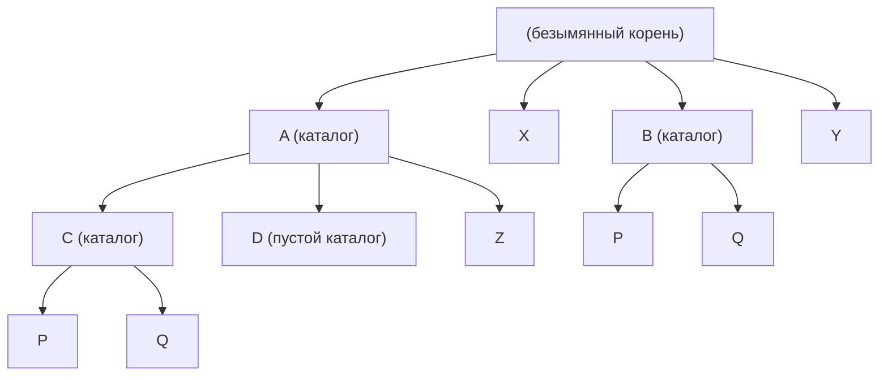

# RFC 3659 — Расширения FTP

**Оригинал (англ.):** Extensions to FTP<br>
**Статус:** Proposed Standard<br>
**Год:** 2007<br>
**Авторы:** P. Hethmon<br>
**Приоритет реализации:** 5 — Критично<br>
**Официальный текст:** <https://www.rfc-editor.org/rfc/rfc3659.html>

## Аннотация

SIZE, MDTM, MLST/MLSD, REST в STREAM-режиме — то, без чего «современный» FTP-сервер выглядит ущербным: докачка, точный размер, машиночитаемый листинг каталога.

## Содержание

- [1 Введение](#section-1)
- [2 Соглашения документа](#section-2)
  - [2.1 Основные токены](#section-2-1)
  - [2.2 Имена путей](#section-2-2)
    - [2.2.1 Синтаксис имён путей](#section-2-2-1)
    - [2.2.2 Маски](#section-2-2-2)
  - [2.3 Время](#section-2-3)
  - [2.4 Ответы сервера](#section-2-4)
  - [2.5 Толкование примеров](#section-2-5)
- [3 Время изменения файла (`MDTM`)](#section-3)
  - [3.1 Синтаксис](#section-3-1)
  - [3.2 Ответы об ошибках](#section-3-2)
  - [3.3 Ответ FEAT для MDTM](#section-3-3)
  - [3.4 Примеры MDTM](#section-3-4)
- [4 Размер файла (`SIZE`)](#section-4)
  - [4.1 Синтаксис](#section-4-1)
  - [4.2 Ответы об ошибках](#section-4-2)
  - [4.3 Ответ FEAT для SIZE](#section-4-3)
  - [4.4 Примеры Size](#section-4-4)
- [5 Возобновление прерванной передачи](#section-5)
  - [5.1 Возобновление в режиме потока](#section-5-1)
  - [5.2 Восстановление после ошибок и возобновление передачи](#section-5-2)
  - [5.3 Синтаксис](#section-5-3)
  - [5.4 Ответ FEAT для REST](#section-5-4)
  - [5.5 Пример REST](#section-5-5)
- [6 Тривиальное виртуальное файловое хранилище](#section-6)
  - [6.1 Имена файлов TVFS](#section-6-1)
  - [6.2 Путьевые имена (pathname) TVFS](#section-6-2)
    - [6.2.1 Замечания](#section-6-2-1)
  - [6.3 Ответ FEAT для TVFS](#section-6-3)
  - [6.4 OPTS для TVFS](#section-6-4)
  - [6.5 Примеры TVFS](#section-6-5)
- [7 Листинги для машинной обработки (MLST и MLSD)](#section-7)
  - [7.1 Формат запросов MLSx](#section-7-1)
  - [7.2 Формат ответа MLSx](#section-7-2)
    - [7.2.1 Ответы об ошибках на команды MLSx](#section-7-2-1)
  - [7.3 Кодирование имён файлов](#section-7-3)
    - [7.3.1 Замечания об имени файла](#section-7-3-1)
  - [7.4 Формат фактов](#section-7-4)
  - [7.5 Стандартные факты](#section-7-5)
    - [7.5.1 Факт Type](#section-7-5-1)
    - [7.5.2 Факт unique](#section-7-5-2)
    - [7.5.3 Факт modify](#section-7-5-3)
    - [7.5.4 Факт create](#section-7-5-4)
    - [7.5.5 Факт perm](#section-7-5-5)
    - [7.5.6 Факт lang](#section-7-5-6)
    - [7.5.7 Факт size](#section-7-5-7)
    - [7.5.8 Факт media-type](#section-7-5-8)
    - [7.5.9 Факт charset](#section-7-5-9)
    - [7.5.10 Обязательные факты](#section-7-5-10)
  - [7.6 Системно-зависимые и локальные факты](#section-7-6)
    - [7.6.1 Системно-зависимые факты](#section-7-6-1)
    - [7.6.2 Локальные факты](#section-7-6-2)
  - [7.7 Примеры MLSx](#section-7-7)
    - [7.7.1 Простой MLST](#section-7-7-1)
    - [7.7.2 MLST для каталога](#section-7-7-2)
    - [7.7.3 MLSD для каталога](#section-7-7-3)
    - [7.7.4 Более сложный пример](#section-7-7-4)
    - [7.7.5 Более точная информация о времени](#section-7-7-5)
    - [7.7.6 Другой сервер](#section-7-7-6)
    - [7.7.7 Несколько файлов IANA](#section-7-7-7)
    - [7.7.8 Проверка на прочность зависимости от регистра](#section-7-7-8)
    - [7.7.9 Пример от другого сервера](#section-7-7-9)
    - [7.7.10 Сервер, выводивший список самого себя](#section-7-7-10)
    - [7.7.11 Сервер, который отличается от остальных](#section-7-7-11)
  - [7.8 Ответ FEAT для MLSx](#section-7-8)
    - [7.8.1 Примеры](#section-7-8-1)
  - [7.9 Параметры OPTS для MLST](#section-7-9)
    - [7.9.1 Ответ на OPTS MLST](#section-7-9-1)
    - [7.9.2 Примеры](#section-7-9-2)
- [8 Влияние на другие команды FTP](#section-8)
- [9 Наборы символов и интернационализация](#section-9)
- [10 Соображения для IANA](#section-10)
  - [10.1 Реестр фактов, специфичных для ОС](#section-10-1)
  - [10.2 Реестр типов файлов, специфичных для ОС](#section-10-2)
- [11 Соображения безопасности](#section-11)
- [12 Нормативные ссылки](#section-12)
- [Благодарности](#thanks)
- [Адрес автора](#authors)

<a id="section-1"></a>

## 1 Введение

Настоящий документ обновляет протокол передачи файлов (FTP) [3]. Добавляются четыре новые команды: `SIZE`, `MDTM`, `MLST` и `MLSD`. Существующая команда `REST` изменяется. Из перечисленного команды `SIZE` и `MDTM`, а также изменения к `REST` уже много лет широко применяются; остальные вводятся впервые.

Эти команды позволяют клиенту возобновлять прерванную передачу в режимах передачи, для которых прежде не было задокументированного способа, а также получать листинг каталога в удобном для машин и предсказуемом формате.

Определяется также необязательная структура файлового хранилища сервера (NVFS), благодаря которой серверы, поддерживающие такую структуру, могут стандартным способом сообщить её клиентам, давая клиентам больше уверенности при построении и разборе имён путей.

<a id="section-2"></a>

## 2 Соглашения документа

В настоящем документе используются соглашения, определённые в BCP 14, RFC 2119 [4]. Они задают толкование написанных заглавными буквами повелительных слов, таких как MUST, SHOULD и т. п.

Кроме того, документ использует обозначения, определённые в STD 9, RFC 959 [3]. В частности, термины «ответ» (reply), «пользователь» (user), «NVFS» (Network Virtual File System, сетевая виртуальная файловая система), «файл», «имя пути» (pathname), «команды FTP», «DTP» (data transfer process, процесс передачи данных), «user-FTP process» (процесс FTP со стороны пользователя), «user-PI» (user protocol interpreter, интерпретатор протокола пользователя), «user-DTP», «server-FTP process» (процесс FTP на сервере), «server-PI», «server-DTP», «режим» (mode), «тип» (type), «NVT» (Network Virtual Terminal, сетевой виртуальный терминал), «управляющее соединение» (control connection), «соединение данных» (data connection) и «ASCII» употребляются здесь в тех же значениях, что и там.

Требуемый синтаксис определяется с помощью расширенной БНФ, заданной в [5]. Некоторые общие определения БНФ, нужные по всему документу, будут приведены ниже в настоящем разделе. При первом чтении разумно просто помнить, что эти определения находятся здесь, и перейти к следующему разделу.

<a id="section-2-1"></a>

### 2.1 Основные токены

Документ импортирует основные определения БНФ, приведённые в приложении A к [5], где определяются базовые элементы БНФ — ALPHA, DIGIT, SP и т. п. Для использования в настоящем документе добавлены следующие термины.

```
TCHAR          = VCHAR / SP / HTAB    ; visible plus white space
RCHAR          = ALPHA / DIGIT / "," / "." / ":" / "!" /
                 "@" / "#" / "$" / "%" / "^" /
                 "&" / "(" / ")" / "-" / "_" /
                 "+" / "?" / "/" / "\" / "'" /
                 DQUOTE   ; <"> -- double quote character (%x22)
SCHAR          = RCHAR / "=" ;
```

Типы VCHAR (из [5]), RCHAR, SCHAR и TCHAR задают базовые символьные типы — различные подмножества набора символов ASCII, используемые в разных командах и ответах.

```
token          = 1*RCHAR
```

«token» — это строка, точный смысл которой зависит от контекста употребления. Иногда это будет значение из набора допустимых значений, поддерживаемого в другом месте; в других случаях — строка, придуманная одной из сторон FTP-переговора из любых источников, которые она сочтёт значимыми.

Заметьте, что в БНФ строковые литералы нечувствительны к регистру. Эта конвенция сохранена и в настоящем документе, а значит, имена команд FTP, добавляемых настоящей спецификацией, могут быть записаны в любом регистре, то есть `MDTM` совпадает с `mdtm`, `Mdtm`, `MdTm` и т. д. Однако, в частности, ALPHA чувствительно к регистру, из чего следует, что «token» — значение, чувствительное к регистру. Такое понимание верно, если только в настоящем документе или в иной спецификации, определяющей значения, которые эта спецификация предписывает использовать в данном контексте, прямо не сказано обратное.

<a id="section-2-2"></a>

### 2.2 Имена путей

Различные команды FTP принимают имена путей в качестве аргументов или возвращают имена путей в ответах. Если поддерживается команда `MLST` — о чём свидетельствует строка в ответе на команду `FEAT` [6], — имена пути передаются в одном из двух следующих форматов.

```
pathname       = utf-8-name / raw
utf-8-name     = <a UTF-8 encoded Unicode string>
raw            = <any string that is not a valid UTF-8 encoding>
```

Какой именно формат используется, выбирает отправитель — user-PI или server-PI. Кодировки UTF-8 [2] содержат достаточно внутренней структуры, поэтому на практике всегда можно определить, применено ли кодирование UTF-8 или «сырое» представление, в тех случаях, когда это важно. Хотя user-PI полезно корректно показать пользователю имя пути, полученное от server-PI, гораздо важнее, чтобы user-PI мог сохранить ровно это имя пути и передать его повторно, когда потребуется. Реализациям не рекомендуется преобразовывать имя пути из UTF-8 в локальный набор символов, который не способен представить весь репертуар знаков Юникода, а затем пытаться обратить это преобразование обратно. Заметьте, что ASCII является подмножеством UTF-8. См. также [1].

Если не указано иное, имя пути завершается последовательностью CRLF, которая оканчивает команду FTP, либо CRLF, которой заканчивается ответ. Любые завершающие пробелы перед этим CRLF входят в состав имени. Перед именем пути будет стоять ровно один пробел, служащий отделителем от предыдущего элемента синтаксиса; любые дополнительные пробелы входят в состав имени пути. Более полное объяснение вопросов кодирования символов дано в [7]. Все реализации, поддерживающие `MLST`, MUST поддерживать [7].

Примечание: для имён путей, передаваемых по соединению данных, нет способа выразить имя пути, содержащее символы CR и LF идущими подряд, и отличить его от признака конца строки. Поэтому имена путей, содержащие пару символов CRLF, нельзя передавать по соединению данных. Соединения данных содержат только имена файлов, передаваемые от server-FTP к user-FTP как результат одной из команд листинга каталога. Файлы, чьи имена содержат последовательность CRLF, обязаны либо иметь эту последовательность преобразованной в иную форму — так, чтобы эта иная форма распознавалась и могла быть корректно обращена обратно в CRLF, — либо быть исключены из листинга.

Реализациям следует также учитывать, что управляющее соединение FTP использует конвенции Telnet NVT [8], и что символ Telnet IAC, если он входит в имя пути, отправляемое по управляющему соединению, MUST корректно экранироваться так, как определено протоколом Telnet.

NVT различает CR, LF и конец строки CRLF, а потому позволяет передавать имена путей, содержащие пару символов CR и LF, корректно. Однако, поскольку такую последовательность нельзя передать по соединению данных (как результат команд LIST, NLST или MLSD), подобных имён путей лучше избегать.

Реализаторам следует также помнить, что, хотя на управляющих соединениях применяются конвенции Telnet NVT, согласование опций Telnet MUST NOT. См. раздел 4.1.2.12 в [9].

<a id="section-2-2-1"></a>

#### 2.2.1 Синтаксис имён путей

Кроме случаев, когда поддерживается TVFS (см. раздел 6), настоящая спецификация не накладывает на имена путей никакого синтаксиса. Она и не ограничивает набор символов, из которого имена путей составляются. Это не означает, что NVFS обязано осмысленно обрабатывать всевозможные имена путей. Server-PI может ограничивать синтаксис допустимых имён путей в своём NVFS любым способом, подходящим его реализации или лежащей в основе файловой системе. Так же и server-PI может разобрать имя пути и придать смысл обнаруженным его компонентам.

<a id="section-2-2-2"></a>

#### 2.2.2 Маски

Для команд, определённых в настоящей спецификации, все имена путей трактуются буквально. То есть для имени пути, данного как параметр команды, подразумевается файл, чьё имя идентично этому имени пути. Ни один символ имени пути не может считаться особым или «магическим», следовательно сопоставление с образцом (кроме проверки на точное равенство) между данным именем пути и файлами, присутствующими в NVFS server-FTP, не допускается.

Клиентам, которым нужна некоторая форма сопоставления по образцу, следует получить листинг соответствующего каталога или каталогов и реализовать собственные процедуры отбора имён файлов.

<a id="section-2-3"></a>

### 2.3 Время

Синтаксис временного значения таков:

```
time-val       = 14DIGIT [ "." 1*DIGIT ]
```

Ведущие, обязательные, четырнадцать цифр трактуются по порядку слева направо так: четыре цифры дают год в диапазоне 1000--9999, две цифры дают месяц года в диапазоне 01--12, две цифры дают день месяца в диапазоне 01--31, две цифры дают час суток в диапазоне 00--23, две цифры дают минуты часа в диапазоне 00--59 и, наконец, две цифры дают секунды минуты в диапазоне 00--60 (значение 60 используется только в високосную секунду). Года десятого века и более ранние выразить нельзя. Это не считается серьёзным недостатком протокола.

Необязательные цифры, перед которыми стоит точка, дают десятичные доли секунды. Их можно приводить с любой точностью, уместной в обстоятельствах; однако реализации MUST NOT добавлять точность к time-val там, где её нет у передаваемого исходного значения.

Символически time-val можно представить как

```
YYYYMMDDHHMMSS.sss
```

Точка и следующие за ней цифры ("sss") необязательны. Однако точка MUST NOT появляться, если после неё не стоит хотя бы одна цифра.

Временные значения всегда представляются в UTC (GMT) и по григорианскому календарю независимо от того, какой календарь мог применяться в указанное дату и время по месту расположения server-PI.

Технические различия между GMT, TAI, UTC, UT1, UT2 и т. п. здесь не рассматриваются. Процессу server-FTP следует всегда использовать одну и ту же временну́ю шкалу, тогда возвращаемые им времена будут согласованны. От клиентов не ожидается синхронизации времени с сервером, поэтому возможная разница времён, сообщаемых различными временны́ми стандартами, не считается существенной.

<a id="section-2-4"></a>

### 2.4 Ответы сервера

Раздел 4.2 в [3] определяет формат и смысл ответов server-PI на команды FTP, поступающие от user-PI. Те соглашения об ответах используются здесь без изменений.

```
error-response = error-code SP *TCHAR CRLF
error-code     = ("4" / "5") 2DIGIT
```

Реализаторам следует также помнить, что синтаксис БНФ, используемый в настоящем документе и в других документах, связанных с FTP (но не используемый в [3]), иногда показывает ответы в однострочном формате. Если явно не сказано иное, это не означает, что многострочные ответы запрещены. Реализаторам следует исходить из того, что — если не сказано обратное — любой ответ на любую команду FTP (включая `QUIT`) может использовать многострочный формат, описанный в [3].

Во всём настоящем документе ответы обозначаются по трёхзначному коду, который является их первым элементом. Таким образом, термин «ответ 500» означает ответ server-PI с трёхзначным кодом "500".

<a id="section-2-5"></a>

### 2.5 Толкование примеров

В примерах диалогов FTP, приведённых в настоящем документе, строки, начинающиеся с "C> ", были отправлены по управляющему соединению от user-PI к server-PI; строки, начинающиеся с "S> ", были отправлены по управляющему соединению от server-PI к user-PI; а каждая последовательность строк, начинающихся с "D> ", была отправлена server-PI пользователю по соединению данных, созданному специально для передачи этих строк и закрытому сразу после них. Ни один пример здесь не показывает данные, передаваемые по соединению данных от клиента к серверу. Во всех случаях показанные префиксы, включая один пробел при них, добавлены ради наглядности настоящего документа и не являются частью данных, обмениваемых между клиентом и сервером.

<a id="section-3"></a>

## 3 Время изменения файла (`MDTM`)

Команда FTP MODIFICATION TIME (`MDTM`) служит, чтобы узнать, когда объект в NVFS сервера последний раз изменялся. Эта команда уже много лет существует во многих FTP-серверах как дополнение к команде `REST` для режима STREAM, а потому широко доступна. Тем не менее там, где она поддерживается, фактом `modify`, который может быть предоставлен в результате новой команды `MLST`, рекомендуется пользоваться как более удачной альтернативой.

Пытаясь возобновить команду RETRieve, процесс user-FTP может воспользоваться командой `MDTM` или фактом `modify`, чтобы проверить, не является ли время модификации исходного файла более поздним, чем время модификации частично переданного файла. Если является, то, скорее всего, исходный файл изменился, и возобновлять ранее незавершённую передачу файла было бы небезопасно.

Поскольку часы процессов user-FTP и server-FTP не обязательно синхронизированы, user-FTP, намеревающимся использовать этот способ, следует обычно получать время модификации файла с сервера до первой RETRieval и сравнивать его со временем модификации, полученным перед RESTart. Если они различаются, файлы могли измениться, и RESTart нежелателен. Там, где это невозможно, user-FTP должен при сравнении времён закладывать возможный перекос часов.

Пытаясь возобновить команду STORe, процесс user-FTP может воспользоваться командой `MDTM`, чтобы узнать время модификации частично переданного файла. Если оно раньше, чем время модификации файла, который собирается быть STORed, то, скорее всего, исходный файл изменился, и возобновлять передачу файла было бы небезопасно.

Заметьте, что использование `MLST` (описано ниже), там где оно доступно, даёт эту информацию и многое другое, а потому даёт ещё более надёжный признак того, что файл изменился и что возобновление передачи даст некорректный результат.

Заметьте, что всё сказанное применимо к любой попытке RESTart, независимо от режима передачи файла.

<a id="section-3-1"></a>

### 3.1 Синтаксис

Синтаксис команды `MDTM` таков:

```
mdtm          = "MdTm" SP pathname CRLF
```

Как и в случае с любой командой FTP, метка команды `MDTM` трактуется без учёта регистра.

Значение "pathname" указывает на объект в NVFS, который может быть объектом команды RETR. Попытки узнать время модификации файлов, которые существуют, но не могут быть выбраны, могут порождать error-response либо приводить к положительному ответу с time-val, имеющим неуказанное значение, — выбор остаётся за server-PI.

Server-PI отвечает на команду `MDTM` ответом 213, дающим последнее время модификации файла с переданным именем пути, либо ответом 550, если файл не существует, время модификации недоступно или произошла какая-то иная ошибка.

```
mdtm-response = "213" SP time-val CRLF /
                error-response
```

Заметьте, когда выдаётся ответ 213 — то есть когда ошибки нет — формат MUST быть в точности таким, как указано. Многострочные ответы не допускаются.

<a id="section-3-2"></a>

### 3.2 Ответы об ошибках

Когда команда корректно разобрана, но время модификации недоступно — либо потому, что имя пути не указывает ни на одну сущность, либо потому, что сведений о времени нет для названной сущности, — следует посылать ответ 550. Когда команду не удаётся корректно разобрать, следует посылать ответ 500 или 501, как определено в [3]. Различные ответы 4xy также возможны в соответствующих обстоятельствах.

<a id="section-3-3"></a>

### 3.3 Ответ FEAT для MDTM

Отвечая на команду `FEAT` [6], процесс server-FTP, поддерживающий команду `MDTM`, MUST включать строку, содержащую единственное слово "MDTM". Оно MAY быть передано в верхнем регистре, в нижнем или в смеси обоих (регистр не важен), но SHOULD передаваться только в верхнем регистре. То есть ответ SHOULD быть таким:

```
C> Feat
S> 211- <any descriptive text>
S>  ...
S>  MDTM
S>  ...
S> 211 End
```

Многоточия обозначают места-заполнители, где могут быть включены иные возможности, но не обязаны. Отступ feature-строк в один пробел обязателен [6].

<a id="section-3-4"></a>

### 3.4 Примеры MDTM

Предположим, существуют три файла, A, B и C, каталог D, два файла с именами, оканчивающимися строкой "ile6", и никаких других файлов вообще; тогда команда `MDTM` может вести себя так, как показано ниже. Строки "C>" — команды от user-PI к server-PI, строки "S>" — ответы server-PI.

```
C> MDTM A
S> 213 19980615100045.014
C> MDTM B
S> 213 19980615100045.014
C> MDTM C
S> 213 19980705132316
C> MDTM D
S> 550 D is not retrievable
C> MDTM E
S> 550 No file named "E"
C> mdtm file6
S> 213 19990929003355
C> MdTm 19990929043300 File6
S> 213 19991005213102
C> MdTm 19990929043300 file6
S> 550 19990929043300 file6: No such file or directory.
```

Из этого мы можем заключить, что и A, и B последний раз изменялись в одно и то же время (с точностью до миллисекунды), а C — через 20 дней и несколько часов спустя.

Времена указаны в GMT, поэтому файл A был изменён 15 июня 1998 года примерно в 11 утра в Лондоне (тогда действовало летнее время) или, возможно, в 8 вечера в Мельбурне (Австралия), или в 6 утра в Нью-Йорке. Все эти времена, разумеется, обозначают один и тот же абсолютный момент. Место, где файл изменялся, а вместе с ним и местное время настенных часов там, недоступно.

Файла с именем "E" в текущем каталоге нет, но существуют файлы с именами и "file6", и "19990929043300 File6". Времена их модификации получены. Файла с именем "19990929043300 file6" нет.

<a id="section-4"></a>

## 4 Размер файла (`SIZE`)

Команда FTP SIZE OF FILE (`SIZE`) служит для получения от процесса server-FTP размера передачи файла. Это точное число октетов (8-битных байтов), которое было бы передано по соединению данных, если бы этот файл передавался. Это значение меняется в зависимости от текущих параметров STRUcture, MODE и TYPE соединения данных — либо соединения данных, которое было бы создано, создавайся оно сейчас. Таким образом, результат команды `SIZE` зависит от установленных в данный момент параметров STRU, MODE и TYPE.

Команда `SIZE` возвращает, сколько октетов было бы передано, если бы файл передавался с текущими структурой, режимом и типом передачи. Обычно эту команду используют совместно с командой RESTART (`REST`), чтобы определить точку возобновления при STORing файла на удалённый сервер в режиме STREAM. Server-PI может понадобиться прочитать частично переданный файл, выполнить всякое требуемое преобразование и сосчитать число октетов, которые получились бы при отправке файла, чтобы корректно ответить на эту команду. Оценки размера передачи файла MUST NOT возвращаться; приемлемо только точное значение.

<a id="section-4-1"></a>

### 4.1 Синтаксис

Синтаксис команды `SIZE` таков:

```
size          = "Size" SP pathname CRLF
```

Server-PI отвечает на команду `SIZE` ответом 213, дающим размер передачи файла с переданным именем пути, либо ответом об ошибке, если файл не существует, размер недоступен или произошла какая-то иная ошибка. Возвращаемое значение имеет формат, пригодный для использования с командой RESTART (`REST`) в режиме STREAM, при условии что режим и тип передачи не меняются.

```
size-response = "213" SP 1*DIGIT CRLF /
                error-response
```

Заметьте, когда выдаётся ответ 213 — то есть когда ошибки нет — формат MUST быть в точности таким, как указано. Многострочные ответы не допускаются.

<a id="section-4-2"></a>

### 4.2 Ответы об ошибках

Когда команда корректно разобрана, но размер недоступен — возможно, потому, что имя пути не указывает ни на одну сущность, либо потому, что названная сущность не может быть передана в текущих MODE и TYPE (или вообще не может быть передана), — следует посылать ответ 550. Когда команду не удаётся корректно разобрать, следует посылать ответ 500 или 501, как определено в [3]. Наличие ответа 550 на команду `SIZE` MUST NOT принимать как указание на то, что файл нельзя передать в текущих MODE и TYPE. Сервер может выдать эту ошибку и по другим причинам — например, если издержки обработки кажутся ему слишком велики. Различные ответы 4xy также возможны в соответствующих обстоятельствах.

<a id="section-4-3"></a>

### 4.3 Ответ FEAT для SIZE

Отвечая на команду `FEAT` [6], процесс server-FTP, поддерживающий команду `SIZE`, MUST включать строку, содержащую единственное слово "SIZE". Это слово нечувствительно к регистру и MAY передаваться в любой смеси верхнего и нижнего регистра, однако SHOULD передаваться в верхнем регистре. То есть ответ SHOULD быть таким:

```
C> FEAT
S> 211- <any descriptive text>
S>  ...
S>  SIZE
S>  ...
S> 211 END
```

Многоточия обозначают места-заполнители, где могут быть включены иные возможности, и не обязательны. Отступ feature-строк в один пробел обязателен [6].

<a id="section-4-4"></a>

### 4.4 Примеры Size

Рассмотрим текстовый файл "Example", хранящийся на сервере Unix(TM), где каждая строка оканчивается одним октетом. Пусть файл содержит 112 строк и 1830 октетов целиком. Тогда команда `SIZE` дала бы:

```
C> TYPE I
S> 200 Type set to I.
C> size Example
S> 213 1830
C> TYPE A
S> 200 Type set to A.
C> Size Example
S> 213 1942
```

Заметьте, что при TYPE=A команда `SIZE` сообщает на 112 октетов больше. Это те дополнительные октеты, которые нужно вставить — по одному в конец каждой строки, — чтобы обеспечить корректную семантику конца строки при передаче с TYPE=A. Другие системы могут вносить в формат передачи файлов и иные изменения при преобразовании между TYPE и MODE. Команда `SIZE` учитывает всё это.

Поскольку вычисление размера файла с такой степенью точности может потребовать от server-PI значительных усилий, user-PI не следует пользоваться этой командой, кроме случаев, когда подобная точность существенна (например, когда предстоит возобновить прерванную передачу). Для прочих применений следует запрашивать факт `Size` команды `MLST` (см. раздел 7.5.7).

<a id="section-5"></a>

## 5 Возобновление прерванной передачи

Чтобы при частичной передаче файла не приходилось отправлять его целиком заново, обеим сторонам нужен некоторый способ договориться о том, где именно в потоке данных возобновить передачу.

Спецификация FTP [3] определяет три режима передачи данных: STREAM (поток), Block (блоки) и Compressed (сжатие). В режимах Block и Compressed поток данных, передаваемый по соединению данных, форматируется, что позволяет встраивать в него маркеры возобновления. Отправляющий DTP может включить маркер возобновления с любой информацией, которая нужна ему, чтобы уметь возобновить передачу файла в этой точке. Принимающий DTP может хранить список таких маркеров и соотносить их с тем, как файл сохраняется. Чтобы возобновить передачу файла, приёмник просто возвращает последний маркер возобновления — и обе стороны знают, как продолжить передачу данных. Заметим, что в описании механизма возобновления в STD 9, RFC 959 [3] есть некоторые недостатки. Исправления приведены в разделе 4.1.3.4 RFC 1123 [9].

<a id="section-5-1"></a>

### 5.1 Возобновление в режиме потока

В режиме STREAM соединение данных содержит просто поток неформатированных октетов данных. Поэтому явные маркеры возобновления в поток данных вставить нельзя: они были бы неотличимы от данных. По этой причине спецификация FTP [3] не предусматривала возможности возобновления в режиме потока. Однако в этом случае явные маркеры возобновления на самом деле и не нужны, поскольку роль маркера может играть смещение (offset) в потоке данных: оно подразумевается само собой.

Поскольку в режиме STREAM поток данных и определяет файл, другой поток данных представлял бы другой файл. Следовательно, смещение всегда обозначает одну и ту же позицию внутри файла. Зато в режимах, отличных от STREAM, один и тот же файл можно передавать совершенно разными последовательностями октетов — и всё равно восстановить из них тот же самый идентичный файл. Поэтому смещение в потоке данных в режимах передачи, отличных от STREAM, не задавало бы однозначной точки возобновления.

Если TYPE представления данных — IMAGE, а STRUcture (структура) — File, то во многих системах файл будет храниться ровно в том же формате, в котором он передаётся по соединению данных. Тогда приёмнику обычно очень легко определить, сколько данных было получено ранее, и сообщить отправителю смещение, с которого следует возобновить передачу. При других типах представления и структурах потребуются бо́льшие усилия, но определить смещение всегда остаётся возможным — ценой конечных, хотя, быть может, и не пренебрежимо малых усилий. В худшем случае процесс FTP может открыть соединение данных сам к себе, задать подходящий тип передачи и структуру и фактически передать файл, подсчитывая переданные октеты.

Если пользовательский процесс FTP намеревается возобновить выборку (retrieve), он вычисляет маркер возобновления напрямую и посылает эту информацию в команде RESTart. Если же пользовательский процесс FTP намеревается возобновить отправку файла, ему нужно уметь определить, сколько данных было прежде отправлено, корректно получено и сохранено. Для получения этой информации нужна новая команда FTP. Это и есть назначение команды SIZE, описанной в разделе 4.

<a id="section-5-2"></a>

### 5.2 Восстановление после ошибок и возобновление передачи

Передачи в режиме STREAM со структурой FILE STRUcture можно возобновлять, даже если вместе с данными не передавался никакой маркер возобновления. Это делается с помощью команды SIZE — когда она нужна — в сочетании с командой RESTART (REST) и одной из стандартных команд передачи файлов.

При использовании TYPE ASCII или IMAGE команда SIZE возвращает число октетов, которые фактически были бы переданы, если бы файл пересылался между двумя системами, то есть при типе IMAGE значение SIZE обычно равно числу октетов в файле. При типе ASCII значение SIZE — число октетов в файле с учётом всех изменений, необходимых, чтобы удовлетворить соглашению об окончании строки `<CR><LF>` для TYPE ASCII.

<a id="section-5-3"></a>

### 5.3 Синтаксис

Синтаксис команды REST, когда текущий режим передачи — STREAM:

      rest          = "Rest" SP 1*DIGIT CRLF

Числовое значение задаёт число октетов немедленно следующей за этим передачи, которые не следует фактически отправлять, что фактически приводит к возобновлению передачи с более поздней точки. Нулевое значение отключает возобновление: передаётся весь файл. Сервер-PI отвечает на команду REST ответом 350, сообщая, что параметр REST сохранён и что для завершения возобновления должна затем последовать другая команда — RETR либо STOR.

      rest-response = "350" SP *TCHAR CRLF /
                      error-response

Серверные процессы FTP могут допускать завершение возобновления командами передачи, отличными от RETR и STOR, например APPE и STOU; однако это не рекомендуется. STOU (store unique) в данном применении не определена: сохранять остаток файла под уникальным именем редко бывает полезно. Если APPE (append) разрешена, она MUST действовать так же, как STOR, когда маркер возобновления установлен. То есть в обоих случаях октеты из соединения данных помещаются в файл в позицию, указанную значением маркера возобновления.

Команда REST предназначена для завершения неудавшейся передачи. Применение её с RETR сравнительно хорошо определено во всех случаях, поскольку ответственность за совмещение выбранной части данных с частично полученным файлом несёт клиент. Он вправе использовать полученные данные иначе, чем для завершения прежней передачи, или заново выбрать уже полученные ранее данные. С STOR ситуация иная: сервер обязан вставить данные в названный файл. Результаты не определены, если клиент использует REST для чего-либо, кроме как возобновить передачу файла, который прежде не был передан полностью. В частности, результаты не определены, если маркер возобновления, установленный командой REST, не находится в конце данных, уже хранимых на сервере (как их оценивает сам сервер), или если в STOR, следующем за REST, передано недостаточно данных, чтобы расширить файл назначения по крайней мере до его прежнего размера.

Команда REST должна быть последней командой, посланной перед командой передачи данных, которая должна вызвать возобновлённую, а не полную передачу файла. Эффект отправления команды REST в любой другой момент не определён. Сервер-PI может отреагировать на неверно расположенную команду REST, выдав ошибочный ответ на следующую команду, не являющуюся возобновляемой командой передачи данных; либо сохранить значение возобновления и применить его к следующей команде передачи данных; либо молча проигнорировать некорректную попытку возобновления. По этой причине пользовательский PI, который послал команду REST, но по какой-либо причине не передал успешно следующую команду передачи данных, должен отправить ещё одну команду REST перед следующей командой передачи данных. Если та передача не должна возобновляться, следует послать «REST 0».

Ошибочный ответ последует за командой REST только тогда, когда сервер не реализует эту команду, или когда значение маркера возобновления синтаксически некорректно для текущего режима передачи (например, в режиме STREAM в параметре команды REST появилось что-то помимо одной или нескольких цифр). Любые другие ошибки, включая такие, как маркер возобновления вне диапазона, должны сообщаться при отправлении следующей команды передачи. Такие ошибки приведут к тому, что запрос передачи будет отклонён с указанием на некорректное возобновление.

<a id="section-5-4"></a>

### 5.4 Ответ FEAT для REST

Если серверный процесс FTP поддерживает возобновление RESTart в режиме STREAM, как определено здесь, он MUST включать в ответ на команду FEAT [6] строку, содержащую ровно строку «REST STREAM». Эта строка нечувствительна к регистру, но её SHOULD передавать в верхнем регистре. Если REST не поддерживается вовсе либо поддерживается только в режимах block или compressed, строка REST MUST NOT включаться в ответ FEAT. Когда она требуется, ответ SHOULD иметь вид:

      C> feat
      S> 211- <any descriptive text>
      S>  ...
      S>  REST STREAM
      S>  ...
      S> 211 end

Многоточия обозначают места-заполнители, где могут быть перечислены другие возможности, и не являются обязательными. Один пробел отступа строк возможностей обязателен [6].

<a id="section-5-5"></a>

### 5.5 Пример REST

Предположим, что передача довольно большого файла ранее была прервана после приёма 802816 октетов, что прежняя передача шла с TYPE=I и что проверено: файл на сервере с тех пор не изменялся.

      C> TYPE I
      S> 200 Type set to I.
      C> PORT 127,0,0,1,15,107
      S> 200 PORT command successful.
      C> REST 802816
      S> 350 Restarting at 802816. Send STORE or RETRIEVE
      C> RETR cap60.pl198.tar
      S> 150 Opening BINARY mode data connection
      [...]
      S> 226 Transfer complete.

<a id="section-6"></a>

## 6 Тривиальное виртуальное файловое хранилище

Традиционно FTP накладывал почти никаких ограничений на файловое хранилище (NVFS), предоставляемое сервером. Настоящая спецификация этого не меняет. Однако стало обычным, что серверы пытаются обеспечить по меньшей мере соглашения об именовании файловой системы, свободно моделируемые соглашениями файловой системы UNIX(TM). Это древовидная файловая система, построенная из каталогов, каждый из которых может содержать другие каталоги, файлы иных родов или и то и другое. Каждый файл и каталог имеет имя относительно каталога, который его содержит, кроме каталога в корне дерева: он не содержится ни в каком другом каталоге и потому собственного имени не имеет.

То, что только что описано, полностью согласуется со стандартными механизмами NVFS и доступа FTP. Для перехода из одного каталога во вложенный служит команда «CWD». Для возврата в родительский каталог может предоставляться «CDUP», а различные команды работы с файлами («RETR», «STOR», команды переименования и т. п.) используются для работы с файлами внутри текущего каталога.

Однако часто полезно ссылаться на файлы иначе, чем через смену каталогов, тем более что FTP не предоставляет гарантированного механизма возврата в прежний каталог. Такую возможность обеспечивает, если реализована, тривиальное виртуальное файловое хранилище (TVFS).

<a id="section-6-1"></a>

### 6.1 Имена файлов TVFS

Если сервер реализует TVFS, элементарное имя файла не должно содержать символ «/». Там, где естественное базовое хранилище допускает символ «/» в именах файлов или каталогов, сервер-PI, реализующий TVFS, обязан кодировать этот символ некоторым способом всякий раз, когда имена файлов или каталогов возвращаются пользовательскому PI, и обратным преобразованием снимать эту кодировку, когда такие имена принимаются от пользовательского PI.

Способ кодирования здесь не определяется. Если в базовой файловой системе некоторый другой символ запрещён в именах файлов и каталогов, может оказаться достаточной простая транслитерация. Если подходящего символа-заменителя нет, вероятно, потребуется более сложная схема кодирования, возможно, с использованием escape-символа.

За единственным исключением безымянного корневого каталога, имя файла TVFS не может быть пустым. То есть все прочие имена содержат по крайней мере один символ.

За единственным исключением символа «/», в имени файла TVFS может использоваться любой корректный символ IS10646 [10]. При передаче символы имён файлов кодируются в кодировке UTF-8 [2]. Заметим, что двухсимвольная последовательность CR LF внутри имени сделает такое имя невозможным для передачи через соединение данных. Следовательно, её следует избегать, а если это недостижимо — она MUST кодироваться каким-либо обратимым способом.

<a id="section-6-2"></a>

### 6.2 Путьевые имена (pathname) TVFS

«Pathname» TVFS сочетает имя файла или каталога — целевого файла или каталога — с именами нуля или более объемлющих каталогов, чтобы на целевой файл или каталог можно было ссылаться не только тогда, когда «текущий рабочий каталог» сервера является каталогом, непосредственно содержащим цель.

По определению каждое имя файла или каталога TVFS является также pathname TVFS. Такое pathname корректно для ссылки на файл из каталога, содержащего это имя, то есть когда этот каталог является текущим рабочим каталогом серверного FTP.

Прочие pathname TVFS строятся добавлением перед pathname имени каталога, из которого путь справедлив, и разделением этих двух частей символом «/». Такое pathname корректно для ссылки на файл или каталог из каталога, содержащего вновь добавленное имя каталога.

Если pathname расширено до точки, когда добавленный каталог — безымянный корневой каталог, pathname будет начинаться с символа «/». Такой путь называют полностью квалифицированным pathname (fully qualified pathname). Полностью квалифицированные пути, очевидно, нельзя расширять дальше, поскольку по определению никакой каталог не содержит корневой каталог; будучи безымянным, он не может быть представлен ни в одном другом каталоге. Полностью квалифицированное pathname корректно для ссылки на названный файл или каталог из любого места (то есть независимо от того, каков текущий рабочий каталог) виртуального файлового хранилища.

Любое pathname, не являющееся полностью квалифицированным, может называться «относительным pathname» (relative pathname) и будет корректно ссылаться на замысленный файл только тогда, когда текущий рабочий каталог серверного FTP — каталог, из которого это относительное pathname справедливо.

В качестве особого случая pathname «/» определено как полностью квалифицированное pathname, обозначающее корневой каталог. То есть корневой каталог не имеет имени файла или каталога, но pathname имеет. Это особое pathname может использоваться только как есть, как ссылка на корневой каталог. Его нельзя комбинировать с другими pathname по приведённым правилам: это привело бы к pathname, содержащему два подряд идущих символа «/», а такая последовательность не определена.

<a id="section-6-2-1"></a>

#### 6.2.1 Замечания

+ Не требуется и не ожидается, чтобы для любого конкретного файла или каталога существовало единственное полностью квалифицированное pathname, ссылающееся на него.

+ Как оговорка: хотя хранилище TVFS по сути древовидное, не требуется, чтобы любой файл или каталог имел единственный родительский каталог.

+ Как определено, pathname TVFS никогда не будет содержать два символа «/» подряд. Такое имя, однако, не запрещено, и сервер может определить его для любой удобной ему цели. Клиенты, реализующие настоящую спецификацию, не должны приписывать таким именам никакой семантики.

+ Аналогично, за исключением особого пути, обозначающего корневой каталог, pathname TVFS, построенное по данным определениям, никогда не будет заканчиваться символом «/». Такие имена тоже не запрещены, но не определены.

+ Хотя в имени файла или каталога TVFS допускается любой корректный символ IS10646, кроме «/», реализации серверного FTP не обязаны поддерживать все возможные символы IS10646. Поддерживаемое подмножество целиком отдаётся на усмотрение сервера. Регистр (там, где он существует) символов, из которых состоят имена файлов, каталогов и pathname, может быть значим. Если иное не установлено средствами, здесь не определёнными, клиенты должны считать, что все такие имена составлены из символов с значимым регистром. Серверы вольны игнорировать регистр (или любой иной атрибут) имени и, значит, отображать два кажущихся различными имени на один и тот же базовый файл.

+ Не определено никаких «магических» имён, подобных «.», «..» или «C:». Серверы могут реализовать такие имена с любой избранной семантикой, но не обязаны.

+ TVFS не навязывает файлам особой семантики или свойств, не гарантирует схем управления доступом и ничего прочего из обычных свойств файлового хранилища. Определена только схема именования.

<a id="section-6-3"></a>

### 6.3 Ответ FEAT для TVFS

В ответ на команду FEAT [6] сервер, желающий заявить поддержку TVFS в определённом здесь виде, включает строку, начинающуюся с четырёх символов «TVFS» (в любом регистре или смеси регистров; верхний регистр не обязателен). Серверы SHOULD посылать верхний регистр.

Такой ответ на команду FEAT MUST NOT возвращаться, если сервер не реализует TVFS в определённом здесь виде.

Последующие спецификации могут дополнять определение TVFS. О таких дополнениях следует извещать дополнительным текстом, добавляемым к строке возможности TVFS. Спецификации, если таковые появятся, определят этот дополнительный текст.

Пока такая спецификация не определена, серверы не должны включать ничего после «TVFS» в строке возможности TVFS. Клиенты, однако, должны быть готовы к произвольному тексту после четырёх определённых символов и просто игнорировать его, если он не распознан.

Типичный ответ на команду FEAT от сервера, реализующего только настоящую спецификацию, был бы таким:

      C> feat
      S> 211- <any descriptive text>
      S>  ...
      S>  TVFS
      S>  ...
      S> 211 end

Многоточия обозначают места-заполнители, где могут быть перечислены другие возможности, но не являются обязательными. Один пробел отступа строк возможностей обязателен [6] и не засчитывается в первые четыре символа при перечислении возможностей.

Возможность TVFS не добавляет новых команд в репертуар команд FTP.

<a id="section-6-4"></a>

### 6.4 OPTS для TVFS

В настоящей спецификации TVFS опций нет, а потому и команда OPTS не определена.

<a id="section-6-5"></a>

### 6.5 Примеры TVFS

Предположим, хранилище TVFS состоит из корневого каталога, который содержит два каталога (A и B) и два некаталожных файла (X и Y). Каталог A содержит два каталога (C и D) и ещё один файл (Z). Каталог B содержит только два некаталожных файла (P и Q), а каталог C — тоже два некаталожных файла (случайно также названных P и Q). Каталог D пуст, то есть не содержит ни файлов, ни каталогов. Эту структуру можно изобразить графически так:



При такой структуре существуют следующие полностью квалифицированные pathname:

         /
         /A
         /B
         /X
         /Y
         /A/C
         /A/D
         /A/Z
         /A/C/P
         /A/C/Q
         /B/P
         /B/Q

Ясно, что ни один из путей `/`, `/A`, `/B` или `/A/D` не обозначает один и тот же каталог: содержимое каждого различно. То же справедливо и для `/`, `/A`, `/A/C` или `/A/D`. Однако `/A/C` и `/B` могли бы быть одним каталогом — данных недостаточно, чтобы судить. Любой из прочих pathname (`/X`, `/Y`, `/A/Z`, `/A/C/P`, `/A/C/Q`, `/B/P` и `/B/Q`) может ссылаться на одни и те же базовые файлы практически в любом сочетании.

Если текущий рабочий каталог серверного FTP — `/A`, то справедливы следующие pathname в дополнение ко всем полностью квалифицированным:

      C
      D
      Z
      C/P
      C/Q

Все они обозначают те же файлы или каталоги, что соответствующие полностью квалифицированные pathname с добавленным в начало «/A/».

То, что все эти pathname существуют, не означает, что сервер TVFS обязательно предоставит какие-либо права доступа к названным путям, или что доступ к одному и тому же файлу через разные pathname будет обязательно предоставлен с равными правами.

Ни один из следующих относительных путей не справедлив, когда текущий каталог — `/A`:

      A
      B
      X
      Y
      B/P
      B/Q
      P
      Q

Любой из них можно сделать справедливым, изменив текущий рабочий каталог серверного FTP на подходящий каталог. Заметим, что пути «P» и «Q» могут обозначать разные файлы в зависимости от того, какой каталог выбран, чтобы эти относительные пути TVFS стали справедливыми.

<a id="section-7"></a>

## 7 Листинги для машинной обработки (MLST и MLSD)

Команды MLST и MLSD предназначены стандартизовать информацию о файлах и каталогах, которую возвращает процесс server-FTP. Они отличаются от команды LIST тем, что формат ответов строго определён, хотя и расширяем.

Определены две команды, MLST и MLSD. MLST даёт данные ровно о том объекте, который назван в строке команды, и ни о каком другом. MLSD, напротив, перечисляет содержимое каталога, если назван каталог; иначе возвращается ответ 501. В обоих случаях, если объект не назван, подразумевается текущий каталог. Тогда MLST пришлёт однострочный ответ с описанием самого текущего каталога, а MLSD перечислит содержимое текущего каталога.

Далее термин MLSx используется везде, где может стоять либо MLST, либо MLSD.

Команды MLST и MLSD также расширяют протокол FTP в том виде, как он представлен в STD 9, RFC 959 [3] и STD 3, RFC 1123 [9], допуская передачу 8-битных данных по соединению управления. Заметьте: здесь не задаются знаковые наборы, которые являются 8-битными, — определяется лишь то, что реализации FTP должны специально разрешать передачу и приём 8-битных байтов со всеми значащими битами по соединению управления. То есть допустимы все 256 возможных значений октета. Команда MLSx допускает как аргументы форму UTF-8/Unicode, так и «сырую» форму, и так же в ответах — и на MLST, и на MLSD, и на все прочие команды FTP, принимающие пути в качестве аргументов.

<a id="section-7-1"></a>

### 7.1 Формат запросов MLSx

Каждая из команд MLST и MLSD допускает один необязательный аргумент. Этим аргументом может быть имя каталога либо, только для MLST, имя файла. Для этих целей «имя файла» — это имя любой сущности в NVFS сервера, не являющейся каталогом. Там, где поддерживается TVFS, может быть задан любой относительный путь TVFS, действительный в текущем рабочем каталоге, либо любой полностью квалифицированный путь TVFS. Если указано имя каталога, MLSD должен вернуть листинг содержимого названного каталога; иначе выдаётся ответ 501 и соединение данных не открывается. Во всех случаях для MLST возвращается один набор строк фактов (обычно одна строка фактов) с информацией о названном файле или каталоге — по соединению управления, без открытия соединения данных.

Если аргумент не задан, MLSD должен вернуть листинг содержимого текущего рабочего каталога, а MLST — сведения о самом текущем рабочем каталоге. Для этих целей содержимое каталога — это те имена файлов или каталогов (не пути), которые server-PI позволит ссылать, когда текущим рабочим каталогом является названный каталог, и которые server-PI желает открыть user-PI. Заметьте: опускание аргумента — единственный определённый способ получить листинг текущего каталога, если только случайно не известен путь, представляющий этот каталог. В частности, для текущего каталога не определено сокращённого имени. Это не запрещает какому-либо конкретному server-PI реализовать такое сокращение.

В выводе команд MLST или MLSD никогда не возвращаются заголовки, строки шапки или итога и никакое иное оформление, кроме указанного ниже.

Если Client-FTP послал неверный аргумент, server-FTP MUST ответить кодом ошибки 501.

Синтаксис команды MLSx таков:

```
   mlst             = "MLst" [ SP pathname ] CRLF
   mlsd             = "MLsD" [ SP pathname ] CRLF
```

<a id="section-7-2"></a>

### 7.2 Формат ответа MLSx

Формат ответа на команду MLSx следующий:

```
   mlst-response    = control-response / error-response
   mlsd-response    = ( initial-response final-response ) /
                      error-response

   control-response = "250-" [ response-message ] CRLF
                      1*( SP entry CRLF )
                      "250" [ SP response-message ] CRLF

   initial-response = "150" [ SP response-message ] CRLF
   final-response   = "226" SP response-message CRLF

   response-message = *TCHAR

   data-response    = *( entry CRLF )

   entry            = [ facts ] SP pathname
   facts            = 1*( fact ";" )
   fact             = factname "=" value
   factname         = "Size" / "Modify" / "Create" /
                      "Type" / "Unique" / "Perm" /
                      "Lang" / "Media-Type" / "CharSet" /
                      os-depend-fact / local-fact
   os-depend-fact   = <IANA assigned OS name> "." token

   local-fact       = "X." token
   value            = *SCHAR
```

Получив команду MLSx, сервер проверяет параметр и, если он неверен, возвращает error-response. Для этой цели параметр следует считать неверным, если клиент, выдающий команду, не имеет права выполнять запрошенную операцию.

Если параметр верен, то для команды MLST server-PI посылает первую (ведущую) строку control-response, запись для указанного пути (или для текущего каталога, если путь не задан) и завершающую строку. Обычно возвращается ровно одна запись; больше записей допускается только тогда, когда это нужно для представления файла, для которого возвращается несколько фактов "Type". В этом случае компонент пути каждого ответа MUST быть идентичен.

Заметьте, что для MLST набор фактов предваряется пробелом. Это сделано, чтобы набор фактов случайно нельзя было истолковать как завершающую строку control-response, но требуется это даже тогда, когда такая ошибка невозможна. Между набором фактов и путём существует ровно один пробел. Когда факты отсутствуют, перед путём будет ровно два ведущих пробела. Пробелы в фактах не допускаются; любые другие пробелы в ответе следует считать частью пути.

Если командой был MLSD, сервер открывает соединение данных в соответствии с разделом 3.2 STD 9, RFC 959 [3]. Если это не удаётся, сервер возвращает error-response. Если всё в порядке, сервер возвращает initial-response, отправляет по новому соединению данных соответствующий data-response, закрывает это соединение, а затем посылает по соединению управления final-response. Грамматика выше определяет формат data-response, который, в свою очередь, определяет формат данных, возвращаемых по установленному соединению данных.

Соединение данных, открываемое для ответа MLSD, должно быть таким, как если бы были даны команды "TYPE L 8", "MODE S" и "STRU F", — независимо от того, какие тип, режим и структура передачи фактически установлены, и без изменения этих установок для последующих команд. То есть данный тип передачи устанавливается только на время соединения данных, установленного для этой команды. Хотя содержимое передаваемых данных можно рассматривать как последовательность строк, реализациям следует учитывать, что максимальная длина строки не определена. Реализации должны быть готовы обрабатывать сколь угодно длинные строки.

Часть спецификации, относящаяся к фактам, содержит ряд «файловых фактов» о файле или каталоге, названных в той же строке. Типичная представляемая информация включает размер файла, время последней модификации, время создания, уникальный идентификатор и признак файл/каталог.

Полный формат успешного ответа на команду MLSD таков:

```
   facts SP pathname CRLF
   facts SP pathname CRLF
   facts SP pathname CRLF
   ...
```

Заметьте, что формат предназначен для машинной обработки, а не для просмотра человеком, и потому очень жёсткий. Реализации MUST NOT изменять формат — например, вставлять лишние пробелы для читаемости, заменять пробелы табуляциями, добавлять строки шапки или заголовка, вставлять пустые строки или иным образом видоизменять этот формат. После набора фактов (который может быть пуст) всегда требуется ровно один пробел. Больше пробелов в строке может быть только тогда и только тогда, когда представляемый путь содержит значащие пробелы. Набор фактов не должен содержать пробелов нигде внутри себя. Факты следует включать в каждую выходную строку только если они одновременно дают релевантную информацию о файле, названном в той же строке, и входят в набор, запрошенный user-PI. См. раздел 7.9 (стр. 51). Не требуется, чтобы для каждого файла предоставлялся один и тот же набор фактов, и чтобы факты в разных строках шли в одном и том же порядке.

<a id="section-7-2-1"></a>

#### 7.2.1 Ответы об ошибках на команды MLSx

Многие ответы 4xy и 5xy, определённые в разделе 4.2 STD 9, RFC 959 [3], возможны как ответы на команды MLST и MLSD. В частности, синтаксические ошибки могут порождать ответы 500 или 501. Указание в качестве аргумента команды MLSD пути, который существует, но не является каталогом, порождает ответ 501. Указание имени, которое не существует либо для которого не предоставлено право доступа (получить запрошенную информацию о каталоге), вызывает ответ 550. Другие ответы (530, 553, 503, 504 и любой из ответов 4xy) тоже возможны в соответствующих обстоятельствах.

<a id="section-7-3"></a>

### 7.3 Кодирование имён файлов

Реализация FTP, поддерживающая команды MLSx, должна быть 8-битно чистой. Это необходимо для передачи имён файлов, закодированных в UTF-8. Настоящая спецификация рекомендует использовать имена файлов в кодировке UTF-8. Реализации FTP SHOULD использовать UTF-8, где только возможно, чтобы обеспечить максимально возможную совместимость.

Имена файлов при этом не ограничены UTF-8, однако обработка произвольных кодировок символов настоящим стандартом не определяется. Приложениям рекомендуется относиться к не-UTF-8 кодировкам имён файлов как к последовательностям октетов.

Заметьте, что данное кодирование не связано с кодированием содержимого файла, даже если файл содержит символьные данные.

Дополнительные сведения о кодировании имён файлов в FTP см. в «Internationalization of the File Transfer Protocol» [7].

<a id="section-7-3-1"></a>

#### 7.3.1 Замечания об имени файла

Имя файла, возвращаемое в ответе MLST, должно быть тем же именем, которое было указано в команде MLST, либо — там, где поддерживается TVFS — полностью квалифицированным путём TVFS, называющим тот же файл. Когда аргумент команде MLST не задавался, server-PI может либо включить в ответ пустое имя файла, либо дать имя, ссылающееся на текущий каталог, если такое имя доступно. Там, где поддерживается TVFS, полностью квалифицированный путь текущего каталога SHOULD возвращаться.

Имена файлов в выводе команды MLSD SHOULD быть неквалифицированными именами внутри названного каталога (или текущего, если аргумент не задан). То есть каталог, названный в команде MLSD, SHOULD NOT встречаться как компонент возвращаемых имён файлов.

Если процесс server-FTP способен на это и факт "type" возвращается, он MAY включить в ответ MLSD запись с типом "cdir", называющую тот каталог, из которого получено содержимое листинга. Там, где поддерживается TVFS, этим именем MAY быть полностью квалифицированный путь каталога, а MAY быть любой другой путь, годный для ссылки на этот каталог из текущего рабочего каталога server-FTP. Если имён несколько, таких записей MAY быть несколько. В некотором смысле запись "cdir" можно рассматривать как заголовок вывода MLSD. Однако она не обязана быть первой возвращённой записью и может встретиться в любом месте листинга.

Когда поддерживается TVFS, user-PI может сослаться на любой файл или каталог из листинга, объединив имя типа "cdir" с подходящим именем из листинга каталога по процедуре, определённой в разделе 6.2.

В качестве альтернативы, независимо от того, поддерживается TVFS или нет, user-PI может выдать команду CWD ([3]) с именем типа "cdir" из полученного листинга и с этого момента ссылаться на файлы, возвращённые в ответе MLSD, из которого был получен cdir, используя компоненты имён файлов из листинга.

<a id="section-7-4"></a>

### 7.4 Формат фактов

«Факты» файла в ответе на команду MLSx состоят из информации об этом файле. Факты — это ряд пар «ключевое слово = значение», каждая из которых завершается точкой с запятой (";"). Отдельный факт не может содержать точку с запятой в своём имени или значении. Полный ряд фактов не может содержать пробел. См. определение "RCHAR" в разделе 2.1 — там перечислены символы, которые могут встречаться в значении факта. Далеко не все они применимы ко всем фактам.

Типичный набор фактов выглядит так (разбит на две строки только для показа здесь):

```
size=4161;lang=en-US;modify=19970214165800;create=19961001124534;
type=file;x.myfact=foo,bar;
```

<a id="section-7-5"></a>

### 7.5 Стандартные факты

Настоящий документ определяет стандартный набор фактов:

| Факт | Синтаксис значения | Назначение | Обязателен |
| --- | --- | --- | --- |
| `size` | 1*DIGIT | Размер в октетах | Нет (рекомендуется, см. 7.5.10) |
| `modify` | time-val | Время последней модификации | Нет (рекомендуется) |
| `create` | time-val | Время создания | Нет |
| `type` | type-val | Тип записи | Нет (рекомендуется) |
| `unique` | token | Уникальный идентификатор файла/каталога | Нет (рекомендуется) |
| `perm` | *pvals | Права файла: разрешены ли чтение, запись, выполнение для вошедшего в систему id | Нет (рекомендуется) |
| `lang` | token | Язык имени файла по реестру IANA [11] | Нет |
| `media-type` | по указаниям IANA | MIME media-type содержимого файла по реестру IANA | Нет |
| `charset` | token | Набор символов по реестру IANA (если не UTF-8) | Нет |

Имена фактов не зависят от регистра. Size, size, SIZE и SiZe — это один и тот же факт.

Дальнейшие системно-зависимые ключевые слова могут определяться с использованием имени операционной системы, назначенного IANA, в качестве префикса (примеры лишь для иллюстрации):

```
   OS/2.ea   -- OS/2 extended attributes
   MACOS.rf  -- MacIntosh resource forks
   UNIX.mode -- Unix file modes (permissions)
```

Реализации могут определять ключевые слова для экспериментального или частного использования. Все такие ключевые слова MUST начинаться с двухсимвольной последовательности "x.". Поскольку имена типов не зависят от регистра, "x." и "X." эквивалентны. Например:

```
   x.ver  -- Version information
   x.desc -- File description
   x.type -- File type
```

<a id="section-7-5-1"></a>

#### 7.5.1 Факт Type

Факт type требует особого описания. Часть проблемы с существующей практикой — определить, когда файл является каталогом. Если он каталог, то текущий это каталог, обычный каталог или родительский? Спецификация MLST снимает эту неоднозначность с помощью факта type. Указанный факт type даёт информацию об объекте, перечисленном в той же строке ответа MLST.

Для факта type возможны пять значений:

```
   file         -- a file entry
   cdir         -- the listed directory
   pdir         -- a parent directory
   dir          -- a directory or sub-directory
   OS.name=type -- an OS or file system dependent file type
```

Синтаксис определён как:

```
   type-fact       = type-label "=" type-val
   type-label      = "Type"
   type-val        = "File" / "cdir" / "pdir" / "dir" /
                     os-type
```

Значение факта type (то есть "type-val") — строка, не зависящая от регистра.

<a id="section-7-5-1-1"></a>

##### 7.5.1.1 type=file

Наличие факта type=file указывает, что перечисленная запись — файл, содержащий несистемные данные. То есть его можно передать из одной системы в другую, весьма непохожую, и он, возможно, сохранит смысл.

<a id="section-7-5-1-2"></a>

##### 7.5.1.2 type=cdir

Факт type=cdir указывает, что перечисленная запись содержит путь каталога, чьё содержимое перечислено. Запись такого типа возвращается только как часть результата команды MLSD, когда включён факт type, и даёт имя перечисленного каталога и факты об этом каталоге. В некотором смысле её можно рассматривать как заголовок листинга в удобной для машины форме. Она может встретиться в любом месте листинга, не обязана стоять в начале — хотя часто бывает именно там, — и может встречаться многократно. Она MUST NOT включаться, если факт type не включён, иначе user-PI не смог бы отличить имя каталога от записи в каталоге.

Там, где server-FTP поддерживает TVFS, это имя может использоваться для построения путей, по которым можно ссылаться на файлы и каталоги, возвращённые в том же выводе MLSD (см. раздел 6.2). Такие пути рассчитаны на работу только когда позиция server-PI в дереве файлов NVFS та же, что и в момент выдачи команды MLSD, — если только не получается полностью квалифицированный путь.

Там, где TVFS не поддерживается, единственная определённая семантика записи "type=cdir" состоит в том, что, при условии неизменности текущего рабочего каталога server-PI, путь типа "cdir" может использоваться как аргумент команды CWD, и это приведёт к тому, что перечисленный каталог станет текущим рабочим каталогом server-PI.

<a id="section-7-5-1-3"></a>

##### 7.5.1.3 type=dir

Если присутствует, запись type=dir даёт имя каталога. Такая запись обычно не может быть передана из одной системы в другую с помощью RETR и т. п., но должна (если позволяют права) быть объектом команды MLSD.

<a id="section-7-5-1-4"></a>

##### 7.5.1.4 type=pdir

Если присутствует — а это случается только в ответе на команду MLSD, когда включён факт type, — запись type=pdir представляет путь родительского каталога по отношению к перечисленному каталогу. Помимо свойств type=dir, команда CWD, использующая путь из этой записи, должна перевести пользователя в родительский каталог перечисленного. Если перечисленный каталог является текущим, команда CDUP также может привести к переходу в названный каталог. Она может появиться в любом месте перечисления — не обязательно в начале, хотя часто стоит именно там, — и встретиться несколько раз. Запись type=pdir MUST NOT включаться, если не включён факт type: иначе user-PI не смог бы отличить имя самого каталога от записи в нём. Процессам User-FTP следует учитывать, что не все ответы содержат эту информацию и что некоторые системы могут давать несколько ответов type=pdir.

Там, где поддерживается TVFS, имя "type=pdir" может быть относительным путём или полностью квалифицированным путём. Относительный путь будет относительным к перечисляемому каталогу, а не к текущему каталогу server-PI в этот момент.

Для целей данного значения типа «родительский каталог» — это любой каталог, в котором есть запись type=dir, ссылающаяся на каталог, где найдена сущность type=pdir. Не требуется, чтобы все сущности с type=pdir ссылались на один и тот же каталог. Факт "unique" (если поддерживается и предоставляется) позволяет определить, есть ли связь между записями type=pdir.

<a id="section-7-5-1-5"></a>

##### 7.5.1.5 Системно-определённые типы

Файловые типы, специфичные для конкретной операционной системы или файловой системы, можно кодировать с помощью имён типов "OS.". Формат:

```
   os-type   = "OS." os-name "=" os-kind
   os-name   = <an IANA registered operating system name>
   os-kind   = token
```

"os-name" указывает конкретный тип системы, поддерживающий данный localtype. Системно-специфичные типы регистрируются IANA по процедурам, указанным в разделе 10. "os-kind" даёт зависящую от системы информацию о типе перечисленного файла. Строки os-name и os-kind в os-type не зависят от регистра. "OS.unix=block" и "OS.Unix=BLOCK" представляют один и тот же тип (вернее, представляли бы, будь такой тип зарегистрирован).

Замечание: если базовая система поддерживает тип файла, представляющий собой по сути непрямую ссылку на другой файл, в NVFS этот тип следует обычно представлять как файл, на который ссылка указывает. То есть базовый файл появится в NVFS более одного раза, каждый раз с фактом "unique" (см. следующий раздел), содержащим одно и то же значение, что показывает: все такие имена представляют один и тот же файл. User-PI, передающему файл, достаточно передать его один раз, а затем вставить собственную форму непрямой ссылки, чтобы построить альтернативные имена, где это желательно, — или, быть может, скопировать локальный файл, если это единственный способ дать два имени с одинаковым содержимым. Файл, который был бы ссылкой на другой файл, если бы только тот другой файл действительно существовал, может представляться любым подходящим системно-зависимым способом либо не представляться вовсе.

<a id="section-7-5-1-6"></a>

##### 7.5.1.6 Несколько типов

Если файл таков, что server-PI может корректно и разумно считать его принадлежащим более чем одному из указанных выше типов, следует вернуть несколько записей, каждая со своим фактом "Type" подходящего типа и каждая с тем же путём. Такое может случиться, например, со структурированным файлом, содержащим подфайлы, когда server-PI разрешает рассматривать структурированный файл как единое целое или как каталог, позволяющий ссылаться на находящиеся в нём подфайлы. Когда это делается, путь, возвращаемый с каждой записью, MUST быть идентичен остальным записям, представляющим тот же файл.

<a id="section-7-5-2"></a>

#### 7.5.2 Факт unique

Факт unique служит для представления уникального идентификатора файла или каталога в NVFS, доступном через процесс server-FTP. Значение этого факта должно быть одинаковым для любого числа путей, ссылающихся на один и тот же базовый файл. Факт должен иметь разные значения для имён, ссылающихся на различные файлы. Отображение между файлами и токенами уникального факта должно поддерживаться и оставаться согласованным по меньшей мере всё время соединения управления от user-PI к server-PI.

```
   unique-fact  = "Unique" "=" token
```

Ожидается, что этим фактом будут пользоваться server-FTP, чья система-хост допускает такие вещи, как символические ссылки, так что один файл может представляться более чем в одном каталоге на сервере. Единственный вывод, который следует делать: если у двух разных имён одинаковое значение факта unique, они ссылаются на один и тот же базовый объект. Значение факта unique (токен) следует считать непрозрачной строкой для целей сравнения, и оно зависит от регистра. Токены "A" и "a" не представляют один и тот же базовый объект.

<a id="section-7-5-3"></a>

#### 7.5.3 Факт modify

Факт modify служит, чтобы определить, когда последний раз изменялось содержимое указанного файла (или каталога). Любое существенное изменение файла должно изменять это значение. То есть если в файл внесено такое изменение, что результат команды RETR отличался бы, значение факта modify должно измениться. User-PI не должны предполагать, что другое значение факта modify обязательно означает, что содержимое файла отличается от последнего полученного. Некоторые системы могут менять значение факта modify по другим причинам, хотя это не приветствуется там, где возможно. Также файл может измениться, а затем вернуться к прежнему содержимому, что обычно отразилось бы двумя последовательными изменениями значения факта modify.

Для каталогов это значение должно изменяться всякий раз, когда в каталоге происходит изменение, из-за которого в его выводе MLSD оказались (или могли оказаться) другие имена файлов.

```
   modify-fact  = "Modify" "=" time-val
```

<a id="section-7-5-4"></a>

#### 7.5.4 Факт create

Факт create указывает, когда файл или каталог был впервые создан. Что именно «создание» для этой цели — здесь не определяется и может различаться от сервера к серверу. Разве что о возвращаемом значении можно сказать, что оно никогда не может указывать время позднее, чем факт modify.

```
   create-fact  = "Create" "=" time-val
```

Замечание по реализации: тем, кто реализует этот факт на системах UNIX(TM), следует учитывать, что поле "st_ctime" unix-функции "stat" не даёт времени создания, а файловые системы unix вообще не записывают время создания. Реализации Unix (и POSIX) обычно НЕ включают этот факт.

<a id="section-7-5-5"></a>

#### 7.5.5 Факт perm

Факт perm используется, чтобы указать права доступа, которые текущий пользователь FTP имеет над перечисленным объектом. Его значение — всегда неупорядоченная последовательность букв алфавита.

```
   perm-fact    = "Perm" "=" *pvals
   pvals        = "a" / "c" / "d" / "e" / "f" /
                  "l" / "m" / "p" / "r" / "w"
```

В настоящее время определены десять индикаторов прав. Многие осмысленны только для определённого типа объекта. Индикаторы не зависят от регистра: "d" и "D" — один и тот же индикатор.

| Литера | К каким типам применяется | Что означает |
| --- | --- | --- |
| `a` | type=file | Команда APPE (append) может применяться к названному файлу |
| `c` | type=dir, type=pdir, type=cdir | В названном каталоге могут создаваться файлы: команда STOU вероятно удастся, а STOR и APPE могут удасться, если названный файл ранее не существовал, но создаётся в каталоге с правом "c"; кроме того, RNTO вероятно удастся для имён в каталоге |
| `d` | Все типы | Названный объект может быть удалён: к нему может применяться RMD, если это каталог, и DELE — в противном случае |
| `e` | Типы каталогов | Для type=dir, type=cdir, type=pdir: команда CWD с этим объектом должна удасться, и пользователь сможет войти в названный каталог; для type=pdir также означает, что может удасться CDUP (если именно этот путь тот, к которому применима CDUP) |
| `f` | Объекты | Названный объект может быть переименован, то есть быть объектом команды RNFR |
| `l` | Типы каталогов | К данному каталогу могут применяться команды листинга LIST, NLST и MLSD |
| `m` | Типы каталогов | Команда MKD может создавать новый каталог внутри рассматриваемого |
| `p` | Типы каталогов | Объекты в каталоге могут удаляться (или, с натяжкой в наименовании, каталог может быть очищен); это не означает, что RMD может удалить сам названный каталог — об говорит индикатор "d" |
| `r` | type=file (для некоторых систем, возможно, и другие типы) | К объекту может применяться команда RETR |
| `w` | type=file (для некоторых систем, возможно, и другие типы) | К названному объекту может применяться команда STOR |

Замечание: установленный индикатор права никогда не означает, что соответствующая команда гарантированно сработает, — только что она может сработать. Другие системно-специфичные ограничения, например ограничение доступного места для хранения файлов, могут привести к неудаче операции, которую флаги прав обещали как вероятно успешную. Права — лишь ориентир.

Замечание по реализации: права описаны здесь так, как они применяются к командам FTP. Они могут легко не отображаться на конкретные права, имеющиеся в ОС сервера. Ожидается, что серверы будут синтезировать эти биты прав из информации о правах, доступной в операционной системе. Например, чтобы корректно определить, следует ли устанавливать бит права "D" для каталога на сервере под управлением UNIX(TM), сервер должен проверить, что названный каталог пуст и что пользователь имеет право записи и на рассматриваемый каталог, и на его родительский каталог.

Некоторые системы могут иметь более специфичные права, чем перечисленные здесь; такие системы SHOULD отображать их на определённые флаги наилучшим образом, как они способны. Другие системы могут иметь лишь более широкие средства контроля доступа. У них вообще будет немного возможных перестановок флагов прав, однако они должны пытаться корректно отразить то, что разрешено.

<a id="section-7-5-6"></a>

#### 7.5.6 Факт lang

Факт lang описывает естественный язык имени файла для целей отображения. Значения следует брать из реестра языков IANA. Синтаксис и процедуры, связанные с языковыми тегами, см. в [12].

```
   lang-fact  = "Lang" "=" token
```

Реализации Server-FTP MUST NOT угадывать значения языка. Значения языка должны определяться однозначным способом — например, по метке языка в файловой системе или по конфигурации пользователя. Заметьте: факт lang не даёт никакой информации о содержимом файла, только о кодировании его имени.

<a id="section-7-5-7"></a>

#### 7.5.7 Факт size

Факт size применяется к некаталожным типам файлов и должен всегда отражать приблизительный размер файла. Настолько точный, насколько сервер может обеспечить, не прибегая к чрезмерным мерам вроде чтения всего файла. Размер выражается в единицах октетов данных в файле.

Учитывая ограничения некоторых систем, реализациям Client-FTP следует понимать, что этот размер может быть неточен и может измениться между операциями MLST и RETR.

Клиентам, которым по какой-то особой причине нужна высокая точность размера, следует использовать команду SIZE, определённую в разделе 4. Наиболее частая потребность в такой точности — скорее всего, сочетание с командой REST, описанной в разделе 5. Факт size, напротив, следует использовать, например, чтобы показать человеку-пользователю приблизительный размер передаваемого файла и, быть может, дать представление об ожидаемом времени завершения передачи.

```
   size-fact  = "Size" "=" 1*DIGIT
```

<a id="section-7-5-8"></a>

#### 7.5.8 Факт media-type

Факт media-type представляет IANA media type названного файла и применяется только к некаталожным типам. Список значений должен следовать указаниям реестра IANA.

```
   media-type  = "Media-Type" "=" <per IANA guidelines>
```

Реализации Server-FTP MUST NOT угадывать значения media type. Значения media type должны определяться однозначным способом — например, по метке media type в файловой системе или по конфигурации пользователя. Этот факт даёт информацию о содержимом названного файла. Следует указывать и основной media type, и подходящий подтип, разделённые косой чертой "/" — как принято.

<a id="section-7-5-9"></a>

#### 7.5.9 Факт charset

Факт charset даёт имя (или алиас) набора символов IANA для закодированных путей в ответе MLSx. Набор символов по умолчанию — UTF-8, если не указано иное. Реализации FTP SHOULD использовать UTF-8, если возможно, чтобы стимулировать максимальную совместимость. Значение этого факта относится только к пути и не даёт информации о содержимом файла.

```
   charset-type  = "Charset" "=" token
```

<a id="section-7-5-10"></a>

#### 7.5.10 Обязательные факты

От серверов не требуется поддерживать какой-либо определённый набор доступных фактов. Однако серверы SHOULD, если это хоть как-то возможно, поддерживать по крайней мере факты type, perm, size, unique и modify.

<a id="section-7-6"></a>

### 7.6 Системно-зависимые и локальные факты

Используя системно-зависимый факт или локальный факт, server-PI может сообщить user-PI информацию о названном файле, специфичную для базовой файловой системы.

<a id="section-7-6-1"></a>

#### 7.6.1 Системно-зависимые факты

Имена системно-зависимых фактов образуются добавлением к метке, определяющей конкретную возвращаемую информацию, префикса с именем соответствующей операционной системы из поддерживаемого IANA списка имён операционных систем.

Значение системно-зависимого факта может быть любым, подходящим для передачи доступной информации. Однако оно должно кодироваться как "token" по определению из раздела 2.1.

Чтобы обеспечить надёжную совместимость между пользователями системно-зависимых фактов, IANA ведёт реестр имён системно-зависимых фактов, их синтаксиса и толкования их значений. Регистрации системно-зависимых фактов выполняются по процедурам раздела 10.

<a id="section-7-6-2"></a>

#### 7.6.2 Локальные факты

Реализации могут также предоставлять иные факты по своему выбору. Поскольку способ толкования такой информации обычно широко не понятен, server-PI следует помнить, что клиенты обычно игнорируют любые предоставленные локальные факты. Поскольку локально определённые факты не регистрируются, вполне возможно, что разные серверы будут использовать одно и то же имя локального факта для совершенно разной информации. Поэтому user-PI следует с осторожностью относиться к любому использованию информации локально определённого факта без какой-либо иной конкретной уверенности, что данный факт им действительно понятен.

Имена локальных фактов начинаются с последовательности "X.". Остальная часть имени — "token" (см. раздел 2.1). Значением локального факта может быть что угодно при условии, что это кодируется как "token".

<a id="section-7-7"></a>

### 7.7 Примеры MLSx

Все приведённые ниже примеры взяты из диалогов между реально существующими клиентами и серверами FTP. Поэтому в примерах показаны не все возможные варианты форматов ответов. Это не следует понимать как ограничение свободы действий других разработчиков серверов. Там, где примеры содержат информацию, зависящую от ОС, она приводится исключительно для демонстрации некоторых возможных специфичных для ОС сведений, которые могли бы быть определены. На момент написания этого документа ни одного зависящего от ОС факта или типа файла определено не было, поэтому приведённые примеры не нужно считать предпочтительными какими-либо образом по сравнению с другими возможными похожими определениями. Следует обращаться к реестрам IANA, чтобы установить, какие типы и факты определены. И наконец, учтите: поскольку примеры взяты из существующих реализаций, написанных до завершения этого документа, возможны расхождения между текстом документа и примерами. В любом таком случае несоответствия пример считается ошибочным.

В показанных примерах приведены только относящиеся к делу команды и ответы. Это не означает, что в реальном соединении отсутствовали бы другие команды (в том числе команды аутентификации, изменения каталога, `PORT` или `PASV` и подобные), или что их на самом деле не использовали в этих примерах до редактирования. Заметьте также, что показаны форматы, которые передаются между клиентом и сервером, а не те, которые обычно сообщаются пользователю клиента.

<a id="section-7-7-1"></a>

#### 7.7.1 Простой MLST

```
C> PWD
S> 257 "/tmp" is current directory.
C> MLst cap60.pl198.tar.gz
S> 250- Listing cap60.pl198.tar.gz
S>  Type=file;Size=1024990;Perm=r; /tmp/cap60.pl198.tar.gz
S> 250 End
```

Сначала клиент попросил сообщить ему текущий каталог сервера — исключительно ради наглядности этого примера. Затем клиент запросил факты о конкретном файле. Сервер вернул первую управляюще-ответную строку `250-`, за ней одну строку фактов о файле и завершающую строку `250 `. Текст в управляюще-ответной строке и в завершающей строке может быть любым — сервер решает сам, что прислать. Обратите внимание: строка фактов смещена одним пробелом. Обратите также внимание: в наборе возвращённых фактов нет пробелов вплоть до единственного пробела перед именем файла. Имя файла, возвращённое в строке фактов, — полностью квалифицированное путь-имя перечисленного файла. Возвращённые факты показывают, что строка относится к файлу, что файл содержит приблизительно 1024990 байт, хотя при получении файла может быть передано больше или меньше, а для хранения файла в файловом хранилище клиента может потребоваться другое число байт; подключённый пользователь имеет право забрать файл, но не делать с ним ничего особенно интересного.

<a id="section-7-7-2"></a>

#### 7.7.2 MLST для каталога

```
C> PWD
S> 257 "/" is current directory.
C> MLst tmp
S> 250- Listing tmp
S>  Type=dir;Modify=19981107085215;Perm=el; /tmp
S> 250 End
```

И здесь `PWD` приведён только для наглядности примера. Строка фактов `MLST` на этот раз показывает, что перечисленный объект — каталог, что он был изменён в последний раз в 08:52:15 7 ноября 1998 года UTC, и что пользователь имеет право войти в каталог и получить его содержимое, но не изменять его никаким образом. Снова указано полностью квалифицированное путь-имя перечисленного каталога.

<a id="section-7-7-3"></a>

#### 7.7.3 MLSD для каталога

```
C> MLSD tmp
S> 150 BINARY connection open for MLSD tmp
D> Type=cdir;Modify=19981107085215;Perm=el; tmp
D> Type=cdir;Modify=19981107085215;Perm=el; /tmp
D> Type=pdir;Modify=19990112030508;Perm=el; ..
D> Type=file;Size=25730;Modify=19940728095854;Perm=; capmux.tar.z
D> Type=file;Size=1830;Modify=19940916055648;Perm=r; hatch.c
D> Type=file;Size=25624;Modify=19951003165342;Perm=r; MacIP-02.txt
D> Type=file;Size=2154;Modify=19950501105033;Perm=r; uar.netbsd.patch
D> Type=file;Size=54757;Modify=19951105101754;Perm=r; iptnnladev.1.0.sit.hqx
D> Type=file;Size=226546;Modify=19970515023901;Perm=r; melbcs.tif
D> Type=file;Size=12927;Modify=19961025135602;Perm=r; tardis.1.6.sit.hqx
D> Type=file;Size=17867;Modify=19961025135602;Perm=r; timelord.1.4.sit.hqx
D> Type=file;Size=224907;Modify=19980615100045;Perm=r; uar.1.2.3.sit.hqx
D> Type=file;Size=1024990;Modify=19980130010322;Perm=r; cap60.pl198.tar.gz
S> 226 MLSD completed
```

В этом примере обратите внимание: в строках фактов, возвращённых по соединению данных, начального пробела нет. Обратите также внимание: заданы две строки `type=cdir`. Они показывают два альтернативных имени перечисленного каталога: одно — полностью квалифицированное путь-имя, другое — локальное имя относительно текущего каталога сервера на момент выполнения `MLSD`. Заметьте, что все остальные имена файлов в выводе относительны к перечисляемому каталогу, хотя сервер мог бы, если бы захотел, дать полностью квалифицированное путь-имя для строки `type=pdir`. Этот сервер предпочёл этого не делать. Остальные перечисленные файлы представляют собой довольно скучный набор файлов, присутствующих в перечисленном каталоге. Заметьте, что они перечислены в каком попало порядке: ни по имени файла, ни по размеру, ни по времени изменения не отсортированы. Заметьте также, что факт `perm` для файла `capmux.tar.z` имеет пустое значение, то есть у подключённого пользователя нет вообще никаких прав на этот файл. Этот сервер выбрал выводить строки `cdir` и `pdir` перед строками, показывающими содержимое каталога; требование такого порядка отсутствует. Факт `size` не несёт осмысленной информации о каталоге, поэтому в строках фактов каталожных типов он не присутствует.

<a id="section-7-7-4"></a>

#### 7.7.4 Более сложный пример

```
C> MLst test
S> 250- Listing test
S>  Type=dir;Perm=el;Unique=keVO1+ZF4 test
S> 250 End
C> MLSD test
S> 150 BINARY connection open for MLSD test
D> Type=cdir;Perm=el;Unique=keVO1+ZF4; test
D> Type=pdir;Perm=e;Unique=keVO1+d?3; ..
D> Type=OS.unix=slink:/foobar;Perm=;Unique=keVO1+4G4; foobar
D> Type=OS.unix=chr-13/29;Perm=;Unique=keVO1+5G4; device
D> Type=OS.unix=blk-11/108;Perm=;Unique=keVO1+6G4; block
D> Type=file;Perm=awr;Unique=keVO1+8G4; writable
D> Type=dir;Perm=cpmel;Unique=keVO1+7G4; promiscuous
D> Type=dir;Perm=;Unique=keVO1+1t2; no-exec
D> Type=file;Perm=r;Unique=keVO1+EG4; two words
D> Type=file;Perm=r;Unique=keVO1+IH4;  leading space
D> Type=file;Perm=r;Unique=keVO1+1G4; file1
D> Type=dir;Perm=cpmel;Unique=keVO1+7G4; incoming
D> Type=file;Perm=r;Unique=keVO1+1G4; file2
D> Type=file;Perm=r;Unique=keVO1+1G4; file3
D> Type=file;Perm=r;Unique=keVO1+1G4; file4
S> 226 MLSD completed
C> MLSD test/incoming
S> 150 BINARY connection open for MLSD test/incoming
D> Type=cdir;Perm=cpmel;Unique=keVO1+7G4; test/incoming
D> Type=pdir;Perm=el;Unique=keVO1+ZF4; ..
D> Type=file;Perm=awdrf;Unique=keVO1+EH4; bar
D> Type=file;Perm=awdrf;Unique=keVO1+LH4;
D> Type=file;Perm=rf;Unique=keVO1+1G4; file5
D> Type=file;Perm=rf;Unique=keVO1+1G4; file6
D> Type=dir;Perm=cpmdelf;Unique=keVO1+!s2; empty
S> 226 MLSD completed
```

Для целей этого примера запрошенный набор фактов был изменён: удалены факты `size` и `modify`, добавлен факт `unique`. Сначала через `MLST` получены факты об имени файла. Обратите внимание: полностью квалифицированное путь-имя на этот раз не задано. Причина в том, что сервер не смог определить эти сведения. Затем, установив, что имя файла представляет каталог, этот каталог перечислен. Перечисление тоже не содержит полностью квалифицированного путь-имени — по той же причине, поэтому в нём только одна строка `type=cdir`. Этот каталог (созданный специально для этой цели) содержит несколько интересных файлов. Есть объекты с зависимыми от ОС типами файлов, несколько подкаталогов и несколько обычных файлов.

Многого здесь не скажешь о зависимых от ОС типах файлов, поскольку ничто из показанной там информации не следует считать чем-то большим, чем возможность. Видно лишь, что ОС-тип сервера — `unix`, а это один из типов ОС в реестре IANA имён операционных систем.

Из трёх перечисленных каталогов `no-exec` этому пользователю вообще не доступен: прав не выдано ни одной. По значениям факта `Unique` можно определить, что `promiscuous` и `incoming` на самом деле представляют один и тот же каталог. Его права показывают, что подключённый пользователь может по сути делать всё, кроме удаления каталога. Этот каталог и был перечислен позже. Случается так, что каталог нельзя удалить, потому что он не пуст.

Среди перечисленных обычных файлов у двух в именах есть пробелы. Файл с именем `" leading space"` на самом деле содержит в имени два пробела: один перед `l` и один между `g` и `s`. Именно два пробела, разделяющие факты от видимой части путь-имени, это и поясняют. У файла `writable` установлены биты прав `a` и `w`, следовательно подключённый пользователь должен уметь выполнять `STOR` или `APPE` в этот файл.

Четыре других имени файлов — `file1`, `file2`, `file3` и `file4` — все представляют один и тот же лежащий в основе файл, как видно из значений факта `unique` у каждого. Случается так, что `file1` и `file2` — «жёсткие» (hard) ссылки Unix, а `file3` и `file4` — «мягкие» или «символьные» ссылки на первые два. Никакая из этой информации недоступна через стандартные факты MLST; для целей FTP достаточно отметить, что все они представляют один файл, что какие бы из них ни запрашивались, будут получены одни и те же данные, и что все они будут изменены одновременно, если в любой из них записать данные.

Наконец, перечисляется подкаталог `incoming`. Поскольку `promiscuous` — тот же каталог, перечислять его тоже смысла нет. В этом каталоге файлы `file5` и `file6` представляют ещё несколько имён ранее виденного файла `file1`. Обратите внимание на запись между строками для `bar` и `file5`. Хотя в этом документе её неудобно показать, она описывает файл, имя которого состоит ровно из трёх пробелов (`"   "`). Клиенту, однако, не составит труда определить это имя из представленного вывода. Каталог `empty`, как подсказывает его имя, пуст, хотя здесь это и не показано. Его, однако, можно удалить, как и файл `bar` и файл с именем из трёх пробелов. Все файлы, находящиеся в этом каталоге, можно переименовать. Это следствие семантики UNIX: каталог, который их содержит, изменяем.

<a id="section-7-7-5"></a>

#### 7.7.5 Более точная информация о времени

```
C> MLst file1
S> 250- Listing file1
S>  Type=file;Modify=19990929003355.237; file1
S> 250 End
```

В этом примере server-FTP указывает, что `file1` был изменён в последний раз через 237 миллисекунд после 00:33:55 UTC 29 сентября 1999 года.

<a id="section-7-7-6"></a>

#### 7.7.6 Другой сервер

```
C> MLST
S> 250-Begin
S>  type=dir;unique=AQkAAAAAAAABCAAA; /
S> 250 End.
C> MLSD
S> 150 Opening ASCII mode data connection for MLS.
D> type=cdir;unique=AQkAAAAAAAABCAAA; /
D> type=dir;unique=AQkAAAAAAAABEAAA; bin
D> type=dir;unique=AQkAAAAAAAABGAAA; etc
D> type=dir;unique=AQkAAAAAAAAB8AwA; halflife
D> type=dir;unique=AQkAAAAAAAABoAAA; incoming
D> type=dir;unique=AQkAAAAAAAABIAAA; lib
D> type=dir;unique=AQkAAAAAAAABWAEA; linux
D> type=dir;unique=AQkAAAAAAAABKAEA; ncftpd
D> type=dir;unique=AQkAAAAAAAABGAEA; outbox
D> type=dir;unique=AQkAAAAAAAABuAAA; quake2
D> type=dir;unique=AQkAAAAAAAABQAEA; winstuff
S> 226 Listing completed.
C> MLSD linux
S> 150 Opening ASCII mode data connection for MLS.
D> type=cdir;unique=AQkAAAAAAAABWAEA; /linux
D> type=pdir;unique=AQkAAAAAAAABCAAA; /
D> type=dir;unique=AQkAAAAAAAABeAEA; firewall
D> type=file;size=12;unique=AQkAAAAAAAACWAEA; helo_world
D> type=dir;unique=AQkAAAAAAAABYAEA; kernel
D> type=dir;unique=AQkAAAAAAAABmAEA; scripts
D> type=dir;unique=AQkAAAAAAAABkAEA; security
S> 226 Listing completed.
C> MLSD linux/kernel
S> 150 Opening ASCII mode data connection for MLS.
D> type=cdir;unique=AQkAAAAAAAABYAEA; /linux/kernel
D> type=pdir;unique=AQkAAAAAAAABWAEA; /linux
D> type=file;size=6704;unique=AQkAAAAAAAADYAEA; k.config
D> type=file;size=7269221;unique=AQkAAAAAAAACYAEA; linux-2.0.36.tar.gz
D> type=file;size=12514594;unique=AQkAAAAAAAAEYAEA; linux-2.1.130.tar.gz
S> 226 Listing completed.
```

Заметьте: этот сервер возвращает своё значение факта `unique` в совсем другом формате. Он также возвращает полностью квалифицированные путь-имена для записи `pdir`.

<a id="section-7-7-7"></a>

#### 7.7.7 Несколько файлов IANA

```
C> MLSD
S> 150 BINARY connection open for MLSD .
D> Type=cdir;Modify=19990219183438; /iana/assignments
D> Type=pdir;Modify=19990112030453; ..
D> Type=dir;Modify=19990219073522; media-types
D> Type=dir;Modify=19990112033515; character-set-info
D> Type=dir;Modify=19990112033529; languages
D> Type=file;Size=44242;Modify=19990217230400; character-sets
D> Type=file;Size=1947;Modify=19990209215600; operating-system-names
S> 226 MLSD completed
C> MLSD media-types
S> 150 BINARY connection open for MLSD media-types
D> Type=cdir;Modify=19990219073522; media-types
D> Type=cdir;Modify=19990219073522; /iana/assignments/media-types
D> Type=pdir;Modify=19990219183438; ..
D> Type=dir;Modify=19990112033045; text
D> Type=dir;Modify=19990219183442; image
D> Type=dir;Modify=19990112033216; multipart
D> Type=dir;Modify=19990112033254; video
D> Type=file;Size=30249;Modify=19990218032700; media-types
S> 226 MLSD completed
C> MLSD character-set-info
S> 150 BINARY connection open for MLSD character-set-info
D> Type=cdir;Modify=19990112033515; character-set-info
D> Type=cdir;Modify=19990112033515; /iana/assignments/character-set-info
D> Type=pdir;Modify=19990219183438; ..
D> Type=file;Size=1234;Modify=19980903020400; windows-1251
D> Type=file;Size=4557;Modify=19980922001400; tis-620
D> Type=file;Size=801;Modify=19970324130000; ibm775
D> Type=file;Size=552;Modify=19970320130000; ibm866
D> Type=file;Size=922;Modify=19960505140000; windows-1258
S> 226 MLSD completed
C> MLSD languages
S> 150 BINARY connection open for MLSD languages
D> Type=cdir;Modify=19990112033529; languages
D> Type=cdir;Modify=19990112033529; /iana/assignments/languages
D> Type=pdir;Modify=19990219183438; ..
D> Type=file;Size=2391;Modify=19980309130000; default
D> Type=file;Size=943;Modify=19980309130000; tags
D> Type=file;Size=870;Modify=19971026130000; navajo
D> Type=file;Size=699;Modify=19950911140000; no-bok
S> 226 MLSD completed
C> PWD
S> 257 "/iana/assignments" is current directory.
```

Этот пример показывает часть файлов, которые ведёт IANA и которые относятся к настоящей спецификации, в формате MLSD. Заметьте: эти перечисления были отредактированы удалением многих записей, настоящие перечисления гораздо длиннее.

<a id="section-7-7-8"></a>

#### 7.7.8 Проверка на прочность зависимости от регистра

Следующий пример предназначен прояснить, в каких случаях в командах MLSx допустимы строки, чувствительные к регистру, а в каких требуются строки, от регистра независимые.

Заметьте прежде всего, что команда `MLSD`, показанная здесь как `MlsD`, от регистра независима. Клиенты MAY выдавать эту команду в любом регистре или в любом сочетании регистра. Так обстоит дело для всех команд FTP.

```
C> MlsD
S> 150 BINARY connection open for MLSD .
D> Type=pdir;Modify=19990929011228;Perm=el;Unique=keVO1+ZF4; ..
D> Type=file;Size=4096;Modify=19990929011440;Perm=r;Unique=keVO1+Bd8; FILE2
D> Type=file;Size=4096;Modify=19990929011440;Perm=r;Unique=keVO1+aG8; file3
D> Type=file;Size=4096;Modify=19990929011440;Perm=r;Unique=keVO1+ag8; FILE3
D> Type=file;Size=4096;Modify=19990929011440;Perm=r;Unique=keVO1+bD8; file1
D> Type=file;Size=4096;Modify=19990929011440;Perm=r;Unique=keVO1+bD8; file2
D> Type=file;Size=4096;Modify=19990929011440;Perm=r;Unique=keVO1+Ag8; File3
D> Type=file;Size=4096;Modify=19990929011440;Perm=r;Unique=keVO1+bD8; File1
D> Type=file;Size=4096;Modify=19990929011440;Perm=r;Unique=keVO1+Bd8; File2
D> Type=file;Size=4096;Modify=19990929011440;Perm=r;Unique=keVO1+bd8; FILE1
S> 226 MLSD completed
```

Теперь заметьте метки фактов. Это тоже строки, независимые от регистра; server-FTP разрешено возвращать их в регистре по желанию. User-FTP должен быть готов работать с любым регистром, хотя при желании может привести метки к единому регистру.

Затем заметьте, что возвращено девять объектов `type` file. В NVFS, независимом от регистра, они представляли бы три разных имени файла: `file1`, `file2` и `file3`. При зависимом от регистра NVFS все девять представляют разные имена файлов. Возможны оба варианта: server-FTPs могут реализовать NVFS, зависимый от регистра, либо независимый от него. User-FTPs обязаны учитывать зависящий от регистра выбор файлов для операций на сервере.

И наконец, заметьте, что значение факта `unique` зависит от регистра. В показанном примере `file1`, `File1` и `file2` имеют одинаковое значение факта `unique` — `keVO1+bD8`, — а значит, все представляют один и тот же лежащий в основе файл. С другой стороны, `FILE1` имеет другое значение факта `unique` (`keVO1+bd8`) и потому представляет иной файл. Аналогично, `FILE2` и `File2` — два имени одного файла в основе, тогда как `file3`, `File3` и `FILE3` представляют разные лежащие в основе файлы.

То, что приблизительные размеры (факт `size`) и времена последней модификации (факт `modify`) во всех случаях одинаковы, возможно, не более чем совпадение.

Не предлагается, чтобы операторы server-FTP создавали NVFS, нагружающий протоколы настолько; тем не менее и клиентские, и серверные реализации должны быть готовы обрабатывать столь крайние примеры.

<a id="section-7-7-9"></a>

#### 7.7.9 Пример от другого сервера

```
C> MlsD
S> 150 File Listing Follows in IMAGE / Binary mode.
D> type=cdir;modify=19990426150227;perm=el; /MISC
D> type=pdir;modify=19791231130000;perm=el; /
D> type=dir;modify=19990426150227;perm=el; CVS
D> type=dir;modify=19990426150228;perm=el; SRC
S> 226 Transfer finished successfully.
C> MlsD src
S> 150 File Listing Follows in IMAGE / Binary mode.
D> type=cdir;modify=19990426150228;perm=el; /MISC/src
D> type=pdir;modify=19990426150227;perm=el; /MISC
D> type=dir;modify=19990426150228;perm=el; CVS
D> type=dir;modify=19990426150228;perm=el; INSTALL
D> type=dir;modify=19990426150230;perm=el; INSTALLI
D> type=dir;modify=19990426150230;perm=el; TREES
S> 226 Transfer finished successfully.
C> MlsD src/install
S> 150 File Listing Follows in IMAGE / Binary mode.
D> type=cdir;modify=19990426150228;perm=el; /MISC/src/install
D> type=pdir;modify=19990426150228;perm=el; /MISC/src
D> type=file;modify=19990406234304;perm=r;size=20059; BOOTPC.C
D> type=file;modify=19980401170153;perm=r;size=278; BOOTPC.H
D> type=file;modify=19990413153736;perm=r;size=54220; BOOTPC.O
D> type=file;modify=19990223044003;perm=r;size=3389; CDROM.C
D> type=file;modify=19990413153739;perm=r;size=30192; CDROM.O
D> type=file;modify=19981119155324;perm=r;size=1055; CHANGELO
D> type=file;modify=19981204171040;perm=r;size=8297; COMMANDS.C
D> type=file;modify=19980508041749;perm=r;size=580; COMMANDS.H
                                                 ...
D> type=file;modify=19990419052351;perm=r;size=54264; URLMETHO.O
D> type=file;modify=19980218161629;perm=r;size=993; WINDOWS.C
D> type=file;modify=19970912154859;perm=r;size=146; WINDOWS.H
D> type=file;modify=19990413153731;perm=r;size=16812; WINDOWS.O
D> type=file;modify=19990322174959;perm=r;size=129; _CVSIGNO
D> type=file;modify=19990413153640;perm=r;size=82536; _DEPEND
S> 226 Transfer finished successfully.
C> MLst src/install/windows.c
S> 250-Listing src/install/windows.c
S>  type=file;perm=r;size=993; /misc/src/install/windows.c
S> 250 End
S> ftp> mlst SRC/INSTALL/WINDOWS.C
C> MLst SRC/INSTALL/WINDOWS.C
S> 250-Listing SRC/INSTALL/WINDOWS.C
S>  type=file;perm=r;size=993; /misc/SRC/INSTALL/WINDOWS.C
S> 250 End
```

Заметьте: этот сервер даёт полностью квалифицированные путь-имена для записей `pdir` и `cdir` в перечислениях MLSD. Обратите также внимание: этот сервер сортирует вывод перечисления каталога, хотя делать это не обязан. Это, разумеется, может быть побочным эффектом механизмов доступа к нижней файловой системе. И наконец, отметьте: NVFS, который поддерживает этот сервер, в отличие от предыдущих, реализует свои путь-имена способом, независимым от регистра. Похоже, сервер возвращает файлы в регистре, в котором они были запрошены, когда имя прислал клиент, а иначе использует известный только ему самому алгоритм выбора регистра возвращаемых имён.

<a id="section-7-7-10"></a>

#### 7.7.10 Сервер, выводивший список самого себя

```
C> MLst f
S> 250-MLST f
S>  Type=dir;Modify=20000710052229;Unique=AAD/AAAABIA; f
S> 250 End
C> CWD f
S> 250 CWD command successful.
C> MLSD
S> 150 Opening ASCII mode data connection for 'MLSD'.
D> Type=cdir;Unique=AAD/AAAABIA; .
D> Type=pdir;Unique=AAD/AAAAAAI; ..
D> Type=file;Size=987;Unique=AAD/AAAABIE; Makefile
D> Type=file;Size=20148;Unique=AAD/AAAABII; conf.c
D> Type=file;Size=11111;Unique=AAD/AAAABIM; extern.h
D> Type=file;Size=38721;Unique=AAD/AAAABIQ; ftpcmd.y
D> Type=file;Size=17922;Unique=AAD/AAAABIU; ftpd.8
D> Type=file;Size=60732;Unique=AAD/AAAABIY; ftpd.c
D> Type=file;Size=3127;Unique=AAD/AAAABIc; logwtmp.c
D> Type=file;Size=2294;Unique=AAD/AAAABIg; pathnames.h
D> Type=file;Size=7605;Unique=AAD/AAAABIk; popen.c
D> Type=file;Size=9951;Unique=AAD/AAAABIo; ftpd.conf.5
D> Type=file;Size=5023;Unique=AAD/AAAABIs; ftpusers.5
D> Type=file;Size=3547;Unique=AAD/AAAABIw; logutmp.c
D> Type=file;Size=2064;Unique=AAD/AAAABI0; version.h
D> Type=file;Size=20420;Unique=AAD/AAAAAAM; cmds.c
D> Type=file;Size=15864;Unique=AAD/AAAAAAg; ls.c
D> Type=file;Size=2898;Unique=AAD/AAAAAAk; ls.h
D> Type=file;Size=2769;Unique=AAD/AAAAAAo; lsextern.h
D> Type=file;Size=2042;Unique=AAD/AAAAAAs; stat_flags.h
D> Type=file;Size=5708;Unique=AAD/AAAAAAw; cmp.c
D> Type=file;Size=9280;Unique=AAD/AAAAAA0; print.c
D> Type=file;Size=4657;Unique=AAD/AAAAAA4; stat_flags.c
D> Type=file;Size=2664;Unique=AAD/AAAAAA8; util.c
D> Type=file;Size=10383;Unique=AAD/AAAABJ0; ftpd.conf.cat5
D> Type=file;Size=3631;Unique=AAD/AAAABJ4; ftpusers.cat5
D> Type=file;Size=17729;Unique=AAD/AAAABJ8; ftpd.cat8
S> 226 MLSD complete.
```

В этом примере показана ещё одна реализация сервера — она выводит список собственного исходного кода. Обратите внимание: данная реализация не включает полностью квалифицированное имя пути в записях `cdir` и `pdir`, а также в выводе команды `MLST`. Отдельно заметим, что запрошенные факты изменились между командами `MLST` и `MLSD`, хотя сам этот обмен здесь не показан.

<a id="section-7-7-11"></a>

#### 7.7.11 Сервер, который отличается от остальных

```
C> PASV
S> 227 Entering Passive Mode (127,0,0,1,255,46)
C> MLSD
S> 150 I tink I tee a trisector tree
D> Type=file;Unique=aaaaafUYqaaa;Perm=rf;Size=15741; x
D> Type=cdir;Unique=aaaaacUYqaaa;Perm=cpmel; /
D> Type=file;Unique=aaaaajUYqaaa;Perm=rf;Size=5760; x4
D> Type=dir;Unique=aaabcaUYqaaa;Perm=elf; sub
D> Type=file;Unique=aaaaagUYqaaa;Perm=rf;Size=8043; x1
D> Type=dir;Unique=aaab8aUYqaaa;Perm=cpmelf; files
D> Type=file;Unique=aaaaahUYqaaa;Perm=rf;Size=4983; x2
D> Type=file;Unique=aaaaaiUYqaaa;Perm=rf;Size=6854; x3
S> 226 That's all folks...
C> CWD sub
S> 250 CWD command successful.
C> PWD
S> 257 "/sub" is current directory.
C> PASV
S> 227 Entering Passive Mode (127,0,0,1,255,44)
C> MLSD
S> 150 I tink I tee a trisector tree
D> Type=dir;Unique=aaabceUYqaaa;Perm=elf; dir
D> Type=file;Unique=aaabcbUYqaaa;Perm=rf;Size=0; y1
D> Type=file;Unique=aaabccUYqaaa;Perm=rf;Size=0; y2
D> Type=file;Unique=aaabcdUYqaaa;Perm=rf;Size=0; y3
D> Type=pdir;Unique=aaaaacUYqaaa;Perm=cpmel; /
D> Type=pdir;Unique=aaaaacUYqaaa;Perm=cpmel; ..
D> Type=cdir;Unique=aaabcaUYqaaa;Perm=el; /sub
S> 226 That's all folks...
C> PASV
S> 227 Entering Passive Mode (127,0,0,1,255,42)
C> MLSD dir
S> 150 I tink I tee a trisector tree
D> Type=pdir;Unique=aaabcaUYqaaa;Perm=el; /sub
D> Type=pdir;Unique=aaabcaUYqaaa;Perm=el; ..
D> Type=file;Unique=aaab8cUYqaaa;Perm=r;Size=15039; mlst.c
D> Type=dir;Unique=aaabcfUYqaaa;Perm=el; ect
D> Type=cdir;Unique=aaabceUYqaaa;Perm=el; dir
D> Type=cdir;Unique=aaabceUYqaaa;Perm=el; /sub/dir
D> Type=dir;Unique=aaabchUYqaaa;Perm=el; misc
D> Type=file;Unique=aaab8bUYqaaa;Perm=r;Size=34589; ftpd.c
S> 226 That's all folks...
C> CWD dir/ect
S> 250 CWD command successful.
C> PWD
S> 257 "/sub/dir/ect" is current directory.
C> PASV
S> 227 Entering Passive Mode (127,0,0,1,255,40)
C> MLSD
S> 150 I tink I tee a trisector tree
D> Type=dir;Unique=aaabcgUYqaaa;Perm=el; ory
D> Type=pdir;Unique=aaabceUYqaaa;Perm=el; /sub/dir
D> Type=pdir;Unique=aaabceUYqaaa;Perm=el; ..
D> Type=cdir;Unique=aaabcfUYqaaa;Perm=el; /sub/dir/ect
S> 226 That's all folks...
C> CWD /files
S> 250 CWD command successful.
C> PASV
S> 227 Entering Passive Mode (127,0,0,1,255,36)
C> MLSD
S> 150 I tink I tee a trisector tree
D> Type=cdir;Unique=aaab8aUYqaaa;Perm=cpmel; /files
D> Type=pdir;Unique=aaaaacUYqaaa;Perm=cpmel; /
D> Type=pdir;Unique=aaaaacUYqaaa;Perm=cpmel; ..
D> Type=file;Unique=aaab8cUYqaaa;Perm=rf;Size=15039; mlst.c
D> Type=file;Unique=aaab8bUYqaaa;Perm=rf;Size=34589; ftpd.c
S> 226 That's all folks...
C> RNFR mlst.c
S> 350 File exists, ready for destination name
C> RNTO list.c
S> 250 RNTO command successful.
C> PASV
S> 227 Entering Passive Mode (127,0,0,1,255,34)
C> MLSD
S> 150 I tink I tee a trisector tree
D> Type=file;Unique=aaab8cUYqaaa;Perm=rf;Size=15039; list.c
D> Type=pdir;Unique=aaaaacUYqaaa;Perm=cpmel; /
D> Type=pdir;Unique=aaaaacUYqaaa;Perm=cpmel; ..
D> Type=file;Unique=aaab8bUYqaaa;Perm=rf;Size=34589; ftpd.c
D> Type=cdir;Unique=aaab8aUYqaaa;Perm=cpmel; /files
S> 226 That's all folks...
```

Показанный здесь сервер возвращает списки каталогов в seemingly случайном порядке и, похоже, даже меняет порядок внутри каталога, когда меняется его содержимое — возможно, лежащая в основе структура каталога построена на каком-то хешировании. Обратите внимание: записи `pdir` и `cdir` перемешаны с прочими записями каталога. Заметим также, что этот сервер не показывает запись `pdir`, когда выводит содержимое корневого каталога виртуального файлохранилища; однако при желании он вполне может включить несколько записей `cdir` и `pdir`. Кроме того, сервер использует вызывающе «милые» сообщения.

<a id="section-7-8"></a>

### 7.8 Ответ FEAT для MLSx

Отвечая на команду FEAT, сервер FTP, который поддерживает MLST, MLSD и интернационализацию имён путей, MUST указать наличие такой поддержки. Для этого в ответ включается строка возможности MLST. Помимо подтверждения базовой поддержки строка MLST сообщает, какие факты MLST доступны на сервере и какие из них будут возвращены, если клиент после этого не пошлёт команду `OPTS MLST`.

```
   mlst-feat     = SP "MLST" [SP factlist] CRLF
   factlist      = 1*( factname ["*"] ";" )
```

Начальный пробел, показанный в ответе mlst-feat, требуется самой командой FEAT, два пробела ставить нельзя. Если список фактов не приведён, сервер FTP сообщает, что MLST он поддерживает, но не реализует ни одного факта — вернуть можно только имена путей. Это была бы минимальная реализация MLST, бесполезная для большинства практических задач. Когда список фактов присутствует, входящие в него имена фактов показывают, что именно сервер поддерживает. Если после имени факта стоит необязательная звёздочка, этот факт будет включаться в ответы в формате MLST — до тех пор, пока не придёт команда `OPTS MLST`, изменяющая набор возвращаемых фактов. После этого последующие команды FEAT вернут звёздочки так, чтобы они отражали факты, выбранные самой последней `OPTS MLST`.

Отметим, что отдельного вывода FEAT для MLSD не существует: наличие строки MLST означает, что поддерживаются обе команды — и MLST, и MLSD.

<a id="section-7-8-1"></a>

#### 7.8.1 Примеры

```
C> Feat
S> 211- Features supported
S>  REST STREAM
S>  MDTM
S>  SIZE
S>  TVFS
S>  UTF8
S>  MLST Type*;Size*;Modify*;Perm*;Unique*;UNIX.mode;UNIX.chgd;X.hidden;
S> 211 End
```

Помимо некоторых не относящихся сюда деталей, этот сервер сообщает, что поддерживает MLST вместе с несколькими стандартными фактами (но не всеми), и все они по умолчанию отправляются. Дополнительно поддерживаются два зависящих от ОС факта и один локально определённый. Последние три сервер выдаёт только по явному запросу клиента.

```
C> Feat
S> 211-Extensions supported:
S>  CLNT
S>  MDTM
S>  MLST type*;size*;modify*;UNIX.mode*;UNIX.owner;UNIX.group;unique;
S>  PASV
S>  REST STREAM
S>  SIZE
S>  TVFS
S>  Compliance Level: 19981201 (IETF mlst-05)
S> 211 End.
```

Опять же, кроме нескольких несущественных здесь возможностей, сервер указывает, что поддерживает MLST, четыре стандартных факта (причём один из них — `unique` — по умолчанию не включён) и несколько зависящих от ОС фактов, один из которых сервер выдаёт по умолчанию. На самом деле такой сервер поддерживал и другие зависящие от ОС факты; часть из них убрана ради этого документа, чтобы соблюсти ограничения на оформление текста.

```
C> FEAT
S> 211-Features supported
S>  MDTM
S>  MLST Type*;Size*;Modify*;Perm;Unique*;
S>  REST STREAM
S>  SIZE
S>  TVFS
S> 211 End
```

Этот сервер разумно отказался от реализации каких-либо зависящих от ОС фактов. На момент написания документа такие факты ещё не были определены (с помощью механизмов раздела 10.1), поэтому осмысленная поддержка была бы затруднена как минимум. Все поддерживаемые этим сервером факты, кроме одного, включены по умолчанию.

<a id="section-7-9"></a>

### 7.9 Параметры OPTS для MLST

Для команд MLSx клиент FTP может задать список фактов, которые хочет получать во всех последующих командах MLSx — до тех пор, пока не будет послана другая команда `OPTS MLST`. Формат задаётся так:

```
      mlst-opts     = "OPTS" SP "MLST"
                      [ SP 1*( factname ";" ) ]
```

Посылая команду `OPTS MLST`, клиент просит сервер включать в вывод последующих команд MLSx только те факты, которые перечислены как аргументы команды. Факты, не указанные в `OPTS MLST`, серверу MUST NOT возвращать. Указанные факты should возвращаться для каждой записи, которую отдаёт команда MLSx, там, где они осмысленно применимы. Запрошенный факт, который не поддерживается либо неприменим к перечисляемому файлу или каталогу, просто опускается в выводе MLSx. Ошибкой это не является. Учтите: если аргументов с именами фактов нет вовсе, клиент просит вернуть только имена файлов. В этом случае — как и всякий раз, когда результатов с фактами нет, — пробел, отделяющий имена и значения фактов от имени файла, обязателен. То есть первым символом строки вывода будет пробел (а при возврате строки по управляющему соединению пробелами будут первые два символа), и сразу после него начнётся имя файла.

Клиентам стоит помнить, что для некоторых серверов вычислить значения отдельных фактов возможно, но очень дорого. Обычно приемлемо запрашивать любой из фактов, которые сервер предлагает в наборе по умолчанию — то есть до всякой команды `OPTS MLST`. Однако факты, в этот набор не входящие, следует запрашивать с особой осторожностью. Иными словами, даже если сервер способен отдать и другие факты, клиенту should воздерживаться от их запроса, пока для конкретной информации нет реальной рабочей необходимости — и эта необходимость должна перевешивать, скажем, простое желание показать пользователю чуть больше сведений.

Отметим, что команды `OPTS MLSD` не существует: набор имён фактов, заданный командой `OPTS MLST`, действует и для MLST, и для MLSD.

Сервер не обязан принимать команды `OPTS MLST` до аутентификации user-PI, но может это разрешить.

<a id="section-7-9-1"></a>

#### 7.9.1 Ответ на OPTS MLST

Сообщение response-message из [6] в ответ на успешно выполненную OPTS MLST имеет следующий синтаксис.

```
      mlst-opt-resp = "MLST OPTS" [ SP 1*( factname ";" ) ]
```

Это определение response-message, используемого в сообщении opts-good из RFC 2389 [6].

Факты, названные в ответе, — те, которые сервер после обработки команды `OPTS MLST` станет включать в ответы MLST (и MLSD). Факты из запроса, которые сервер не поддерживает, в этом сообщении опускаются. Если факты включаться не будут, список окажется пустым. Заметьте: список фактов в ответе совпадёт с теми, что отмечены завершающей звёздочкой (`*`) в последующем ответе FEAT. Не требуется, чтобы порядок возвращаемых фактов совпадал с порядком запроса, с порядком в ответе FEAT или с порядком фактов в ответах MLST. Фиксированную строку `MLST OPTS` в ответе можно возвращать в любом регистре — верхнем, нижнем или смешанном.

<a id="section-7-9-2"></a>

#### 7.9.2 Примеры

```
C> Feat
S> 211- Features supported
S>  MLST Type*;Size;Modify*;Perm;Unique;UNIX.mode;UNIX.chgd;X.hidden;
S> 211 End
C> OptS Mlst Type;UNIX.mode;Perm;
S> 200 MLST OPTS Type;Perm;UNIX.mode;
C> Feat
S> 211- Features supported
S>  MLST Type*;Size;Modify;Perm*;Unique;UNIX.mode*;UNIX.chgd;X.hidden;
S> 211 End
C> opts MLst lang;type;charset;create;
S> 200 MLST OPTS Type;
C> Feat
S> 211- Features supported
S>  MLST Type*;Size;Modify;Perm;Unique;UNIX.mode;UNIX.chgd;X.hidden;
S> 211 End
C> OPTS mlst size;frogs;
S> 200 MLST OPTS Size;
C> Feat
S> 211- Features supported
S>  MLST Type;Size*;Modify;Perm;Unique;UNIX.mode;UNIX.chgd;X.hidden;
S> 211 End
C> opts MLst unique type;
S> 501 Invalid MLST options
C> Feat
S> 211- Features supported
S>  MLST Type;Size*;Modify;Perm;Unique;UNIX.mode;UNIX.chgd;X.hidden;
S> 211 End
```

В этом примере прочие возможности, кроме MLST, из вывода убраны, чтобы не мешались. Показан сначала исходный вывод о возможностях по умолчанию для MLST, затем клиент меняет запрашиваемые факты. Первая правка выбирает факты, которые сервер действительно отдаёт; последующий вывод FEAT показывает, что изменённый набор стал возвращаться. Потом клиент пытается выбрать несколько стандартных возможностей, которые сервер не поддерживает. Это не ошибка: сервер просто игнорирует запросы на неподдерживаемые факты — что видно по следующему выводу FEAT. Далее клиент запрашивает нестандартный и тоже неподдерживаемый факт; сервер его пропускает и выбирает лишь поддержанные из запрошенных. Наконец клиент шлёт запрос с синтаксической ошибкой (пробелы в списке фактов недопустимы). Сервер FTP отвечает ошибкой и полностью игнорирует запрос, оставляя набор выбранных фактов прежним.

Обратите внимание: во всех случаях, кроме ответа с ошибкой, в ответе перечисляются факты, которые были выбраны.

```
C> Feat
S> 211- Features supported
S>  MLST Type*;Size*;Modify*;Perm*;Unique*;UNIX.mode;UNIX.chgd;X.hidden;
S> 211 End
C> Opts MLST
S> 200 MLST OPTS
C> Feat
S> 211- Features supported
S>  MLST Type;Size;Modify;Perm;Unique;UNIX.mode;UNIX.chgd;X.hidden;
S> 211 End
C> MLst tmp
S> 250- Listing tmp
S>   /tmp
S> 250 End
C> OPTS mlst unique;size;
S> 200 MLST OPTS Size;Unique;
C>  MLst tmp
S> 250- Listing tmp
S>  Unique=keVO1+YZ5; /tmp
S> 250 End
C> OPTS mlst unique;type;modify;
S> 200 MLST OPTS Type;Modify;Unique;
C> MLst tmp
S> 250- Listing tmp
S>  Type=dir;Modify=19990930152225;Unique=keVO1+YZ5; /tmp
S> 250 End
C> OPTS mlst fish;cakes;
S> 200 MLST OPTS
C> MLst tmp
S> 250- Listing tmp
S>   /tmp
S> 250 End
C> OptS Mlst Modify;Unique;
S> 200 MLST OPTS Modify;Unique;
C> MLst tmp
S> 250- Listing tmp
S>  Modify=19990930152225;Unique=keVO1+YZ5; /tmp
S> 250 End
C> opts MLst fish cakes;
S> 501 Invalid MLST options
C> MLst tmp
S> 250- Listing tmp
S>  Modify=19990930152225;Unique=keVO1+YZ5; /tmp
S> 250 End
```

Этот пример показывает, как изменение запрошенных фактов сказывается на последующих командах MLST. Обратите внимание: синтаксическая ошибка оставляет набор выбранных фактов неизменным. Обратите также внимание ровно на два пробела перед именем пути, когда факты не выбраны — сознательно ли, или потому что ни один из запрошенных фактов недоступен.

<a id="section-8"></a>

## 8 Влияние на другие команды FTP

Наряду с появлением MLST традиционные команды FTP приходится расширять, чтобы они допускали использование наборов символов, отличных от US-ASCII [1] или EBCDIC. Если говорить в общем, поддержка MLST требует поддержки произвольных наборов символов везде, где встречаются имена файлов и имена каталогов. Это в равной мере относится и к аргументам перечисленных ниже команд, и — где это уместно — к их ответам.

| Команда | Команда |
| --- | --- |
| `APPE` | `RMD` |
| `CWD` | `RNFR` |
| `DELE` | `RNTO` |
| `MKD` | `STAT` |
| `PWD` | `STOR` |
| `RETR` | `STOU` |

Аргументы всех этих команд следует обрабатывать так же, как обрабатываются команды и ответы MLST, — в части, касающейся встроенных пробелов, символов CR и NUL. См. раздел 2.2.

<a id="section-9"></a>

## 9 Наборы символов и интернационализация

Команды FTP — элементы протокола, и они всегда выражаются в ASCII. Ответ FTP складывается из числового кода, который тоже является элементом протокола, и сообщения, которое часто должно доносить информацию до пользователя. Не предполагается, что пользователь обычно взаимодействует с элементами протокола напрямую: процесс «пользователь — FTP» строит команды и трактует результаты так, как удобнее именно этому пользователю. Пояснительный текст в ответах, как правило, не имеет для протокола никакого значения — всю необходимую информацию дают числовые коды. Серверный PI волен писать текст на любом языке, который адекватно передаётся средствами ASCII, либо — когда согласованы иной язык и иное представление (см. [7]) — на этом языке и в этом представлении.

Ожидается, что пути кодируются в UTF-8, так что в пути можно записать практически любой символ. Осмысленные пути определяет виртуальная файловая система сервера (NVFS).

На содержимое файлов, передаваемых по протоколам FTP, не накладывается никаких ограничений. И если факт `media-type` не предоставлен в ответе MLSx, то здесь нет и советов, которые позволили бы определить тип содержимого: предполагается, что эта информация получается другими способами.

<a id="section-10"></a>

## 10 Соображения для IANA

Эта спецификация использует несколько списков значений, которые уже ведёт IANA, и создаёт два новых списка для ведения IANA. Никаких значений в существующие реестры она не добавляет.

Существующие реестры IANA, используемые в этой спецификации, изменяются механизмами, заданными в других документах.

<a id="section-10-1"></a>

### 10.1 Реестр фактов, специфичных для ОС

IANA SHALL вести реестр имён фактов, специфичных для операционных систем. Имена ОС для той части имени факта, которая отвечает за ОС, MUST браться из списка зарегистрированных имён ОС, который ведёт IANA. Чтобы добавить имя факта в этот реестр специфичных для ОС фактов, заявитель MUST направить в IANA запрос, в котором указаны: имя ОС, имя специфичного для ОС факта, определение синтаксиса значения факта (оно обязано соответствовать синтаксису token, данному в настоящем документе) и описание семантики, связываемой с этим фактом и его значениями. Получив такую заявку и убедившись, что сочетание имени ОС и имени специфичного для ОС факта ранее не определялось, IANA внесёт эту спецификацию в реестр.

Любые примеры специфичных для ОС фактов, встречающиеся в настоящем документе, следует рассматривать лишь как примеры возможных фактов; сами по себе упоминания в этом документе они не входят в реестр IANA.

<a id="section-10-2"></a>

### 10.2 Реестр типов файлов, специфичных для ОС

IANA SHALL вести реестр специфичных для ОС типов файлов. Имена ОС для той части имени факта, которая отвечает за ОС, MUST браться из списка зарегистрированных имён ОС, который ведёт IANA. Чтобы добавить тип файла в этот реестр специфичных для ОС типов файлов, заявитель MUST направить в IANA запрос, в котором указаны: имя ОС, специфичный для ОС тип файла, определение синтаксиса значения факта (оно обязано соответствовать синтаксису token, данному в настоящем документе) и описание семантики, связываемой с этим фактом и его значениями. Получив такую заявку и убедившись, что сочетание имени ОС и специфичного для ОС типа файла ранее не определялось, IANA внесёт эту спецификацию в реестр.

Любые примеры специфичных для ОС типов файлов, встречающиеся в настоящем документе, следует рассматривать лишь как потенциальные специфичные для ОС типы файлов; сами по себе упоминания в этом документе они не входят в реестр IANA.

<a id="section-11"></a>

## 11 Соображения безопасности

Этот мем напрямую не касается безопасности. Не считается, что описанные здесь механизмы каким-то особым образом влияют на безопасность FTP.

Реализация команды SIZE и, возможно, части фактов команд MLSx может создавать на сервере заметную нагрузку, что способно привести к атакам типа «отказ в обслуживании». Впрочем, серверы реализуют это уже много лет, и серьёзных трудностей сообщено не было.

Серверу FTP следует следить за тем, чтобы не раскрывать чувствительную информацию о файлах неуполномоченным сторонам. В частности, некоторые лежащие в основе файловые системы предоставляют идентификатор файла, который при известности позволяет обойти многие механизмы защиты файловой системы. Такой идентификатор не подошёл бы в качестве основы для значения факта `unique`.

Команды `FEAT` и `OPTS` могут выдаваться до того, как выполнена аутентификация по FTP [6]. Это даёт неаутентифицированным клиентам возможность определить, какие из описанных здесь возможностей поддерживаются, и согласовать список фактов для вывода MLSx. Однако сами команды MLSx выдавать при этом нельзя, и проблем из-за разрешения выбирать формат до аутентификации не предвидится.

Общее обсуждение вопросов, связанных с безопасностью FTP, см. в [13].

<a id="section-12"></a>

## 12 Нормативные ссылки

- [1] Coded Character Set--7-bit American Standard Code for Information Interchange, ANSI X3.4-1986.
- [2] Yergeau, F., "UTF-8, a transformation format of ISO 10646", RFC 3629, November 2003.
- [3] Postel, J. and J. Reynolds, "File Transfer Protocol (FTP)", STD 9, RFC 959, October 1985.
- [4] Bradner, S., "Key words for use in RFCs to Indicate Requirement Levels", BCP 14, RFC 2119, March 1997.
- [5] Crocker, D. and P. Overell, "Augmented BNF for Syntax Specifications: ABNF", RFC 4234, October 2005.
- [6] Hethmon, P. and R. Elz, "Feature negotiation mechanism for the File Transfer Protocol", RFC 2389, August 1998.
- [7] Curtin, B., "Internationalization of the File Transfer Protocol", RFC 2640, July 1999.
- [8] Postel, J. and J. Reynolds, "Telnet protocol Specification", STD 8, RFC 854, May 1983.
- [9] Braden, R,. "Requirements for Internet Hosts -- Application and Support", STD 3, RFC 1123, October 1989.
- [10] ISO/IEC 10646-1:1993 "Universal multiple-octet coded character set (UCS) -- Part 1: Architecture and basic multilingual plane", International Standard -- Information Technology, 1993.
- [11] Internet Assigned Numbers Authority. http://www.iana.org Email: iana@iana.org.
- [12] Phillips, A. and M. Davis, "Tags for Identifying Languages", BCP 47, RFC 4646, September 2006.
- [13] Allman, M. and S. Ostermann, "FTP Security Considerations" RFC 2577, May 1999.

<a id="thanks"></a>

## Благодарности

Этот документ — результат работы рабочей группы FTPEXT в составе IETF.

Вклад в документ внесли (среди прочих):

- Alex Belits
- D. J. Bernstein
- Dave Cridland
- Martin J. Duerst
- Bill Fenner (and the rest of the IESG)
- Paul Ford-Hutchinson
- Mike Gleason
- Mark Harris
- Stephen Head
- Alun Jones
- Andrew Main
- James Matthews
- Luke Mewburn
- Jan Mikkelsen
- Keith Moore
- Buz Owen
- Mark Symons
- Stephen Tihor
- и вся рабочая группа FTPEXT IETF.

Приносим извинения всем, кто был случайно пропущен.

Описание изменений команды `REST`, а также команд `MDTM` и `SIZE` восходит к набору предложений по изменению STD 9, RFC 959, внесённых Риком Адамсом в 1989 году. Документ, содержавший только эти команды и отредактированный Дэвидом Борманом, объединён с настоящим.

Майк Глисон, Алун Джонс и Люк Мьюбёрн предоставили доступ к FTP-серверам, использованным в некоторых примерах.

Все примеры в этом документе взяты из реальных обменов клиента и сервера, хотя часть из них сокращена или приведена в соответствие с требованиями к оформлению документов.

Заметка редактора RFC:

Некоторые примеры в этом документе превышают стандартную для RFC длину строки в 72 символа. Поскольку документ является результатом работы рабочей группы IETF на треке стандартов и важен для подсообщества IETF, редактор RFC публикует его с нарушением полей. Это не создаёт прецедента.

<a id="authors"></a>

## Адрес автора

Paul Hethmon
Hethmon Software
10420 Jackson Oaks Way, Suite 201
Knoxville, TN 37922

EMail: phethmon@hethmon.com

## Связанные RFC

- [RFC 959](rfc-959.md) — Протокол передачи файлов (FTP)
- [RFC 2389](rfc-2389.md) — Механизм согласования возможностей FTP
- [RFC 2640](rfc-2640.md) — Интернационализация FTP

---

← [RFC 2428](rfc-2428.md)  ·  [Index](index.md)  ·  [RFC 1579](rfc-1579.md) →
