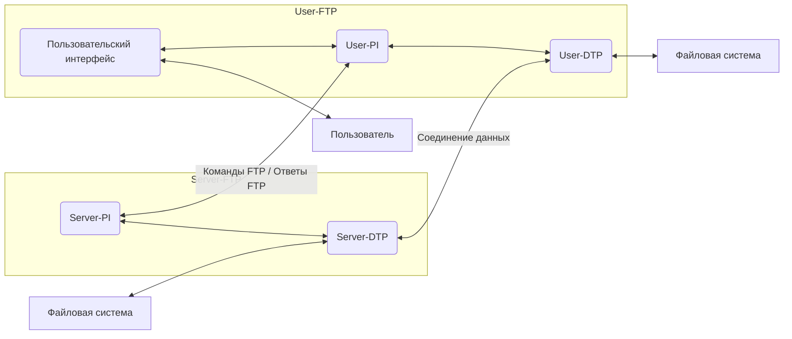
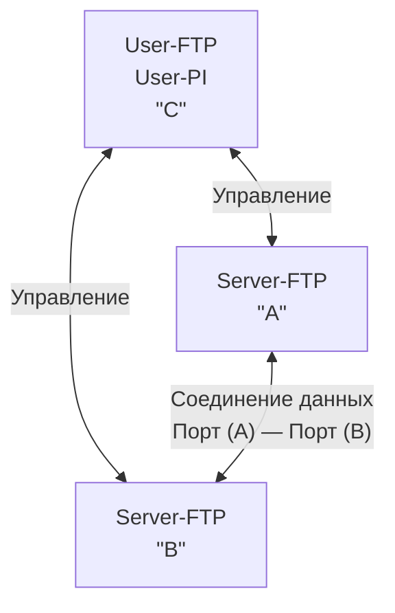
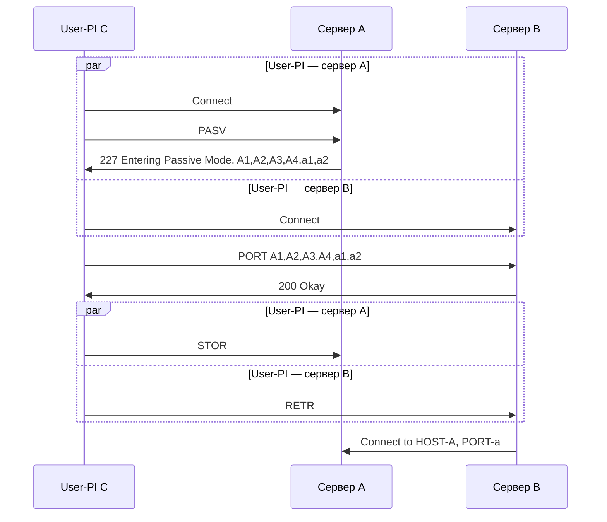
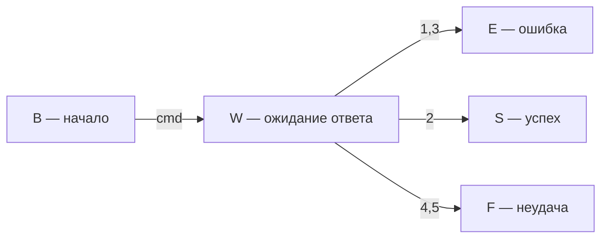
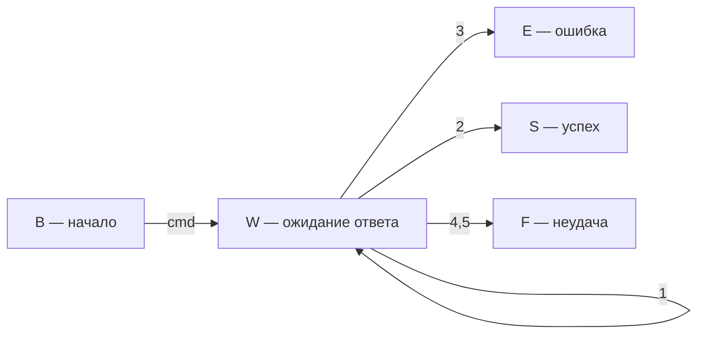
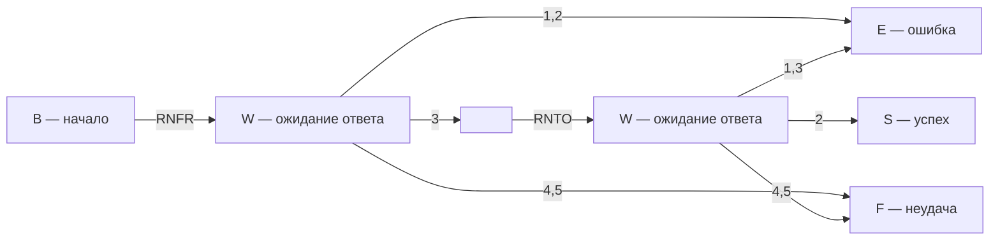
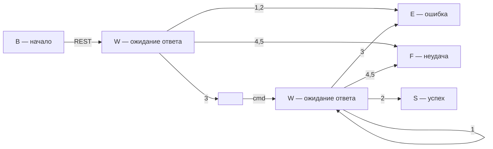
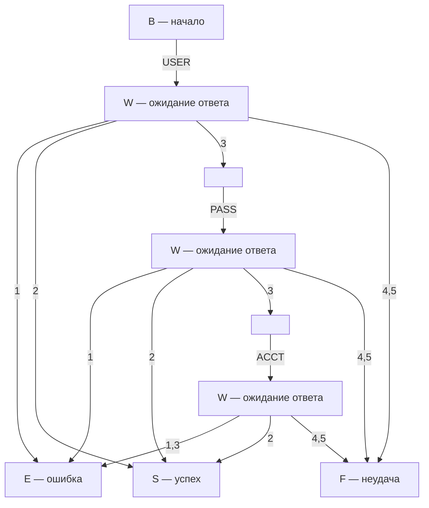
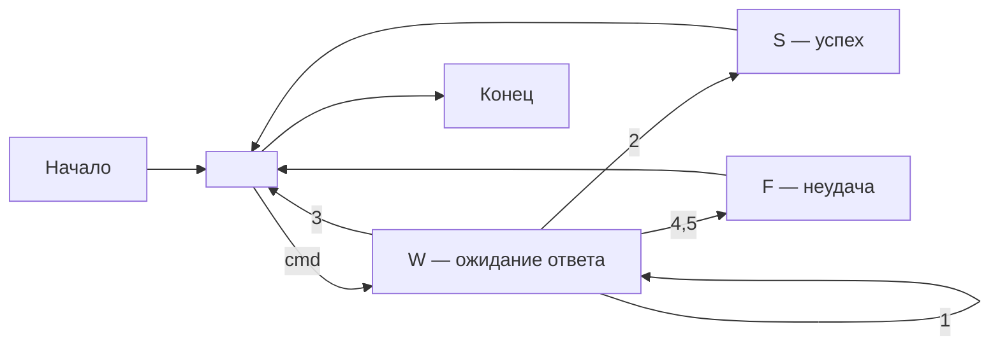

# RFC 959 — Протокол передачи файлов (FTP)

**Оригинал (англ.):** File Transfer Protocol (FTP)<br>
**Статус:** Internet Standard<br>
**Год:** 1985<br>
**Авторы:** J. Postel, J. Reynolds<br>
**Приоритет реализации:** 1 — Критично<br>
**Официальный текст:** <https://www.rfc-editor.org/rfc/rfc959.html>

## Аннотация

Базовый стандарт FTP (STD 9). Без него сервер невозможен: определяет модель двух соединений (управление + данные), команды, коды ответов, режимы передачи, типы данных и сценарии сессии.

## Содержание

- [Статус настоящего документа](#status)
- [1. Введение](#section-1)
- [2. Обзор](#section-2)
  - [2.1. История](#section-2.1)
  - [2.2. Терминология](#section-2.2)
  - [2.3. Модель FTP](#section-2.3)
- [3. Функции передачи данных](#section-3)
  - [3.1. Представление и хранение данных](#section-3.1)
  - [3.2. Установление соединений данных](#section-3.2)
  - [3.3. Управление соединением данных](#section-3.3)
  - [3.4. Режимы передачи](#section-3.4)
  - [3.5. Восстановление после ошибок и возобновление передачи](#section-3.5)
- [4. Функции передачи файлов](#section-4)
  - [4.1. Команды FTP](#section-4.1)
  - [4.2. Ответы FTP](#section-4.2)
- [5. Декларативные спецификации](#section-5)
  - [5.1. Минимальная реализация](#section-5.1)
  - [5.2. Соединения](#section-5.2)
  - [5.3. Команды](#section-5.3)
  - [5.4. Последовательности команд и ответов](#section-5.4)
- [6. Диаграммы состояний](#section-6)
- [7. Типичный сценарий FTP](#section-7)
- [8. Установление соединения](#section-8)
- [Приложение I. Страничная структура](#appendix-I)
- [Приложение II. Команды работы с каталогами](#appendix-II)
- [Приложение III. RFC, посвящённые FTP](#appendix-III)
- [Литература](#references)

---

Рабочая группа по сетям<br>
Запрос комментариев (RFC): 959<br>
J. Postel, J. Reynolds<br>
ISI<br>
Заменяет RFC 765 (IEN 149)<br>
Октябрь 1985 г.

ПРОТОКОЛ ПЕРЕДАЧИ ФАЙЛОВ (FTP)

<a id="status"></a>

## Статус настоящего документа

Настоящий документ является официальной спецификацией протокола передачи файлов (FTP). Распространение настоящего документа не ограничено.

В эту редакцию спецификации включены следующие новые необязательные команды:

`CDUP` (переход в родительский каталог), `SMNT` (монтирование структуры), `STOU` (сохранение под уникальным именем), `RMD` (удаление каталога), `MKD` (создание каталога), `PWD` (вывод текущего каталога) и `SYST` (система).

Обратите внимание, что эта спецификация совместима с предыдущей редакцией.

<a id="section-1"></a>

## 1. Введение

Цели FTP состоят в следующем: 1) способствовать совместному использованию файлов (компьютерных программ и/или данных); 2) поощрять косвенное или неявное (посредством программ) использование удалённых компьютеров; 3) оградить пользователя от различий между системами хранения файлов на разных хостах; 4) передавать данные надёжно и эффективно. Хотя пользователь может применять FTP непосредственно с терминала, этот протокол предназначен главным образом для использования программами.

В настоящей спецификации предпринята попытка удовлетворить разнообразные потребности пользователей больших хостов, малых хостов, персональных рабочих станций и TAC с помощью простой и легко реализуемой конструкции протокола.

Предполагается, что читатель знаком с протоколом управления передачей (TCP) [2](#ref-2) и протоколом Telnet [3](#ref-3). Эти документы включены в справочник протоколов ARPA-Internet [1](#ref-1).

<a id="section-2"></a>

## 2. Обзор

В этом разделе рассматриваются история, терминология и модель FTP. Здесь определяются только те термины, которые имеют особое значение в FTP. Часть терминологии весьма специфична для модели FTP; при ознакомлении с терминологией некоторым читателям, возможно, будет полезно обратиться к разделу, посвящённому модели FTP.

<a id="section-2.1"></a>

### 2.1. История

За прошедшие годы FTP прошёл длительный путь развития. В приложении III приведена хронологическая подборка документов Request for Comments, относящихся к FTP. Среди них — первые предложенные в 1971 году механизмы передачи файлов, разработанные для реализации на хостах Массачусетского технологического института (M.I.T.) (RFC 114), а также замечания и обсуждение в RFC 141.

В RFC 172 был представлен ориентированный на пользовательский уровень протокол передачи файлов между хост-компьютерами (включая терминальные IMP). В его переработанной редакции, RFC 265, FTP был изложен заново для дальнейшего рассмотрения, а в RFC 281 предлагались дополнительные изменения. Использование транзакции «Установить тип данных» было предложено в RFC 294 в январе 1982 года [так в оригинале].

RFC 354 заменил RFC 264 и 265. Теперь протокол передачи файлов определялся как протокол передачи файлов между хостами сети ARPANET, а основной функцией FTP объявлялись эффективная и надёжная передача файлов между хостами и обеспечение удобного использования возможностей удалённого хранения файлов. В RFC 385 были приведены дополнительные замечания об ошибках, моментах, требующих особого внимания, и дополнениях к протоколу, а RFC 414 содержал отчёт о состоянии работающих серверных и пользовательских реализаций FTP. RFC 430, выпущенный в 1973 году, наряду с другими RFC, слишком многочисленными для перечисления, содержал дальнейшие замечания по FTP. Наконец, в качестве RFC 454 был опубликован «официальный» документ FTP.

К июлю 1973 года по сравнению с последними версиями FTP были внесены значительные изменения, однако общая структура оставалась прежней. Чтобы отразить эти изменения, в качестве новой «официальной» спецификации был опубликован RFC 542. Тем не менее многие реализации, основанные на более старой спецификации, не были обновлены.

В 1974 году замечания по FTP продолжились в RFC 607 и 614. В RFC 624 предлагались дальнейшие изменения конструкции протокола и небольшие модификации. В 1975 году в RFC 686 под названием «Оставить и так достаточно хорошее в покое» обсуждались различия между всеми ранними и более поздними версиями FTP. В RFC 691 была представлена небольшая корректировка RFC 686, касавшаяся файлов для печати.

Переход от NCP к TCP в качестве нижележащего протокола побудил к тому, что из всех перечисленных усилий, словно феникс, возник RFC 765 — спецификация FTP для работы поверх TCP.

Настоящая редакция спецификации FTP предназначена для исправления небольших ошибок в документации, улучшения объяснений некоторых особенностей протокола и добавления нескольких новых необязательных команд.

В частности, в эту редакцию спецификации включены следующие новые необязательные команды:

- `CDUP` — переход в родительский каталог.
- `SMNT` — монтирование структуры.
- `STOU` — сохранение под уникальным именем.
- `RMD` — удаление каталога.
- `MKD` — создание каталога.
- `PWD` — вывод текущего каталога.
- `SYST` — система.

Эта спецификация совместима с предыдущей редакцией. Ожидается, что программа, реализованная в соответствии с предыдущей спецификацией, автоматически будет соответствовать и настоящей спецификации.

<a id="section-2.2"></a>

### 2.2. Терминология

**ASCII**

Набор символов ASCII определяется в справочнике протоколов ARPA-Internet. В FTP символы ASCII определены как нижняя половина восьмибитного набора кодов, то есть старший бит равен нулю.

**Управление доступом**

Средства управления доступом определяют права пользователей на использование системы и файлов в ней. Управление доступом необходимо для предотвращения несанкционированного или случайного использования файлов. Решение о применении средств управления доступом является прерогативой серверного процесса FTP.

**Размер байта**

В FTP представляют интерес два размера байта: размер логического байта файла и размер байта передачи, используемого при передаче данных. Размер байта передачи всегда составляет 8 бит. Размер байта передачи не обязательно совпадает ни с размером байта, в котором данные должны храниться в системе, ни с размером логического байта, используемого для интерпретации структуры данных.

**Управляющее соединение**

Канал связи между User-PI и Server-PI для обмена командами и ответами. Это соединение подчиняется протоколу Telnet.

**Соединение данных**

Полнодуплексное соединение, по которому данные передаются с заданными режимом и типом. Передаваемые данные могут представлять собой часть файла, целый файл или несколько файлов. Канал может связывать Server-DTP и User-DTP либо два Server-DTP.

**Порт данных**

Пассивный процесс передачи данных «прослушивает» порт данных, ожидая соединения от активного процесса передачи, чтобы открыть соединение данных.

**DTP**

Процесс передачи данных (DTP) устанавливает соединение данных и управляет им. DTP может быть пассивным или активным.

**Конец строки**

Последовательность конца строки определяет разделение печатных строк. Она состоит из возврата каретки (`Carriage Return`), за которым следует перевод строки (`Line Feed`).

**`EOF`**

Условие конца файла, определяющее конец передаваемого файла.

**`EOR`**

Условие конца записи, определяющее конец передаваемой записи.

**Восстановление после ошибок**

Процедура, позволяющая пользователю восстановить работу после некоторых ошибок, таких как отказ одной из хост-систем или процесса передачи. В FTP восстановление после ошибок может включать возобновление передачи файла с заданной контрольной точки.

**Команды FTP**

Набор команд, составляющих управляющую информацию, которая поступает от пользовательского процесса FTP к серверному процессу FTP.

**Файл**

Упорядоченный набор компьютерных данных, включая программы, произвольной длины, однозначно идентифицируемый путевым именем.

**Режим**

Режим, в котором данные должны передаваться по соединению данных. Режим определяет формат данных во время передачи, включая `EOR` и `EOF`. Режимы передачи, определённые в FTP, описаны в разделе «Режимы передачи».

**NVT**

Сетевой виртуальный терминал, определённый в протоколе Telnet.

**NVFS**

Сетевая виртуальная файловая система. Понятие, определяющее стандартную сетевую файловую систему со стандартными командами и соглашениями о путевых именах.

**Страница**

Файл может быть структурирован как набор независимых частей, называемых страницами. FTP поддерживает передачу файлов с разрывами как независимых индексированных страниц.

**Путевое имя**

Путевое имя определяется как строка символов, которую пользователь должен ввести в файловую систему, чтобы идентифицировать файл. Путевое имя обычно содержит имена устройств и/или каталогов, а также спецификацию имени файла. FTP пока не устанавливает стандартного соглашения о путевых именах. Каждый пользователь должен соблюдать соглашения об именовании файлов, принятые в файловых системах, участвующих в передаче.

**PI**

Интерпретатор протокола (PI). Пользовательская и серверная стороны протокола имеют различные роли, реализованные в User-PI и Server-PI.

**Запись**

Последовательный файл может быть структурирован как ряд смежных частей, называемых записями. FTP поддерживает структуры, состоящие из записей, однако файл не обязательно должен иметь структуру записей.

**Ответ**

Ответ — это положительное или отрицательное подтверждение, передаваемое от сервера пользователю по управляющему соединению в ответ на команды FTP. В общем виде ответ состоит из кода завершения, в том числе кода ошибки, за которым следует текстовая строка. Коды предназначены для использования программами, а текст обычно адресован пользователям-людям.

**Server-DTP**

Процесс передачи данных в своём обычном «активном» состоянии устанавливает соединение данных с «прослушивающим» портом данных. Он задаёт параметры передачи и хранения и передаёт данные по команде своего PI. DTP можно перевести в «пассивное» состояние, чтобы он ожидал соединения на порту данных, а не инициировал его.

**Серверный процесс FTP**

Процесс или набор процессов, выполняющих функцию передачи файлов во взаимодействии с пользовательским процессом FTP и, возможно, другим сервером. Функционально он состоит из интерпретатора протокола (PI) и процесса передачи данных (DTP).

**Server-PI**

Серверный интерпретатор протокола «прослушивает» порт `L`, ожидая соединения от User-PI, и устанавливает управляющее соединение. Он получает стандартные команды FTP от User-PI, отправляет ответы и управляет Server-DTP.

**Тип**

Тип представления данных, используемый при передаче и хранении данных. Тип подразумевает определённые преобразования при переходе между хранением данных и их передачей. Типы представления, определённые в FTP, описаны в разделе «Установление соединений данных».

**Пользователь**

Человек или процесс, действующий от имени человека, который желает воспользоваться службой передачи файлов. Пользователь-человек может непосредственно взаимодействовать с серверным процессом FTP, однако предпочтительно использовать пользовательский процесс FTP, поскольку протокол спроектирован преимущественно в расчёте на автоматическую работу.

**User-DTP**

Процесс передачи данных «прослушивает» порт данных, ожидая соединения от серверного процесса FTP. Если два сервера передают данные друг другу, User-DTP неактивен.

**Пользовательский процесс FTP**

Набор функций, включающий интерпретатор протокола, процесс передачи данных и пользовательский интерфейс, которые совместно выполняют функцию передачи файлов во взаимодействии с одним или несколькими серверными процессами FTP. Пользовательский интерфейс позволяет использовать локальный язык в диалоге команд и ответов с пользователем.

**User-PI**

Пользовательский интерпретатор протокола инициирует управляющее соединение со своего порта `U` к серверному процессу FTP, инициирует команды FTP и управляет User-DTP, если этот процесс участвует в передаче файлов.

<a id="section-2.3"></a>

### 2.3. Модель FTP

С учётом приведённых выше определений службу FTP можно представить следующей моделью, показанной на рисунке 1.



ПРИМЕЧАНИЯ:

1. Соединение данных может использоваться в любом из двух направлений.
2. Соединение данных не обязательно должно существовать всё время.

Рисунок 1. Модель использования FTP.

В модели, описанной на рисунке 1, управляющее соединение инициирует пользовательский интерпретатор протокола. Управляющее соединение подчиняется протоколу Telnet. По инициативе пользователя User-PI формирует стандартные команды FTP и передаёт их серверному процессу по управляющему соединению. (Пользователь может установить непосредственное управляющее соединение с серверным процессом FTP, например с терминала TAC, и самостоятельно формировать стандартные команды FTP, минуя пользовательский процесс FTP.) В ответ на команды Server-PI отправляет User-PI стандартные ответы по управляющему соединению.

Команды FTP задают параметры соединения данных — порт данных, режим передачи, тип представления и структуру — и характер операции с файловой системой: сохранение, получение, добавление в конец, удаление и т. д. User-DTP или назначенному вместо него процессу следует «прослушивать» указанный порт данных, а серверу — инициировать соединение данных и передачу данных в соответствии с заданными параметрами. Следует отметить, что порт данных не обязательно должен находиться на том же хосте, который инициирует команды FTP по управляющему соединению, однако пользователь или пользовательский процесс FTP должен обеспечить «прослушивание» указанного порта данных. Следует также отметить, что соединение данных может использоваться для одновременной отправки и приёма.

В другой ситуации пользователь может пожелать передавать файлы между двумя хостами, ни один из которых не является локальным. Пользователь устанавливает управляющие соединения с двумя серверами, а затем организует соединение данных между ними. Таким образом, управляющая информация передаётся User-PI, а данные передаются между серверными процессами передачи данных. Ниже приведена модель такого взаимодействия между серверами.



Рисунок 2.

Протокол требует, чтобы управляющие соединения оставались открытыми, пока идёт передача данных. По завершении использования службы FTP пользователь обязан запросить закрытие управляющих соединений, а само закрытие выполняет сервер. Сервер может прервать передачу данных, если управляющие соединения закрыты без команды.

**Связь между FTP и Telnet:**

FTP использует протокол Telnet на управляющем соединении. Это может быть реализовано двумя способами: во-первых, User-PI или Server-PI могут непосредственно реализовать правила протокола Telnet в собственных процедурах; во-вторых, User-PI или Server-PI могут воспользоваться уже существующим в системе модулем Telnet.

В пользу второго подхода говорят простота реализации, совместное использование кода и модульное программирование. В пользу первого подхода говорят эффективность и независимость. На практике FTP использует лишь очень небольшую часть протокола Telnet, поэтому первый подход не обязательно требует большого объёма кода.

<a id="section-3"></a>

## 3. Функции передачи данных

Файлы передаются только через соединение данных. Управляющее соединение используется для передачи команд, описывающих функции, которые необходимо выполнить, и ответов на эти команды (см. раздел об ответах FTP). Ряд команд относится к передаче данных между хостами. К этим командам передачи данных относятся команда MODE, задающая, как должны передаваться биты данных, и команды STRUcture и TYPE, используемые для определения способа представления данных. Передача и представление в основном независимы друг от друга, однако потоковый режим передачи (Stream) зависит от атрибута структуры файла, а при использовании сжатого режима передачи (Compressed) характер байта-заполнителя зависит от типа представления.

<a id="section-3.1"></a>

### 3.1. Представление и хранение данных

Данные передаются с устройства хранения на передающем хосте на устройство хранения на принимающем хосте. Часто над данными необходимо выполнить определённые преобразования, поскольку представления данных при хранении в этих двух системах различаются. Например, NVT-ASCII имеет разные представления при хранении в разных системах. Системы DEC TOPS-20 обычно хранят NVT-ASCII в виде пяти 7-битных символов ASCII, выровненных по левому краю 36-битного слова. Мэйнфреймы IBM хранят NVT-ASCII в виде 8-битных кодов EBCDIC. Multics хранит NVT-ASCII в виде четырёх 9-битных символов в 36-битном слове. При передаче текста между разнородными системами желательно преобразовывать символы в стандартное представление NVT-ASCII. Передающая и принимающая стороны должны были бы выполнять необходимые преобразования между стандартным представлением и своими внутренними представлениями.

Другая проблема представления возникает при передаче двоичных данных (не кодов символов) между хост-системами с разной длиной слова. Не всегда ясно, как отправителю следует передавать данные, а получателю — хранить их. Например, при передаче 32-битных байтов из системы с 32-битной длиной слова в систему с 36-битной длиной слова может оказаться желательным (из соображений эффективности и удобства использования) хранить 32-битные байты в последней системе с выравниванием по правому краю 36-битного слова. В любом случае пользователю следует предоставить возможность задавать представление данных и функции преобразования. Следует отметить, что FTP предоставляет лишь весьма ограниченные возможности представления типов данных. Требуемые преобразования, выходящие за пределы этих ограниченных возможностей, пользователю следует выполнять самостоятельно.

<a id="section-3.1.1"></a>

#### 3.1.1. Типы данных

Представлением данных в FTP управляет пользователь, задавая тип представления. Этот тип может неявно (как в случае ASCII или EBCDIC) либо явно (как в случае локального байта — Local byte) определять размер байта для интерпретации, называемый «размером логического байта». Обратите внимание: он никак не связан с размером байта, используемого для передачи через соединение данных и называемого «размером байта передачи»; эти два понятия не следует смешивать. Например, у NVT-ASCII размер логического байта составляет 8 бит. Если выбран тип Local byte, команда TYPE имеет обязательный второй параметр, задающий размер логического байта. Размер байта передачи всегда составляет 8 бит.

<a id="section-3.1.1.1"></a>

##### 3.1.1.1. Тип ASCII

Это тип по умолчанию, и его должны поддерживать все реализации FTP. Он предназначен прежде всего для передачи текстовых файлов, за исключением случаев, когда обоим хостам удобнее использовать тип EBCDIC.

Отправитель преобразует данные из внутреннего представления символов в стандартное 8-битное представление NVT-ASCII (см. спецификацию Telnet). Получатель преобразует данные из стандартной формы в собственную внутреннюю форму.

В соответствии со стандартом NVT там, где необходимо обозначить конец строки текста, следует использовать последовательность `<CRLF>`. (См. обсуждение структуры файла в конце раздела о представлении и хранении данных.)

Использование стандартного представления NVT-ASCII означает, что данные должны интерпретироваться как 8-битные байты.

Параметр формата (Format) для типов ASCII и EBCDIC обсуждается ниже.

<a id="section-3.1.1.2"></a>

##### 3.1.1.2. Тип EBCDIC

Этот тип предназначен для эффективной передачи между хостами, использующими EBCDIC в качестве внутреннего представления символов.

Для передачи данные представляются в виде 8-битных символов EBCDIC. Код символов — единственное различие между функциональными спецификациями типов EBCDIC и ASCII.

Конец строки (в отличие от конца записи — см. обсуждение структуры), вероятно, будет редко использоваться с типом EBCDIC для обозначения структуры, но там, где это необходимо, следует применять символ `<NL>`.

<a id="section-3.1.1.3"></a>

##### 3.1.1.3. Тип образа (IMAGE)

Данные передаются как непрерывная последовательность битов, которые для передачи упаковываются в 8-битные байты передачи. Принимающая сторона должна хранить данные как непрерывную последовательность битов. Структура системы хранения может потребовать дополнения файла (или каждой записи, если файл имеет структуру записей) до некоторой удобной границы — байта, слова или блока. Такое дополнение должно целиком состоять из нулей и может находиться только в конце файла (или в конце каждой записи); при этом должен существовать способ распознавания дополняющих битов, чтобы при получении файла их можно было удалить. Способ преобразования с добавлением дополнения следует широко доводить до сведения пользователей, чтобы пользователь мог обрабатывать файл на хосте, где он хранится.

Тип Image предназначен для эффективного хранения и получения файлов, а также для передачи двоичных данных. Рекомендуется, чтобы этот тип поддерживался всеми реализациями FTP.

<a id="section-3.1.1.4"></a>

##### 3.1.1.4. Локальный тип (LOCAL)

Данные передаются логическими байтами размера, заданного обязательным вторым параметром — размером байта (Byte size). Значение Byte size должно быть десятичным целым числом; значения по умолчанию нет. Размер логического байта не обязательно совпадает с размером байта передачи. Если размеры байтов различаются, логические байты следует упаковывать непрерывно, без учёта границ байтов передачи, помещая необходимое дополнение в конце.

Когда данные достигнут принимающего хоста, они будут преобразованы способом, зависящим от размера логического байта и конкретного хоста. Это преобразование должно быть обратимым (то есть при использовании тех же параметров можно получить идентичный файл), и разработчикам реализаций FTP следует широко доводить сведения о нём до пользователей.

Например, пользователь, отправляющий 36-битные числа с плавающей точкой на хост с 32-битным словом, мог бы передать эти данные с типом Local byte и размером логического байта 36. Тогда от принимающего хоста ожидалось бы, что он сохранит логические байты так, чтобы с ними было легко работать; в этом примере должно быть достаточно размещения 36-битных логических байтов в 64-битных двойных словах.

Другой пример: два хоста с размером слова 36 бит могут передавать друг другу данные словами, используя `TYPE L 36`. Данные передавались бы в 8-битных байтах передачи, упакованных так, чтобы 9 байтов передачи содержали два слова хоста.

<a id="section-3.1.1.5"></a>

##### 3.1.1.5. Управление форматом

Типы ASCII и EBCDIC также принимают второй (необязательный) параметр; он указывает, какой вид управления вертикальным форматом, если таковой вообще имеется, связан с файлом. В FTP определены следующие типы представления данных:

Символьный файл может передаваться на хост с одной из трёх целей: для печати, для хранения и последующего получения либо для обработки. Если файл отправляется для печати, принимающий хост должен знать, как представлено управление вертикальным форматом. Во втором случае должна существовать возможность сохранить файл на хосте, а затем получить его в точности в том же виде. Наконец, следует предусмотреть возможность переместить файл с одного хоста на другой и обработать его на втором хосте без чрезмерных затруднений. Один-единственный формат ASCII или EBCDIC не удовлетворяет всем этим условиям. Поэтому у этих типов имеется второй параметр, задающий один из следующих трёх форматов:

<a id="section-3.1.1.5.1"></a>

###### 3.1.1.5.1. Не для печати (NON PRINT)

Это формат по умолчанию, который следует использовать, если второй параметр (формат) опущен. Формат Non-print должны поддерживать все реализации FTP.

Файл не обязан содержать какую-либо информацию о вертикальном формате. Если он передаётся процессу печати, этот процесс может принять стандартные значения межстрочных интервалов и полей.

Обычно этот формат будет использоваться для файлов, предназначенных для обработки или только для хранения.

<a id="section-3.1.1.5.2"></a>

###### 3.1.1.5.2. Управляющие символы формата TELNET

Файл содержит управляющие символы вертикального формата ASCII/EBCDIC (то есть `<CR>`, `<LF>`, `<NL>`, `<VT>`, `<FF>`), которые процесс печати будет интерпретировать соответствующим образом. `<CRLF>`, именно в такой последовательности, также обозначает конец строки.

<a id="section-3.1.1.5.2-2"></a>

###### 3.1.1.5.2. Управление кареткой (ASA)

> Примечание переводчика: номер 3.1.1.5.2 повторяется в оригинале; это повторение сохранено.

Файл содержит символы управления вертикальным форматом ASA (FORTRAN). (См. приложение C к RFC 740, а также Communications of the ACM, том 7, № 10, с. 606, октябрь 1964 года.) В строке или записи, отформатированной в соответствии со стандартом ASA, первый символ не должен печататься. Вместо этого его следует использовать для определения вертикального перемещения бумаги, которое следует выполнить до печати остальной части записи.

Стандарт ASA определяет следующие управляющие символы:

| Символ | Вертикальное перемещение |
| --- | --- |
| пробел | Переместить бумагу вверх на одну строку |
| `0` | Переместить бумагу вверх на две строки |
| `1` | Переместить бумагу к началу следующей страницы |
| `+` | Без перемещения, то есть печать поверх уже напечатанного |

Очевидно, у процесса печати должен быть какой-то способ различать конец структурной единицы. Если файл имеет структуру записей (см. ниже), это не представляет проблемы: записи будут явно обозначаться при передаче и хранении. Если файл не имеет структуры записей, для разделения печатаемых строк используется последовательность конца строки `<CRLF>`, однако управляющие символы ASA имеют приоритет над этими символами управления форматом.

<a id="section-3.1.2"></a>

#### 3.1.2. Структуры данных

Помимо различных типов представления, FTP позволяет задавать структуру файла. В FTP определены три структуры файла:

- файловая структура (file-structure), при которой внутренняя структура отсутствует и файл рассматривается как непрерывная последовательность байтов данных;
- структура записей (record-structure), при которой файл состоит из последовательных записей;
- и страничная структура (page-structure), при которой файл состоит из независимых индексированных страниц.

Если команда STRUcture не использовалась, по умолчанию предполагается файловая структура, однако все реализации FTP должны поддерживать для «текстовых» файлов (то есть файлов с TYPE ASCII или EBCDIC) как файловую структуру, так и структуру записей. Структура файла будет влиять как на режим его передачи (см. раздел о режимах передачи), так и на интерпретацию и хранение файла.

«Естественная» структура файла будет зависеть от того, на каком хосте он хранится. Файл исходного кода обычно хранится на мэйнфрейме IBM в виде записей фиксированной длины, а на DEC TOPS-20 — в виде потока символов, разделённого на строки, например посредством `<CRLF>`. Чтобы передача файлов между столь различными хостами была полезной, должен существовать какой-то способ, позволяющий одному хосту распознавать предположения другого относительно файла.

Поскольку одни хосты естественным образом ориентированы на файлы, а другие — на записи, могут возникать проблемы, если файл с одной структурой отправляется на хост, ориентированный на другую. Если текстовый файл отправляется со структурой записей на хост, ориентированный на файлы, этому хосту следует выполнить внутреннее преобразование файла на основе структуры записей. Очевидно, следует обеспечить полезность этого преобразования, но оно также должно быть обратимым, чтобы можно было получить идентичный файл, используя структуру записей.

При отправке файла с файловой структурой на хост, ориентированный на записи, возникает вопрос о том, какие критерии хосту следует использовать для разделения файла на записи, которые можно обрабатывать локально. Если такое разделение необходимо, реализации FTP следует использовать в качестве разделителя последовательность конца строки: `<CRLF>` для текстовых файлов ASCII или `<NL>` для текстовых файлов EBCDIC. Если реализация FTP применяет этот способ, она должна быть готова выполнить обратное преобразование при получении файла с файловой структурой.

<a id="section-3.1.2.1"></a>

##### 3.1.2.1. Файловая структура

Если команда STRUcture не использовалась, по умолчанию предполагается файловая структура.

При файловой структуре внутренняя структура отсутствует, и файл рассматривается как непрерывная последовательность байтов данных.

<a id="section-3.1.2.2"></a>

##### 3.1.2.2. Структура записей

Все реализации FTP должны поддерживать структуру записей для «текстовых» файлов (то есть файлов с TYPE ASCII или EBCDIC).

При структуре записей файл состоит из последовательных записей.

<a id="section-3.1.2.3"></a>

##### 3.1.2.3. Страничная структура

Для передачи файлов, которые не являются непрерывными, FTP определяет страничную структуру. Файлы этого типа иногда называют «файлами с произвольным доступом» или даже «файлами с дырами». В таких файлах иногда имеется и другая информация, связанная с файлом в целом (например, дескриптор файла), с участком файла (например, средства управления доступом к странице) либо и с тем и с другим. В FTP участки файла называются страницами.

Чтобы обеспечить поддержку страниц различных размеров и связанной с ними информации, каждая страница передаётся с заголовком страницы. Для заголовка страницы определены следующие поля:

**Длина заголовка (Header Length)**

Число логических байтов в заголовке страницы, включая этот байт. Минимальная длина заголовка — 4.

**Индекс страницы (Page Index)**

Логический номер страницы данного участка файла. Это не порядковый номер данной страницы при передаче, а индекс, используемый для идентификации этой страницы файла.

**Длина данных (Data Length)**

Число логических байтов в данных страницы. Минимальная длина данных — 0.

**Тип страницы (Page Type)**

Тип данной страницы. Определены следующие типы страниц:

- **0 = Последняя страница (Last Page)**

  Используется для обозначения конца передачи со страничной структурой. Длина заголовка должна быть равна 4, а длина данных — 0.

- **1 = Простая страница (Simple Page)**

  Это обычный тип для простых страничных файлов без связанной со страницей управляющей информации. Длина заголовка должна быть равна 4.

- **2 = Страница-дескриптор (Descriptor Page)**

  Этот тип используется для передачи описательной информации о файле в целом.

- **3 = Страница с управлением доступом (Access Controlled Page)**

  Этот тип включает дополнительное поле заголовка для страничных файлов с информацией об управлении доступом на уровне страницы. Длина заголовка должна быть равна 5.

**Необязательные поля (Optional Fields)**

Для передачи управляющей информации по каждой странице, например управления доступом к отдельным страницам, могут использоваться дополнительные поля заголовка.

Все поля имеют длину в один логический байт. Размер логического байта задаётся командой TYPE. Дополнительные сведения и конкретный пример страничной структуры см. в [приложении I](#appendix-I).

Предостережение относительно параметров: если полученная версия файла должна быть идентична первоначально переданной, файл необходимо сохранять и получать с одними и теми же параметрами. И наоборот, реализации FTP должны возвращать файл, идентичный исходному, если параметры, использованные при сохранении и получении файла, одинаковы.

<a id="section-3.2"></a>

### 3.2. Установление соединений данных

Механизм передачи данных состоит в установлении соединения данных с соответствующими портами и выборе параметров передачи. И у пользовательского, и у серверного процесса передачи данных (DTP) имеется порт данных по умолчанию. Порт данных пользовательского процесса по умолчанию совпадает с портом управляющего соединения (то есть U). Порт данных серверного процесса по умолчанию — порт, соседний с портом управляющего соединения (то есть L-1).

Размер байта передачи составляет 8 бит. Этот размер байта относится только к собственно передаче данных; он никак не связан с представлением данных в файловой системе хоста.

Пассивный процесс передачи данных (это может быть пользовательский DTP или DTP второго сервера) должен «прослушивать» порт данных до отправки команды запроса передачи. Команда запроса FTP определяет направление передачи данных. Получив запрос передачи, сервер инициирует соединение данных с этим портом. Когда соединение установлено, между DTP начинается передача данных, а серверный интерпретатор протокола (PI) отправляет подтверждающий ответ пользовательскому PI.

Каждая реализация FTP должна поддерживать использование портов данных по умолчанию, и только USER-PI может инициировать переход к портам, отличным от используемых по умолчанию.

Пользователь может задать другой порт данных с помощью команды PORT. Он может захотеть вывести файл на построчный принтер TAC или получить его с третьего хоста. В последнем случае пользовательский PI устанавливает управляющие соединения с обоими серверными PI. Затем одному серверу предписывается (командой FTP) «прослушивать» соединение, которое будет инициировано другим. Пользовательский PI отправляет одному серверному PI команду PORT, указывающую порт данных другого сервера. Наконец, обоим отправляются соответствующие команды передачи. Точная последовательность команд и ответов, передаваемых между управляющей стороной пользователя и серверами, определена в разделе об ответах FTP.

В общем случае ответственность за обслуживание соединения данных — его инициирование и закрытие — лежит на сервере. Исключение составляет случай, когда пользовательский DTP отправляет данные в режиме передачи, требующем закрытия соединения для обозначения EOF. Сервер ДОЛЖЕН закрыть соединение данных при следующих условиях:

1. Сервер завершил отправку данных в режиме передачи, требующем закрытия для обозначения EOF.
2. Сервер получает от пользователя команду ABORT.
3. Команда пользователя изменяет заданный порт.
4. Управляющее соединение закрывается штатным или иным образом.
5. Возникает состояние неустранимой ошибки.

В остальных случаях закрытие остаётся на усмотрение сервера; о том, что сервер воспользовался этой возможностью, он должен сообщить пользовательскому процессу исключительно ответом 250 или 226.

<a id="section-3.3"></a>

### 3.3. Управление соединением данных

**Порты соединения данных по умолчанию.** Все реализации FTP должны поддерживать использование портов соединения данных по умолчанию, и только пользовательский PI может инициировать использование портов, отличных от используемых по умолчанию.

**Согласование портов данных, отличных от используемых по умолчанию.** Пользовательский PI может задать такой порт данных на стороне пользователя командой PORT. Пользовательский PI может командой PASV запросить, чтобы серверная сторона указала порт данных на стороне сервера, отличный от используемого по умолчанию. Поскольку соединение определяется парой адресов, любого из этих действий достаточно, чтобы получить другое соединение данных; тем не менее разрешается выполнить обе команды, чтобы использовать новые порты на обоих концах соединения данных.

**Повторное использование соединения данных.** При использовании потокового режима передачи данных конец файла должен обозначаться закрытием соединения. Это создаёт проблему, если в рамках сеанса требуется передать несколько файлов, поскольку для гарантии надёжной связи TCP необходимо сохранять запись о соединении в течение периода ожидания. Поэтому соединение нельзя немедленно открыть заново.

Существуют два решения этой проблемы. Первое — согласовать порт, отличный от используемого по умолчанию. Второе — использовать другой режим передачи.

Замечание о режимах передачи. Потоковый режим передачи по своей природе ненадёжен, поскольку невозможно определить, было ли соединение закрыто преждевременно. Другие режимы передачи (блочный — Block, сжатый — Compressed) не закрывают соединение для обозначения конца файла. В них предусмотрено достаточно средств кодирования FTP, чтобы поток соединения данных можно было разобрать и определить конец файла. Таким образом, при использовании этих режимов соединение данных можно оставлять открытым для передачи нескольких файлов.

<a id="section-3.4"></a>

### 3.4. Режимы передачи

Следующий вопрос при передаче данных — выбор подходящего режима передачи. Имеются три режима: один форматирует данные и допускает процедуры возобновления; другой, кроме того, сжимает данные для эффективной передачи; третий передаёт данные с небольшой обработкой или вовсе без неё. В последнем случае режим взаимодействует с атрибутом структуры, определяя вид обработки. В сжатом режиме тип представления определяет байт-заполнитель.

Все передачи данных должны завершаться концом файла (EOF), который может быть указан явно либо подразумеваться закрытием соединения данных. Для файлов со структурой записей все маркеры конца записи (EOR), включая последний, задаются явно. Для файлов, передаваемых со страничной структурой, используется тип страницы «последняя страница».

ПРИМЕЧАНИЕ: в оставшейся части этого раздела под байтом понимается «байт передачи», кроме случаев, когда явно указано иное.

В целях стандартизованной передачи передающий хост преобразует своё внутреннее обозначение конца строки или конца записи в представление, предписанное режимом передачи и структурой файла, а принимающий хост выполняет обратное преобразование в своё внутреннее обозначение. Поле счётчика записи мэйнфрейма IBM может быть не распознано на другом хосте, поэтому информация о конце записи может передаваться как двухбайтный управляющий код в потоковом режиме либо как установленный бит-флаг в дескрипторе блочного или сжатого режима. Конец строки в файле ASCII или EBCDIC без структуры записей следует обозначать соответственно `<CRLF>` или `<NL>`. Поскольку эти преобразования требуют от некоторых систем дополнительной работы, одинаковые системы, передающие текстовые файлы без структуры записей, могут предпочесть для передачи двоичное представление и потоковый режим.

В FTP определены следующие режимы передачи:

<a id="section-3.4.1"></a>

#### 3.4.1. Потоковый режим

Данные передаются как поток байтов. Ограничений на используемый тип представления нет; структура записей допускается.

В файле со структурой записей EOR и EOF обозначаются каждый двухбайтным управляющим кодом. Первый байт управляющего кода целиком состоит из единиц и является escape-символом. Для EOR у второго байта младший бит установлен, а все остальные равны нулю; для EOF установлен второй младший бит, то есть байт имеет значение 1 для EOR и значение 2 для EOF. EOR и EOF могут быть обозначены вместе в последнем переданном байте установкой обоих младших битов (то есть значением 3). Если байт, целиком состоящий из единиц, требуется передать как данные, его следует повторить во втором байте управляющего кода.

Если используется файловая структура, EOF обозначается закрытием соединения данных передающим хостом, а все байты являются байтами данных.

<a id="section-3.4.2"></a>

#### 3.4.2. Блочный режим

Файл передаётся как последовательность блоков данных, каждому из которых предшествует один или несколько байтов заголовка. Байты заголовка содержат поле счётчика и код дескриптора. Поле счётчика указывает полную длину блока данных в байтах, тем самым отмечая начало следующего блока данных (битов-заполнителей нет). Код дескриптора определяет: последний блок в файле (EOF), последний блок в записи (EOR), маркер возобновления (см. раздел о восстановлении после ошибок и возобновлении) либо сомнительные данные (то есть предполагается, что передаваемые данные содержат ошибки и не являются достоверными). Этот последний код НЕ предназначен для контроля ошибок внутри FTP. Он введён потому, что хосты, обменивающиеся определёнными типами данных (например, сейсмическими или метеорологическими), хотят передавать и принимать все данные, несмотря на локальные ошибки (такие как «ошибки чтения магнитной ленты»), но при этом указывать при передаче, что определённые части данных сомнительны. В этом режиме допускается структура записей и может использоваться любой тип представления.

Заголовок состоит из трёх байтов. Из 24 бит информации заголовка 16 младших битов должны представлять счётчик байтов, а 8 старших битов — коды дескриптора, как показано ниже.

**Заголовок блока**

| Порядок в заголовке | Поле | Ширина | Разряды 24-битного заголовка, от старшего к младшему |
| --- | --- | --- | --- |
| Байт 1 | Дескриптор | 8 бит | 23–16 |
| Байты 2–3 | Счётчик байтов | 16 бит | 15–0 |

Коды дескриптора обозначаются битовыми флагами в байте дескриптора. Назначены четыре кода, причём номер каждого кода — это десятичное значение соответствующего бита в байте.

| Код | Значение |
| --- | --- |
| 128 | Конец блока данных является EOR |
| 64 | Конец блока данных является EOF |
| 32 | Предполагаемые ошибки в блоке данных |
| 16 | Блок данных является маркером возобновления |

При таком кодировании для конкретного блока могут одновременно иметь место несколько условий, задаваемых кодами дескриптора. Может быть установлено столько битов-флагов, сколько необходимо.

Маркер возобновления встраивается в поток данных как целое число 8-битных байтов, представляющих печатные символы на языке, используемом в управляющем соединении (например, по умолчанию — NVT-ASCII). `<SP>` (пробел в соответствующем языке) не должен использоваться ВНУТРИ маркера возобновления.

Например, для передачи маркера из шести символов будет отправлено следующее:

| Порядок передачи | Поле | Ширина | Значение или содержимое |
| --- | --- | --- | --- |
| Байт 1 | Код дескриптора | 8 бит | 16 |
| Байты 2–3 | Счётчик байтов | 16 бит | 6 |
| Байт 4 | Маркер | 8 бит | Первый символ маркера |
| Байт 5 | Маркер | 8 бит | Второй символ маркера |
| Байт 6 | Маркер | 8 бит | Третий символ маркера |
| Байт 7 | Маркер | 8 бит | Четвёртый символ маркера |
| Байт 8 | Маркер | 8 бит | Пятый символ маркера |
| Байт 9 | Маркер | 8 бит | Шестой символ маркера |

<a id="section-3.4.3"></a>

#### 3.4.3. Сжатый режим

Предусмотрены три вида передаваемой информации: обычные данные, передаваемые последовательностью байтов; сжатые данные, состоящие из повторений или заполнителей; и управляющая информация, передаваемая двухбайтной escape-последовательностью. Если передаются `n>0` байтов (до 127) обычных данных, этим n байтам предшествует байт, в котором крайний левый бит установлен в 0, а крайние правые 7 бит содержат число n.

**Последовательность байтов**

| Порядок передачи | Поле | Ширина | Положение внутри байта, от старшего бита к младшему |
| --- | --- | --- | --- |
| Байт 1, первое поле | `0` | 1 бит | Бит 7 |
| Байт 1, второе поле | `n` | 7 бит | Биты 6–0 |
| Байт 2 | `d(1)` | 8 бит | Биты 7–0 |
| Последующие байты, вплоть до байта n+1 | `..., d(n)` | По 8 бит | Биты 7–0 каждого байта |

Последовательность из n байтов данных `d(1),..., d(n)`. Число n должно быть положительным.

Чтобы сжать последовательность из n повторений байта данных d, передаются следующие 2 байта:

**Повторяемый байт**

| Порядок передачи | Поле | Ширина | Положение внутри байта, от старшего бита к младшему |
| --- | --- | --- | --- |
| Байт 1, первое поле | `1 0` | 2 бита | Биты 7–6 |
| Байт 1, второе поле | `n` | 6 бит | Биты 5–0 |
| Байт 2 | `d` | 8 бит | Биты 7–0 |

Последовательность из n байтов-заполнителей может быть сжата в один байт, причём байт-заполнитель зависит от типа представления. Если тип — ASCII или EBCDIC, байтом-заполнителем является `<SP>` (пробел, код ASCII 32, код EBCDIC 64). Если тип — Image или Local byte, заполнителем является нулевой байт.

**Последовательность заполнителей**

| Порядок передачи | Поле | Ширина | Положение внутри байта, от старшего бита к младшему |
| --- | --- | --- | --- |
| Байт 1, первое поле | `1 1` | 2 бита | Биты 7–6 |
| Байт 1, второе поле | `n` | 6 бит | Биты 5–0 |

Escape-последовательность состоит из двух байтов: первый — escape-байт (целиком состоящий из нулей), а второй содержит коды дескриптора, определённые для блочного режима. Коды дескриптора имеют то же значение, что и в блочном режиме, и относятся к следующей за ними последовательности байтов.

Сжатый режим полезен для повышения пропускной способности при передаче по сети очень больших объёмов данных ценой небольших дополнительных затрат процессорного времени. Наиболее эффективно он может применяться для уменьшения размера файлов печати, например создаваемых хостами RJE.

<a id="section-3.5"></a>

### 3.5. Восстановление после ошибок и возобновление

Средства обнаружения потерянных или искажённых при передаче данных битов не предусмотрены; контроль ошибок на этом уровне выполняет TCP. Однако предусмотрена процедура возобновления для защиты пользователей от серьёзных системных сбоев (включая сбои хоста, процесса FTP или нижележащей сети).

Процедура возобновления определена только для блочного и сжатого режимов передачи данных. Она требует, чтобы отправитель данных вставлял в поток данных специальный код маркера с некоторой информацией маркера. Информация маркера имеет смысл только для отправителя, но должна состоять из печатных символов на используемом по умолчанию или согласованном языке управляющего соединения (ASCII или EBCDIC). Маркер мог бы представлять счётчик битов, счётчик записей или любую другую информацию, по которой система может определить контрольную точку данных. Получатель данных, если он реализует процедуру возобновления, затем отмечал бы соответствующую этому маркеру позицию в принимающей системе и возвращал эту информацию пользователю.

В случае системного сбоя пользователь может возобновить передачу данных, указав точку маркера с помощью процедуры возобновления FTP. Следующий пример иллюстрирует использование процедуры возобновления.

Отправитель данных вставляет соответствующий блок маркера в поток данных в удобном месте. Принимающий хост отмечает соответствующую точку данных в своей файловой системе и сообщает пользователю последнюю известную информацию о маркерах отправителя и получателя — либо непосредственно, либо через управляющее соединение в ответе 110 (в зависимости от того, кто является отправителем). В случае системного сбоя пользователь или управляющий процесс возобновляет работу сервера с последнего серверного маркера, отправляя команду возобновления с кодом маркера сервера в качестве аргумента. Команда возобновления передаётся через управляющее соединение, и сразу за ней следует команда (например, RETR, STOR или LIST), которая выполнялась в момент системного сбоя.

<a id="section-4"></a>

## 4. Функции передачи файлов

Канал связи от пользовательского интерпретатора протокола (PI) к серверному PI устанавливается как TCP-соединение от пользователя к стандартному порту сервера. Пользовательский интерпретатор протокола отвечает за отправку команд FTP и интерпретацию получаемых ответов; серверный PI интерпретирует команды, отправляет ответы и даёт своему процессу передачи данных (DTP) указания установить соединение данных и передать данные. Если второй стороной передачи данных (пассивным процессом передачи) является пользовательский DTP, то он управляется посредством внутреннего протокола узла пользовательского FTP; если же это второй серверный DTP, то им управляет его PI по команде пользовательского PI. Ответы FTP рассматриваются в следующем разделе. При описании некоторых команд в этом разделе полезно явно указать возможные ответы.

<a id="section-4.1"></a>

### 4.1. Команды FTP

<a id="section-4.1.1"></a>

#### 4.1.1. Команды управления доступом

Следующие команды задают идентификаторы управления доступом (коды команд приведены в скобках).

##### Имя пользователя (`USER`)

Поле аргумента представляет собой строку Telnet, идентифицирующую пользователя. Для идентификации пользователя служат сведения, которые сервер требует для доступа к своей файловой системе. Обычно эта команда будет первой командой, передаваемой пользователем после установления управляющих соединений (некоторые серверы могут этого требовать). Некоторым серверам могут также потребоваться дополнительные сведения для идентификации, передаваемые командой пароля и/или командой счёта. Серверы могут разрешать ввод новой команды `USER` в любой момент для изменения сведений об управлении доступом и/или учётной информации. При этом все ранее предоставленные сведения о пользователе, пароле и счёте удаляются, а последовательность входа в систему начинается заново. Все параметры передачи остаются неизменными, и любая уже выполняющаяся передача файла завершается с прежними параметрами управления доступом.

##### Пароль (`PASS`)

Поле аргумента представляет собой строку Telnet, задающую пароль пользователя. Этой команде должна непосредственно предшествовать команда имени пользователя; на некоторых узлах она завершает идентификацию пользователя для управления доступом. Поскольку сведения о пароле весьма конфиденциальны, в общем случае желательно «маскировать» их или подавлять отображение вводимых символов. По-видимому, у сервера нет безотказного способа добиться этого. Поэтому скрытие конфиденциальных сведений о пароле является обязанностью пользовательского процесса FTP.

##### Счёт (`ACCT`)

Поле аргумента представляет собой строку Telnet, идентифицирующую счёт пользователя. Эта команда не обязательно связана с командой `USER`, поскольку на одних узлах счёт может требоваться для входа в систему, а на других — только для определённых видов доступа, например для сохранения файлов. В последнем случае команда может поступить в любой момент.

Для автоматического различения этих случаев предусмотрены коды ответов: когда сведения о счёте требуются для входа в систему, ответ на успешно выполненную команду пароля `PASS` имеет код `332`. Если же сведения о счёте для входа в систему НЕ требуются, ответ на успешно выполненную команду пароля `PASS` имеет код `230`; если сведения о счёте понадобятся для команды, выданной позднее в ходе диалога, серверу следует вернуть ответ `332` или `532` в зависимости от того, сохраняет ли он эту команду (в ожидании получения команды счёта `ACCT`) или отбрасывает её, соответственно.

##### Изменение рабочего каталога (`CWD`)

Эта команда позволяет пользователю работать с другим каталогом или набором данных для сохранения или получения файлов, не изменяя сведений о входе в систему или учётной информации. Параметры передачи также остаются неизменными. Аргумент представляет собой имя пути, задающее каталог или иное зависящее от системы обозначение группы файлов.

##### Переход в родительский каталог (`CDUP`)

Эта команда является частным случаем `CWD` и включена для упрощения реализации программ, передающих деревья каталогов между операционными системами с различным синтаксисом обозначения родительского каталога. Коды ответов должны быть идентичны кодам ответов на `CWD`. Дополнительные сведения приведены в приложении II.

##### Монтирование структуры (`SMNT`)

Эта команда позволяет пользователю смонтировать другую структуру данных файловой системы, не изменяя сведений о входе в систему или учётной информации. Параметры передачи также остаются неизменными. Аргумент представляет собой имя пути, задающее каталог или иное зависящее от системы обозначение группы файлов.

##### Повторная инициализация (`REIN`)

Эта команда завершает сеанс `USER`, удаляя всю информацию ввода-вывода и сведения о счёте, за исключением того, что любой уже выполняющейся передаче разрешается завершиться. Все параметры сбрасываются к значениям по умолчанию, а управляющее соединение остаётся открытым. Это состояние идентично тому, в котором пользователь находится сразу после открытия управляющего соединения. Можно ожидать, что далее последует команда `USER`.

##### Выход из системы (`QUIT`)

Эта команда завершает сеанс `USER`, и, если передача файла не выполняется, сервер закрывает управляющее соединение. Если передача файла выполняется, соединение останется открытым для ответа о результате, после чего сервер его закроет. Если пользовательский процесс передаёт файлы для нескольких `USER`, но не желает закрывать и затем вновь открывать соединения для каждого из них, вместо `QUIT` следует использовать команду `REIN`.

Неожиданное закрытие управляющего соединения приведёт к тому, что сервер выполнит действия, эквивалентные прерыванию (`ABOR`) и выходу из системы (`QUIT`).

<a id="section-4.1.2"></a>

#### 4.1.2. Команды задания параметров передачи

Все параметры передачи данных имеют значения по умолчанию, и команды, задающие параметры передачи данных, требуются только тогда, когда эти значения нужно изменить. Значением по умолчанию является последнее указанное значение, а если никакого значения не указывалось — стандартное значение по умолчанию, приведённое здесь. Это означает, что сервер должен «помнить» применимые значения по умолчанию. Команды могут следовать в любом порядке, но должны предшествовать запросу услуги FTP. Следующие команды задают параметры передачи данных:

##### Порт данных (`PORT`)

Аргумент представляет собой спецификацию `HOST-PORT` для порта данных, который должен использоваться в соединении данных. Как для пользовательского, так и для серверного порта данных существуют значения по умолчанию, и в обычных обстоятельствах эта команда и ответ на неё не нужны. Если эта команда используется, её аргумент представляет собой конкатенацию 32-битного межсетевого адреса узла и 16-битного адреса TCP-порта. Эти адресные сведения разбиваются на 8-битные поля, и значение каждого поля передаётся как десятичное число (представленное строкой символов). Поля разделяются запятыми. Команда порта имеет вид:

```text
PORT h1,h2,h3,h4,p1,p2
```

где `h1` — старшие 8 бит межсетевого адреса узла.

##### Пассивный режим (`PASV`)

Эта команда запрашивает у серверного DTP «прослушивание» порта данных (не являющегося его портом данных по умолчанию) и ожидание соединения вместо его инициирования при получении команды передачи. Ответ на эту команду включает адрес узла и порта, на котором данный сервер ожидает соединения.

##### Тип представления (`TYPE`)

Аргумент задаёт тип представления, описанный в разделе о представлении и хранении данных. Для нескольких типов предусмотрен второй параметр. Первый параметр обозначается одним символом Telnet, как и второй параметр формата (`Format`) для ASCII и EBCDIC; второй параметр для локального байта представляет собой десятичное целое число, указывающее размер байта (`Bytesize`). Параметры разделяются символом `<SP>` (пробел, код ASCII 32).

Для типа назначены следующие коды:

| Первый параметр | Тип | Второй параметр |
| --- | --- | --- |
| `A` | ASCII | `N` — не для печати; `T` — управляющие символы форматирования Telnet; `C` — управление кареткой (ASA) |
| `E` | EBCDIC | `N` — не для печати; `T` — управляющие символы форматирования Telnet; `C` — управление кареткой (ASA) |
| `I` | Образ | — |
| `L` | Локальный байт | `<byte size>` — размер байта |

Тип представления по умолчанию — ASCII, не для печати. Если параметр `Format` изменён, а затем изменяется только первый аргумент, `Format` возвращается к значению по умолчанию «не для печати».

##### Структура файла (`STRU`)

Аргумент представляет собой односимвольный код Telnet, задающий структуру файла, описанную в разделе о представлении и хранении данных.

Для структуры назначены следующие коды:

| Код | Структура |
| --- | --- |
| `F` | Файл (без структуры записей) |
| `R` | Структура записей |
| `P` | Страничная структура |

Структура по умолчанию — «Файл».

##### Режим передачи (`MODE`)

Аргумент представляет собой односимвольный код Telnet, задающий режимы передачи данных, описанные в разделе о режимах передачи.

Для режимов передачи назначены следующие коды:

| Код | Режим |
| --- | --- |
| `S` | Потоковый |
| `B` | Блочный |
| `C` | Сжатый |

Режим передачи по умолчанию — потоковый.

<a id="section-4.1.3"></a>

#### 4.1.3. Команды услуг FTP

Команды услуг FTP определяют запрашиваемую пользователем передачу файла или функцию файловой системы. Аргументом команды услуги FTP обычно является имя пути. Синтаксис имён путей должен соответствовать соглашениям узла сервера (с применением стандартных значений по умолчанию), а также языковым соглашениям управляющего соединения. В качестве рекомендуемой обработки по умолчанию предлагается использовать последнее указанное устройство, каталог или имя файла либо стандартное значение по умолчанию, определённое для локальных пользователей. Команды могут следовать в любом порядке, за исключением того, что за командой «переименовать из» должна следовать команда «переименовать в», а за командой возобновления — прерванная команда услуги (например, `STOR` или `RETR`). Данные, передаваемые в ответ на команды услуг FTP, всегда должны отправляться по соединению данных, за исключением некоторых информационных ответов. Следующие команды задают запросы услуг FTP:

##### Получение файла (`RETR`)

Эта команда предписывает серверному DTP передать копию файла, заданного именем пути, серверному или пользовательскому DTP на другом конце соединения данных. Состояние и содержимое файла на узле сервера не должны изменяться.

##### Сохранение файла (`STOR`)

Эта команда предписывает серверному DTP принять данные, передаваемые по соединению данных, и сохранить их в виде файла на узле сервера. Если файл, заданный именем пути, существует на узле сервера, его содержимое должно быть заменено передаваемыми данными. Если файл, заданный именем пути, ещё не существует, на узле сервера создаётся новый файл.

##### Сохранение под уникальным именем (`STOU`)

Эта команда действует подобно `STOR`, за исключением того, что результирующий файл должен быть создан в текущем каталоге под именем, уникальным для этого каталога. Ответ `250` «Передача начата» должен включать сформированное имя.

##### Добавление в конец файла (с созданием) (`APPE`)

Эта команда предписывает серверному DTP принять данные, передаваемые по соединению данных, и сохранить их в файле на узле сервера. Если файл, заданный именем пути, существует на узле сервера, данные должны быть добавлены в конец этого файла; в противном случае файл, заданный именем пути, должен быть создан на узле сервера.

##### Выделение места (`ALLO`)

Эта команда может требоваться некоторым серверам для резервирования достаточного места для размещения нового файла, который будет передан. Аргумент должен быть десятичным целым числом, представляющим количество байтов (с использованием размера логического байта) места, которое нужно зарезервировать для файла. Для файлов, передаваемых со структурой записей или страничной структурой, может также потребоваться максимальный размер записи или страницы (в логических байтах); он указывается десятичным целым числом во втором поле аргумента команды. Этот второй аргумент необязателен, но, если он присутствует, его следует отделять от первого тремя символами Telnet: `<SP> R <SP>`. За этой командой должна следовать команда сохранения `STOR` или добавления `APPE`. Серверам, не требующим предварительного объявления максимального размера файла, следует трактовать команду `ALLO` как `NOOP` (отсутствие операции), а серверам, которым нужен только максимальный размер записи или страницы, следует принимать фиктивное значение первого аргумента и игнорировать его.

##### Возобновление (`REST`)

Поле аргумента представляет маркер возобновления сервера, с которого должна быть возобновлена передача файла. Эта команда не вызывает передачу файла, а пропускает его содержимое до указанной контрольной точки данных. Непосредственно за этой командой должна следовать соответствующая команда услуги FTP, которая должна вызвать возобновление передачи файла.

##### Исходное имя для переименования (`RNFR`)

Эта команда задаёт прежнее имя пути файла, который нужно переименовать. Непосредственно за этой командой должна следовать команда «переименовать в», задающая новое имя пути файла.

##### Новое имя для переименования (`RNTO`)

Эта команда задаёт новое имя пути файла, указанного в непосредственно предшествующей команде «переименовать из». Вместе эти две команды вызывают переименование файла.

##### Прерывание (`ABOR`)

Эта команда предписывает серверу прервать предыдущую команду услуги FTP и любую связанную с ней передачу данных. Чтобы сервер распознал команду прерывания, могут потребоваться «специальные действия», рассматриваемые в разделе о командах FTP. Если предыдущая команда уже завершена (включая передачу данных), никаких действий не должно предприниматься. Сервер не должен закрывать управляющее соединение, но соединение данных должно быть закрыто.

При получении этой команды для сервера возможны два случая: (1) команда услуги FTP уже завершена или (2) команда услуги FTP всё ещё выполняется.

1. В первом случае сервер закрывает соединение данных (если оно открыто) и возвращает ответ `226`, указывающий, что команда прерывания успешно обработана.
2. Во втором случае сервер прерывает выполняющуюся услугу FTP и закрывает соединение данных, возвращая ответ `426`, указывающий, что выполнение запроса услуги завершилось аварийно. Затем сервер отправляет ответ `226`, указывающий, что команда прерывания успешно обработана.

##### Удаление файла (`DELE`)

Эта команда вызывает удаление на узле сервера файла, заданного именем пути. Если желателен дополнительный уровень защиты (например, запрос «Вы действительно хотите удалить?»), его следует обеспечивать пользовательскому процессу FTP.

##### Удаление каталога (`RMD`)

Эта команда вызывает удаление каталога, заданного именем пути, как каталога (если имя пути абсолютное) или как подкаталога текущего рабочего каталога (если имя пути относительное). См. приложение II.

##### Создание каталога (`MKD`)

Эта команда вызывает создание каталога, заданного именем пути, как каталога (если имя пути абсолютное) или как подкаталога текущего рабочего каталога (если имя пути относительное). См. приложение II.

##### Вывод рабочего каталога (`PWD`)

Эта команда вызывает возврат имени текущего рабочего каталога в ответе. См. приложение II.

##### Список (`LIST`)

Эта команда вызывает отправку списка от сервера пассивному DTP. Если имя пути задаёт каталог или другую группу файлов, серверу следует передать список файлов в указанном каталоге. Если имя пути задаёт файл, серверу следует отправить текущую информацию об этом файле. Пустой аргумент подразумевает текущий рабочий каталог пользователя или его каталог по умолчанию. Передача данных осуществляется по соединению данных с типом ASCII или EBCDIC. (Пользователь должен обеспечить соответствующее значение `TYPE`: ASCII или EBCDIC.) Поскольку сведения о файле могут сильно различаться в разных системах, их может быть трудно автоматически использовать в программе, но они могут быть весьма полезны человеку-пользователю.

##### Список имён (`NLST`)

Эта команда вызывает отправку списка содержимого каталога от сервера на узел пользователя. В имени пути следует указывать каталог или иное специфичное для системы обозначение группы файлов; пустой аргумент подразумевает текущий каталог. Сервер вернёт поток имён файлов без какой-либо другой информации. Данные будут передаваться с типом ASCII или EBCDIC по соединению данных в виде строк допустимых имён путей, разделённых `<CRLF>` или `<NL>`. (И здесь пользователь должен обеспечить правильное значение `TYPE`.) Эта команда предназначена для возврата сведений, которые программа может использовать для дальнейшей автоматической обработки файлов. Например, при реализации функции «получить несколько файлов».

##### Параметры узла (`SITE`)

Эта команда используется сервером для предоставления услуг, специфичных для его системы, которые необходимы для передачи файлов, но недостаточно универсальны, чтобы включать их в протокол в виде команд. Характер этих услуг и спецификация их синтаксиса могут быть изложены в ответе на команду `HELP SITE`.

##### Система (`SYST`)

Эта команда используется для определения типа операционной системы на сервере. Первым словом ответа должно быть одно из имён систем, перечисленных в текущей версии документа «Назначенные номера» (Assigned Numbers) [4](#ref-4).

##### Состояние (`STAT`)

Эта команда должна вызывать отправку сведений о состоянии по управляющему соединению в форме ответа. Команда может быть отправлена во время передачи файла (вместе с сигналами Telnet `IP` и `Synch` — см. раздел о командах FTP), и в этом случае сервер ответит сведениями о состоянии выполняющейся операции; она также может быть отправлена между передачами файлов. В последнем случае команда может иметь поле аргумента. Если аргумент представляет собой имя пути, команда аналогична команде «список», за исключением того, что данные должны передаваться по управляющему соединению. Если задано частичное имя пути, сервер может ответить списком имён файлов или атрибутов, связанных с этим обозначением. Если аргумент не задан, серверу следует вернуть общие сведения о состоянии серверного процесса FTP. В них следует включать текущие значения всех параметров передачи и состояние соединений.

##### Справка (`HELP`)

Эта команда должна вызывать отправку сервером пользователю по управляющему соединению полезных сведений о состоянии своей реализации. Команда может принимать аргумент (например, имя любой команды) и возвращать в ответ более конкретную информацию. Ответ имеет тип `211` или `214`. Предлагается разрешать `HELP` до ввода команды `USER`. Сервер может использовать этот ответ для указания параметров, зависящих от узла, например в ответ на `HELP SITE`.

##### Отсутствие операции (`NOOP`)

Эта команда не влияет ни на какие параметры или ранее введённые команды. Она не предписывает никаких действий, кроме отправки сервером ответа `OK`.

Протокол передачи файлов следует спецификациям протокола Telnet при любом обмене по управляющему соединению. Поскольку язык, используемый для обмена по Telnet, может быть согласуемой опцией, во всех ссылках в следующих двух разделах будут употребляться понятия «язык Telnet» и соответствующий ему «код конца строки Telnet». В настоящее время под ними можно понимать NVT-ASCII и `<CRLF>`. Другие положения спецификации протокола Telnet здесь приводиться не будут.

Команды FTP представляют собой «строки Telnet», завершаемые «кодом конца строки Telnet». Сами коды команд состоят из буквенных символов и завершаются символом `<SP>` (пробел), если за ними следуют параметры, и `Telnet-EOL` в противном случае. Коды команд и их семантика описаны в этом разделе; подробный синтаксис команд задан в разделе о командах, последовательности ответов рассматриваются в разделе о последовательности команд и ответов, а сценарии, иллюстрирующие применение команд, приведены в разделе о типичных сценариях FTP.

Команды FTP можно разделить на команды, задающие идентификаторы управления доступом, параметры передачи данных или запросы услуг FTP. Некоторые команды (такие как `ABOR`, `STAT`, `QUIT`) могут отправляться по управляющему соединению во время передачи данных. Некоторые серверы могут быть неспособны одновременно отслеживать управляющее соединение и соединение данных; в этом случае для привлечения внимания сервера потребуются специальные действия. Предварительно рекомендуется следующий порядок действий:

1. Пользовательская система вставляет сигнал Telnet «Прервать процесс» (`IP`, Interrupt Process) в поток Telnet.
2. Пользовательская система отправляет сигнал Telnet `Synch`.
3. Пользовательская система вставляет команду (например, `ABOR`) в поток Telnet.
4. Серверный PI, получив `IP`, просматривает поток Telnet в поисках РОВНО ОДНОЙ команды FTP.

(Для других серверов это может быть не нужно, но перечисленные выше действия не должны вызывать каких-либо необычных последствий.)

<a id="section-4.2"></a>

### 4.2. Ответы FTP

Ответы на команды протокола передачи файлов устроены так, чтобы обеспечивать синхронизацию запросов и действий в процессе передачи файлов и гарантировать, что пользовательскому процессу всегда известно состояние сервера. Каждая команда должна порождать по меньшей мере один ответ, хотя их может быть и несколько; в последнем случае ответы должны легко различаться. Кроме того, некоторые команды образуют последовательные группы, например `USER`, `PASS` и `ACCT` или `RNFR` и `RNTO`. Если все предшествующие команды были выполнены успешно, ответы показывают наличие промежуточного состояния. Сбой в любой точке последовательности требует повторения всей последовательности с самого начала.

Подробности последовательности команд и ответов явно представлены ниже в наборе диаграмм состояний.

Ответ FTP состоит из трёхзначного числа (передаваемого тремя буквенно-цифровыми символами), за которым следует некоторый текст. Число предназначено для использования автоматами при определении следующего состояния, в которое нужно перейти; текст предназначен для человека-пользователя. Предполагается, что в трёх цифрах закодировано достаточно информации, чтобы пользовательскому процессу (пользовательскому PI) не требовалось анализировать текст и он мог либо отбросить его, либо передать пользователю, в зависимости от обстоятельств. В частности, текст может зависеть от сервера, поэтому для каждого кода ответа, вероятно, будут существовать различные тексты.

По определению ответ содержит трёхзначный код, за которым следуют пробел `<SP>`, одна строка текста (для которой задана некоторая максимальная длина строки) и завершающий код конца строки Telnet. Однако возможны случаи, когда текст занимает больше одной строки. В этих случаях полный текст должен иметь обозначенные границы, чтобы пользовательский процесс знал, когда можно прекратить чтение ответа (то есть прекратить обработку входных данных управляющего соединения) и заняться другими действиями. Для этого требуется особый формат первой строки, показывающий, что последует более одной строки, и другой формат последней строки, обозначающий её как последнюю. По крайней мере одна из этих строк должна содержать соответствующий код ответа, указывающий состояние транзакции. Чтобы удовлетворить все стороны, было решено, что коды в первой и последней строках должны быть одинаковыми.

Таким образом, формат многострочных ответов таков: первая строка начинается в точности с требуемого кода ответа, непосредственно за которым следует дефис `-` (также называемый минусом), а затем текст. Последняя строка начинается с того же кода, непосредственно за которым следуют пробел `<SP>`, необязательный текст и код конца строки Telnet.

Например:

```text
123-Первая строка
Вторая строка
  234 Строка, начинающаяся с чисел
123 Последняя строка
```

Тогда пользовательскому процессу достаточно искать второе вхождение того же кода ответа с последующим `<SP>` (пробелом) в начале строки, игнорируя все промежуточные строки. Если промежуточная строка начинается с трёхзначного числа, сервер должен добавить перед ним заполняющие символы, чтобы избежать путаницы.

Эта схема позволяет использовать стандартные системные процедуры для получения информации ответа (например, для ответа на `STAT`), добавляя к ней «искусственные» первую и последнюю строки. В редких случаях, когда такие процедуры могут сформировать три цифры и пробел в начале какой-либо строки, начало каждой строки текста следует сдвигать с помощью некоторого нейтрального текста, например пробела.

Эта схема предполагает, что многострочные ответы не могут быть вложенными.

Каждая из трёх цифр ответа имеет особое значение. Это должно позволить пользовательскому процессу реагировать с различной степенью сложности — от очень простой до весьма развитой. Первая цифра обозначает, является ли ответ положительным, отрицательным или неполным. (Если обратиться к диаграмме состояний,) простой пользовательский процесс сможет определить своё следующее действие (продолжить по плану, повторить, отступить и т. д.), проверив лишь эту первую цифру. Пользовательский процесс, которому нужно примерно знать, какого рода ошибка произошла (например, ошибка файловой системы или синтаксическая ошибка команды), может проверить вторую цифру; третья цифра оставляется для наиболее подробного различения информации (например, команда `RNTO` без предшествующей `RNFR`).

Для первой цифры кода ответа существуют пять значений:

- **`1yz` — Предварительный положительный ответ.**

  Запрошенное действие начинает выполняться; прежде чем переходить к новой команде, следует ожидать ещё одного ответа. (Отправка пользовательским процессом другой команды до получения ответа о завершении была бы нарушением протокола; однако серверным процессам FTP следует ставить в очередь любые команды, поступающие во время выполнения предшествующей команды.) Этот тип ответа может использоваться для указания на то, что команда принята и пользовательский процесс теперь может обратить внимание на соединения данных, в реализациях, где одновременное отслеживание затруднено. Серверный процесс FTP может отправить не более одного ответа `1yz` на команду.

- **`2yz` — Положительный ответ о завершении.**

  Запрошенное действие успешно завершено. Можно инициировать новый запрос.

- **`3yz` — Промежуточный положительный ответ.**

  Команда принята, но запрошенное действие приостановлено в ожидании получения дополнительной информации. Пользователю следует отправить другую команду, задающую эту информацию. Этот ответ используется в группах последовательных команд.

- **`4yz` — Отрицательный ответ о завершении вследствие временной ошибки.**

  Команда не принята, и запрошенное действие не выполнено, но состояние ошибки временное, и действие можно запросить повторно. Пользователю следует вернуться к началу последовательности команд, если она есть. Трудно точно определить, что означает «временное», особенно когда два различных узла (серверный и пользовательский процессы) должны согласовать толкование. Каждый ответ категории `4yz` может подразумевать несколько иной промежуток времени, но замысел состоит в том, чтобы побудить пользовательский процесс повторить попытку. При отнесении ответа к категории `4yz` или `5yz` (постоянный отрицательный ответ) можно руководствоваться следующим практическим правилом: ответ относится к `4yz`, если команды можно повторить без каких-либо изменений их формы или свойств пользователя либо сервера (например, команда записана так же и использует те же аргументы; пользователь не меняет свои права доступа к файлам или имя пользователя; сервер не вводит новую реализацию).

- **`5yz` — Отрицательный ответ о завершении вследствие постоянной ошибки.**

  Команда не принята, и запрошенное действие не выполнено. Пользовательскому процессу не рекомендуется повторять точно такой же запрос (в той же последовательности). Даже некоторые «постоянные» состояния ошибки можно исправить, поэтому человек-пользователь может захотеть в какой-то момент в будущем непосредственным действием указать своему пользовательскому процессу заново начать последовательность команд (например, после исправления написания или после изменения пользователем состояния своего каталога).

Во второй цифре закодированы следующие функциональные группы:

| Вторая цифра | Функциональная группа и значение |
| --- | --- |
| `x0z` | Синтаксис — эти ответы относятся к синтаксическим ошибкам, синтаксически правильным командам, не входящим ни в одну функциональную категорию, нереализованным или избыточным командам. |
| `x1z` | Информация — это ответы на запросы информации, например о состоянии или справочной информации. |
| `x2z` | Соединения — ответы, относящиеся к управляющему соединению и соединениям данных. |
| `x3z` | Аутентификация и учёт — ответы, относящиеся к процессу входа в систему и процедурам учёта. |
| `x4z` | Пока не определено. |
| `x5z` | Файловая система — эти ответы указывают состояние файловой системы сервера применительно к запрошенной передаче или другому действию с файловой системой. |

Третья цифра даёт более подробное различение значений внутри каждой функциональной категории, заданной второй цифрой. Это иллюстрирует приведённый ниже список ответов. Следует отметить, что текст, связанный с каждым ответом, является рекомендуемым, а не обязательным и может даже изменяться в зависимости от команды, с которой он связан. Коды ответов, напротив, должны строго следовать спецификациям в последнем разделе; то есть реализациям сервера не следует изобретать новые коды для ситуаций, лишь незначительно отличающихся от описанных здесь, а следует приспосабливать уже определённые коды.

Команда вроде `TYPE` или `ALLO`, успешное выполнение которой не даёт пользовательскому процессу никакой новой информации, вызывает возврат ответа `200`. Если команда не реализована определённым серверным процессом FTP, поскольку она неприменима к данной вычислительной системе, например `ALLO` на узле TOPS20, положительный ответ о завершении всё равно желателен, чтобы простой пользовательский процесс знал, что может продолжать намеченные действия. В этом случае используется ответ `202`, например с текстом «Выделение места не требуется». Если же команда запрашивает действие, не зависящее от особенностей узла, и не реализована, ответом является `502`. Уточнением этого случая служит ответ `504` для команды, которая реализована, но запрашивает нереализованный параметр.

<a id="section-4.2.1"></a>

#### 4.2.1. Коды ответов по функциональным группам

| Код | Текст ответа и пояснение |
| --- | --- |
| `200` | Команда выполнена успешно. |
| `500` | Синтаксическая ошибка, команда не распознана.<br>Сюда могут относиться такие ошибки, как слишком длинная командная строка. |
| `501` | Синтаксическая ошибка в параметрах или аргументах. |
| `202` | Команда не реализована, на этом узле она излишня. |
| `502` | Команда не реализована. |
| `503` | Неправильная последовательность команд. |
| `504` | Команда не реализована для этого параметра. |

| Код | Текст ответа и пояснение |
| --- | --- |
| `110` | Ответ с маркером возобновления.<br>В этом случае текст задан точно и не оставлен на усмотрение конкретной реализации; он должен иметь вид:<br>`MARK yyyy = mmmm`<br>где `yyyy` — маркер потока данных пользовательского процесса, а `mmmm` — эквивалентный ему маркер сервера (обратите внимание на пробелы между маркерами и `=`). |
| `211` | Состояние системы или ответ со справкой по системе. |
| `212` | Состояние каталога. |
| `213` | Состояние файла. |
| `214` | Справочное сообщение.<br>О том, как пользоваться сервером, или о значении определённой нестандартной команды. Этот ответ полезен только человеку-пользователю. |
| `215` | `NAME` — тип системы.<br>Здесь `NAME` — официальное имя системы из списка в документе «Назначенные номера» (Assigned Numbers). |

| Код | Текст ответа и пояснение |
| --- | --- |
| `120` | Служба будет готова через `nnn` минут. |
| `220` | Служба готова для нового пользователя. |
| `221` | Служба закрывает управляющее соединение.<br>При необходимости выполнен выход из системы. |
| `421` | Служба недоступна, управляющее соединение закрывается.<br>Это может быть ответом на любую команду, если службе известно, что она должна завершить работу. |
| `125` | Соединение данных уже открыто; передача начинается. |
| `225` | Соединение данных открыто; передача не выполняется. |
| `425` | Невозможно открыть соединение данных. |
| `226` | Соединение данных закрывается.<br>Запрошенное действие с файлом выполнено успешно (например, передача файла или прерывание передачи файла). |
| `426` | Соединение закрыто; передача прервана. |
| `227` | Переход в пассивный режим `(h1,h2,h3,h4,p1,p2)`. |

| Код | Текст ответа и пояснение |
| --- | --- |
| `230` | Пользователь вошёл в систему, продолжайте. |
| `530` | Вход в систему не выполнен. |
| `331` | Имя пользователя принято, требуется пароль. |
| `332` | Для входа в систему требуется счёт. |
| `532` | Для сохранения файлов требуется счёт. |

| Код | Текст ответа и пояснение |
| --- | --- |
| `150` | Состояние файла в порядке; сейчас будет открыто соединение данных. |
| `250` | Запрошенное действие с файлом успешно выполнено и завершено. |
| `257` | `"PATHNAME"` создан. |
| `350` | Запрошенное действие с файлом ожидает дополнительной информации. |
| `450` | Запрошенное действие с файлом не выполнено.<br>Файл недоступен (например, файл занят). |
| `550` | Запрошенное действие не выполнено.<br>Файл недоступен (например, файл не найден, нет доступа). |
| `451` | Запрошенное действие прервано. Локальная ошибка при обработке. |
| `551` | Запрошенное действие прервано. Тип страницы неизвестен. |
| `452` | Запрошенное действие не выполнено.<br>В системе недостаточно места для хранения. |
| `552` | Запрошенное действие с файлом прервано.<br>Превышен выделенный объём места для хранения (для текущего каталога или набора данных). |
| `553` | Запрошенное действие не выполнено.<br>Имя файла недопустимо. |

<a id="section-4.2.2"></a>

#### 4.2.2. Список кодов ответов в числовом порядке

| Код | Текст ответа и пояснение |
| --- | --- |
| `110` | Ответ с маркером возобновления.<br>В этом случае текст задан точно и не оставлен на усмотрение конкретной реализации; он должен иметь вид:<br>`MARK yyyy = mmmm`<br>где `yyyy` — маркер потока данных пользовательского процесса, а `mmmm` — эквивалентный ему маркер сервера (обратите внимание на пробелы между маркерами и `=`). |
| `120` | Служба будет готова через `nnn` минут. |
| `125` | Соединение данных уже открыто; передача начинается. |
| `150` | Состояние файла в порядке; сейчас будет открыто соединение данных. |

| Код | Текст ответа и пояснение |
| --- | --- |
| `200` | Команда выполнена успешно. |
| `202` | Команда не реализована, на этом узле она излишня. |
| `211` | Состояние системы или ответ со справкой по системе. |
| `212` | Состояние каталога. |
| `213` | Состояние файла. |
| `214` | Справочное сообщение.<br>О том, как пользоваться сервером, или о значении определённой нестандартной команды. Этот ответ полезен только человеку-пользователю. |
| `215` | `NAME` — тип системы.<br>Здесь `NAME` — официальное имя системы из списка в документе «Назначенные номера» (Assigned Numbers). |
| `220` | Служба готова для нового пользователя. |
| `221` | Служба закрывает управляющее соединение.<br>При необходимости выполнен выход из системы. |
| `225` | Соединение данных открыто; передача не выполняется. |
| `226` | Соединение данных закрывается.<br>Запрошенное действие с файлом выполнено успешно (например, передача файла или прерывание передачи файла). |
| `227` | Переход в пассивный режим `(h1,h2,h3,h4,p1,p2)`. |
| `230` | Пользователь вошёл в систему, продолжайте. |
| `250` | Запрошенное действие с файлом успешно выполнено и завершено. |
| `257` | `"PATHNAME"` создан. |

| Код | Текст ответа и пояснение |
| --- | --- |
| `331` | Имя пользователя принято, требуется пароль. |
| `332` | Для входа в систему требуется счёт. |
| `350` | Запрошенное действие с файлом ожидает дополнительной информации. |

| Код | Текст ответа и пояснение |
| --- | --- |
| `421` | Служба недоступна, управляющее соединение закрывается.<br>Это может быть ответом на любую команду, если службе известно, что она должна завершить работу. |
| `425` | Невозможно открыть соединение данных. |
| `426` | Соединение закрыто; передача прервана. |
| `450` | Запрошенное действие с файлом не выполнено.<br>Файл недоступен (например, файл занят). |
| `451` | Запрошенное действие прервано: локальная ошибка при обработке. |
| `452` | Запрошенное действие не выполнено.<br>В системе недостаточно места для хранения. |

| Код | Текст ответа и пояснение |
| --- | --- |
| `500` | Синтаксическая ошибка, команда не распознана.<br>Сюда могут относиться такие ошибки, как слишком длинная командная строка. |
| `501` | Синтаксическая ошибка в параметрах или аргументах. |
| `502` | Команда не реализована. |
| `503` | Неправильная последовательность команд. |
| `504` | Команда не реализована для этого параметра. |
| `530` | Вход в систему не выполнен. |
| `532` | Для сохранения файлов требуется счёт. |
| `550` | Запрошенное действие не выполнено.<br>Файл недоступен (например, файл не найден, нет доступа). |
| `551` | Запрошенное действие прервано: тип страницы неизвестен. |
| `552` | Запрошенное действие с файлом прервано.<br>Превышен выделенный объём места для хранения (для текущего каталога или набора данных). |
| `553` | Запрошенное действие не выполнено.<br>Имя файла недопустимо. |

<a id="section-5"></a>

## 5. Декларативные спецификации

<a id="section-5.1"></a>

### 5.1. Минимальная реализация

Чтобы FTP мог работать без ненужных сообщений об ошибках, от всех серверов требуется следующая минимальная реализация:

```text
TYPE - ASCII без управления печатью
MODE - потоковый режим
STRUCTURE - файл, запись
COMMANDS - USER, QUIT, PORT,
           TYPE, MODE, STRU,
             для значений по умолчанию
           RETR, STOR,
           NOOP.
```

Значения параметров передачи по умолчанию:

```text
TYPE - ASCII без управления печатью
MODE - потоковый режим
STRU - файл
```

Все хосты должны принимать приведённые выше значения как стандартные значения по умолчанию.

<a id="section-5.2"></a>

### 5.2. Соединения

Серверный интерпретатор протокола должен «прослушивать» порт L. Пользователь или интерпретатор протокола пользователя должен инициировать полнодуплексное управляющее соединение. Серверному и пользовательскому процессам следует соблюдать правила протокола Telnet, изложенные в справочнике протоколов ARPA-Internet [1](#ref-1). Серверы не обязаны обеспечивать редактирование командных строк и могут требовать, чтобы оно выполнялось на хосте пользователя. Сервер должен закрывать управляющее соединение по запросу пользователя после завершения всех передач данных и отправки всех ответов.

Пользовательский процесс передачи данных (user-DTP) должен «прослушивать» указанный порт данных; это может быть порт пользователя по умолчанию (U) или порт, указанный в команде PORT. Сервер должен инициировать соединение данных со своего порта данных по умолчанию (L-1), используя указанный порт данных пользователя. Направление передачи и используемый порт определяются служебной командой FTP.

Обратите внимание, что все реализации FTP должны поддерживать передачу данных с использованием порта по умолчанию и что только USER-PI может инициировать использование портов, отличных от порта по умолчанию.

Когда данные должны передаваться между двумя серверами, A и B (см. рисунок 2), интерпретатор протокола пользователя, user-PI C, устанавливает управляющие соединения с интерпретаторами протокола обоих серверов, server-PI. Затем одному из серверов, скажем A, посылается команда PASV, предписывающая ему «прослушивать» свой порт данных, а не инициировать соединение при получении служебной команды передачи. Когда user-PI получает подтверждение команды PASV, включающее сведения о хосте и прослушиваемом порте, user-PI посылает серверу B порт a сервера A в команде PORT; в ответ возвращается сообщение. Затем user-PI может послать соответствующие служебные команды серверам A и B. Сервер B инициирует соединение, и начинается передача. Ниже приведена последовательность команд и ответов, в которой сообщения синхронны по вертикали, но асинхронны по горизонтали:



Рисунок 3

Сервер должен закрывать соединение данных при условиях, описанных в разделе «Установление соединений данных». Если соединение данных должно быть закрыто после передачи данных, при которой закрытие соединения не требуется для обозначения конца файла, сервер должен сделать это немедленно. Ожидать поступления новой команды передачи не разрешается, поскольку пользовательский процесс к этому моменту уже проверит соединение данных, чтобы определить, нужно ли ему перейти к «прослушиванию»; (помните, что пользователь должен начать «прослушивать» закрытый порт данных ДО отправки запроса на передачу). Чтобы предотвратить здесь состояние гонки, сервер посылает ответ (226) после закрытия соединения данных (либо, если соединение остаётся открытым, ответ `file transfer completed` («передача файла завершена») (250), и user-PI следует дождаться одного из этих ответов, прежде чем выдавать новую команду передачи).

Всякий раз, когда пользователь или сервер обнаруживает, что другая сторона закрывает соединение, ему следует без промедления прочитать все оставшиеся данные в очереди этого соединения и выполнить закрытие со своей стороны.

<a id="section-5.3"></a>

### 5.3. Команды

Команды представляют собой строки символов Telnet, передаваемые по управляющим соединениям, как описано в разделе «Команды FTP». Функции и семантика команд описаны в разделах «Команды управления доступом», «Команды задания параметров передачи», «Служебные команды FTP» и «Прочие команды». Здесь определяется синтаксис команд.

Команды начинаются с кода команды, за которым следует поле аргумента. Коды команд состоят не более чем из четырёх буквенных символов. Прописные и строчные буквы должны обрабатываться одинаково. Таким образом, любой из следующих вариантов может обозначать команду получения файла:

```text
RETR    Retr    retr    ReTr    rETr
```

Это также относится к любым символам, представляющим значения параметров, например A или a для TYPE ASCII. Коды команд и поля аргументов разделяются одним или несколькими пробелами.

Поле аргумента состоит из строки символов переменной длины, заканчивающейся последовательностью символов `<CRLF>` (возврат каретки, перевод строки) для представления NVT-ASCII; для других согласованных языков может использоваться иной символ конца строки. Следует отметить, что сервер не должен предпринимать никаких действий до получения кода конца строки.

Ниже синтаксис задан в NVT-ASCII. Все символы в поле аргумента являются символами ASCII, включая любые десятичные целые числа, представленные в ASCII. Квадратные скобки обозначают необязательное поле аргумента. Если необязательный аргумент не указан, подразумевается соответствующее значение по умолчанию.

<a id="section-5.3.1"></a>

#### 5.3.1. Команды FTP

Ниже приведены команды FTP:

```text
USER <SP> <username> <CRLF>
PASS <SP> <password> <CRLF>
ACCT <SP> <account-information> <CRLF>
CWD  <SP> <pathname> <CRLF>
CDUP <CRLF>
SMNT <SP> <pathname> <CRLF>
QUIT <CRLF>
REIN <CRLF>
PORT <SP> <host-port> <CRLF>
PASV <CRLF>
TYPE <SP> <type-code> <CRLF>
STRU <SP> <structure-code> <CRLF>
MODE <SP> <mode-code> <CRLF>
RETR <SP> <pathname> <CRLF>
STOR <SP> <pathname> <CRLF>
STOU <CRLF>
APPE <SP> <pathname> <CRLF>
ALLO <SP> <decimal-integer>
    [<SP> R <SP> <decimal-integer>] <CRLF>
REST <SP> <marker> <CRLF>
RNFR <SP> <pathname> <CRLF>
RNTO <SP> <pathname> <CRLF>
ABOR <CRLF>
DELE <SP> <pathname> <CRLF>
RMD  <SP> <pathname> <CRLF>
MKD  <SP> <pathname> <CRLF>
PWD  <CRLF>
LIST [<SP> <pathname>] <CRLF>
NLST [<SP> <pathname>] <CRLF>
SITE <SP> <string> <CRLF>
SYST <CRLF>
STAT [<SP> <pathname>] <CRLF>
HELP [<SP> <string>] <CRLF>
NOOP <CRLF>
```

<a id="section-5.3.2"></a>

#### 5.3.2. Аргументы команд FTP

Синтаксис приведённых выше полей аргументов (с использованием нотации БНФ там, где она применима) таков:

```text
<username> ::= <string>
<password> ::= <string>
<account-information> ::= <string>
<string> ::= <char> | <char><string>
<char> ::= любой из 128 символов ASCII, кроме <CR> и
<LF>
<marker> ::= <pr-string>
<pr-string> ::= <pr-char> | <pr-char><pr-string>
<pr-char> ::= печатные символы, любой
              код ASCII от 33 до 126
<byte-size> ::= <number>
<host-port> ::= <host-number>,<port-number>
<host-number> ::= <number>,<number>,<number>,<number>
<port-number> ::= <number>,<number>
<number> ::= любое десятичное целое число от 1 до 255
<form-code> ::= N | T | C
<type-code> ::= A [<sp> <form-code>]
              | E [<sp> <form-code>]
              | I
              | L <sp> <byte-size>
<structure-code> ::= F | R | P
<mode-code> ::= S | B | C
<pathname> ::= <string>
<decimal-integer> ::= любое десятичное целое число
```

<a id="section-5.4"></a>

### 5.4. Последовательность команд и ответов

Обмен между пользователем и сервером задуман как диалог с чередованием реплик. Соответственно, пользователь выдаёт команду FTP, а сервер без промедления отвечает первичным ответом. Пользователю следует дождаться этого первоначального первичного ответа об успехе или неудаче, прежде чем посылать дальнейшие команды.

Некоторые команды требуют второго ответа, которого пользователю также следует дождаться. Эти ответы могут, например, сообщать о ходе или завершении передачи файла либо о закрытии соединения данных. Они являются вторичными ответами на команды передачи файлов.

Важную группу информационных ответов составляют приветствия при установлении соединения. При нормальных обстоятельствах сервер посылает ответ 220, `awaiting input` («ожидание ввода»), после установления соединения. Пользователю следует дождаться этого приветственного сообщения, прежде чем посылать какие-либо команды. Если сервер не может немедленно принимать ввод, ему следует сразу послать ответ 120, `expected delay` («ожидаемая задержка»), а по готовности — ответ 220. Тогда пользователь будет знать, что при задержке не следует разрывать соединение.

**Самопроизвольные ответы**

Иногда у «системы» самопроизвольно возникает сообщение, которое необходимо послать пользователю (обычно всем пользователям). Например: `System going down in 15 minutes` («Система будет выключена через 15 минут»). В FTP не предусмотрена отправка такой самопроизвольно возникающей информации от сервера пользователю. Рекомендуется помещать такую информацию в очередь в server-PI и доставлять её user-PI в следующем ответе (возможно, сделав его многострочным).

В приведённой ниже таблице перечислены альтернативные ответы об успехе и неудаче для каждой команды. Их необходимо строго придерживаться; сервер может заменять текст ответов, но смысл и действия, подразумеваемые числовыми кодами и конкретной последовательностью команд и ответов, изменять нельзя.

**Последовательности команд и ответов**

В этом разделе представлена последовательность команд и ответов. Для каждой команды перечислены возможные ответы; группы команд приведены вместе. Сначала перечислены предварительные положительные ответы (следующие за ними ответы приведены под ними с отступом), затем положительные ответы о завершении и отрицательные ответы о завершении и, наконец, промежуточные положительные ответы, за которыми следуют остальные команды последовательности. Этот перечень служит основой для диаграмм состояний, которые будут представлены отдельно.

```text
Установление соединения
   120
      220
   220
   421
Вход в систему
   USER
      230
      530
      500, 501, 421
      331, 332
   PASS
      230
      202
      530
      500, 501, 503, 421
      332
   ACCT
      230
      202
      530
      500, 501, 503, 421
   CWD
      250
      500, 501, 502, 421, 530, 550
   CDUP
      200
      500, 501, 502, 421, 530, 550
   SMNT
      202, 250
      500, 501, 502, 421, 530, 550
Выход из системы
   REIN
      120
         220
      220
      421
      500, 502
   QUIT
      221
      500
Параметры передачи
   PORT
      200
      500, 501, 421, 530
   PASV
      227
      500, 501, 502, 421, 530
   MODE
      200
      500, 501, 504, 421, 530
   TYPE
      200
      500, 501, 504, 421, 530
   STRU
      200
      500, 501, 504, 421, 530
Команды действий с файлами
   ALLO
      200
      202
      500, 501, 504, 421, 530
   REST
      500, 501, 502, 421, 530
      350
   STOR
      125, 150
         (110)
         226, 250
         425, 426, 451, 551, 552
      532, 450, 452, 553
      500, 501, 421, 530
   STOU
      125, 150
         (110)
         226, 250
         425, 426, 451, 551, 552
      532, 450, 452, 553
      500, 501, 421, 530
   RETR
      125, 150
         (110)
         226, 250
         425, 426, 451
      450, 550
      500, 501, 421, 530
   LIST
      125, 150
         226, 250
         425, 426, 451
      450
      500, 501, 502, 421, 530
   NLST
      125, 150
         226, 250
         425, 426, 451
      450
      500, 501, 502, 421, 530
   APPE
      125, 150
         (110)
         226, 250
         425, 426, 451, 551, 552
      532, 450, 550, 452, 553
      500, 501, 502, 421, 530
   RNFR
      450, 550
      500, 501, 502, 421, 530
      350
   RNTO
      250
      532, 553
      500, 501, 502, 503, 421, 530
   DELE
      250
      450, 550
      500, 501, 502, 421, 530
   RMD
      250
      500, 501, 502, 421, 530, 550
   MKD
      257
      500, 501, 502, 421, 530, 550
   PWD
      257
      500, 501, 502, 421, 550
   ABOR
      225, 226
      500, 501, 502, 421
Информационные команды
   SYST
      215
      500, 501, 502, 421
   STAT
      211, 212, 213
      450
      500, 501, 502, 421, 530
   HELP
      211, 214
      500, 501, 502, 421
Прочие команды
   SITE
      200
      202
      500, 501, 530
   NOOP
      200
      500 421
```

---

**Примечания переводчика о сохранённых особенностях оригинала**

- В 5.3.2 продукция `<number>` задаёт диапазон от 1 до 255, не включая 0. Именно этот диапазон сохранён.
- В 5.3.1 используется `<SP>`, а в продукции `<type-code>` в 5.3.2 — `<sp>`; регистр сохранён.
- В примере на рисунке 3 ответ `227 Entering Passive Mode. A1,A2,A3,A4,a1,a2` приведён без скобок вокруг адреса, а команды `STOR` и `RETR` — без аргументов. Эти особенности сохранены.
- В абзаце 5.2 об ответах 226 и 250 закрывающая скобка стоит после указания user-PI дождаться ответа, а не сразу после описания ответа 250; положение скобки сохранено.
- В таблице 5.4 для `NOOP` последняя строка имеет вид `500 421`, без запятой. Необычный порядок кодов, повторы, `(110)` и различия между списками ответов разных команд также сохранены без исправлений.

<a id="section-6"></a>

## 6. Диаграммы состояний

Здесь приведены диаграммы состояний для весьма простой реализации FTP. Используется только первая цифра кодов ответов. Для каждой группы команд FTP или последовательностей команд имеется отдельная диаграмма состояний.

Группы команд были определены следующим образом: для каждой команды построили модель, а затем объединили команды со структурно одинаковыми моделями.

Для каждой команды или последовательности команд возможны три исхода: успех (S), неудача (F) и ошибка (E). В приведённых ниже диаграммах состояний символ B обозначает начало, а символ W — ожидание ответа.

Сначала приведём диаграмму, представляющую самую большую группу команд FTP. Метка `cmd` обозначает команду; числовые метки переходов обозначают первую цифру кода ответа, а не полный код.



Эта диаграмма моделирует команды:

`ABOR`, `ALLO`, `DELE`, `CWD`, `CDUP`, `SMNT`, `HELP`, `MODE`, `NOOP`, `PASV`, `QUIT`, `SITE`, `PORT`, `SYST`, `STAT`, `RMD`, `MKD`, `PWD`, `STRU` и `TYPE`.

Другая большая группа команд представлена очень похожей диаграммой:



Эта диаграмма моделирует команды:

`APPE`, `LIST`, `NLST`, `REIN`, `RETR`, `STOR` и `STOU`.

Заметим, что эту вторую модель можно было бы использовать и для представления первой группы команд. Единственное различие состоит в том, что для первой группы ответы серии 100 являются неожиданными и потому рассматриваются как ошибка, тогда как для второй группы ответы серии 100 ожидаются, а для некоторых команд могут быть обязательны. Напомним, что для одной команды допускается не более одного ответа серии 100.

Оставшиеся диаграммы моделируют последовательности команд; пожалуй, самая простая из них — последовательность переименования:



Следующая диаграмма представляет собой простую модель команды возобновления:



Здесь `cmd` — это `APPE`, `STOR` или `RETR`.

Отметим, что три приведённые выше модели похожи. Возобновление отличается от переименования (в оригинале — «Rename two») только обработкой ответов серии 100 на втором этапе, тогда как вторая группа ожидает ответы серии 100, а для некоторых команд они могут быть обязательны. Напомним, что для одной команды допускается не более одного ответа серии 100.

Самая сложная диаграмма относится к последовательности входа в систему:



Наконец, приведём обобщённую диаграмму, которую можно использовать для моделирования обмена командами и ответами:



<a id="section-7"></a>

## 7. Типичный сценарий FTP

Пользователь на хосте U хочет передавать файлы на хост S или получать файлы с него.

Как правило, пользователь взаимодействует с сервером через посредника — процесс пользовательского FTP. Ниже приведён возможный типичный сценарий. Приглашения пользовательского FTP показаны в круглых скобках; `---->` обозначает команды от хоста U к хосту S, а `<----` — ответы от хоста S к хосту U. В таблице эти направления обозначены соответственно U → S и S → U; текст локальных команд, команд протокола и ответов оставлен в исходном виде.

| Локальные команды пользователя | Выполняемое действие |
| --- | --- |
| `ftp (host) multics<CR>` | Подключение к хосту S, порту L, с установлением управляющих соединений.<br>S → U: `220 Service ready <CRLF>`. Служба готова. |
| `username Doe <CR>` | U → S: `USER Doe<CRLF>`<br>S → U: `331 User name ok, need password<CRLF>`. Имя пользователя принято, требуется пароль. |
| `password mumble <CR>` | U → S: `PASS mumble<CRLF>`<br>S → U: `230 User logged in<CRLF>`. Пользователь вошёл в систему. |
| `retrieve (local type) ASCII<CR>`<br>`(local pathname) test 1 <CR>` | Пользовательский FTP открывает локальный файл в представлении ASCII. |
| `(for. pathname) test.pl1<CR>` | U → S: `RETR test.pl1<CRLF>`<br>S → U: `150 File status okay; about to open data connection<CRLF>`. Состояние файла в порядке; сейчас будет открыто соединение данных.<br>Сервер устанавливает соединение данных с портом U.<br>S → U: `226 Closing data connection, file transfer successful<CRLF>`. Соединение данных закрывается, передача файла завершена успешно. |
| `type Image<CR>` | U → S: `TYPE I<CRLF>`<br>S → U: `200 Command OK<CRLF>`. Команда выполнена успешно. |
| `store (local type) image<CR>`<br>`(local pathname) file dump<CR>` | Пользовательский FTP открывает локальный файл в представлении Image. |
| `(for.pathname) >udd>cn>fd<CR>` | U → S: `STOR >udd>cn>fd<CRLF>`<br>S → U: `550 Access denied<CRLF>`. Доступ запрещён. |
| `terminate` | U → S: `QUIT <CRLF>`<br>Сервер закрывает все соединения. |

<a id="section-8"></a>

## 8. Установление соединения

Управляющее соединение FTP устанавливается по TCP между портом U пользовательского процесса и портом L серверного процесса. Этому протоколу назначен служебный порт 21 (25 в восьмеричной системе), то есть L = 21.

<a id="appendix-I"></a>

## Приложение I. Страничная структура

Необходимость поддержки страничной структуры в FTP обусловлена главным образом необходимостью эффективно передавать файлы между системами TOPS-20, в особенности файлы, используемые NLS.

Файловая система TOPS-20 основана на понятии страниц. Операционная система наиболее эффективно работает с файлами, представленными в виде страниц. Она предоставляет интерфейс к файловой системе, благодаря которому многие приложения рассматривают файлы как последовательные потоки символов. Однако некоторые приложения непосредственно используют лежащую в основе страничную структуру, и часть из них создаёт файлы с «дырами».

Дисковый файл TOPS-20 состоит из четырёх частей: полного имени файла, таблицы страниц, набора страниц (возможно, пустого) и набора атрибутов.

Полное имя файла задаётся в команде `RETR` или `STOR`. Оно включает имя каталога, имя файла, расширение имени файла и номер поколения.

Таблица страниц содержит до `2**18` записей. Каждая запись может быть ПУСТОЙ либо указывать на страницу. Если запись не пуста, в ней также имеются биты доступа, относящиеся к данной странице; не все страницы файла обязательно имеют одинаковую защиту доступа.

Страница — это непрерывная последовательность из 512 слов по 36 бит каждое.

Атрибуты файла, находящиеся в блоке дескриптора файла (File Descriptor Block, FDB), включают такие сведения, как время создания, время записи, время чтения, размер байта, использовавшийся при записи, указатель конца файла, число чтений и записей, номера лент системы резервного копирования и т. д.

Обратите внимание: требования о том, чтобы записи в таблице страниц располагались подряд, НЕТ. Между занятыми ячейками таблицы страниц могут находиться пустые. Кроме того, указатель конца файла — это просто число. Не требуется, чтобы он действительно указывал на «последний» элемент данных в файле. Обычные вызовы последовательного ввода-вывода в TOPS-20 оставляют указатель конца файла после последнего записанного элемента данных, однако другие операции могут приводить к иному результату, если этого требует конкретная система программирования.

На практике оба этих особых случая — файлы с «дырами» и указатели конца файла, находящиеся НЕ в конце файла, — встречаются в файлах данных NLS.

Страничные файлы TOPS-20 можно передавать со следующими параметрами передачи FTP: `TYPE L 36`, `STRU P` и `MODE S` (на самом деле можно использовать любой режим).

Каждая страница информации имеет заголовок. Каждое поле заголовка, являющееся логическим байтом, представляет собой слово TOPS-20, поскольку TYPE имеет значение `L 36`.

Поля заголовка:

- **Слово 0: длина заголовка.**

  Длина заголовка равна 5.

- **Слово 1: индекс страницы.**

  Если данные представляют собой страницу дискового файла, это номер данной страницы в карте страниц файла. Пустые страницы («дыры») в файле просто не передаются. Обратите внимание: «дыра» — это НЕ то же самое, что страница из нулей.

- **Слово 2: длина данных.**

  Число слов данных на этой странице, следующих за заголовком. Таким образом, общая длина единицы передачи равна сумме длины заголовка и длины данных.

- **Слово 3: тип страницы.**

  Код, обозначающий тип данного фрагмента. Страница данных имеет тип 3, страница FDB — тип 2.

- **Слово 4: управление доступом к странице.**

  Биты доступа, связанные с этой страницей в карте страниц файла. (Программа, считывающая данные из сети на диск, помещает это значение размером в полное слово в AC2 при выполнении SPACS.)

После заголовка следует столько слов данных, сколько указано в поле длины данных. В настоящее время длина данных равна либо 512 для страницы данных, либо 31 для FDB. Завершающие нули в странице дискового файла могут быть отброшены; в этом случае длина данных будет меньше 512.

<a id="appendix-II"></a>

## Приложение II. Команды работы с каталогами

Поскольку UNIX имеет древовидную структуру каталогов, в которой манипулировать каталогами так же легко, как обычными файлами, полезно расширить FTP-серверы на этих машинах командами, связанными с созданием каталогов. Поскольку в ARPA-Internet имеются и другие хосты с древовидными каталогами, в том числе TOPS-20 и Multics, эти команды сделаны настолько общими, насколько это возможно.

В FTP добавлены четыре команды работы с каталогами:

- `MKD pathname`

  Создать каталог с именем `pathname`.

- `RMD pathname`

  Удалить каталог с именем `pathname`.

- `PWD`

  Вывести имя текущего рабочего каталога.

- `CDUP`

  Перейти в родительский каталог текущего рабочего каталога.

Каталог, заданный аргументом `pathname`, следует создавать (удалять) как подкаталог текущего рабочего каталога, если только строка `pathname` не содержит достаточной информации, чтобы указать серверу иное; например, если `pathname` является абсолютным путём (в UNIX и Multics) либо имеет вид `<abso.lute.path>` в TOPS-20.

### Коды ответов

Команда `CDUP` — частный случай `CWD`; она включена, чтобы упростить реализацию программ переноса деревьев каталогов между операционными системами с разным синтаксисом обозначения родительского каталога. Коды ответов для `CDUP` должны быть такими же, как коды ответов для `CWD`.

Коды ответов для `RMD` должны быть такими же, как коды ответов для её аналога, работающего с файлами, — `DELE`.

С кодами ответов для `MKD`, однако, дело обстоит несколько сложнее. Вновь созданный каталог, вероятно, станет объектом последующей команды `CWD`. К сожалению, аргумент `MKD` не всегда подходит в качестве аргумента `CWD`. Так бывает, например, когда подкаталог TOPS-20 создаётся указанием только имени подкаталога. То есть при работе с серверным FTP системы TOPS-20 последовательность команд

```text
MKD MYDIR
CWD MYDIR
```

завершится неудачей. На новый каталог можно ссылаться только по его «абсолютному» имени; например, если приведённая выше команда `MKD` была выдана при подключении к каталогу `<DFRANKLIN>`, к новому подкаталогу можно было бы обратиться только по имени `<DFRANKLIN.MYDIR>`.

Однако даже в UNIX и Multics аргумент, переданный `MKD`, может оказаться неподходящим. Если это «относительный» путь, то есть путь, интерпретируемый относительно текущего каталога, пользователю для перехода в подкаталог потребовалось бы находиться в том же текущем каталоге. В зависимости от приложения это может быть неудобно. Во всяком случае, такое решение не отличается надёжностью.

Чтобы решить эти проблемы, после успешного завершения команды `MKD` серверу следует возвращать строку следующего вида:

```text
257<space>"<directory-name>"<space><commentary>
```

Здесь `<space>` — пробел, `<directory-name>` — имя каталога, а `<commentary>` — пояснение. Иными словами, сервер сообщает пользователю, какую строку использовать при обращении к созданному каталогу. Имя каталога может содержать любой символ; находящиеся внутри него двойные кавычки следует экранировать двойными кавычками — по правилу «удвоения кавычек».

Например, пользователь подключается к каталогу `/usr/dm` и создаёт подкаталог с именем `pathname`:

```text
CWD /usr/dm
200 directory changed to /usr/dm
MKD pathname
257 "/usr/dm/pathname" directory created
```

Ответы сообщают о переходе в каталог `/usr/dm` и создании каталога `/usr/dm/pathname`.

Пример со встроенной двойной кавычкой:

```text
MKD foo"bar
257 "/usr/dm/foo""bar" directory created
CWD /usr/dm/foo"bar
200 directory changed to /usr/dm/foo"bar
```

Ответы сообщают о создании каталога и переходе в него; в имени каталога внутри кавычек ответа `257` двойная кавычка удвоена.

Наличие уже существующего подкаталога с тем же именем является ошибкой, и в этом случае сервер должен вернуть ответ об ошибке «доступ запрещён».

```text
CWD /usr/dm
200 directory changed to /usr/dm
MKD pathname
521-"/usr/dm/pathname" directory already exists;
521 taking no action.
```

После сообщения о переходе в `/usr/dm` сервер отвечает, что каталог `/usr/dm/pathname` уже существует и никаких действий не предпринимается.

Ответы о неудаче для `MKD` аналогичны ответам для родственной ей команды создания файлов `STOR`. Кроме того, ответ «доступ запрещён» возвращается, если файл с тем же именем, что и подкаталог, будет препятствовать созданию подкаталога; это проблема для UNIX, но для TOPS-20 её быть не должно.

По существу, поскольку команда `PWD` возвращает тот же вид информации, что и успешно выполненная команда `MKD`, при успешном выполнении `PWD` также используется код ответа `257`.

### Тонкости

Поскольку эти команды будут наиболее полезны при переносе поддеревьев с одной машины на другую, следует особо учитывать, что аргумент `MKD` должен интерпретироваться как подкаталог текущего рабочего каталога, если только он не содержит достаточно информации, чтобы хост назначения мог определить иное. Гипотетический пример использования в среде TOPS-20:

```text
CWD <some.where>
200 Working directory changed
MKD overrainbow
257 "<some.where.overrainbow>" directory created
CWD overrainbow
431 No such directory
CWD <some.where.overrainbow>
200 Working directory changed
```

Ответы последовательно сообщают о смене рабочего каталога, создании каталога `<some.where.overrainbow>`, отсутствии каталога с указанным именем при `CWD overrainbow` и успешной смене рабочего каталога при указании полного имени.

```text
CWD <some.where>
200 Working directory changed to <some.where>
MKD <unambiguous>
257 "<unambiguous>" directory created
CWD <unambiguous>
```

Ответы сообщают о смене рабочего каталога на `<some.where>` и создании каталога `<unambiguous>`.

Заметим, что первый пример приводит к созданию подкаталога того каталога, к которому установлено подключение. Напротив, во втором примере аргумент содержит достаточно информации, чтобы TOPS-20 могла определить, что `<unambiguous>` — каталог верхнего уровня. Заметим также, что в первом примере пользователь «нарушил» протокол, попытавшись обратиться к только что созданному каталогу по имени, отличному от возвращённого TOPS-20. Если бы существовал каталог `<overrainbow>`, это могло бы привести к проблемам; такая неоднозначность присуща некоторым реализациям TOPS-20. Аналогичные соображения применимы к команде `RMD`. Суть в следующем: за исключением случаев, когда это нарушило бы принятые на хосте соглашения об обозначении относительных и абсолютных путей, хосту следует рассматривать операнды команд `MKD` и `RMD` как подкаталоги. Ответ `257` на команду `MKD` всегда должен содержать абсолютный путь созданного каталога.

<a id="appendix-III"></a>

## Приложение III. RFC, посвящённые FTP

- Bhushan, Abhay, "A File Transfer Protocol", [RFC 114](https://www.rfc-editor.org/rfc/rfc114) (NIC 5823), MIT-Project MAC, 16 апреля 1971 г.

- Harslem, Eric, и John Heafner, "Comments on RFC 114 (A File Transfer Protocol)", [RFC 141](https://www.rfc-editor.org/rfc/rfc141) (NIC 6726), RAND, 29 апреля 1971 г.

- Bhushan, Abhay, и др., "The File Transfer Protocol", [RFC 172](https://www.rfc-editor.org/rfc/rfc172) (NIC 6794), MIT-Project MAC, 23 июня 1971 г.

- Braden, Bob, "Comments on DTP and FTP Proposals", [RFC 238](https://www.rfc-editor.org/rfc/rfc238) (NIC 7663), UCLA/CCN, 29 сентября 1971 г.

- Bhushan, Abhay, и др., "The File Transfer Protocol", [RFC 265](https://www.rfc-editor.org/rfc/rfc265) (NIC 7813), MIT-Project MAC, 17 ноября 1971 г.

- McKenzie, Alex, "A Suggested Addition to File Transfer Protocol", [RFC 281](https://www.rfc-editor.org/rfc/rfc281) (NIC 8163), BBN, 8 декабря 1971 г.

- Bhushan, Abhay, "The Use of "Set Data Type" Transaction in File Transfer Protocol", [RFC 294](https://www.rfc-editor.org/rfc/rfc294) (NIC 8304), MIT-Project MAC, 25 января 1972 г.

- Bhushan, Abhay, "The File Transfer Protocol", [RFC 354](https://www.rfc-editor.org/rfc/rfc354) (NIC 10596), MIT-Project MAC, 8 июля 1972 г.

- Bhushan, Abhay, "Comments on the File Transfer Protocol (RFC 354)", [RFC 385](https://www.rfc-editor.org/rfc/rfc385) (NIC 11357), MIT-Project MAC, 18 августа 1972 г.

- Hicks, Greg, "User FTP Documentation", [RFC 412](https://www.rfc-editor.org/rfc/rfc412) (NIC 12404), Utah, 27 ноября 1972 г.

- Bhushan, Abhay, "File Transfer Protocol (FTP) Status and Further Comments", [RFC 414](https://www.rfc-editor.org/rfc/rfc414) (NIC 12406), MIT-Project MAC, 20 ноября 1972 г.

- Braden, Bob, "Comments on File Transfer Protocol", [RFC 430](https://www.rfc-editor.org/rfc/rfc430) (NIC 13299), UCLA/CCN, 7 февраля 1973 г.

- Thomas, Bob, и Bob Clements, "FTP Server-Server Interaction", [RFC 438](https://www.rfc-editor.org/rfc/rfc438) (NIC 13770), BBN, 15 января 1973 г.

- Braden, Bob, "Print Files in FTP", [RFC 448](https://www.rfc-editor.org/rfc/rfc448) (NIC 13299), UCLA/CCN, 27 февраля 1973 г.

- McKenzie, Alex, "File Transfer Protocol", [RFC 454](https://www.rfc-editor.org/rfc/rfc454) (NIC 14333), BBN, 16 февраля 1973 г.

- Bressler, Bob, и Bob Thomas, "Mail Retrieval via FTP", [RFC 458](https://www.rfc-editor.org/rfc/rfc458) (NIC 14378), BBN-NET и BBN-TENEX, 20 февраля 1973 г.

- Neigus, Nancy, "File Transfer Protocol", [RFC 542](https://www.rfc-editor.org/rfc/rfc542) (NIC 17759), BBN, 12 июля 1973 г.

- Krilanovich, Mark, и George Gregg, "Comments on the File Transfer Protocol", [RFC 607](https://www.rfc-editor.org/rfc/rfc607) (NIC 21255), UCSB, 7 января 1974 г.

- Pogran, Ken, и Nancy Neigus, "Response to RFC 607 - Comments on the File Transfer Protocol", [RFC 614](https://www.rfc-editor.org/rfc/rfc614) (NIC 21530), BBN, 28 января 1974 г.

- Krilanovich, Mark, George Gregg, Wayne Hathaway и Jim White, "Comments on the File Transfer Protocol", [RFC 624](https://www.rfc-editor.org/rfc/rfc624) (NIC 22054), UCSB, Исследовательский центр Эймса, SRI-ARC, 28 февраля 1974 г.

- Bhushan, Abhay, "FTP Comments and Response to RFC 430", [RFC 463](https://www.rfc-editor.org/rfc/rfc463) (NIC 14573), MIT-DMCG, 21 февраля 1973 г.

- Braden, Bob, "FTP Data Compression", [RFC 468](https://www.rfc-editor.org/rfc/rfc468) (NIC 14742), UCLA/CCN, 8 марта 1973 г.

- Bhushan, Abhay, "FTP and Network Mail System", [RFC 475](https://www.rfc-editor.org/rfc/rfc475) (NIC 14919), MIT-DMCG, 6 марта 1973 г.

- Bressler, Bob, и Bob Thomas "FTP Server-Server Interaction - II", [RFC 478](https://www.rfc-editor.org/rfc/rfc478) (NIC 14947), BBN-NET и BBN-TENEX, 26 марта 1973 г.

- White, Jim, "Use of FTP by the NIC Journal", [RFC 479](https://www.rfc-editor.org/rfc/rfc479) (NIC 14948), SRI-ARC, 8 марта 1973 г.

- White, Jim, "Host-Dependent FTP Parameters", [RFC 480](https://www.rfc-editor.org/rfc/rfc480) (NIC 14949), SRI-ARC, 8 марта 1973 г.

- Padlipsky, Mike, "An FTP Command-Naming Problem", [RFC 506](https://www.rfc-editor.org/rfc/rfc506) (NIC 16157), MIT-Multics, 26 июня 1973 г.

- Day, John, "Memo to FTP Group (Proposal for File Access Protocol)", [RFC 520](https://www.rfc-editor.org/rfc/rfc520) (NIC 16819), Illinois, 25 июня 1973 г.

- Merryman, Robert, "The UCSD-CC Server-FTP Facility", [RFC 532](https://www.rfc-editor.org/rfc/rfc532) (NIC 17451), UCSD-CC, 22 июня 1973 г.

- Braden, Bob, "TENEX FTP Problem", [RFC 571](https://www.rfc-editor.org/rfc/rfc571) (NIC 18974), UCLA/CCN, 15 ноября 1973 г.

- McKenzie, Alex, и Jon Postel, "Telnet and FTP Implementation - Schedule Change", [RFC 593](https://www.rfc-editor.org/rfc/rfc593) (NIC 20615), BBN и MITRE, 29 ноября 1973 г.

- Sussman, Julie, "FTP Error Code Usage for More Reliable Mail Service", [RFC 630](https://www.rfc-editor.org/rfc/rfc630) (NIC 30237), BBN, 10 апреля 1974 г.

- Postel, Jon, "Revised FTP Reply Codes", [RFC 640](https://www.rfc-editor.org/rfc/rfc640) (NIC 30843), UCLA/NMC, 5 июня 1974 г.

- Harvey, Brian, "Leaving Well Enough Alone", [RFC 686](https://www.rfc-editor.org/rfc/rfc686) (NIC 32481), SU-AI, 10 мая 1975 г.

- Harvey, Brian, "One More Try on the FTP", [RFC 691](https://www.rfc-editor.org/rfc/rfc691) (NIC 32700), SU-AI, 28 мая 1975 г.

- Lieb, J., "CWD Command of FTP", [RFC 697](https://www.rfc-editor.org/rfc/rfc697) (NIC 32963), 14 июля 1975 г.

- Harrenstien, Ken, "FTP Extension: XSEN", [RFC 737](https://www.rfc-editor.org/rfc/rfc737) (NIC 42217), SRI-KL, 31 октября 1977 г.

- Harrenstien, Ken, "FTP Extension: XRSQ/XRCP", [RFC 743](https://www.rfc-editor.org/rfc/rfc743) (NIC 42758), SRI-KL, 30 декабря 1977 г.

- Lebling, P. David, "Survey of FTP Mail and MLFL", [RFC 751](https://www.rfc-editor.org/rfc/rfc751), MIT, 10 декабря 1978 г.

- Postel, Jon, "File Transfer Protocol Specification", [RFC 765](https://www.rfc-editor.org/rfc/rfc765), ISI, июнь 1980 г.

- Mankins, David, Dan Franklin и Buzz Owen, "Directory Oriented FTP Commands", [RFC 776](https://www.rfc-editor.org/rfc/rfc776), BBN, декабрь 1980 г.

- Padlipsky, Michael, "FTP Unique-Named Store Command", [RFC 949](https://www.rfc-editor.org/rfc/rfc949), MITRE, июль 1985 г.

<a id="references"></a>

## Литература

<a id="ref-1"></a>

[1] Feinler, Elizabeth, "Internet Protocol Transition Workbook", Сетевой информационный центр, SRI International, март 1982 г.

<a id="ref-2"></a>

[2] Postel, Jon, "Transmission Control Protocol - DARPA Internet Program Protocol Specification", [RFC 793](https://www.rfc-editor.org/rfc/rfc793), DARPA, сентябрь 1981 г.

<a id="ref-3"></a>

[3] Postel, Jon, и Joyce Reynolds, "Telnet Protocol Specification", [RFC 854](https://www.rfc-editor.org/rfc/rfc854), ISI, май 1983 г.

<a id="ref-4"></a>

[4] Reynolds, Joyce, и Jon Postel, "Assigned Numbers", [RFC 943](https://www.rfc-editor.org/rfc/rfc943), ISI, апрель 1985 г.

---

[Оглавление RFC](index.md) · [RFC 1123](rfc-1123.md) →
