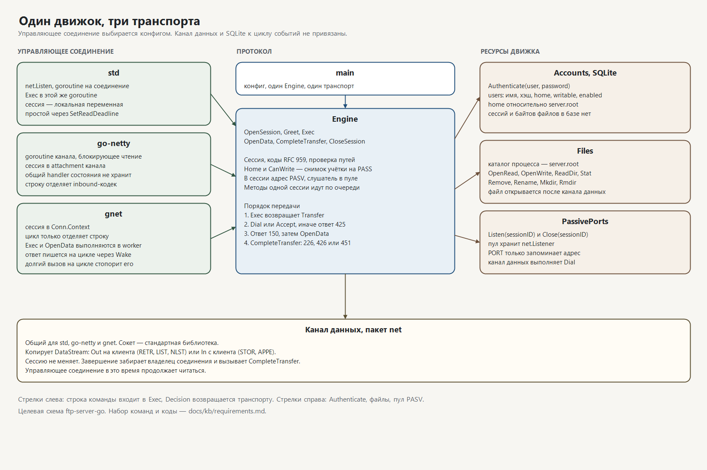
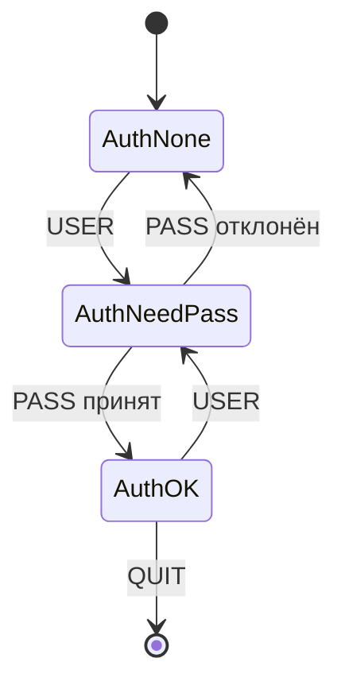
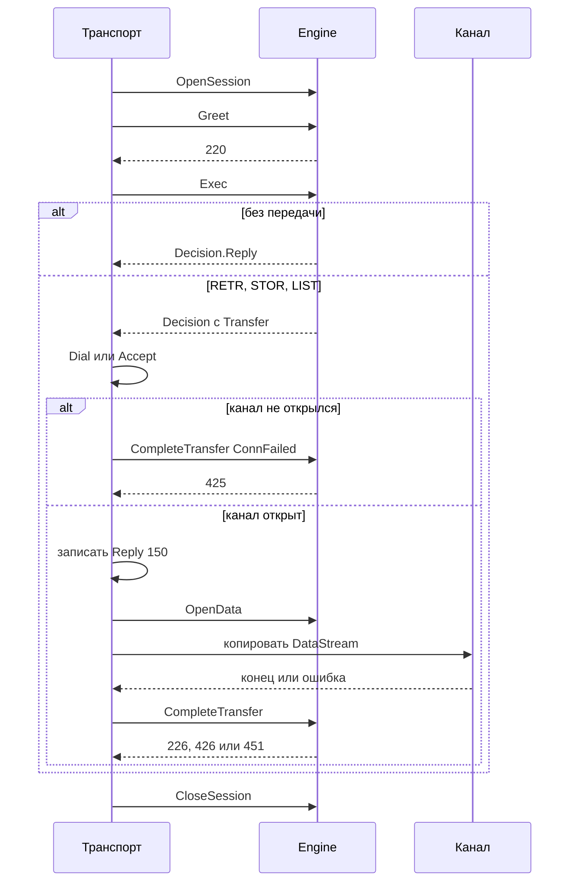

# Архитектура Go-сервера

Эта страница описывает, как в `ftp-server-go` раскладываются движок, транспорты и база и какими объектами они обмениваются. Один протоколный движок обслуживает три варианта управляющего соединения — стандартную библиотеку, go-netty и gnet, — а SQLite и канал данных у них общие. Обязательный набор команд и коды ответов здесь не вводятся: они остаются в [requirements.md](../../docs/kb/requirements.md).

Рядом лежат разборы самих библиотек, [go-netty](ref/go-netty.md) и [gnet](ref/gnet.md). Там разобрано, как устроены чужие циклы и каналы. Здесь — какие собственные объекты стоят между этими циклами и FTP. Рисунок ниже — карта владения, а не текст объяснения: в рамках только подписи, связный разбор идёт следом.

Текущий код к этой схеме ещё не приведён. В конце страницы показано, в каких местах он с ней расходится.



## Как устроено владение

Сборка начинается в `main`. Он читает конфигурацию, открывает SQLite, создаёт один экземпляр `Engine` и поднимает ровно один транспорт. Какой именно, задаёт конфиг: `std`, `gonetty` или `gnet`.

Дальше каждый слой держит своё состояние. Движок ведёт FTP-сессию: помнит, вошёл ли пользователь, в каком каталоге тот находится и какое представление выбрано, и решает, какой ответ вернуть на команду. Транспорт в смысл команды не вникает. Он принимает управляющее соединение, снимает с потока готовую строку и записывает обратно уже собранный текст, а по простою закрывает сокет. Пока идёт передача файла, канал данных открывает второе соединение и копирует по нему байты. Учётки лежат в SQLite, сами файлы — в каталоге `server.root`.

| Объект | Владелец | Что у него есть | Чего у него нет |
|---|---|---|---|
| `Session` | один владелец на соединение | вход, каталог, `TYPE`/`MODE`/`STRU`, адрес данных | `net.Conn`, канал go-netty, `gnet.Conn`, `*sql.DB` |
| `Engine` | процесс, один экземпляр | команды, политика путей, снимки учёток | карта сокетов |
| Транспорт | принятое управляющее соединение | сокет, разбор кадра, запись ответа | разбор смысла команды |
| Канал данных | одна передача | `Dial`/`Accept`, копирование `DataStream` | поля сессии |
| `PassivePorts` | процесс | `net.Listener` по идентификатору сессии | ответ клиенту |
| SQLite | процесс | учётки | сессии, текущий каталог, байты файлов |

Управляющее соединение продолжает читаться и во время передачи, поэтому канал данных живёт в своей goroutine. Если копирование файла оставить в том же цикле, который читает команды, event loop gnet остановится целиком, а позже некуда будет принять `ABOR`.

Из этого же следует, где вызывать методы движка. gnet ходит в базу и в файлы из worker-а: `Exec`, `OpenData` и `CompleteTransfer` внутри `OnTraffic` задержали бы остальные сокеты этого цикла. Сам цикл только отделяет строку и, когда worker закончил, пишет ответ через `Wake`. У std и go-netty на соединение и так приходится своя goroutine с блокирующим чтением, поэтому те же методы вызываются прямо в ней и чужих клиентов не задерживают.

На Windows к этому добавляется оговорка про сам gnet. Модель, разобранная в [справочнике](ref/gnet.md), построена на epoll и kqueue. Методы адаптера те же — `OnTraffic`, `Conn.Context`, `Wake`, — но здешний процесс ту unix-схему не исполняет, и сравнение скорости на этой машине её не покажет.

## Интерфейс Engine

Транспорты зависят от интерфейса `Engine`, а не от конкретной структуры. `New` возвращает этот интерфейс и сразу регистрирует команды внутри реализации. Снаружи карту пополнить нельзя, так что у трёх транспортов оказывается один и тот же набор.

```go
type Engine interface {
	OpenSession(remote string) *Session
	Greet(s *Session) Reply
	Exec(ctx context.Context, s *Session, line string) Decision
	OpenData(ctx context.Context, s *Session, t Transfer) (DataStream, error)
	CompleteTransfer(ctx context.Context, s *Session, result TransferResult) Reply
	CloseSession(s *Session, reason CloseReason) Reply
}

func New(accounts Accounts, files Files, ports PassivePorts) Engine
```

Методы идут по жизни соединения. `OpenSession` создаёт сессию в момент `accept` и сразу выставляет `AuthNone`, `TYPE A`, `MODE S` и `STRU F`, чтобы транспорт не собирал структуру сам и не забывал стартовые значения. `Greet` следом возвращает `220`: текст приветствия тогда один на все три транспорта. `Exec` вызывается на каждую готовую строку и возвращает `Decision`. `OpenData` открывает файл или листинг, когда канал данных уже установлен. `CompleteTransfer` ставит передаче итоговый код. `CloseSession` снимает пассивный слушатель и при необходимости возвращает прощальный ответ.

| Метод | Когда вызывается | Что возвращает |
|---|---|---|
| `OpenSession` | принят клиент | сессия с `AuthNone`, `TYPE A`, `MODE S`, `STRU F` |
| `Greet` | сразу после `OpenSession` | ответ `220` |
| `Exec` | готова строка команды | `Decision` |
| `OpenData` | канал данных уже установлен | поток файла или листинга |
| `CompleteTransfer` | передача закончилась или канал не открылся | `226`, `425`, `426` или `451` |
| `CloseSession` | управляющее соединение закрывается | прощальный ответ либо пустой `Reply` |

Отдельного `error` у `Exec` нет. Отказ протокола — синтаксис, неизвестная команда, неверный вход, недоступный путь — приходит внутри `Decision` кодами `501`, `502`, `530` или `550`. Если процесс останавливают и контекст отменён, движок отвечает `421` и ставит `Decision.Close`.

Строка к этому моменту уже очищена транспортом: с неё сняты CRLF и байты Telnet IAC. Движок считает командой первое слово и сравнивает его без учёта регистра. Всё, что стоит после первого пробела, остаётся одним аргументом, поэтому пробел в пароле или в пути не разрезает команду на части.

Нулевой код у `Reply` означает, что в сокет писать нечего. `CloseSession` пользуется этим дважды: когда клиент просто закрыл соединение и когда `QUIT` уже отправил `221` из `Exec`.

```go
type CloseReason int

const (
	CloseClient CloseReason = iota // EOF, ответ не слать
	CloseQuit                      // 221 уже отправлен
	CloseIdle                      // 421
	CloseShutdown                  // 421
)
```

На одну сессию методы вызываются по очереди и всегда с одного владельца. Канал данных к сессии не обращается: ему отдают только `DataStream`.

## Session

Сессия описывает одно управляющее соединение. Создаёт её только `OpenSession`, и в ней нет ни сокета, ни соединения с базой: первое принадлежит транспорту, второе остаётся за `Accounts`.

```go
type AuthState int

const (
	AuthNone AuthState = iota
	AuthNeedPass
	AuthOK
)

type DataMode int

const (
	DataNone DataMode = iota
	DataActive  // PORT
	DataPassive // PASV
)

type Representation struct {
	Type byte // 'A' или 'I'; старт — 'A'
	Mode byte // 'S'
	Stru byte // 'F'
}

type DataEndpoint struct {
	Mode DataMode
	Host string
	Port int
}

type Session struct {
	ID     string
	Remote string

	Auth     AuthState
	User     string
	Home     string // абсолютный корень учётки, уже проверенный
	CanWrite bool

	Dir  string // каталог внутри Home
	Repr Representation

	Data       *DataEndpoint // последний PORT или PASV
	RenameFrom string        // путь после RNFR, пока не пришёл RNTO
}
```

`Home` и `CanWrite` заполняются в момент успешного `PASS` и дальше живут как снимок учётки. Пока сессия открыта, движок не перечитывает строку пользователя из базы. Смена каталога и `TYPE` в SQLite не попадают: это состояние разговора, а не учётной записи.

Повторный `USER` на уже открытой сессии снова требует пароль и переводит её в `AuthNeedPass`. `RenameFrom` живёт только между `RNFR` и `RNTO`: любая другая команда его сбрасывает.



Жизнь сокета — принят, закрыт, оборван — в этих полях не хранится. У трёх транспортов она устроена по-разному, и видит её транспорт.

## Decision и объекты передачи

`Decision` — это всё, что движок сообщает транспорту после одной команды: какой текст записать, нужно ли закрыть управляющее соединение и предстоит ли передача байтов.

```go
type Reply struct {
	Code  FtpCode
	Lines []string
}

type Decision struct {
	Reply    Reply
	Close    bool
	Transfer *Transfer
}

type TransferKind int

const (
	TransferRetr TransferKind = iota
	TransferStor
	TransferAppe
	TransferList
	TransferNlst
)

type Transfer struct {
	Kind TransferKind
	Path string // абсолютный путь внутри Home
}

type DataStream struct {
	Out io.ReadCloser  // RETR, LIST, NLST
	In  io.WriteCloser // STOR, APPE
}

type TransferStatus int

const (
	TransferDone TransferStatus = iota
	TransferConnFailed // 425, канал данных не открылся
	TransferAborted    // 426, обрыв посередине
	TransferLocalError // 451, файл или каталог
)

type TransferResult struct {
	Kind   TransferKind
	Status TransferStatus
	Err    error // в журнал; клиенту уходит код из Reply
}
```

У `DataStream` заполнена одна сторона. Для `RETR`, `LIST` и `NLST` канал читает `Out` и пишет в сокет клиента. Для `STOR` и `APPE` он читает сокет и пишет в `In`. Когда копирование заканчивается, поток закрывается. Поле `Err` в результате нужно журналу: клиент видит только код, который движок положил в `Reply`.

Команды, которым канал данных не нужен, заполняют только `Reply`. `PORT` запоминает адрес в `Session.Data` и отвечает `200`. `PASV` просит порт у `PassivePorts`, кладёт в сессию тот адрес, который уйдёт клиенту ответом `227`, а сам `net.Listener` оставляет в пуле. `RETR`, `STOR`, `APPE`, `LIST` и `NLST` возвращают предварительный ответ вместе с `Transfer`.

Дальше транспорт держится одного порядка. Сначала он открывает канал данных. Если `Dial` или `Accept` не удался, предварительные `150` клиенту не отправляются: в управляющее соединение уходит только `425` из `CompleteTransfer`. Если канал открылся, транспорт пишет `150`, вызывает `OpenData` и отдаёт поток каналу данных. Чем копирование кончилось, решает уже `CompleteTransfer`: `226` при успехе, `426` при обрыве канала и `451` при ошибке файла.



`QUIT` проходит через тот же `Exec` и возвращает `221` вместе с `Decision.Close`. Следующий `CloseSession` с причиной `CloseQuit` в сокет больше ничего не пишет, но пассивный слушатель этой сессии снимает.

## Зависимости конструктора

`Accounts`, `Files` и `PassivePorts` в интерфейс `Engine` не входят. Их реализуют соседние пакеты и передают в `New`, а движок вызывает их сам, пока исполняет команду.

```go
type Account struct {
	Name     string
	Home     string // относительно server.root
	CanWrite bool
}

type Accounts interface {
	Authenticate(ctx context.Context, user, password string) (Account, error)
}

type FileInfo struct {
	Name  string
	Size  int64
	IsDir bool
	MTime time.Time
}

type DirEntry struct {
	Name  string
	IsDir bool
	Size  int64
	MTime time.Time
}

type Files interface {
	OpenRead(ctx context.Context, path string) (io.ReadCloser, error)
	OpenWrite(ctx context.Context, path string, append bool) (io.WriteCloser, error)
	ReadDir(ctx context.Context, path string) ([]DirEntry, error)
	Stat(ctx context.Context, path string) (FileInfo, error)
	Remove(ctx context.Context, path string) error
	Rename(ctx context.Context, from, to string) error
	Mkdir(ctx context.Context, path string) error
	Rmdir(ctx context.Context, path string) error
}

type PassivePorts interface {
	Listen(ctx context.Context, sessionID string) (host string, port int, error)
	Close(sessionID string)
}
```

Корень файлов у процесса один: это `server.root` из конфига. `Account.Home` хранится относительно него. На `PASS` движок склеивает оба пути, чистит результат и проверяет, что тот остаётся внутри `server.root`. Абсолютный путь, записанный в базе, сам по себе клиенту каталог не открывает.

Слушатель пассивного режима появляется внутри `Exec` команды `PASV`. `PassivePorts.Listen` запоминает его под идентификатором сессии и возвращает движку адрес, который попадёт в ответ `227`. `CloseSession` вызывает `ports.Close`. Исходящее подключение по `PORT` откладывается до канала данных: сокет нужен только когда передача уже началась.

Набор команд остаётся неэкспортируемой картой внутри реализации. Обработчик получает сессию и один аргумент и возвращает `Decision`. Транспорт до этой карты не добирается.

## SQLite

Базу открывает и закрывает `main`. К моменту `accept` она уже отвечает на `Ping`, а при остановке процесса закрывается там же. Движок получает интерфейс `Accounts` и `*sql.DB` не видит.

Драйвер — `modernc.org/sqlite`. Он собирается без cgo, так что на Windows не нужен отдельный набор инструментов для C. DSN в конфиг не кладётся: `store.Open` собирает его из пути и таймаута и сразу включает WAL, внешние ключи и `busy_timeout`.

`file:<path>?mode=rwc&_pragma=busy_timeout(<мс>)&_pragma=journal_mode(WAL)&_pragma=foreign_keys(ON)`

Относительный путь считается от рабочего каталога процесса, каталог файла создаётся до открытия. Размер пула берётся из конфига, запрос идёт с контекстом, чтобы остановка процесса прерывала ожидание блокировки.

Транзакция не длиннее одного вызова `Authenticate`. Держать её открытой на время `RETR` нельзя: писатель у SQLite один, а передача файла длится столько, сколько качается тело.

```json
"database": {
  "driver": "sqlite",
  "path": "data/ftp.db",
  "maxOpenConns": 4,
  "busyTimeoutMs": 5000
}
```

```go
type DatabaseConfig struct {
	Driver        string `mapstructure:"driver"`
	Path          string `mapstructure:"path"`
	MaxOpenConns  int    `mapstructure:"max_open_conns"`
	BusyTimeoutMs int    `mapstructure:"busy_timeout_ms"`
}
```

Ключи подписаны тегом `mapstructure`, потому что viper читает именно его. Дефолты и файл используют одни и те же имена, без смеси `snake_case` и `camelCase`, из-за которой сейчас часть дефолтов не попадает в поля.

На этом шаге хватает одной таблицы `users`.

| Колонка | Смысл |
|---|---|
| `id` | целый ключ |
| `name` | имя входа, уникальное без учёта регистра |
| `password_hash` | bcrypt или argon2id |
| `home` | каталог относительно `server.root` |
| `writable` | разрешены ли запись, удаление и переименование |
| `enabled` | выключенная учётка получает `530` |

Анонимный вход в коде не выделяется. Это обычная строка `anonymous` с пустым паролем и запретом записи.

Пароль в открытом виде, сессии, текущий каталог, адреса `PORT` и `PASV` и содержимое файлов в эту базу не пишутся. Сессия живёт в памяти, пока открыт сокет, а байты файла остаются на диске.

## Пакеты

```
internal/service/engine          интерфейс Engine, Session, Decision, команды
internal/store                   SQLite и Accounts
internal/fs                      Files поверх server.root
internal/data                    канал данных и PassivePorts на net
internal/service/server/std      транспорт стандартной библиотеки
internal/service/server/gonetty  транспорт go-netty
internal/service/server/gnet     транспорт gnet
```

Фабрика смотрит имя транспорта в конфиге и возвращает `service.Service`. У реализаций разные `Name` и `Run`, но движок, база, каталог и пул портов передаются им одни и те же.

Канал данных при любом выборе остаётся на `net` из стандартной библиотеки. У go-netty публичный `Listener` не отдаёт адрес, к которому реально привязался сокет, а gnet не умеет добавить `PASV`-порт уже после старта. Оба ограничения разобраны в справочниках `ref/`. Сравнение трёх транспортов остаётся на том, чем они действительно различаются: как читается команда и кто владеет сессией.

## Чем текущий код отличается

Сейчас `Engine` — структура с картой обработчиков, а не интерфейс с этой страницы. `Exec` принимает строку и сам возвращает текст ответа, сессию в него не передают. `Session` помнит имя пользователя и статус сокета. `USER` записывает имя в `context`, который вызывающий код тут же теряет, и отвечает `200`, хотя для принятого имени в наборе кодов уже есть `331`.

До `Exec` выполнение всё равно не доходит. `handleConnection` отвечает `502` на любую непустую команду, а `Setup`, где регистрируются `USER` и `PASS`, из `main` не вызывается. В `server` заведён свой набор кодов, параллельный `FtpCode`. В конфиге нет корня каталога, имени транспорта и блока базы.
