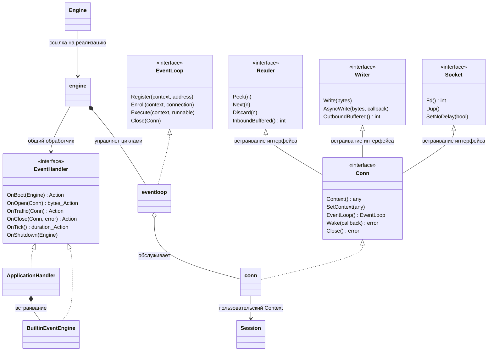
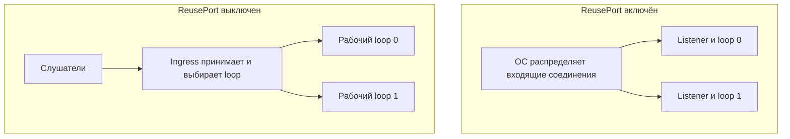
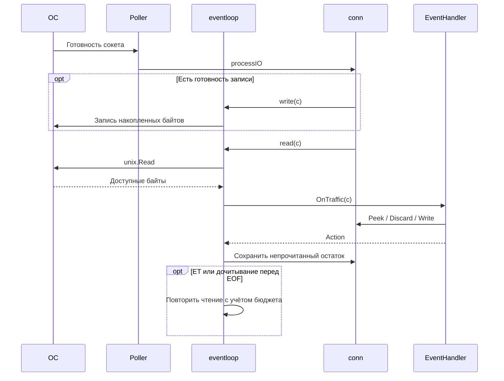
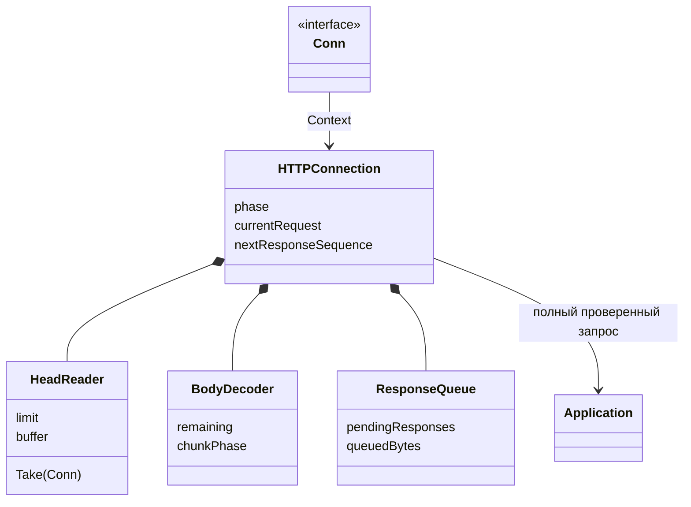
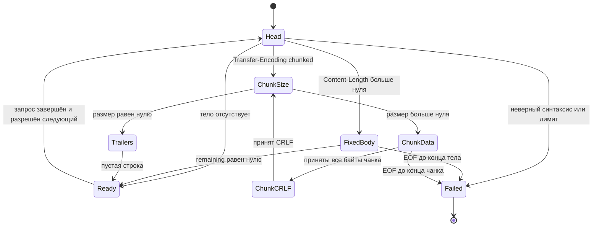
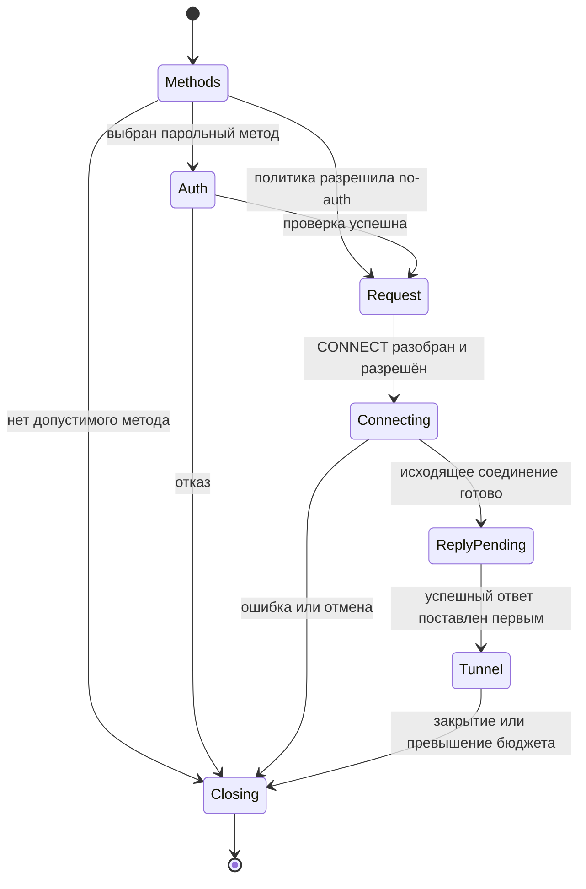
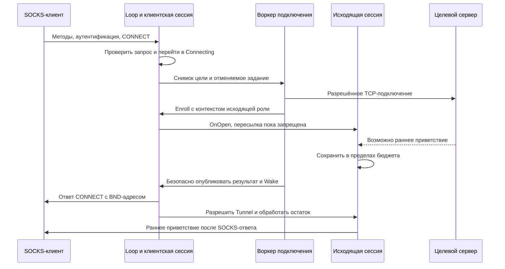
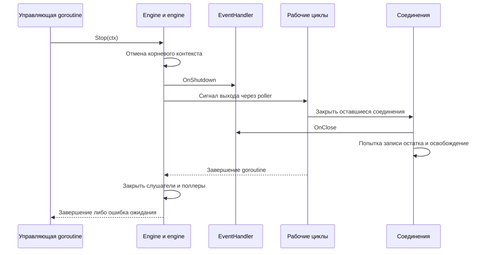

# gnet: объекты, методы и устройство событийного сервера

Эта глава объясняет не только то, из каких частей состоит [gnet](https://github.com/panjf2000/gnet), но и как ими пользоваться: кто создаёт соединение, где хранится его состояние, когда допустимо читать и писать и каким образом результат фоновой работы возвращается в обработчик. Сначала рассматриваются публичные интерфейсы и их отношения, затем внутренний путь события, а после него — законченные небольшие примеры и подробные разборы HTTP и SOCKS5. Материал относится к Go-подпроекту; общие требования к FTP остаются в [базе требований протокола](../../../docs/kb/requirements.md).

Разбор привязан к исходникам `441457f07983e2e2fbc12a33c05fa68ffdc5ee47` от 03.07.2026, а не к произвольной последней версии. Основной предмет — Unix-реализация gnet v2 с epoll/kqueue; модуль объявляет `go 1.20`, лицензия проекта — Apache-2.0. Windows-ветка рассматривается отдельно: переносимость интерфейса не означает одинакового устройства ввода-вывода. Ссылки на исходники закреплены за этим коммитом; блоки с сигнатурами описывают API, а учебные реализации явно отделены от готового сетевого сервера.

## 1. Главная идея: соединение принадлежит циклу событий

В обычном Go-сервере можно выделить соединению goroutine и последовательно вызывать блокирующие операции. gnet выбирает другую организацию: один цикл событий обслуживает множество соединений, получает уведомления о готовности сокетов и вызывает прикладной обработчик. Пока обработчик не вернулся, этот цикл не может перейти к следующему соединению. Поэтому запрос к базе данных, DNS-разрешение, ожидание канала и чтение большого файла внутри обработчика задерживают не одного клиента, а всех клиентов того же цикла.

Это не означает, что gnet работает без goroutine. Циклы событий сами запускаются в goroutine, а блокирующую работу приложение может поручать отдельным исполнителям. Отличие состоит в **владении состоянием**: поля соединения и его входные/выходные буферы обслуживаются владельцем — определённым event loop. Фоновая goroutine передаёт результат владельцу через предусмотренные API, а не начинает произвольно менять это состояние.

Фреймворк предоставляет транспорт и диспетчеризацию событий, но не определяет границы прикладных сообщений. Один `OnTraffic` может содержать часть HTTP-заголовка, несколько запросов сразу или вообще не содержать новых байтов, если его вызвал `Wake`. Ни число событий, ни число TCP-пакетов не задают число команд протокола.

### Иерархия интерфейсов и композиция объектов

В Go здесь нет иерархии классов в смысле Java. `Conn` объединяет интерфейсы `Reader`, `Writer` и `Socket`; внутренняя структура `conn` удовлетворяет этому набору методов. `BuiltinEventEngine` встраивается в прикладную структуру, чтобы предоставить реализации ненужных ей callbacks. `Engine`, напротив, является небольшим значением со ссылкой на внутренний `engine`, а не базовым классом обработчика.



Диаграмма разделяет реализацию интерфейса, встраивание и владение; подписи методов в ней сокращены ради читаемости. Точные сигнатуры приведены ниже. Один `ApplicationHandler`, переданный при запуске, доступен нескольким циклам: поле `currentRequest` на таком объекте стало бы общим состоянием клиентов. Текущий запрос, фаза парсера и счётчики конкретного соединения обычно принадлежат `Session`, закреплённой в `Conn.Context()`. Основание этой модели видно в [объявлении Conn][src-conn-api] и [создании eventloop][src-engine-start].

## 2. Запуск: Run, Rotate, Options и Option

### Run и Rotate: когда нужен один слушатель, а когда несколько

Публичные точки входа имеют следующие сигнатуры ([gnet.go:675–717][src-run]).

```go
func Run(eventHandler EventHandler, protoAddr string, opts ...Option) error
func Rotate(eventHandler EventHandler, addrs []string, opts ...Option) error
```

`Run` создаёт слушатель для одного адреса и остаётся внутри обслуживания до остановки движка. Возвращённая ошибка может означать, например, невозможность занять порт. Это не конструктор, который немедленно отдаёт работающий сервер: код после успешного запуска продолжится после выхода из обслуживания. Если процесс должен одновременно обслуживать другие компоненты, организацию goroutine и ожидания завершения задаёт приложение.

`Rotate` запускает один движок с несколькими слушателями и одним обработчиком событий. Второй аргумент — именно `[]string`, а не вариативный список строк. Этот вариант нужен, когда одна логика должна принимать соединения на нескольких заранее известных адресах. Различать их можно по `Conn.LocalAddr()` внутри обработчика. `Rotate` не является методом динамического добавления и удаления портов уже работающего движка.

Адрес должен явно задавать схему `tcp`, `tcp4`, `tcp6`, `udp`, `udp4`, `udp6` или `unix`. Хотя комментарий к `Run` обещает TCP по умолчанию, фактический `parseProtoAddr` в этой ревизии отвергает пустую схему; поэтому для TCP передают адрес с префиксом `tcp://` ([gnet.go:762–798](https://github.com/panjf2000/gnet/blob/441457f07983e2e2fbc12a33c05fa68ffdc5ee47/gnet.go#L762-L798)). Имя `Run` не делает UDP соединением с TCP-жизненным циклом: для входящей датаграммы создаётся краткоживущий контекст обработки, и правила хранения `Conn` из TCP-примера к нему не переносятся автоматически.

### Options и функции With: выбор поведения до запуска

`Options` хранит конфигурацию, а `Option` имеет тип `func(*Options)`. Функции `WithMulticore`, `WithReadBufferCap` и остальные меняют отдельные поля до создания движка. `WithOptions(options Options)` копирует всю структуру; поскольку функции применяются последовательно, поздний `WithOptions` заменяет и ранее заданные значения. Это существенно, если библиотечный код объединяет базовую конфигурацию и настройки вызывающей стороны ([options.go:23–31, 162–167][src-options]).

`WithMulticore(true)` выбирает число циклов по `runtime.NumCPU()`. Положительный `WithNumEventLoop(n)` переопределяет этот выбор; ноль не означает «не запускать ни одного цикла». Внутренняя функция дополнительно ограничивает число представимым индексом цикла. Увеличивать его полезно, когда работа действительно распределяется между соединениями; отдельный медленный обработчик внутри своего цикла от этого не станет неблокирующим ([gnet.go:801–813][src-loop-count]).

`WithReadBufferCap(n)` задаёт размер рабочего буфера чтения цикла. `WithWriteBufferCap(n)` задаёт размер статической части выходного буфера, **но не предел очереди ответа**: переполнение продолжается в связном списке. Значения нормализуются до степеней двойки, а базовое значение равно 64 KiB. Для защиты от медленных клиентов требуется самостоятельный предел накопленных байтов, а не только эта настройка ([gnet.go:584–608][src-listeners], [elastic.Buffer][src-elastic]).

`WithSocketRecvBuffer` и `WithSocketSendBuffer` относятся к буферам операционной системы, а не к описанным Go-буферам. `WithTCPNoDelay(gnet.TCPNoDelay)` отключает алгоритм Нейгла; ему передаётся `TCPSocketOpt`, не `bool`. `WithTCPKeepAlive`, `WithTCPKeepInterval` и `WithTCPKeepCount` настраивают обнаружение исчезнувшего TCP-пира. Keepalive не заменяет прикладной таймаут «клиент начал команду, но не закончил её».

`WithReusePort`, `WithLoadBalancing` и `WithLockOSThread` меняют топологию и размещение исполнения, описанные далее. `LockOSThread` связывает goroutine цикла с потоком ОС, что бывает нужно при работе с thread-local состоянием или определёнными cgo-библиотеками; это не универсальная настройка «сделать быстрее». `WithTicker(true)` разрешает периодические `OnTick`. `WithEdgeTriggeredIO` меняет режим готовности сокетов; положительный `WithEdgeTriggeredIOChunk` также включает его и задаёт бюджет чтения/записи за проход.

Для журнала предусмотрены `WithLogPath`, `WithLogLevel` и `WithLogger`. Собственный ненулевой `logging.Logger` имеет приоритет над файловым вариантом. `WithReuseAddr` относится к повторному связыванию адреса, `WithBindToDevice` — к выбору сетевого интерфейса на Linux, а `WithMulticastInterfaceIndex` — к UDP multicast. Полное определение этих настроек находится в [Options][src-options]; их не следует включать все сразу без конкретной эксплуатационной причины.

## 3. Engine: управление работающим сервером

`Engine` приложение получает в `OnBoot`. Значение можно сохранить у управляющего компонента, чтобы позднее запросить статистику или остановку. Копирование `Engine` не создаёт нового сервера: копии ссылаются на один внутренний объект. Собственный `Engine{}` не заменяет полученное от библиотеки значение ([gnet.go:53–172][src-engine-api]).

### Validate и CountConnections

`Validate() error` проверяет наличие внутреннего движка, слушателей и отсутствие завершённой остановки. Он полезен для диагностики управляющего API, но не подтверждает, что следующий вызов не встретится с параллельным завершением работы.

`CountConnections() int` суммирует счётчики циклов и возвращает `-1`, если `Validate` не прошёл. Значение удобно для наблюдения за нагрузкой; оно не является атомарным снимком всех клиентов и само по себе не обеспечивает строгий лимит подключений. Проверка «сейчас меньше лимита, значит можно принять» требует отдельной согласованной процедуры допуска.

### Register: поручить движку выбор цикла

`Register(ctx context.Context) (<-chan RegisteredResult, error)` принимает не адрес отдельным параметром, а контекст, подготовленный `NewNetAddrContext` либо `NewNetConnContext`. В первом случае библиотека подключается к адресу, во втором принимает уже установленное соединение. Если в контексте присутствуют оба значения, существующий `net.Conn` имеет приоритет.

У вызова два уровня результата. Возвращённый `error` относится к проверке и постановке работы; канал позднее приносит `RegisteredResult{Conn, Err}`. Поэтому отсутствие немедленной ошибки ещё не означает успешного подключения. Ожидание результата блокирует вызывающую goroutine, и внутри callback цикла его выполнять нельзя.

Этот метод выбирает цикл по балансировщику движка. Когда исходящее соединение должно принадлежать тому же циклу, что и входящее, используют `c.EventLoop().Register` или `Enroll`. Кроме того, комментарий к `Engine.Register` в рассматриваемой версии прямо предупреждает о гонке при поздних конкурентных вызовах с обычным `RoundRobin`: его счётчик не синхронизирован. Такое предупреждение нельзя отменить предположением, что все методы публичного фасада автоматически потокобезопасны.

### Dup и DupListener: специальные операции со слушателем

`Dup() (int, error)` дублирует дескриптор единственного слушателя; при нескольких слушателях возвращает ошибку. `DupListener(network, addr string) (int, error)` выбирает конкретный слушатель по сети и адресу. Эти методы нужны для специальных схем передачи дескриптора, а не для обычной отправки ответа клиенту. Получившая копию сторона обязана закрыть её сама; закрытие оригинального дескриптора не закрывает копию.

### Stop: остановка механизма, а не завершение бизнес-операций

`Stop(ctx context.Context) error` инициирует остановку и ждёт флага её завершения либо окончания переданного контекста. Если ожидание прервано по deadline, запрос остановки уже был отправлен: это не транзакция с откатом. Вызов должен идти из управляющей goroutine, а не из обработчика соединения, иначе ожидание может удерживать тот самый цикл, завершения которого ждут. Из callback для остановки сервера возвращают `gnet.Shutdown`.

Устаревшая глобальная функция `gnet.Stop(ctx, protoAddr)` ищет движок по адресу. Авторы рекомендуют `Engine.Stop`, поскольку несколько движков на одном адресе с reuse-настройками делают такой поиск неоднозначным. Остановка не гарантирует завершения HTTP-ответа или файловой передачи; фактическая последовательность показана в разделе жизненного цикла.

В этой версии нет действующего публичного набора `Engine.AsyncWrite`, `Engine.Wake` и `Engine.Close` по GFD: соответствующий текст находится внутри блочного комментария в `gnet.go:174–226`. Для обращения к конкретному соединению используется `Conn`.

## 4. EventHandler и BuiltinEventEngine: точки входа приложения

Обработчик задаёт поведение сервера, но сам не владеет сокетным циклом. Его методы вызываются фреймворком; приложение возвращает управление и указание `Action`. Полный контракт приведён в [gnet.go:486–554][src-handler].

```go
type EventHandler interface {
    OnBoot(eng Engine) Action
    OnShutdown(eng Engine)
    OnOpen(c Conn) ([]byte, Action)
    OnClose(c Conn, err error) Action
    OnTraffic(c Conn) Action
    OnTick() (time.Duration, Action)
}
```

`BuiltinEventEngine` реализует этот интерфейс пустыми методами. Встраивание `gnet.BuiltinEventEngine` в свою структуру позволяет переопределить только нужные события. Это удобство реализации интерфейса, а не отдельный движок, запускаемый при создании структуры. Особенно важно не включать ticker, оставив встроенный `OnTick`: его нулевая задержка не задаёт полезного периода.

### OnBoot: сохранить управляющий объект и завершить инициализацию

`OnBoot(eng Engine) Action` вызывается после подготовки слушателей, но до `engine.start`, который создаёт и запускает рабочие циклы. Здесь уместно сохранить `Engine` и проверить готовность прикладных зависимостей. Если запуск продолжать нельзя, возвращают `Shutdown`. Не следует ждать здесь работы, которую должен выполнить ещё не запущенный loop, либо считать полученный `Engine` подтверждением, что все циклы уже обслуживают события ([engine_unix.go:260–272][src-engine-run]).

### OnOpen: создать состояние конкретного соединения

`OnOpen(c Conn) ([]byte, Action)` получает новое потоковое соединение. Типичное действие — создать состояние парсера через `c.SetContext`, а возвращённые байты использовать для короткого приветствия протокола. Большой файл лучше не возвращать как `out`: он требует отдельного управления передачей и памятью.

Событие вызывается и для принятого клиента, и для исходящего соединения, зарегистрированного через loop. Во втором случае пользовательское состояние уже могло прийти через `gnet.NewContext`. Безусловный `SetContext(newSession)` затёр бы сведения о роли исходящего соединения. Поэтому приложение с несколькими ролями проверяет переданный контекст и инициализирует только нужный тип сессии.

### OnTraffic: обработать доступное, а не дождаться недостающего

`OnTraffic(c Conn) Action` читает уже доступные байты. Если полного сообщения ещё нет, обработчик сохраняет фазу и возвращает `None`; gnet удержит непрочитанный остаток. Если сообщений несколько, их можно разобрать за один вызов, соблюдая бюджет работы. Оставление уже готового сообщения «до следующего сетевого пакета» опасно: нового пакета может не быть, поэтому сознательная уступка цикла требует собственного планирования продолжения.

`Wake` также вызывает `OnTraffic`, но без чтения сокета. Следовательно, нулевой `InboundBuffered()` не является ошибкой. Обычно обработчик сначала проверяет опубликованные фоновые результаты и состояние завершения, а затем разбирает байты.

### OnClose: освободить сессию и отменить её работу

`OnClose(c Conn, err error) Action` сообщает о логическом закрытии и последней известной ошибке. В Unix-реализации соединение уже удаляется из набора активных, но callback вызывается **до** очистки контекста и окончательного `unix.Close`. Здесь можно отменить фоновые задания, убрать сессию из реестра, закрыть связанные ресурсы и записать итоговую статистику. Начинать новый ответ на закрываемом соединении не следует ([eventloop_unix.go:363–403][src-loop-close]).

Возвращаемый `Shutdown` останавливает движок; обычное завершение очистки возвращает `None`. Ошибка `io.EOF` не является публичной командой «закрылась только входящая половина»: стандартный путь gnet закрывает соединение целиком, поэтому прозрачный TCP half-close нельзя вывести из одного аргумента `err`.

### OnTick: периодический сигнал вне владельца соединения

`OnTick() (time.Duration, Action)` вызывается, только если включён ticker. Возвращаемая длительность задаёт ожидание до следующего вызова. Это подходит для запуска периодической проверки сроков, но не разрешает напрямую читать `Conn.Context()` или `OutboundBuffered()` у произвольного соединения.

В исследуемой Unix-версии ticker работает отдельной goroutine: при `ReusePort` он связан с нулевым loop, при ingress-топологии — с ingress. Такая привязка не превращает выполнение ticker в callback на владельце соединения. Общий реестр должен быть синхронизирован, а проверка локального состояния передаваться владельцу через `Execute` или `Wake`. Значение `Close` здесь не относится к конкретному клиенту и игнорируется; `Shutdown` отправляет сигнал остановки ([engine_unix.go:127–131, 179–184][src-engine-start], [eventloop_unix.go:416–449][src-ticker]).

### OnShutdown: уведомление о начале остановки

`OnShutdown(eng Engine)` нужен для реакции приложения на остановку движка. Комментарий публичного интерфейса утверждает, что циклы уже закрыты, но фактический `engine.stop` вызывает callback **до** отправки сигналов завершения циклам. В этой главе используется порядок реализации, а не противоречащая ему формулировка комментария. Поэтому освобождать из `OnShutdown` общие данные, которые ещё используются `OnTraffic` или `OnClose`, без координации нельзя.

### Action: что означает результат callback

`None` оставляет обслуживание в обычном режиме, `Close` инициирует закрытие текущего соединения в событиях, где оно есть, а `Shutdown` останавливает движок. `None` не означает, что запрос успешно обработан; `Close` не означает, что все байты достигли клиента. В дополнение к `Action` существует конкурентно-безопасный `Conn.Close()`, так что возвращаемое значение не является единственным способом управлять жизненным циклом.

## 5. Conn: состояние, чтение, запись и сокет

`Conn` представляет соединение и принадлежит одному loop. Его интерфейс похож на `net.Conn`, но совпадение названий не даёт прежних гарантий блокирующего чтения, работающих дедлайнов или конкурентной безопасности всех методов. Чтобы выбрать метод, сначала определяют, находитесь ли вы на владельце соединения и кому принадлежат передаваемые байты.

### Context, SafeContext и адреса

`Context() any` и `SetContext(any)` работают с обычным полем, предназначенным для локального состояния loop. `SafeContext() any` и `SetSafeContext(any)` используют отдельный атомарный слот. В данной реализации это **два разных поля**: последующий `SetContext` не обновляет `SafeContext`, а `SetSafeContext` не обновляет обычный контекст. При регистрации через `Enroll` библиотека первоначально записывает payload в оба, что не отменяет их дальнейшей независимости ([connection_unix.go:464–467, 566–575][src-context-impl]).

Атомарность слота не защищает объект, на который он указывает. Если `SafeContext` вернул `*Session`, одновременные изменения `Session.phase` всё равно требуют синхронизации. Практически удобно держать машину протокола только на loop, а с воркером обмениваться неизменяемым результатом через канал или атомарный указатель.

`LocalAddr() net.Addr` и `RemoteAddr() net.Addr` используют внутри событий владельца. Для передачи адреса в фоновую работу предварительно сохраняют строку через `.String()`. Адрес исходящего соединения нужен, например, при формировании SOCKS5 `BND.ADDR`; удалённый адрес входящего соединения — для журнала и политики доступа. `EventLoop() EventLoop` предоставляет ссылку на владельца и помечен как конкурентно-безопасный.

### Reader: Peek, Next, Discard и InboundBuffered

`Peek(n int) ([]byte, error)` смотрит на ближайшие `n` байт, не сдвигая курсор. Он удобен, когда сначала надо прочитать длину или тип адреса и только затем решить, достаточно ли данных для всего сообщения. При нехватке возвращается `io.ErrShortBuffer`, а не частичный пакет. Можно заранее проверить `InboundBuffered()` или отдельно распознать эту ошибку; обе стратегии корректны.

`Next(n int) ([]byte, error)` возвращает байты и сразу потребляет их. Он подходит, когда размер целого сообщения уже известен и возвращённые данные будут обработаны немедленно. `Discard(n int) (int, error)` потребляет байты без выдачи содержимого; типичный порядок парсера — `Peek`, проверка и извлечение полей, затем `Discard`. Нельзя продолжать читать поля через прежний срез после `Discard`.

`InboundBuffered() int` показывает сумму остатка предыдущих чтений и данных текущего чтения. Это локальный счётчик доступных приложению байтов, не размер TCP receive buffer. В рассматриваемой реализации `Peek(0)` и `Next(0)` означают «всё доступное», а `Discard(0)` удаляет всё доступное. Поэтому нулевой размер из арифметики незавершённого сообщения нельзя без проверки передавать в `Discard` ([connection_unix.go:333–406][src-reader-impl]).

Срез из `Peek` нельзя сохранять после потребления или передавать другой goroutine. Для `Next` интерфейс также запрещает использование в новой goroutine. Практическая безопасная граница для заимствованных байтов — текущий callback; долговечный объект сообщения должен владеть копией. Название метода не обещает zero-copy: при объединении данных из разных буферов реализация может выделить и заполнить промежуточный срез.

### Read и WriteTo: стандартные интерфейсы с нестандартным ожиданием

`Read(p []byte) (int, error)` копирует доступное в ваш буфер, но не ждёт следующего сетевого события. На пустом входе при непустом `p` Unix-реализация возвращает `io.ErrShortBuffer`. Поэтому `http.ReadRequest(bufio.NewReader(c))` не превращается в корректный блокирующий HTTP-парсер: он может получить временную нехватку данных посередине заголовка или тела.

`WriteTo(w io.Writer) (int64, error)` переносит доступные входные байты в получателя. Это не разрешение писать прямо на диск из event loop: если `w.Write` блокирует, блокируется и loop. Метод применим, когда поведение приёмника известно и укладывается в бюджет callback, например при переносе ограниченного блока в память. Оба метода относятся к неконкурентному `Reader` ([gnet.go:228–257][src-reader-api], [connection_unix.go:314–331, 439–450][src-reader-impl]).

### Write, Writev, Flush и OutboundBuffered

`Write(p []byte) (int, error)` вызывают на владельце соединения. Для TCP он пытается записать данные в сокет, а неотправленную часть сохраняет в выходной очереди. Если очередь уже непуста, новые данные присоединяются к ней, сохраняя порядок. Поэтому успешное принятие `len(p)` байт не доказывает отправку всех байтов в ядро и тем более получение их приложением клиента ([connection_unix.go:142–185][src-write-impl]).

`Writev(bs [][]byte) (int, error)` служит тому же для нескольких фрагментов: например, заголовка, тела и разделителя без предварительного склеивания в один срез. Unix-реализация может менять элементы переданного внешнего `[][]byte` при обработке частичной записи; не стоит использовать этот внешний срез как неизменяемый общий шаблон. `Write` и `Writev` не предназначены для вызова из произвольной goroutine.

`Flush() error` пытается выгрузить уже накопленное в сокет. При `EAGAIN` очередь может остаться непустой: это попытка продвинуть запись, а не ожидание полного завершения. `OutboundBuffered() int` показывает оставшиеся байты в библиотеке; его читают на владельце. Даже ноль означает только отсутствие локальной очереди, а не подтверждение обработки ответа клиентом.

`ReadFrom(r io.Reader) (int64, error)` также входит в `Writer`, но в этой версии непосредственно вызывает `outboundBuffer.ReadFrom(r)`. Он может вычитать источник в память, не является sendfile и не даёт автоматического ограничения памяти или безопасного фонового чтения файла. Для больших источников требуется самостоятельный ограниченный цикл передачи, а не универсальное `io.Copy(c, file)` внутри `OnTraffic` ([connection_unix.go:435–437][src-reader-impl]).

### SendTo: отдельный путь для UDP

`SendTo(buf []byte, addr net.Addr) (int, error)` отправляет датаграмму конкретному адресу и вызывается на владельце. Он нужен, когда адрес назначения отличается от адреса, связанного с текущим UDP-событием; для обычного ответа отправителю документация рекомендует `Conn.Write`. На потоковом сокете `SendTo` возвращает `ErrUnsupportedOp`, а `Writev` и `AsyncWritev` в Unix-ветке не поддерживают UDP ([connection_unix.go:408–432, 516–521][src-async]).

Входящая серверная UDP-датаграмма не создаёт долговечной TCP-сессии с парой `OnOpen`/`OnClose`: `readUDP` формирует объект для обработки пакета и освобождает его данные после callback. Если протоколу нужна ассоциация из нескольких датаграмм, приложение хранит её в собственном ограниченном реестре, а не сохраняет этот `Conn` как бессрочную сессию. Важны и его срок жизни, и правила конкурентного доступа.

### AsyncWrite и AsyncWritev: передать запись владельцу

`AsyncWrite(buf []byte, callback AsyncCallback) error` и `AsyncWritev(bs [][]byte, callback AsyncCallback) error` позволяют запросить запись из внешней goroutine. Для потокового соединения операция ставится в очередь поллера, а реальная запись выполняется позже на владельце. Callback имеет сигнатуру `func(c Conn, err error) error` и тоже не должен блокировать.

Входные срезы не копируются при постановке задачи: `asyncWriteHook` хранит ссылку на `buf`. Неизменность байтов должна сохраняться до callback; для `AsyncWritev` это относится и к внешнему срезу, и к его элементам. Копия необходима, если источник — заимствованный буфер чтения либо память, которую производитель собирается сразу переиспользовать. Если производитель действительно владеет блоком и не трогает его до завершения операции, новая копия ради самого названия `AsyncWrite` не нужна.

Callback сообщает о выполнении `c.write`, а не об опустошении очереди: данные могут остаться в `outboundBuffer`. Поэтому схема «прочитать блок файла, дождаться callback, прочитать следующий» ограничивает число заданий производителя, но **не ограничивает накопленный сетевой ответ**. Ещё одна деталь реализации: возвращаемая ошибка пользовательского `AsyncCallback` в `asyncWrite` игнорируется, так что для закрытия соединения недостаточно вернуть из него ошибку ([connection_unix.go:250–289, 501–521][src-async]).

У немедленного возврата `AsyncWrite` и callback разные назначения: первый сообщает о постановке/уведомлении цикла, второй — о последующей операции. При остановке нельзя бесконечно ждать callback как единственный сигнал жизни задачи; владелец фоновой работы должен иметь собственную отмену. Для UDP путь иной: запись выполняется синхронно, а callback нельзя использовать как основание для TCP-схемы владения соединением.

### Wake, Close и CloseWithCallback

`Wake(callback AsyncCallback) error` ставит задачу, которая вызывает `OnTraffic(c)`, не читая сокет. Это полезно, когда воркер уже опубликовал результат и нужно дать машине состояний возможность продолжить работу. Callback самого `Wake` выполняется **после** `OnTraffic`: если публиковать результат только в нём, обработчик не увидит результат при этом пробуждении. Само пробуждение также не делает несинхронизированную передачу памяти безопасной.

`Close() error` запрашивает закрытие из любой goroutine. `CloseWithCallback(callback AsyncCallback) error` дополнительно сообщает о выполнении операции закрытия на loop. После освобождения внутренних данных callback закрытия не должен рассчитывать на прежние значения контекста и адресов. Оба варианта закрывают соединение целиком; отдельного публичного `CloseWrite` в этом интерфейсе нет ([connection_unix.go:523–548][src-wake-close]).

### Socket: когда нужен доступ ниже протокола

`Fd() int` возвращает дескриптор, а `Dup() (int, error)` создаёт его копию, которую обязан закрыть вызывающий код. Эти методы существуют для специальных интеграций. Начать самостоятельно читать из того же сокета, пока его обслуживает gnet, — значит создать двух конкурирующих потребителей потока. Дублирование дескриптора не создаёт независимую копию TCP-соединения и не устраняет эту проблему.

`SetReadBuffer(size int)` и `SetWriteBuffer(size int)` меняют буферы ОС для конкретного соединения. `SetNoDelay(bool)` управляет Нейглом уже на сокете; в отличие от `WithTCPNoDelay`, здесь аргумент действительно `bool`. `SetLinger(secs int)` определяет поведение закрытия при оставшихся в ядре данных; он не заставляет gnet сначала полностью выгрузить свой пользовательский буфер.

`SetKeepAlivePeriod(time.Duration)` и `SetKeepAlive(enabled bool, idle, intvl time.Duration, cnt int)` настраивают TCP keepalive. Методы `Socket` объявлены конкурентно-безопасными, но успешность конкретной настройки зависит от типа сокета и платформы. `SetDeadline`, `SetReadDeadline` и `SetWriteDeadline` формально присутствуют в `Conn`, однако Unix-реализация возвращает `ErrUnsupportedOp`: применять их как рабочий механизм тайм-аутов нельзя ([Socket][src-socket], [connection_unix.go:554–564][src-context-impl]).

## 6. EventLoop, Runnable и регистрация исходящих соединений

`Conn.EventLoop()` возвращает интерфейс владельца. Он нужен не вместо `Conn`, а для операций, где важно место исполнения: привязать второе соединение к тому же loop или выполнить короткое изменение локального состояния. Точный контракт находится в [gnet.go:381–421][src-loop-api].

```go
type EventLoop interface {
    Register(ctx context.Context, addr net.Addr) (<-chan RegisteredResult, error)
    Enroll(ctx context.Context, c net.Conn) (<-chan RegisteredResult, error)
    Execute(ctx context.Context, runnable Runnable) error
    Schedule(ctx context.Context, runnable Runnable, delay time.Duration) error
    Close(Conn) error
}

type Runnable interface {
    Run(ctx context.Context) error
}

type RegisteredResult struct {
    Conn Conn
    Err  error
}
```

### Register и Enroll: подключиться или принять готовый net.Conn

`Register(ctx, addr)` устанавливает соединение и закрепляет его за выбранным loop. `Enroll(ctx, conn)` принимает уже установленное соединение. Оба возвращают канал результата, ожидать который можно вне loop. Связь с конкретным владельцем особенно важна в прокси: два соединения на одном loop допускают последовательную обработку их состояний без межцикловой синхронизации.

В Unix-реализации `Register` передаёт работу в пул, где вызывается обычный `net.Dial`, не `DialContext`. Переданный контекст используется для payload, но не делает это подключение отменяемым автоматически. Если нужны deadline и отмена DNS/TCP-установления, приложение может выполнить `net.Dialer.DialContext` в ограниченном воркере, затем передать результат в `Enroll`. Сам `Enroll` всё равно требует обработки остановки движка и запоздавшего результата.

При успешной передаче Unix-ветка получает `syscall.Conn`, дублирует дескриптор и закрывает исходный `net.Conn`. После передачи нельзя продолжать пользоваться исходным объектом как второй стороной чтения. Если постановка работы завершилась немедленной ошибкой, передача владения не состоялась и исходный ресурс остаётся ответственностью вызывающего кода. Не всякая обёртка, реализующая `net.Conn`, подходит: проверяются доступ к дескриптору и конкретные поддержанные типы соединений ([eventloop_unix.go:113–203][src-enroll]).

`OnOpen` нового соединения вызывается при регистрации до публикации `RegisteredResult`. Это имеет практический смысл: исходящий сервер может прислать приветствие раньше, чем клиентская сессия прокси обработает результат подключения. Поэтому исходящему соединению заранее передают роль и состояние ожидания, а не сразу разрешают пересылку в ещё не готовый клиентский поток.

### NewContext: данные соединения, а не машина отмены

`gnet.NewContext(parent context.Context, value any) context.Context` переносит `value` в создаваемый `Conn`; `gnet.FromContext` извлекает его. Для `Engine.Register` отдельно предусмотрены `NewNetAddrContext` и `NewNetConnContext`, задающие объект подключения. Эти утилиты решают разные задачи: прикрепить состояние сессии и указать, что регистрировать ([context.go:24–64][src-context]).

Например, состояние исходящей стороны прокси можно подготовить до `Enroll`, сохранив в нём роль, связь с туннелем и признак «ожидается подтверждение клиенту». Поскольку `OnOpen` получает это состояние уже заполненным, ему не требуется угадывать назначение нового соединения по адресу.

### Execute и RunnableFunc: короткая работа на владельце

`Execute(ctx, runnable) error` ставит `Runnable.Run(ctx)` на loop. Он возвращает только ошибку постановки, **не канал RegisteredResult** и не результат выполнения `Run`. Адаптер `gnet.RunnableFunc` превращает обычную функцию нужной сигнатуры в `Runnable`.

Метод нужен, например, чтобы после фоновой проверки обновить фазу сессии на её владельце. Внутри `Run` нельзя снова ждать внешний сервис: тогда перенос лишь переместил блокировку на loop. Контекст передаётся функции, но обёртка `Execute` сама не отменяет уже поставленную задачу; необходимые проверки актуальности и `ctx.Err()` выполняет задача. Если вызывающей стороне нужно уведомление о результате, она организует отдельную безопасную передачу, не заставляющую loop ждать получателя ([eventloop_unix.go:72–86][src-loop-methods]).

`Schedule(ctx, runnable, delay)` заявлен в интерфейсе, но в исследуемых Unix- и Windows-реализациях возвращает `ErrUnsupportedOp`. Поэтому это не готовый планировщик тайм-аутов. Внешний таймер с последующим `Execute`/`Wake` возможен, однако его надо отменять вместе с сессией и проверять, что запланированное действие ещё актуально.

### EventLoop.Close: непосредственная операция владельца

`EventLoop.Close(c)` закрывает соединение, принадлежащее этому же loop, и допускается только на нём. В отличие от конкурентно-безопасного `Conn.Close`, это не универсальный запрос из любого места. Для обычного обработчика зачастую понятнее вернуть `gnet.Close`; прямой метод полезен, когда нужно управлять другим соединением того же владельца.

## 7. Client: исходящие соединения с собственными циклами

`NewClient(eh EventHandler, opts ...Option) (*Client, error)` создаёт клиентский объект. `Start() error` запускает его циклы и возвращает управление; `Stop() error` останавливает их и ждёт завершения. Поэтому `Start` по поведению отличается от серверного `Run`, который остаётся внутри жизненного цикла сервера ([client_unix.go:38–177][src-client]).

`Dial(network, address string) (Conn, error)` синхронно устанавливает соединение и регистрирует его. `DialContext(network, address string, ctx any) (Conn, error)` в этой библиотеке принимает **пользовательские данные**, а не `context.Context` для отмены. Внутри всё равно вызывается `net.Dial`. Это особенно легко перепутать с одноимённым методом стандартного `net.Dialer`.

`Enroll(conn net.Conn)` и `EnrollContext(conn net.Conn, ctx any)` принимают уже готовое соединение. Для контролируемого подключения сначала можно использовать стандартный `Dialer` вне event loop, а затем передать соединение клиенту. Unix-реализация дублирует дескриптор и закрывает исходный объект, как и loop-вариант. Эти вызовы ждут регистрации и не подходят для исполнения внутри обслуживающего callback ([client_unix.go:179–292][src-client-dial]).

`Client` оправдан, когда приложению нужен самостоятельный набор исходящих соединений. Если нужен именно второй конец туннеля на владельце уже принятого клиента, `c.EventLoop().Enroll` выражает это требование точнее. Управлять остановкой `Client` следует через `Client.Stop`: серверный `Engine.Validate` проверяет наличие слушателей, которых у клиентского движка нет.

## 8. Внутренние объекты: что происходит ниже интерфейсов

### engine, eventloop и listener

Внутренний `engine` хранит слушатели, опции, балансировщик, общий обработчик и координацию goroutine через `errgroup`. Метод `start` выбирает топологию, `shutdown` отменяет корневой контекст, а `stop` координирует выход и освобождение ресурсов. Это общий срок жизни сервера, а не срок жизни отдельного клиента ([engine_unix.go:35–61][src-engine-start]).

`eventloop` хранит свой поллер, буфер чтения, индекс и набор соединений. Методы `register0` и `open` вводят соединение в обслуживание; `read` вызывает `OnTraffic`; `write` выгружает очередь; `close` вызывает очистку сессии и освобождает сокет. Доступ к этим внутренним методам не является точкой расширения приложения: публичными аналогами служат `EventLoop` и события обработчика.

`listener` представляет слушающий сокет. В ingress-режиме `accept0` принимает соединения, выбирает loop балансировщиком и ставит регистрацию на него. В режиме `ReusePort` `accept` создаёт соединение сразу на цикле, которому принадлежит слушатель. `conn` связывает fd, владельца, пользовательские контексты и буферы. У него действительно освобождаются внутренние буферы, но `newStreamConn` создаёт `&conn{...}`; говорить, будто вся структура обязательно взята из пула объектов, оснований нет ([acceptor_unix.go:30–115][src-accept], [connection_unix.go:39–117][src-conn-impl]).

### Поллер и очередь задач

`netpoll.Poller` скрывает механизм уведомлений ОС. Для Linux он содержит epoll fd, eventfd для пробуждения и очереди задач. `Polling` получает события и вызывает обработку сокетов; `Trigger` помещает функцию в очередь и будит поллер; `AddRead`, `ModReadWrite` и `Delete` управляют подписками готовности. Приложение обычно использует не их, а `AsyncWrite`, `Wake` и `Execute` ([poller_epoll_default.go:35–235][src-poller]).

Разные категории задач могут иметь разные приоритеты. Из факта «всё попадает в один loop» не следует глобальный FIFO между сетевыми событиями, `Wake`, закрытиями и всеми фоновыми заданиями. Правильный порядок сообщений обеспечивается состоянием приложения и последовательностью разрешённых записей, а не предположением о единой очереди для всего.

### Буферы и цена сохранённых данных

Свежие байты сначала находятся в рабочем буфере loop. Если `OnTraffic` их не потребил, остаток копируется в `conn.inboundBuffer`, чтобы следующий сокет не затёр данные. Выходной `elastic.Buffer` сочетает кольцевой буфер и связный список. Пулы помогают переиспользовать память, но не превращают неограниченный поток в ограниченную очередь.

Так объясняется, почему дешёвый парсер предпочитает смотреть на заголовок через `Peek`, но долгоживущая задача должна владеть копией. Так же объясняется, почему `WriteBufferCap` не защищает от медленного читателя: библиотека намеренно умеет продолжать накопление сверх статической части.

### Две топологии распределения соединений



В первой топологии каждый loop имеет слушающий сокет на том же адресе; распределение выполняет ОС. Во второй один ingress принимает, а затем передаёт соединение рабочему циклу. Настройка балансировщика имеет смысл именно там, где выбор делает библиотека.

`RoundRobin` выбирает по кругу, `LeastConnections` смотрит на текущие счётчики, `SourceAddrHash` хеширует `net.Addr.String()`. Для TCP строка включает не только IP, но и порт: два соединения одного клиента не обязаны попасть на один loop. Если совместное владение принципиально, его задают явно через `EventLoop`, а не выводят из имени алгоритма ([load_balancer.go:24–140][src-balancer]).

Платформенная корректировка `ReusePort` точнее, чем «выключен на всех BSD». При нескольких циклах эта версия сохраняет его для Linux, FreeBSD и DragonFlyBSD, но отключает для остальных соответствующих платформ; отдельно отключает для Unix domain sockets. Наличие UDP принудительно включает reuse-port путь и отключает ET. Рассматривать настройку независимо от сети и ОС поэтому нельзя ([gnet.go:610–657][src-listeners]).

### Путь чтения и отличие level-triggered от edge-triggered



Это упрощённая последовательность успешного чтения, а не полный граф обработки ошибок. На Linux `processIO` сначала распознаёт отдельные ситуации разрыва, затем обслуживает готовность записи перед чтением и отдельно рассматривает `EPOLLRDHUP` вместе с непрочитанными данными ([connection_linux.go:28–69][src-linux-io]).

`OnTraffic` вызывается после успешного `unix.Read`. В ET-режиме и при дочитывании EOF один заход в `read` может выполнить несколько чтений и несколько callbacks. Утверждение «ровно один OnTraffic на проход» поэтому неверно. Когда достигается бюджет ET и ещё может оставаться работа, gnet ставит продолжение в очередь, чтобы не удерживать цикл бесконечно ([eventloop_unix.go:255–301][src-loop-read]).

## 9. Небольшой законченный пример: строковый echo-сервис

Следующий блок полностью задаёт учебный компонент: функцию запуска и обработчик TCP-строк, заканчивающихся `LF`. Адрес и пределы передаются вызывающей стороной, а не зашиваются в исходник. Это не FTP-сервер и не универсальная защита публичного сервиса: пример показывает привязку интерфейсов, неполные сообщения, несколько строк за одно событие и ограничение выходной очереди; прикладные тайм-ауты в него не включены.

```go
package example

import (
    "bytes"
    "fmt"

    "github.com/panjf2000/gnet/v2"
)

type lineSession struct {
    lines uint64
}

type lineServer struct {
    gnet.BuiltinEventEngine
    maxLine   int
    maxQueued int
}

func ServeLines(address string, maxLine, maxQueued int) error {
    if maxLine < 1 || maxQueued < maxLine {
        return fmt.Errorf("invalid line or queue limit")
    }
    server := &lineServer{maxLine: maxLine, maxQueued: maxQueued}
    return gnet.Run(server, "tcp://"+address)
}

func (s *lineServer) OnOpen(c gnet.Conn) ([]byte, gnet.Action) {
    c.SetContext(&lineSession{})
    return nil, gnet.None
}

func (s *lineServer) OnTraffic(c gnet.Conn) gnet.Action {
    session := c.Context().(*lineSession)
    for {
        n := c.InboundBuffered()
        if n == 0 {
            return gnet.None
        }
        if n > s.maxLine {
            n = s.maxLine
        }
        data, err := c.Peek(n)
        if err != nil {
            return gnet.Close
        }
        end := bytes.IndexByte(data, '\n')
        if end < 0 {
            if n == s.maxLine {
                return gnet.Close
            }
            return gnet.None
        }
        size := end + 1
        if c.OutboundBuffered() > s.maxQueued-size {
            return gnet.Close
        }
        written, err := c.Write(data[:size])
        if err != nil || written != size {
            return gnet.Close
        }
        if _, err := c.Discard(size); err != nil {
            return gnet.Close
        }
        session.lines++
    }
}
```

`lineServer` содержит только неизменяемую конфигурацию, а `lineSession` — изменяемое состояние одного клиента. Если пришло `hel`, обработчик оставляет байты и возвращается; если затем пришло `lo\nnext\n`, цикл выделяет и возвращает две строки. Срез используется для `Write` до `Discard`, поэтому код не читает уже освобождённые входные данные.

Предел `maxLine` включает `LF`. Строка без разделителя, достигшая этого предела, отклоняется, даже если клиент обещает дописать разделитель позже. Проверка `maxQueued-size` выполняется до записи и не складывает потенциально переполняющиеся числа. Выбранная политика перегрузки — закрыть клиента, а не бесконечно накапливать ответ; это осознанный компромисс учебного сервиса, а не встроенное поведение gnet.

## 10. HTTP/1.1: от байтов к запросу и ответу

HTTP нельзя получить добавлением `bufio.Reader` поверх `Conn`. Нужна машина протокола, которая отличает неполный заголовок от ошибки, понимает длину тела и сохраняет порядок ответов. В gnet её объекты являются **объектами приложения**, а не отсутствующими классами фреймворка.

### Разделение ответственности HTTP-объектов

`HTTPConnection` хранит фазу разбора и текущий запрос. `HeadReader` собирает ограниченную секцию заголовков до `CRLF CRLF`; он ещё не решает, допустим ли сам HTTP-запрос. `BodyDecoder` отвечает за выбранное framing тела, а `ResponseQueue` — за порядок ответов при pipelining. Прикладной обработчик получает уже проверенное сообщение и не должен самостоятельно дочитывать случайные байты из сокета.



Это проектная модель HTTP-обработчика, не список готовых типов gnet. Она полезна тем, что у каждого метода появляется конкретный владелец: `HeadReader.Take` может потреблять только заголовки, декодер тела — только тело текущего запроса, а отправитель — только ответ, которому разрешено занять следующее место в потоке.

### Законченный компонент HeadReader: не потерять тело после заголовков

Ниже приведена полная реализация выделения секции заголовков. Она не реализует весь HTTP и не заменяет проверку синтаксиса. `Take` вызывается только на владельце соединения; результат `ready=false, err=nil` означает, что надо вернуть управление и дождаться данных. Лимит включает завершающие четыре байта.

```go
package example

import (
    "bytes"
    "errors"

    "github.com/panjf2000/gnet/v2"
)

var ErrHeadTooLarge = errors.New("HTTP header section exceeds limit")

type HeadReader struct {
    limit  int
    buffer []byte
}

func NewHeadReader(limit int) (*HeadReader, error) {
    if limit < 4 {
        return nil, errors.New("HTTP header limit must be at least four bytes")
    }
    return &HeadReader{limit: limit}, nil
}

func (h *HeadReader) Take(c gnet.Conn) ([]byte, bool, error) {
    for c.InboundBuffered() > 0 {
        remaining := h.limit - len(h.buffer)
        if remaining == 0 {
            return nil, false, ErrHeadTooLarge
        }
        n := c.InboundBuffered()
        if n > remaining {
            n = remaining
        }
        window, err := c.Peek(n)
        if err != nil {
            return nil, false, err
        }
        consumed := 0
        ready := false
        for _, b := range window {
            h.buffer = append(h.buffer, b)
            consumed++
            size := len(h.buffer)
            if size >= 4 && bytes.Equal(h.buffer[size-4:], []byte("\r\n\r\n")) {
                ready = true
                break
            }
        }
        if _, err := c.Discard(consumed); err != nil {
            return nil, false, err
        }
        if ready {
            head := h.buffer
            h.buffer = nil
            return head, true, nil
        }
        if len(h.buffer) == h.limit {
            return nil, false, ErrHeadTooLarge
        }
    }
    return nil, false, nil
}
```

Здесь намеренно потребляется только `consumed`, а не всё окно. Если в одном чтении находятся заголовки, начало тела и следующий запрос, байты после первой пустой строки остаются в `Conn`. Разделитель, разрезанный между двумя callbacks, также распознаётся: последние байты уже сохранены в `h.buffer`. Поиск проверяет только хвост фиксированной длины, поэтому не пересматривает весь накопленный заголовок при каждом новом байте.

Возвращённый `head` принадлежит приложению: он не ссылается на рабочий буфер gnet. Один `HeadReader` используют последовательно в рамках одной сессии; после успешного извлечения он готов к следующей секции, но вызывать его снова следует только после завершения тела предыдущего запроса. При ошибке превышения лимита вызывающая сторона прекращает разбор и закрывает соединение по своей процедуре отправки отказа.

### Проверка заголовков и выбор framing

После выделения секции проверяются request-line, версия, имена и значения полей, обязательный для HTTP/1.1 `Host` и неоднозначности framing. Сочетание `Transfer-Encoding` и `Content-Length` обнаруживают по исходным полям **до** нормализации независимо от политики отказа. По RFC 9112 §6.1 сервер может отклонить такой запрос либо обработать его исключительно по `Transfer-Encoding`, но в обоих случаях обязан закрыть соединение после ответа. `http.ReadRequest` может нормализовать или удалить framing-заголовки, поэтому последующий `req.Header.Get("Transfer-Encoding")` не является надёжным способом обнаружить первоначальное сочетание; без отдельного признака обязательного закрытия приложение рискует неверно повторно использовать соединение.

Стандартный `http.ReadRequest` можно применить к уже выделенному блоку для разбора синтаксиса, но его `Body` тогда привязан к этому ограниченному источнику, а не к будущим байтам gnet. Такой результат нельзя без адаптации передать обычному `http.Handler` и ожидать, что `r.Body.Read` продолжит чтение из сети. Либо приложение самостоятельно декодирует тело и собирает законченное сообщение, либо создаёт отдельную тщательно спроектированную потоковую границу вне event loop.

По RFC 9112 длина запроса определяется не «до закрытия соединения»: при отсутствии `Transfer-Encoding` и `Content-Length` тело запроса имеет нулевую длину. При фиксированной длине счётчик оставшихся байтов уменьшается только на реально потреблённое; лишние байты принадлежат следующему запросу. Объявленную длину проверяют на допустимый диапазон и лимит до накопления тела.

### Chunked: почему одного состояния BodyChunk недостаточно



Строка размера, данные чанка и следующий `CRLF` могут прийти в разных событиях. Если после последних данных перейти сразу к чтению следующего размера, оставшийся `CRLF` будет принят за пустую строку размера. Поэтому состояние `ChunkCRLF` должно переживать возврат из callback отдельно от счётчика данных.

Размер читается как шестнадцатеричное число с проверкой переполнения; отдельно ограничиваются строка расширений чанка, суммарное тело и трейлеры. После нулевого размера ещё требуется закончить секцию трейлеров. EOF до завершения объявленного тела означает уже обнаруженное неполное сообщение, а не повод продолжать ждать тайм-аут. Тайм-аут нужен, когда соединение остаётся открытым, но клиент перестал продвигать сообщение.

### Expect, HEAD и постоянное соединение

`Expect: 100-continue` позволяет клиенту дождаться разрешения перед отправкой тела. Если сервер принимает запрос и намерен читать ожидаемое тело, он отправляет промежуточный `100 Continue`; если уже решил отказать, может отправить окончательный ответ. Правило «тело не нужно, значит всегда 417» неверно: код окончательного ответа определяется причиной отказа, а дальнейшее чтение или закрытие — возможностью сохранить границы потока.

У ответов на `HEAD`, а также ответов `1xx`, `204` и `304` нет тела сообщения. Правила наличия `Content-Length` при этом различаются: для `204` его отправлять нельзя, а для `HEAD` и `304` он допускается лишь с определённым семантикой значением. `Content-Length` не является безусловно обязательным заголовком ответа на `HEAD`. Эти правила относятся к семантике HTTP, а не к настройкам выходного буфера gnet.

Постоянное соединение требует однозначного конца каждого ответа. При pipelining ответы отправляются в порядке запросов, даже если фоновая работа для второго завершилась раньше. Поэтому `ResponseQueue` должна удержать второй результат до завершения первого и учитывать память всех ожидающих результатов; независимые `AsyncWrite` из нескольких воркеров сами по себе такой порядок не обеспечивают.

### Отдача файла и действительное ограничение памяти

Для файла есть два разных ограничения: сколько блоков читает воркер заранее и сколько байтов уже удерживает выходная очередь gnet. Callback `AsyncWrite` регулирует передачу владения блоком, но не вторую величину. Если клиент читает медленно, очередь может расти даже при одном незавершённом вызове производителя.

Рабочая архитектура выдаёт воркеру разрешение на следующий ограниченный блок только после проверки бюджета на loop. В бюджет входят `OutboundBuffered()`, ожидающие блоки и другие ответы этой сессии. При достижении верхней границы производитель ждёт **вне loop**; повторную проверку организует внешний таймер или диспетчер, передавая работу владельцу через `Execute`/`Wake`. Сам gnet не предоставляет здесь публичного уведомления «очередь ниже low-water mark», поэтому эту часть нельзя прятать за выдуманным callback выгрузки.

Закрытие сессии отменяет чтение файла и ожидание разрешения. После завершения тела loop определяет, можно ли начать следующий ответ или надо закрыть соединение. Проверка локальной очереди нужна до закрытия, но даже она не даёт подтверждения доставки прикладному клиенту. Протокольные основания этого раздела — RFC 9112 §§6–9 и RFC 9110 §§8.6, 9.3.2, 10.1.1.

## 11. SOCKS5: переменная длина заголовка и переход в туннель

SOCKS5 полезен как второй пример потому, что после рукопожатия протокольный парсер должен перестать искать сообщения и начать пересылать непрозрачный поток. Один объект хранит состояние клиентской стороны, другой — состояние исходящего соединения, а общий объект туннеля связывает их жизненные циклы. Ни один из этих объектов не встроен в gnet.

### Состояния и значения байтов

Клиент начинает с `VER=0x05`, `NMETHODS` и списка методов. Сервер выбирает допустимый **по своей политике** метод; если пароль обязателен, наличие предложенного клиентом `0x00` не разрешает обход аутентификации. При отсутствии подходящего метода отправляется `05 FF`, после чего соединение закрывается. Для метода `0x02` выполняется RFC 1929: версия подпроцедуры `0x01`, ненулевые однобайтовые длины имени и пароля, затем ответ с нулевым или ненулевым статусом. Пароль передаётся этим методом открыто и не должен попадать в журнал.

Запрос содержит `VER`, `CMD`, нулевой `RSV`, `ATYP`, адрес и двухбайтовый порт в сетевом порядке. Типы адреса: `0x01` — IPv4, `0x03` — доменное имя с однобайтовой длиной, `0x04` — IPv6. Значение `0x02` означает метод аутентификации в другом сообщении, но не IPv6. Команды `CONNECT`, `BIND` и `UDP ASSOCIATE` имеют разные жизненные циклы; следующий пример выделяет только запрос `CONNECT`.



### Законченный парсер запроса CONNECT

Функция ниже применяется **после** выбора метода и необходимой аутентификации. Она не устанавливает соединение, не пишет ответ и не является готовым прокси. При неполном запросе возвращается `(nil, 0, nil)`, при полном — запрос и число его байтов, при нарушении — типизированная ошибка с кодом `REP`. Вход не модифицируется, а строка адреса в результате принадлежит получателю.

```go
package example

import (
    "encoding/binary"
    "fmt"
    "net"
)

type ConnectRequest struct {
    Host string
    Port uint16
}

type RequestError struct {
    Reply byte
    Text  string
}

func (e *RequestError) Error() string {
    return fmt.Sprintf("SOCKS5 request: %s", e.Text)
}

func ParseConnect(data []byte) (*ConnectRequest, int, error) {
    if len(data) < 4 {
        return nil, 0, nil
    }
    if data[0] != 0x05 || data[2] != 0 {
        return nil, 0, &RequestError{Reply: 0x01, Text: "invalid version or reserved byte"}
    }
    if data[1] != 0x01 {
        return nil, 0, &RequestError{Reply: 0x07, Text: "command is not supported"}
    }

    start, addressSize := 4, 0
    switch data[3] {
    case 0x01:
        addressSize = net.IPv4len
    case 0x04:
        addressSize = net.IPv6len
    case 0x03:
        if len(data) < 5 {
            return nil, 0, nil
        }
        start, addressSize = 5, int(data[4])
        if addressSize == 0 {
            return nil, 0, &RequestError{Reply: 0x01, Text: "empty domain name"}
        }
    default:
        return nil, 0, &RequestError{Reply: 0x08, Text: "address type is not supported"}
    }

    end := start + addressSize
    size := end + 2
    if len(data) < size {
        return nil, 0, nil
    }
    var host string
    if data[3] == 0x03 {
        host = string(data[start:end])
    } else {
        host = net.IP(data[start:end]).String()
    }
    request := &ConnectRequest{
        Host: host,
        Port: binary.BigEndian.Uint16(data[end:size]),
    }
    return request, size, nil
}
```

Размер этого запроса ограничен самим форматом: доменное имя занимает максимум 255 байт, а целиком такой запрос — 262 байта. Обработчик на loop может передать парсеру непустое окно не больше этого размера, полученное через `Peek`. Сначала он проверяет `err` и при ошибке запускает отказ и закрытие; только сочетание `err == nil` и `request == nil` означает неполный запрос и возврат `None`. Если запрос готов, обработчик сохраняет результат, затем делает `Discard(size)` и переходит к подключению. Байты за `size`, включая уже присланные данные будущего туннеля, не удаляются.

Например, массив `[]byte{0x05, 0x01, 0x00, 0x01, 127, 0, 0, 1, 0x01, 0xBB}` разбирается как IPv4-адрес `127.0.0.1` и порт `443`. Это пример декодирования, не разрешение подключаться к loopback. Сначала политика прокси должна решить, какие адреса и порты допустимы; для доменного имени проверяют и конкретный разрешённый IP, к которому будут подключаться, чтобы повторное DNS-разрешение не изменило проверенную цель.

### Connecting: зачем исходящему соединению отдельная роль

После разбора выполняются разрешение имени, проверка цели и подключение вне event loop. Если нужен управляемый таймаут, стандартный `Dialer.DialContext` используется до `Enroll`. Контекст исходящей стороны заранее содержит связь с туннелем и фазу ожидания. `OnOpen` не должен заменять его новой клиентской сессией.

Успешный SOCKS5-ответ можно формировать лишь после успешного подключения. Поля `BND.ADDR` и `BND.PORT` описывают локальную сторону **исходящего соединения прокси**, а не адрес назначения из запроса. Для IPv4 ответ занимает 10 байт, для IPv6 — 22; поменять один `ATYP` в десятибайтовом буфере недостаточно.



Порядок публикации результата и `Wake` имеет значение, как и порядок данных от цели. Если исходящая сторона сразу пишет баннер в клиентское соединение, баннер может оказаться **раньше SOCKS-ответа**, и клиент воспримет его как повреждённое рукопожатие. До перехода в `Tunnel` ранние данные либо удерживаются в ограниченной очереди, либо соединение отклоняется при превышении бюджета. После перехода уже накопленные данные надо обработать сразу или запланировать продолжение — ждать нового сетевого события нельзя.

### Tunnel: один владелец помогает, но не отменяет очереди

Когда оба соединения принадлежат одному loop благодаря `EventLoop.Enroll`, обработчик может последовательно читать доступный кусок одной стороны и писать другой через обычный `Write`. Заимствованный срез используется до его освобождения. Это избавляет от отдельной межцикловой передачи, но не означает zero-copy: gnet копирует данные при необходимости сохранить их в выходном буфере.

Если стороны принадлежат разным loop, прямые чтение состояния пира и `peer.Write` недопустимы. Нужна передача принадлежащего отправителю блока через конкурентно-безопасный API и согласованный порядок сообщений. При этом callback `AsyncWrite` по-прежнему не означает, что медленный пир освободил очередь.

Для каждой стороны ограничиваются данные, ожидающие подключения, раннее приветствие и выходная очередь. Если приложение не реализует управляемую приостановку производителя, честной политикой остаётся завершение перегруженного туннеля. В публичном `Conn` нет универсального `PauseRead`/`ResumeRead`, поэтому такую возможность нельзя предполагать по аналогии с другими фреймворками.

### Closing: отмена, позднее подключение и half-close

Закрытие клиента отменяет задание подключения. Если соединение успело установиться после отмены, его надо закрыть, а не публиковать как действующий туннель. При передаче владения в `Enroll` также требуется определить, кто освобождает результат, если потребляющая сессия уже исчезла. Проверка актуальности выполняется на владельце; одного атомарного указателя на результат для полного жизненного цикла недостаточно.

Простой вариант прокси закрывает обе стороны при закрытии одной. Это понятная политика, но не полная прозрачность TCP half-close: некоторые протоколы после EOF в одном направлении ещё ожидают данные в другом. Интерфейс gnet не предоставляет готового `CloseWrite`, а стандартный EOF-путь закрывает соединение. Такая граница должна быть оговорена, а не скрыта в названии «прозрачный туннель».

`BIND` требует двух ответов и ожидания входящего соединения к объявленному адресу. `UDP ASSOCIATE` создаёт ассоциацию, срок жизни которой связан с TCP-управлением; каждая UDP-датаграмма содержит `RSV`, `FRAG`, `ATYP`, адрес, порт и данные. Это отдельные машины состояний, не дополнительные значения в том же `CONNECT`-парсере. Нормативная основа — RFC 1928 §§3–7 и RFC 1929 §2.

## 12. Остановка и границы обещаний фреймворка



При закрытии соединения gnet действительно пытается записать остаток выходной очереди. Однако попытки прекращаются при ошибке, включая ситуацию, когда сокет пока не готов принять данные; это не ожидание полного опустошения по всем будущим событиям готовности. Поэтому одинаково неверны утверждения «никакой попытки дописать нет» и «Close гарантирует доставку всех ответов» ([eventloop_unix.go:363–387][src-loop-close]).

Прикладное корректное завершение строится **до** финального `Engine.Stop`: приложение прекращает допуск новых операций, завершает или отменяет текущие, контролирует очереди и только затем останавливает механизм обслуживания. Публичный `Engine` не предлагает отдельного универсального шага «закрыть все listeners, но продолжать обслуживать принятых», поэтому конкретный способ прекращения допуска зависит от архитектуры сервиса. `OnShutdown` не является безопасной точкой, в которой можно блокирующе ждать всех обработчиков без риска взаимного ожидания.

На Windows вместо Unix-поллера используется другая реализация с каналом событий и задачами пула goroutine. Сам README этой ревизии рекомендует Windows только для разработки и проверки, не для production. Выводы о epoll, дескрипторах и стоимости операций нельзя подтверждать одним Windows-запуском ([eventloop_windows.go:31–72][src-windows], [README][src-readme]). TLS, io_uring и KCP в этой ревизии остаются в roadmap; их нельзя описывать как готовые возможности.

## 13. Что это означает для FTP и выбора библиотеки

Для FTP соединение управления удобно представить сессией с инкрементальным разбором команд. Telnet/NVT-обработку нужно согласовать с выделением строк: управляющие последовательности не должны ошибочно превращаться в команды. Активное соединение данных требует отдельного подключения, пассивное — отдельного слушателя и привязки принятого соединения к ожидающей передаче. Сами требования одинаковы для всех языков и определяются [общим документом](../../../docs/kb/requirements.md), а не выбранной Go-библиотекой.

gnet даёт явное владение состоянием и эффективную обработку многих сетевых соединений, но файловая система, тайм-ауты, ограничение очередей, динамические пассивные слушатели и интеграция TLS требуют самостоятельного проектирования. Нельзя просто обернуть обслуживаемый gnet дескриптор вторым читателем `crypto/tls`: два независимых владельца потока нарушат модель. Наличие подходящего решения для FTPS следует выяснять до выбора транспортной основы.

В [go-netty](go-netty.md) основная единица композиции — канал с конвейером, а блокирующее чтение протокола выполняется в goroutine этого канала. В gnet единица сериализации состояния — loop, и приложение явно хранит незавершённый разбор между callbacks. Поэтому выбор сводится не к числу удобных методов, а к тому, какую сложность проект готов нести: последовательное чтение и композицию кодеков либо неблокирующие автоматы и строгие границы владения.

## Исходники и протокольные основания

Публичные API сверяются с `gnet.go`, настройка — с `options.go`, а порядок событий — с Unix-реализацией, поскольку комментарий не всегда совпадает с ней. Учебные блоки показывают отдельные законченные компоненты, не полный HTTP-сервер и не production-прокси. Они проверены чтением контрактов; сборка и запуск примеров в рамках этой документационной работы не выполнялись.

Для форматов сообщений используются [RFC 1928](https://www.rfc-editor.org/rfc/rfc1928.html), [RFC 1929](https://www.rfc-editor.org/rfc/rfc1929.html), [RFC 9112](https://www.rfc-editor.org/rfc/rfc9112.html) и [RFC 9110](https://www.rfc-editor.org/rfc/rfc9110.html). Сопоставимый разбор объектов и методов другого Go-фреймворка находится в [go-netty.md](go-netty.md).

[src-run]: https://github.com/panjf2000/gnet/blob/441457f07983e2e2fbc12a33c05fa68ffdc5ee47/gnet.go#L675-L717
[src-options]: https://github.com/panjf2000/gnet/blob/441457f07983e2e2fbc12a33c05fa68ffdc5ee47/options.go#L23-L325
[src-loop-count]: https://github.com/panjf2000/gnet/blob/441457f07983e2e2fbc12a33c05fa68ffdc5ee47/gnet.go#L801-L813
[src-listeners]: https://github.com/panjf2000/gnet/blob/441457f07983e2e2fbc12a33c05fa68ffdc5ee47/gnet.go#L559-L672
[src-engine-api]: https://github.com/panjf2000/gnet/blob/441457f07983e2e2fbc12a33c05fa68ffdc5ee47/gnet.go#L53-L226
[src-handler]: https://github.com/panjf2000/gnet/blob/441457f07983e2e2fbc12a33c05fa68ffdc5ee47/gnet.go#L486-L554
[src-conn-api]: https://github.com/panjf2000/gnet/blob/441457f07983e2e2fbc12a33c05fa68ffdc5ee47/gnet.go#L424-L480
[src-reader-api]: https://github.com/panjf2000/gnet/blob/441457f07983e2e2fbc12a33c05fa68ffdc5ee47/gnet.go#L228-L257
[src-socket]: https://github.com/panjf2000/gnet/blob/441457f07983e2e2fbc12a33c05fa68ffdc5ee47/gnet.go#L308-L374
[src-loop-api]: https://github.com/panjf2000/gnet/blob/441457f07983e2e2fbc12a33c05fa68ffdc5ee47/gnet.go#L381-L421
[src-conn-impl]: https://github.com/panjf2000/gnet/blob/441457f07983e2e2fbc12a33c05fa68ffdc5ee47/connection_unix.go#L39-L117
[src-reader-impl]: https://github.com/panjf2000/gnet/blob/441457f07983e2e2fbc12a33c05fa68ffdc5ee47/connection_unix.go#L314-L462
[src-write-impl]: https://github.com/panjf2000/gnet/blob/441457f07983e2e2fbc12a33c05fa68ffdc5ee47/connection_unix.go#L142-L248
[src-async]: https://github.com/panjf2000/gnet/blob/441457f07983e2e2fbc12a33c05fa68ffdc5ee47/connection_unix.go#L250-L521
[src-wake-close]: https://github.com/panjf2000/gnet/blob/441457f07983e2e2fbc12a33c05fa68ffdc5ee47/connection_unix.go#L523-L548
[src-context-impl]: https://github.com/panjf2000/gnet/blob/441457f07983e2e2fbc12a33c05fa68ffdc5ee47/connection_unix.go#L464-L575
[src-context]: https://github.com/panjf2000/gnet/blob/441457f07983e2e2fbc12a33c05fa68ffdc5ee47/context.go#L24-L64
[src-loop-methods]: https://github.com/panjf2000/gnet/blob/441457f07983e2e2fbc12a33c05fa68ffdc5ee47/eventloop_unix.go#L52-L90
[src-enroll]: https://github.com/panjf2000/gnet/blob/441457f07983e2e2fbc12a33c05fa68ffdc5ee47/eventloop_unix.go#L113-L248
[src-loop-read]: https://github.com/panjf2000/gnet/blob/441457f07983e2e2fbc12a33c05fa68ffdc5ee47/eventloop_unix.go#L255-L301
[src-loop-close]: https://github.com/panjf2000/gnet/blob/441457f07983e2e2fbc12a33c05fa68ffdc5ee47/eventloop_unix.go#L363-L414
[src-ticker]: https://github.com/panjf2000/gnet/blob/441457f07983e2e2fbc12a33c05fa68ffdc5ee47/eventloop_unix.go#L416-L449
[src-engine-start]: https://github.com/panjf2000/gnet/blob/441457f07983e2e2fbc12a33c05fa68ffdc5ee47/engine_unix.go#L35-L228
[src-engine-run]: https://github.com/panjf2000/gnet/blob/441457f07983e2e2fbc12a33c05fa68ffdc5ee47/engine_unix.go#L230-L278
[src-client]: https://github.com/panjf2000/gnet/blob/441457f07983e2e2fbc12a33c05fa68ffdc5ee47/client_unix.go#L38-L177
[src-client-dial]: https://github.com/panjf2000/gnet/blob/441457f07983e2e2fbc12a33c05fa68ffdc5ee47/client_unix.go#L179-L292
[src-balancer]: https://github.com/panjf2000/gnet/blob/441457f07983e2e2fbc12a33c05fa68ffdc5ee47/load_balancer.go#L24-L140
[src-accept]: https://github.com/panjf2000/gnet/blob/441457f07983e2e2fbc12a33c05fa68ffdc5ee47/acceptor_unix.go#L30-L115
[src-linux-io]: https://github.com/panjf2000/gnet/blob/441457f07983e2e2fbc12a33c05fa68ffdc5ee47/connection_linux.go#L28-L69
[src-poller]: https://github.com/panjf2000/gnet/blob/441457f07983e2e2fbc12a33c05fa68ffdc5ee47/pkg/netpoll/poller_epoll_default.go#L35-L235
[src-elastic]: https://github.com/panjf2000/gnet/blob/441457f07983e2e2fbc12a33c05fa68ffdc5ee47/pkg/buffer/elastic/elastic_ring_list_buffer.go#L25-L175
[src-windows]: https://github.com/panjf2000/gnet/blob/441457f07983e2e2fbc12a33c05fa68ffdc5ee47/eventloop_windows.go#L31-L72
[src-readme]: https://github.com/panjf2000/gnet/blob/441457f07983e2e2fbc12a33c05fa68ffdc5ee47/README.md#L26-L60
