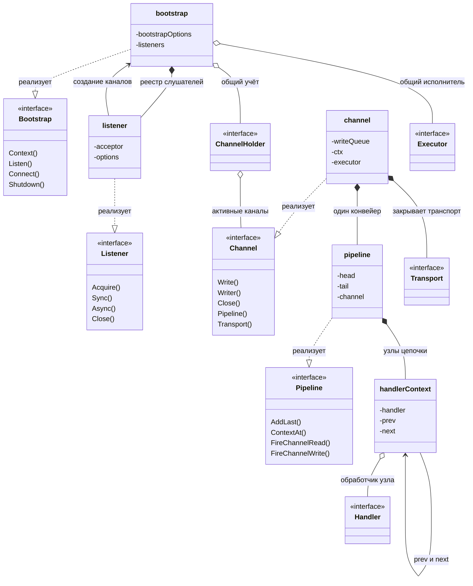
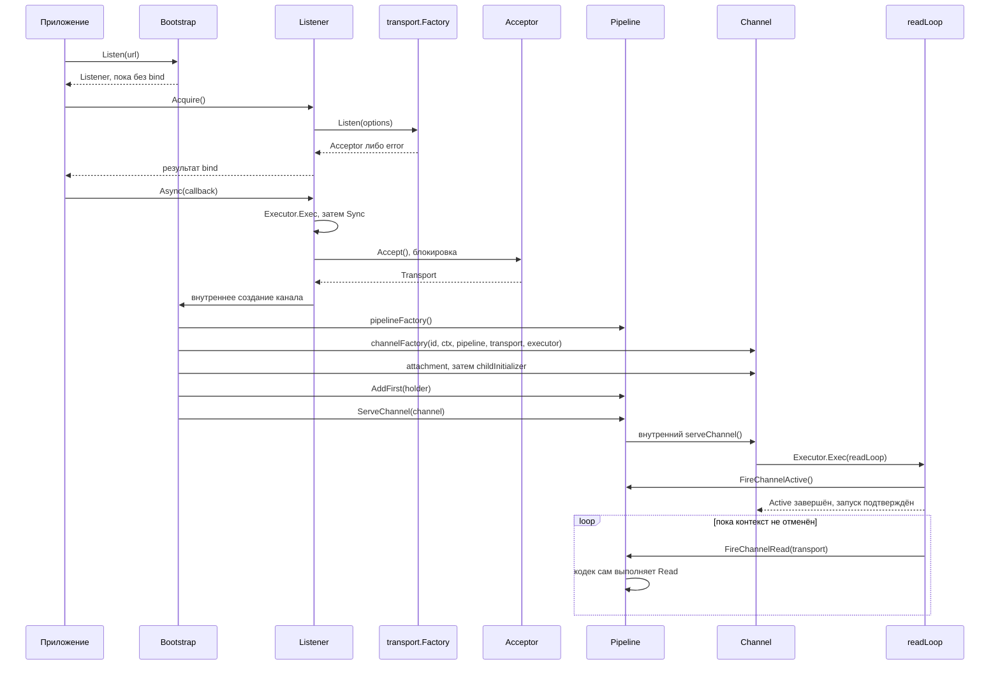
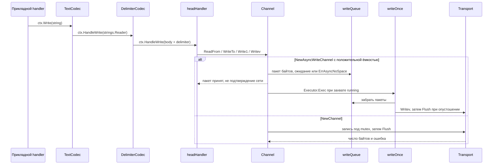
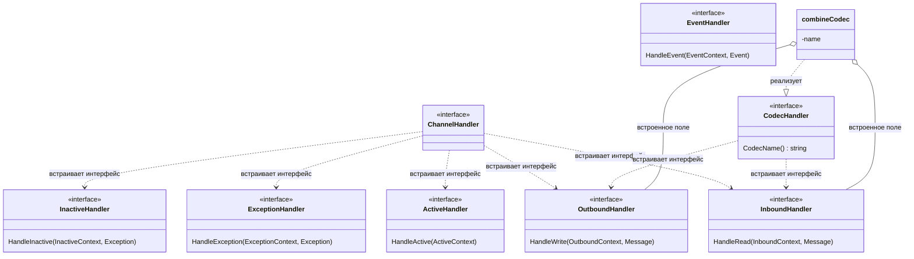
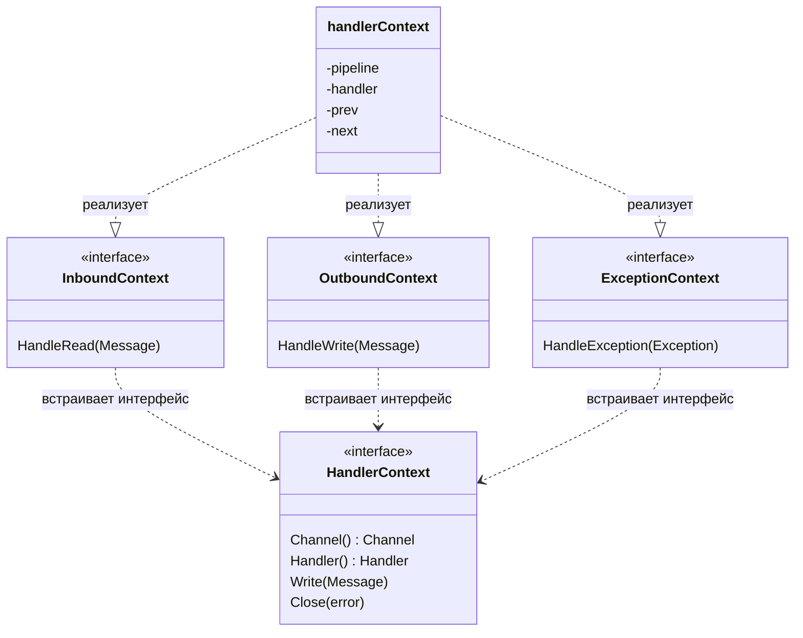
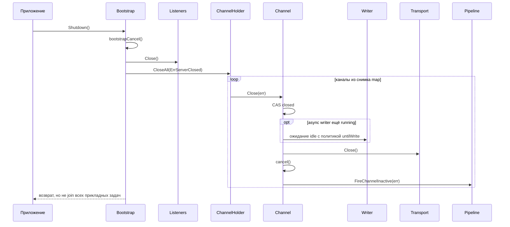
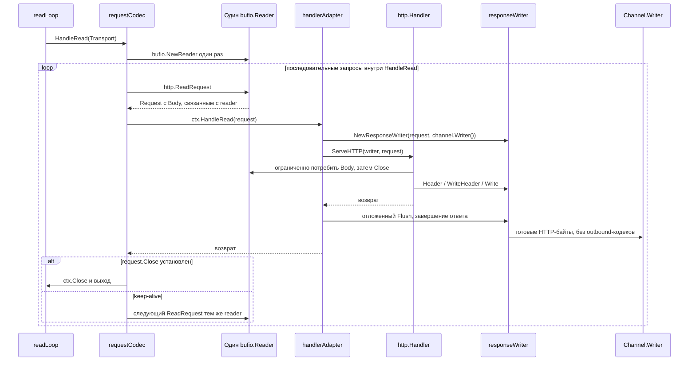
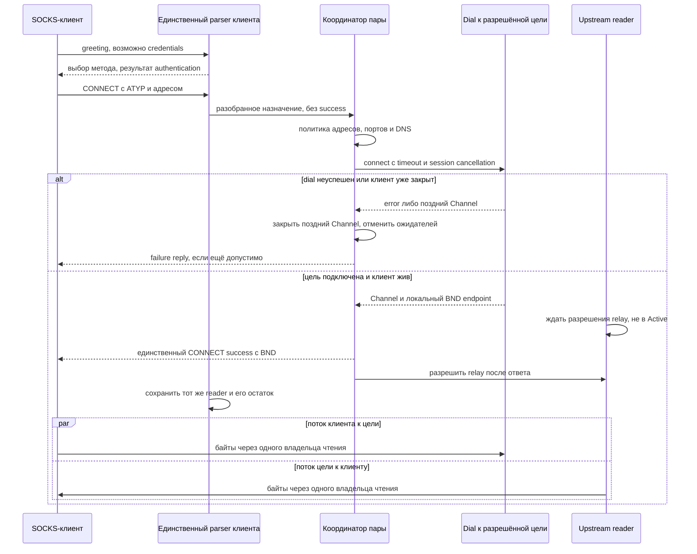

# go-netty: объекты, конвейер и границы ответственности

Эта глава объясняет go-netty через жизненный цикл соединения: кто создаёт сокет, кто владеет чтением, где байты становятся сообщением, каким путём отправляется ответ и что действительно происходит при закрытии. Такой порядок важнее перечня названий API: одинаковое слово `Write` здесь может означать проход через прикладные кодеки, постановку байтов в очередь или непосредственную запись в транспорт.

Материал сверён с исходниками **`github.com/go-netty/go-netty` на коммите `ef3fe972ce35bf877931af87323bca14ce3472a9` от 24 декабря 2025 года**. Ссылки закреплены за этим коммитом; сокращённые ссылки `файл:строки` относятся к корню той же библиотеки, а не к исходникам FTP-сервера. Это разбор конкретной реализации, не обещание поведения других версий. Примеры находятся только в документации и не проходили сборку или запуск.

Страница не вводит требований к FTP. Их общий источник для всех языков — [требования проекта](../../../docs/kb/requirements.md). Для сравнения с моделью event loop см. соседнюю главу [gnet](gnet.md).

## Содержание

- [Модель исполнения и композиция объектов](#модель-исполнения-и-композиция-объектов)
- [Bootstrap: сборка семейства соединений](#bootstrap-сборка-семейства-соединений)
- [Listener: привязка адреса отдельно от приёма](#listener-привязка-адреса-отдельно-от-приёма)
- [Channel: соединение и два уровня записи](#channel-соединение-и-два-уровня-записи)
- [Pipeline: устройство цепочки и изменение состава](#pipeline-устройство-цепочки-и-изменение-состава)
- [Handler и Context: способности и продолжение события](#handler-и-context-способности-и-продолжение-события)
- [Transport: фабрика, acceptor и соединение](#transport-фабрика-acceptor-и-соединение)
- [Codec: границы сообщения отдельно от формата](#codec-границы-сообщения-отдельно-от-формата)
- [Executor, ChannelHolder и обработчики простоя](#executor-channelholder-и-обработчики-простоя)
- [Закрытие канала и остановка Bootstrap](#закрытие-канала-и-остановка-bootstrap)
- [HTTP: путь запроса и два способа ответа](#http-путь-запроса-и-два-способа-ответа)
- [SOCKS5: ограниченный парсер и переход к туннелю](#socks5-ограниченный-парсер-и-переход-к-туннелю)
- [Ненормативное отображение на FTP](#ненормативное-отображение-на-ftp)
- [Что проверено и что остаётся проверить](#что-проверено-и-что-остаётся-проверить)

## Модель исполнения и композиция объектов

Основная идея go-netty — цепочка обработчиков вокруг одного соединения. `Bootstrap` задаёт способ создания каналов; каждый `Channel` связывает транспорт, конвейер и контекст отмены. Конвейер передаёт события обработчикам, которые умеют их принимать. Он не знает, является сообщение строкой команды, HTTP-запросом или блоком бинарных данных.

Это **не один неблокирующий event loop на множество сокетов**. При стандартном `AsyncExecutor` канал получает отдельную goroutine с `readLoop`. Но сам цикл не читает очередной блок байтов: он вызывает `FireChannelRead(c.transport)`. Первому подходящему inbound-обработчику приходит транспорт как `io.Reader`, и уже обработчик или кодек выполняет блокирующее чтение. Асинхронная запись организована отдельно, очередью и задачей writer. Долгое чтение одного клиента не занимает общий event loop, однако потребляет goroutine и удерживает дальнейшую обработку этого соединения.

В Go здесь нет иерархии классов с наследованием реализации. Интерфейсы описывают наборы методов; встраивание интерфейса в другой интерфейс объединяет эти наборы. Структуры реализуют интерфейсы неявно. Встраивание поля, например `netty.OutboundHandler` в `lengthFieldCodec`, продвигает методы этого поля и делегирует ему вызовы — это композиция, а не подкласс с виртуальным переопределением.



Диаграмма показывает ответственность и ссылки, а не правила освобождения памяти: памятью управляет GC. Закрытие сокетов, остановка таймеров и завершение прикладных операций при этом остаются явными действиями. Объект обработчика может быть общим для нескольких цепочек, но фреймворк не делает его состояние потокобезопасным. Stateful-кодек, таймер или состояние сессии обычно создают заново в инициализаторе каждого канала.

## Bootstrap: сборка семейства соединений

`Bootstrap` — долгоживущий объект конфигурации и управления группой слушателей и соединений. Его создаёт приложение, обычно при запуске сервиса, а завершает вызовом `Shutdown`. Он не является самим TCP-listener и не представляет одну пользовательскую сессию.

Публичный контракт невелик:

```go
func NewBootstrap(option ...Option) Bootstrap

type Bootstrap interface {
    Context() context.Context
    Listen(url string, option ...transport.Option) Listener
    Connect(url string, option ...transport.Option) (Channel, error)
    Shutdown()
}
```

`Context` возвращает корневой контекст Bootstrap. `Listen` только регистрирует объект `Listener`: ошибки привязки адреса появятся позже. `Connect` синхронно разбирает опции, устанавливает соединение и запускает клиентский канал; возвращает канал либо ошибку разбора/транспорта. Возврат успешного `Connect` не следует понимать как подтверждение готовности прикладного протокола. Запуск канала ждёт завершения доставки `Active`, поэтому медленный `HandleActive` задерживает и `Connect`, и серверный accept-цикл при создании принятого канала.

В конкретной структуре `bootstrap` есть метод `ServeChannel`, однако **в интерфейсе `Bootstrap` его нет**, и `NewBootstrap` возвращает именно интерфейс. Это внутренний путь сборки принятого или исходящего соединения, а не публичная команда фасада для приложения. Не следует путать его с действительно публичным `Pipeline.ServeChannel`.

Источник: [контракт Bootstrap, значения по умолчанию и создание канала](https://github.com/go-netty/go-netty/blob/ef3fe972ce35bf877931af87323bca14ce3472a9/bootstrap.go#L33-L154).

### Option меняет политику создания, а не готовое соединение

Опции Bootstrap применяются по порядку при `NewBootstrap`. Это функции над закрытым типом `bootstrapOptions`; они не возвращают ошибок и не являются транспортными опциями. Основные типы фабрик и их точные сигнатуры:

```go
type ChannelInitializer func(Channel)
type ChannelFactory func(id int64, ctx context.Context, pipeline Pipeline, transport transport.Transport, executor Executor) Channel
type PipelineFactory func() Pipeline
type TransportFactory transport.Factory
type ChannelIDFactory func() int64
type Option func(options *bootstrapOptions)

func SequenceID() ChannelIDFactory
func WithContext(ctx context.Context) Option
func WithChannelID(channelIDFactory ChannelIDFactory) Option
func WithPipeline(pipelineFactory PipelineFactory) Option
func WithChannel(channelFactory ChannelFactory) Option
func WithTransport(transportFactory TransportFactory) Option
func WithChildInitializer(initializer ChannelInitializer) Option
func WithClientInitializer(initializer ChannelInitializer) Option
func WithExecutor(executor Executor) Option
func WithChannelHolder(holder ChannelHolder) Option
```

`WithChildInitializer` нужен серверу: функция вызывается один раз для каждого принятого соединения. В ней добавляют обработчики и выделяют состояние сессии. `WithClientInitializer` выполняет ту же роль для исходящих соединений. **Нужный инициализатор необходимо задать**: в значениях по умолчанию оба поля `nil`, а внутренний `ServeChannel` вызывает выбранную функцию без проверки. Даже клиент, которому пока достаточно сырого потока, нуждается в осмысленном inbound-потребителе; пустой конвейер ничего не читает и способен превратить `readLoop` в активное вращение.

`WithChannel` выбирает стратегию записи посредством фабрики, а не готового канала. `NewChannel()` создаёт фабрику синхронных каналов; `NewAsyncWriteChannel(writeQueueSize int, untilWrite bool)` — фабрику каналов с очередью при положительном размере. Никакой дополнительной опции «async mode» к ним не требуется. `WithPipeline` нужен, если меняется сама реализация цепочки; для обычного добавления кодеков достаточно initializer. `WithTransport` заменяет способ открытия соединений, например для иной транспортной реализации, но не выбирает кодек прикладного протокола.

`SequenceID` замыкает атомарный счётчик, отдельный для каждой созданной фабрики. Стандартный holder требует уникальности ID среди своих каналов. Собственная фабрика идентификаторов уместна для согласования с системой наблюдаемости, но не должна выдавать один ID двум одновременно живущим каналам. `WithContext` создаёт дочерний контекст с отменой; это привязка времени жизни, а не автоматический аналог `Shutdown` при срабатывании родителя.

По умолчанию используются `SequenceID()`, `NewPipeline`, `NewAsyncWriteChannel(64, true)`, `tcp.New()`, `AsyncExecutor()` и `NewChannelHolder(128)`. Число 128 — начальная ёмкость map учёта, **не лимит подключений**. Пользовательские фабрики могут вызываться одновременно из нескольких слушателей и клиентских `Connect`; общий изменяемый объект внутри такой фабрики требует собственной синхронизации.

Практический сценарий: одному сервису нужны принятые команды и исходящие подключения к другому серверу. Можно настроить обе initializer-функции в одном Bootstrap, но у каждого канала всё равно будут собственные pipeline и состояние. Если роли имеют разные политики закрытия или разные транспортные настройки, несколько Bootstrap делают границу владения явнее.

Источник сигнатур: [фабрики и Option](https://github.com/go-netty/go-netty/blob/ef3fe972ce35bf877931af87323bca14ce3472a9/options.go#L26-L131).

## Listener: привязка адреса отдельно от приёма

`Listener` принадлежит Bootstrap и хранит URL, транспортные опции, разобранные `Options` и один `Acceptor`. Его интерфейс:

```go
type Listener interface {
    Acquire() error
    Close() error
    Sync() error
    Async(func(error))
}
```

`Acquire` разбирает адрес и вызывает `Factory.Listen`. Для TCP это фактическая привязка порта. Он может блокироваться внутри транспортной фабрики и возвращает ошибку создания слушателя, но **не принимает клиентов и не запускает accept-цикл**. Повторный последовательный вызов после успешного создания acceptor возвращает `nil`. Это удобно для проверки готовности: сначала привязать все нужные порты, затем объявить сервис готовым и запустить приём.

`Sync` сначала вызывает `Acquire`, затем бесконечно вызывает `Accept` и создаёт серверные каналы. Метод блокируется до ошибки. Если ошибка accept совпала с отменённым `options.Context`, возвращается `ErrServerClosed`; иначе возвращается исходная ошибка. Поэтому локальный `Listener.Close` без отмены контекста необязательно даёт `ErrServerClosed`.

`Async` передаёт выполнение `Sync` в настроенный `Executor`, а его результат — callback. При стандартном executor это отдельная goroutine. Callback должен быть ненулевым; это место обработки **завершения всего accept-цикла**, а не callback каждого клиента. Сам метод ничего не возвращает. Синхронный или ограниченный пользовательский executor меняет его поведение, поэтому слово Async не заменяет анализа executor.

`Close` удаляет URL из реестра Bootstrap и закрывает acceptor, если он уже создан. Он прекращает приём, но не закрывает ранее принятые каналы. Объект listener не рассчитан на повторное использование после закрытия: поле acceptor не сбрасывается. Создать новый listener для того же URL после удаления можно, но одновременные вызовы `Acquire`, `Sync` и `Close` требуют координации приложением — вокруг полей listener нет mutex. Не запускайте два `Sync` для одного объекта.

Вызов `Listen` с уже зарегистрированной **той же строкой URL** паникует. Это не проверка эквивалентности сетевых адресов: два разных URL могут конфликтовать уже на bind. У конкретной реализации есть `Acceptor()`, но публичный `Listener` его не объявляет; штатного `Addr()` для получения автоматически выбранного порта в этом интерфейсе также нет.

Практический порядок: `l := b.Listen("tcp://:9000")`, затем проверить `l.Acquire()`, и только после успеха вызвать `l.Async(func(err error) { ... })` с реальной обработкой ошибки. При завершении приложения сохранить контроль над этим callback и отдельно вызвать `b.Shutdown()`.

Источник: [Listener и разделение Acquire/Sync/Async](https://github.com/go-netty/go-netty/blob/ef3fe972ce35bf877931af87323bca14ce3472a9/bootstrap.go#L161-L240).



## Channel: соединение и два уровня записи

Канал создаётся фабрикой на один `Transport` и живёт до `Close`. Он владеет дочерним контекстом, конвейером и механизмом записи. Следующие методы дают идентичность, связи и прикладное состояние:

```go
ID() int64
IsActive() bool
LocalAddr() string
RemoteAddr() string
Transport() transport.Transport
Pipeline() Pipeline
Context() context.Context
Attachment() Attachment
SetAttachment(Attachment)
```

`ID` — стабильный идентификатор, адреса возвращаются как строки. `IsActive` читает атомарный флаг закрытия, но не выполняет сетевую проверку доступности peer и не подтверждает, что конкретная запись доставлена. `Context` годится для отмены прикладной работы. Само закрытие контекста не обязательно прерывает блокирующий `Read` сокета: для этого нужны закрытие транспорта или deadline.

`Attachment` — одно поле произвольного типа на канал, а не map атрибутов и не отдельное хранилище каждого узла. `SetAttachment` делает обычное присваивание без блокировки. Безопасный простой сценарий — установить неизменяемую ссылку на объект сессии в initializer, а изменяемые поля этого объекта защищать отдельно. Транспортный `WithAttachment` на listener передаёт одно и то же значение всем его каналам; он не клонирует состояние пользователя.

В `Channel` есть неэкспортируемый `serveChannel()`. Поэтому внешнему пакету нельзя с нуля реализовать этот интерфейс обычным набором экспортируемых методов. `WithChannel` остаётся полезным для выбора готовых фабрик и обёрток с встраиванием существующего `Channel`, но не следует обещать неограниченную подмену реализации.

Источник: [интерфейс Channel и фабрики](https://github.com/go-netty/go-netty/blob/ef3fe972ce35bf877931af87323bca14ce3472a9/channel.go#L34-L143).

### Write отправляет сообщение через кодеки

```go
Write(Message) error
Trigger(event Event)
Close(err error)
```

`Write` запускает `Pipeline.FireChannelWrite` от tail к head. Вызовы обработчиков происходят синхронно на goroutine вызывающего; только нижележащая доставка байтов может быть асинхронной. Например, `ch.Write("ready")` пройдёт через `TextCodec` и `DelimiterCodec`, если они находятся в конвейере. Строка, дошедшая до head без преобразования, вызовет панику: head не является текстовым сериализатором.

Возвращаемый `error` у `Channel.Write` **не является результатом записи сообщения в сеть**. Метод возвращает причину уже закрытого канала в соответствующей ветке, а паники из активного pipeline направляет в exception-путь и обычно возвращает `nil`. При закрытии с `nil` даже причина закрытия не даёт ненулевой ошибки. После начала закрытия метод также может ждать завершения закрытия через контекст. Если нужен непосредственный результат операции над байтами, предназначены низкоуровневые методы ниже; подтверждение обработки сообщения удалённой стороной требует собственного протокола.

`Trigger` запускает пользовательское событие от начала pipeline, а не широковещательную рассылку всем обработчикам. `Close` переводит канал в неактивное состояние, ждёт writer согласно выбранной политике и освобождает транспорт; его детали разобраны отдельно.

### Writer работает с байтами и обходит конвейер

```go
Write1(p []byte) (n int, err error)
Writev([][]byte) (int64, error)
CtxWrite1(ctx context.Context, p []byte) (n int, err error)
CtxWritev(ctx context.Context, pv [][]byte) (n int64, err error)
ReadFrom(r io.Reader) (n int64, err error)
Writer() io.Writer
```

`Writer()` возвращает лёгкую обёртку, чей `Write([]byte)` вызывает `Channel.Write1`. Она не владеет сокетом отдельно от канала и **не запускает outbound-кодеки**. Это правильный уровень для уже сериализованного HTTP-ответа или `io.Copy`, но неверный для строки, к которой pipeline ещё должен добавить CRLF. `Writev` принимает несколько срезов; это оптимизация байтового тракта, а не несколько прикладных сообщений.

В синхронном канале `Write1`/`Writev` выполняют транспортную запись и `Flush` под общим `writeLock`; возвращаемые число байтов и ошибка относятся к этой операции. Ошибка flush может сопровождать уже записанные байты. В async-канале входные срезы копируются, `[][]byte` объединяется в один пакет очереди, а успешный возврат означает **принятие в очередь**, не успешный `Writev` сокета. Ошибка writer возникает позже и закрывает канал. Положительный размер очереди ограничивает число пакетов, но не их суммарный объём в байтах.

При `untilWrite=true` заполнение очереди блокирует отправителя. При `false` возвращается `ErrAsyncNoSpace`, если отправить в очередь сразу нельзя. `CtxWrite1` и `CtxWritev` добавляют проверку контекста ожидания очереди, но не меняют `untilWrite=false` на ожидающий режим. В синхронном варианте из контекста берётся только `Deadline`, ставится `SetWriteDeadline`, а после операции deadline сбрасывается. Одна лишь отмена контекста **без deadline** не прерывает такую синхронную запись; ожидание mutex также отдельно контекстом не ограничено.

`ReadFrom` читает источник до EOF, в данной реализации блоками по 1024 байта, и пишет каждый блок через байтовый тракт. Даже при async-канале **источник читается в вызывающей goroutine**, а не «передаётся writer в фон». Источник не закрывается библиотекой. Возвращаемый `n` считает прочитанные байты и при ошибке записи может быть больше реально отправленного. Передача живого сокета как `io.Reader` поэтому означает длительное владение его чтением до EOF, а не безопасное неблокирующее сообщение-маркер.

Head принимает `[]byte`, `[][]byte`, `*bytes.Buffer`, `io.WriterTo` и `io.Reader`. Проверка `io.WriterTo` идёт раньше `io.Reader`, поэтому конкретный объект может пойти по `WriteTo`, а не по `Channel.ReadFrom`. Обещать для любого файла строго один способ копирования или zero-copy нельзя.

Практический сценарий: кодек уже сформировал заголовок и тело бинарного ответа — ему подходит `ctx.HandleWrite([][]byte{header, body})`. Прикладному обработчику, который хочет послать объект через сериализатор, подходит `ctx.Write(object)`. Потоковый сериализатор, самостоятельно производящий все байты, использует `ctx.Channel().Writer()` и тем самым сознательно исключает остальные outbound-узлы.

Источник: [запись, ожидание очереди и ReadFrom](https://github.com/go-netty/go-netty/blob/ef3fe972ce35bf877931af87323bca14ce3472a9/channel.go#L172-L454); финальный выбор типа — `handler.go:158–176`, работа writer — `channel.go:550–623`.

### Сериализация байтов не означает сериализацию прикладных сообщений

CAS по `running` оставляет одну активную задачу `writeOnce`. Она выбирает несколько пакетов, вызывает `Transport.Writev`, продолжает разбирать очередь и делает `Flush`, когда доходит до её опустошения. Не следует ожидать отдельного flush после каждого пакета или каждого набора `sendBuffers`.

Mutex/очередь защищают отдельные байтовые операции, а не весь вызов произвольного `Request.Write`, `io.Copy` или `Channel.Write`: они могут породить много записей. Два конкурентных сериализатора способны перемешать такие записи. Кроме того, outbound-обработчики выполняются на goroutine отправителей и могут одновременно обращаться к собственному состоянию. Для одного соединения полезно назначить одного владельца порядка прикладных ответов или защищать всю сериализацию сообщения, а не только отдельный `Write1`.



## Pipeline: устройство цепочки и изменение состава

`NewPipeline() Pipeline` создаёт двусвязную цепочку с head и tail. У одного pipeline может быть только один канал. Узел `handlerContext` хранит сам обработчик, соседей и заранее вычисленные приведения к capability-интерфейсам. Обработчик не обязан реализовывать все события: при поиске следующего получателя неподходящие узлы пропускаются.

Методы управления составом и поиска:

```go
AddFirst(handlers ...Handler) Pipeline
AddLast(handlers ...Handler) Pipeline
AddHandler(position int, handlers ...Handler) Pipeline
IndexOf(func(Handler) bool) int
LastIndexOf(func(Handler) bool) int
ContextAt(position int) HandlerContext
Size() int
Channel() Channel
ServeChannel(channel Channel)
```

Методы добавления возвращают тот же pipeline для цепочки вызовов. Они проверяют, что каждый объект реализует хотя бы одну поддерживаемую способность, и паникуют при неподходящем объекте; это не методы с `error`. Обычно их вызывают в initializer, до запуска чтения. Механизм не содержит блокировок для конкурентного изменения списка во время событий.

`AddLast(a, b)` сохраняет порядок `a`, затем `b`. У `AddFirst(a, b)` каждый элемент вставляется непосредственно после head, поэтому итоговый порядок будет `b`, затем `a`. Если порядок слоёв существенен, последовательный `AddLast` яснее. `AddHandler(position, ...)` вставляет **после узла** с указанным индексом; `-1` и индекс tail означают добавление в конец пользовательской части. Индекс 0 — head. Не используйте другие отрицательные индексы: их смысл не определён нормальным контрактом и реализация не даёт полноценной проверки.

`Size` включает оба служебных узла, а позже и добавленный Bootstrap holder. `IndexOf`/`LastIndexOf` обходят также служебные узлы и возвращают `-1`, если predicate никого не нашёл. `ContextAt(-1)` и индекс не меньше размера дают `nil`; через найденный контекст можно получить `Handler()`, то есть исходный объект обработчика. Это способ найти свой кодек по типу или `CodecName`, а не отдельный именованный реестр.

**Методов `Remove`, `Replace`, `Get` или `GetByName` в этом Pipeline нет.** Для чтения используются predicate и `ContextAt`. Переход протокола не следует описывать как готовую операцию «удалить SOCKS-кодек и заменить его relay»: в этой версии проще иметь один обработчик с явным режимом или собственную реализацию pipeline. Поддерживаемые добавления тоже лучше завершить до обслуживания соединения.

`ServeChannel` привязывает pipeline к каналу и запускает его обслуживание, паникуя при повторной привязке. При обычном использовании за это отвечает Bootstrap. До привязки `Pipeline.Channel()` ещё `nil`: initializer может пользоваться переданным ему `Channel`, но не должен преждевременно запускать события, требующие уже привязанного контекста узла.

Практический сценарий поиска — получить свою конфигурацию диагностики через `IndexOf` и `ContextAt`, когда pipeline уже собран. Для маршрутизации каждой команды искать и изменять узлы не нужно: таблица команд принадлежит прикладному handler, а pipeline описывает стабильные слои обработки.

Источник: [публичный API, добавление и поиск узлов](https://github.com/go-netty/go-netty/blob/ef3fe972ce35bf877931af87323bca14ce3472a9/pipeline.go#L26-L219).

### Fire запускает событие с границы, Context продолжает с текущего узла

```go
FireChannelActive()
FireChannelRead(message Message)
FireChannelWrite(message Message)
FireChannelException(ex Exception)
FireChannelInactive(ex Exception)
FireChannelEvent(event Event)
```

Все эти методы синхронны, ничего не возвращают и сами не создают задачу executor. `Write` идёт от tail к head; остальные события — от head к tail. Это **цепочка ответственности**, а не автоматический вызов всех обработчиков. Каждый получатель либо поглощает событие, либо явно продолжает его через контекст.

`FireChannelRead` нужен источнику нового inbound-события, а `ctx.HandleRead` — уже находящемуся в цепочке декодеру. Если внутри `HandleRead` снова вызвать `Pipeline.FireChannelRead` с тем же сообщением, обработка начнётся сначала и может рекурсивно попасть в тот же обработчик. Аналогично `Channel.Write` начинает outbound от tail, тогда как `ctx.Write` идёт от текущего узла к head и не захватывает нижележащие прикладные узлы.

При отсутствии конечного inbound-потребителя сообщение просто никем не обрабатывается. Если им был сырой транспорт, никто не выполнит `Read`. Exception, дошедший до tail, печатается в stderr и закрывает канал. У остальных событий нет такого универсального действия на tail.

## Handler и Context: способности и продолжение события

`Handler`, `Message`, `Event` и `Attachment` — пустые интерфейсы. Статический тип сообщения не закреплён за pipeline; договор «здесь `io.Reader`, здесь `string`, здесь `*http.Request`» создаётся композицией обработчиков. Ошибка этого договора проявится во время выполнения, часто как panic.

Способности обработчика объявлены отдельно:

```go
type ActiveHandler interface {
    HandleActive(ctx ActiveContext)
}
type InboundHandler interface {
    HandleRead(ctx InboundContext, message Message)
}
type OutboundHandler interface {
    HandleWrite(ctx OutboundContext, message Message)
}
type ExceptionHandler interface {
    HandleException(ctx ExceptionContext, ex Exception)
}
type InactiveHandler interface {
    HandleInactive(ctx InactiveContext, ex Exception)
}
type EventHandler interface {
    HandleEvent(ctx EventContext, event Event)
}
```

`Active` нужен для приветствия или запуска ресурсов соединения; `Inactive` — для их освобождения. `Inbound` разбирает/потребляет вход, `Outbound` преобразует исходящее сообщение. `Event` полезен для таймеров и прикладных уведомлений, не являющихся байтами протокола. `Exception` выбирает политику ошибки: закрыть канал, передать событие дальше или явно обработать и остановить распространение. **`HandleException` не возвращает `error`**, как и остальные методы обработчиков.

`ChannelHandler` объединяет Active, Inbound, Outbound, Exception и Inactive, но не Event. `ChannelInboundHandler` объединяет Active, Inbound и Inactive; `ChannelOutboundHandler` — Active, Outbound и Inactive. `SimpleChannelHandler` — alias `ChannelInboundHandler`, а не готовая структура с пустыми методами. Для коротких действий есть адаптеры `ActiveHandlerFunc`, `InboundHandlerFunc`, `OutboundHandlerFunc`, `ExceptionHandlerFunc`, `InactiveHandlerFunc`, `EventHandlerFunc`: это именованные типы функций с соответствующим методом, а не отдельная модель исполнения.



Источник: [capability-интерфейсы и функциональные адаптеры](https://github.com/go-netty/go-netty/blob/ef3fe972ce35bf877931af87323bca14ce3472a9/handler.go#L30-L156).

### Контекст — позиция в цепочке, не context.Context

`HandlerContext` создаётся pipeline для каждого добавленного узла и живёт вместе с этим узлом. Его не конструируют вручную. Он знает текущий обработчик и канал, поэтому позволяет отправить ответ в правильную сторону:

```go
type HandlerContext interface {
    Channel() Channel
    Handler() Handler
    Write(message Message)
    Trigger(event Event)
    Close(err error)
    Attachment() Attachment
    SetAttachment(Attachment)
}

type InboundContext interface {
    HandlerContext
    HandleRead(message Message)
}
type OutboundContext interface {
    HandlerContext
    HandleWrite(message Message)
}
type ExceptionContext interface {
    HandlerContext
    HandleException(ex Exception)
}
```

`ActiveContext`, `InactiveContext` и `EventContext` точно так же встраивают `HandlerContext` и добавляют соответственно `HandleActive()`, `HandleInactive(ex Exception)`, `HandleEvent(event Event)`. Это сужение доступного API по виду события; внутри все эти роли выполняет одна структура `handlerContext`.



`ctx.HandleRead(message)` передаёт сообщение следующему inbound-узлу ближе к tail. Если декодер выдаёт два сообщения, он может дважды вызвать этот метод; если он потребил сообщение полностью, продолжать необязательно. `ctx.HandleWrite(message)` продолжает outbound к предыдущему подходящему узлу. `ctx.Write(message)` начинает такую же исходящую передачу с текущей позиции, но дополнительно оборачивает её в recover с направлением ошибки в `FireChannelException`. У `ctx.HandleWrite` такой собственной recover-обёртки нет; он рассчитывает на внешнюю границу обработки.

`ctx.HandleException(ex)` продолжает исключение **после текущего узла**. Напротив, panic, перехваченный `Channel.invokeMethod` или `ctx.Write`, публикуется от head и может попасть к обработчику ошибок, который стоит раньше места возникновения ошибки. В `readLoop` вызовы Active и Read также проходят через `invokeMethod`. Если перехваченная ошибка соответствует `net.Error` и не является timeout, эта обёртка дополнительно закрывает канал после доставки exception, даже когда обработчик не продолжил исключение. Поэтому «поглотить exception» не всегда означает «сохранить соединение». Ошибка асинхронного writer идёт другим путём — напрямую к `Close` и Inactive.

Обработчик исключений должен сам быть аккуратным: библиотечный recover не является глобальной защитой от любой паники, в частности из initializer, callback executor или собственного exception-handler. Прямой вызов `Pipeline.FireChannelRead` из прикладной goroutine также не получает recover автоматически только из-за наличия слова Fire.

`ctx.Attachment` и `ctx.SetAttachment` действительно существуют, но делегируют **единственному attachment канала**. `ctx.Channel().Context()` возвращает стандартный `context.Context`; у `HandlerContext` нет собственных `Done()`/`Deadline()`. Сохранённый контекст узла допустим как ссылка на канал, но не предоставляет автоматической сериализации вызовов из других goroutine и не продлевает активность соединения.

Практический сценарий: inbound-handler получает строку, формирует ответ через `ctx.Write`, но не вызывает `ctx.HandleRead`, поскольку команда уже обработана. Логирующий handler, наоборот, после записи в журнал должен вызвать `ctx.HandleRead(message)`, иначе он станет конечным потребителем и заблокирует логически всё, что стоит ниже.

Источник: [контексты и алгоритм продолжения событий](https://github.com/go-netty/go-netty/blob/ef3fe972ce35bf877931af87323bca14ce3472a9/context.go#L19-L260). `Exception` — alias `error`; `AsException(ex interface{}) Exception` возвращает error как есть, преобразует иной объект panic через `fmt.Errorf` и сохраняет `nil` (`exception.go:21–32`).

## Transport: фабрика, acceptor и соединение

Транспортный слой отделяет создание соединения от его обслуживания. Фабрика обычно общая для Bootstrap; acceptor принадлежит listener; отдельный Transport передаётся одному Channel, который затем его закрывает.

```go
type Factory interface {
    Schemes() Schemes
    Connect(options *Options) (Transport, error)
    Listen(options *Options) (Acceptor, error)
}
type Acceptor interface {
    Accept() (Transport, error)
    Close() error
}
type BuffersWriter interface {
    Writev(buffs Buffers) (int64, error)
}
type Transport interface {
    net.Conn
    BuffersWriter
    Flush() error
    RawTransport() interface{}
}

type Addr = net.Addr
type Buffers = net.Buffers
type Schemes []string
```

`Connect` устанавливает исходящее соединение, `Listen` создаёт точку приёма, `Accept` блокируется до следующего соединения или ошибки. `Schemes` определяет поддерживаемые схемы; его `FixScheme(u *url.URL) error` выбирает первую при пустой схеме или отклоняет неподдерживаемую. У TCP это `tcp`, `tcp4`, `tcp6`.

Transport встраивает весь контракт `net.Conn`: `Read([]byte) (int, error)`, `Write([]byte) (int, error)`, `Close() error`, `LocalAddr() net.Addr`, `RemoteAddr() net.Addr`, `SetDeadline(time.Time) error`, `SetReadDeadline(time.Time) error`, `SetWriteDeadline(time.Time) error`. Дополнительный `Writev` работает с `net.Buffers`, `Flush` сбрасывает библиотечный буфер записи, а `RawTransport` возвращает нижележащий объект. Это escape hatch для возможностей конкретного сокета, не универсальная операция протокола.

Хотя `net.Conn` разрешает конкурентные вызовы, обёртки с `bufio.Reader`/`bufio.Writer` не добавляют общую синхронизацию. Нормальный путь — один читатель и запись через Channel. Одновременные прямые `Transport.Write` и записи Channel обходят его mutex/очередь и нарушают порядок. Чтение `RawTransport()` при существующем буферизованном Transport способно пропустить байты, уже прочитанные в его буфер.

Источник: [Transport, Acceptor, Factory и Schemes](https://github.com/go-netty/go-netty/blob/ef3fe972ce35bf877931af87323bca14ce3472a9/transport/transport.go#L36-L114).

### Три разных уровня опций

`netty.Option` настраивает Bootstrap. `transport.Option` настраивает конкретный `Listen`/`Connect`, возвращает ошибку и работает с экспортируемой структурой:

```go
type Option func(options *Options) error

type Options struct {
    Address    *url.URL
    Context    context.Context
    Attachment interface{}
}

func ParseOptions(ctx context.Context, url string, options ...Option) (*Options, error)
func WithContext(ctx context.Context) Option
func WithAttachment(attachment interface{}) Option

// Методы *transport.Options:
AddressWithoutHost() string
Apply(options ...Option) error
```

Здесь `Option`, `Options` и `WithContext` относятся к пакету `transport`. `WithContext` **заменяет** контекст, а не обязательно делает потомка Bootstrap; передав независимый context, можно разорвать ожидаемую цепочку отмены. `WithAttachment` задаёт начальное значение attachment. `Apply` выполняет опции по порядку до первой ошибки. `ParseOptions` сначала разбирает URL, затем применяет переданные опции; наиболее однозначная запись адреса — `tcp://host:port`, включая квадратные скобки для IPv6. Совместимость с голым `host:port` основана на запасном разборе некоторых ошибок `url.Parse`, поэтому не стоит считать её универсальной нормализацией любых адресов (`transport/options.go:29–102`).

Отдельно `tcp.WithOptions(option *tcp.Options) transport.Option` кладёт TCP-настройки в context value; `tcp.FromContext(ctx context.Context, def *Options) *Options` их извлекает. Поля `tcp.Options`: `Timeout time.Duration`, `KeepAlive bool`, `KeepAlivePeriod time.Duration`, `Linger int`, `NoDelay bool`, `SockBuf int`, `ReadBufferSize int`, `WriteBufferSize int`. `Timeout` ограничивает dial, а не чтение сессии. `SockBuf` задаёт буферы ОС в обе стороны; `ReadBufferSize`/`WriteBufferSize` — пользовательскую буферизацию вокруг `net.Conn`.

`DefaultOption` — общий указатель со значениями 5 секунд для dial, keepalive включён, период 1 минута, linger −1, no-delay включён; остальные поля нулевые. Для частичной настройки сначала копируют значение `*tcp.DefaultOption`, меняют копию и передают её адрес. `&tcp.Options{Timeout: ...}` заменяет всю структуру, а не наследует остальные default-поля. Ни переданную структуру, ни глобальный default не стоит менять конкурентно с работой соединений.

`transport.NewTransport(conn net.Conn, readSize, writeSize int) Transport` выбирает `rawConn`, `bufReadConn`, `bufWriteConn` или `bufConn`. При отсутствии буфера записи `Flush` возвращает `nil`. Создание этой обёртки само по себе не запускает goroutine.

### Существенная особенность TCP Listen: host отбрасывается

В проверенной версии `tcpFactory.Listen` вызывает `net.Listen(options.Address.Scheme, options.AddressWithoutHost())`. Поэтому `tcp://127.0.0.1:9000` **не является гарантией bind только на loopback**: host удаляется, остаётся `:9000`. Это особенно важно для демонстрационного HTTP-сервиса или прокси. Для ограничения сетевой экспозиции нужны проверенная другая фабрика/обёртка listener либо внешний сетевой барьер; запись loopback в URL сама проблему не решает.

Практический сценарий transport-опций — задать короткий `tcp.Options.Timeout` для исходящего подключения, сохранив lifetime-context канала отдельно. Для тайм-аута рукопожатия после accept следует установить deadline у `Channel.Transport()`: dial timeout к уже принятому клиенту отношения не имеет.

Источники: [TCP dial, bind и accept](https://github.com/go-netty/go-netty/blob/ef3fe972ce35bf877931af87323bca14ce3472a9/transport/tcp/factory.go#L27-L123), [TCP Options](https://github.com/go-netty/go-netty/blob/ef3fe972ce35bf877931af87323bca14ce3472a9/transport/tcp/options.go#L26-L63), выбор буферов — `transport/buffered.go:24–123`.

## Codec: границы сообщения отдельно от формата

Кодек — не особый поток исполнения. Это обработчик с inbound- и outbound-способностями и именем:

```go
// Пакет netty:
type CodecHandler interface {
    CodecName() string
    InboundHandler
    OutboundHandler
}

// Пакет codec:
type Codec = netty.CodecHandler
func Combine(name string, inbound netty.InboundHandler, outbound netty.OutboundHandler) Codec
```

`Combine` создаёт `combineCodec`, содержащий два встроенных интерфейсных поля. Его `CodecName()` возвращает заданное имя; inbound/outbound-методы делегируются соответствующим полям. Он не копирует обработчики, не синхронизирует их и не добавляет границ сообщений. Дополнительные способности компонентов, например `ActiveHandler` или `ExceptionHandler`, автоматически наружу не передаются: встраиваются именно узкие интерфейсы Inbound/Outbound. Передавать `nil` вместо требуемого направления нельзя считать отключением направления: при вызове продвинутого метода это приведёт к ошибке.

Композиция полезна для асимметричного протокола: входящие запросы разбирает один объект, исходящие ответы сериализует другой. Именно так сделаны HTTP server/client codecs. Если нужен проход без изменений, передают настоящий обработчик, вызывающий `ctx.HandleRead` или `ctx.HandleWrite`, а не `nil`.

Источник: [alias Codec и реализация Combine](https://github.com/go-netty/go-netty/blob/ef3fe972ce35bf877931af87323bca14ce3472a9/codec/codec.go#L21-L38).

### Потоковый reader в сообщении задаёт обязательство его потребить

Для TCP привычная сборка — frame, затем format, затем приложение. На входе frame получает поток и выдаёт ограниченное сообщение; format превращает его в удобное представление. На выходе направление обратное: объект сериализуется, затем оформляется граница кадра.

Однако не все frame-кодеки сначала собирают кадр в память. `FixedLengthCodec`, `LengthFieldCodec` и `VarintLengthFieldCodec` передают reader, который ещё читает из транспорта. Нижележащий обработчик обязан **до возврата** потребить нужную часть кадра, либо осознанно дочитать остаток, либо закрыть канал. Сохранить этот reader в goroutine и вернуть управление означает допустить второго читателя того же сокета. Непотреблённый хвост не превращается автоматически в «остаток следующего правильного кадра».

Перенос работы в фон безопаснее делать после декодирования в независимую ограниченную структуру/копию байтов. `PacketCodec` и `VariableLengthCodec` также требуют внимания к владению: они переиспользуют собственные буферы. Напротив, не каждый кодек stateful: `TextCodec` не хранит изменяемого состояния, а `DelimiterCodec` собирает текущую строку в локальной переменной. Правило «создавать каждый кодек в initializer» — простой безопасный стиль, но утверждать, что абсолютно все кодеки обязательно имеют общий изменяемый курсор, неверно.

### DelimiterCodec: законченная строка, но не HTTP и не весь FTP

```go
func DelimiterCodec(maxFrameLength int, delimiter string, stripDelimiter bool) codec.Codec
```

Конструктор паникует при неположительном лимите или пустом разделителе. На входе реализация читает по одному байту до совпадения хвоста с разделителем, затем передаёт `*bytes.Reader` над собранным кадром. Лимит учитывает **и байты разделителя**. Если разделитель найден точно на границе лимита, кадр принимается; отсутствие разделителя к этому моменту вызывает исключение. `stripDelimiter` влияет на вход, но не отменяет добавление разделителя на выходе.

На выходе кодек дописывает delimiter к сообщению через `[][]byte` либо `io.MultiReader`. Прикладная строка обычно не должна уже содержать конечный delimiter, иначе он будет добавлен ещё раз. Это удобный выбор для ограниченного line echo или собственных строковых команд. Это не HTTP framing: тело HTTP может быть бинарным, иметь Content-Length или chunked-кодирование, а не заканчиваться на первой CRLF.

Побайтовые вызовы `Read` заметно дороже чтения блоками; буферизованный transport способен снизить количество реальных socket reads, но алгоритм всё равно остаётся побайтовым. Для длинных потоков такой кодек не нужен. Источник: `codec/frame/delimiter.go:29–101`.

### Фиксированная длина, поле длины и varint

```go
func FixedLengthCodec(length int) codec.Codec
func LengthFieldCodec(
    byteOrder binary.ByteOrder,
    maxFrameLength int,
    lengthFieldOffset int,
    lengthFieldLength int,
    lengthAdjustment int,
    initialBytesToStrip int,
) codec.Codec
func LengthFieldPrepender(
    byteOrder binary.ByteOrder,
    lengthFieldLength int,
    lengthAdjustment int,
    lengthIncludesLengthFieldLength bool,
) netty.OutboundHandler
func VarintLengthFieldCodec(maxFrameLength int) codec.Codec
```

`FixedLengthCodec` подходит для записей с заранее известным размером, например 16-байтовых идентификаторов. Он отдаёт `io.LimitReader` на `length` байтов и пропускает outbound без изменений: не дополняет короткую запись и не проверяет длину исходящей. `LimitReader` также не превращает ранний EOF в `io.ErrUnexpectedEOF`; точное количество входных байтов должен проверить потребитель, если протокол этого требует (`codec/frame/fixed_length.go:27–48`).

`LengthFieldCodec` сначала читает заголовок через `io.ReadFull`. Полная вычисленная длина кадра равна значению поля плюс `lengthAdjustment` плюс конец поля (`lengthFieldOffset + lengthFieldLength`). Затем проверяются лимит и число отбрасываемых байтов. Поле может занимать 1, 2, 4 или 8 байтов — значение 3 упомянуто в тексте ошибки, но проверку конструктора не проходит. Полезный простой случай: двухбайтовая big-endian длина тела с параметрами offset=0, fieldLength=2, adjustment=0, strip=2.

Outbound у `LengthFieldCodec` уже есть: встроен `LengthFieldPrepender(byteOrder, lengthFieldLength, 0, false)`. Однако это только простой префикс длины тела. Произвольные inbound offset/adjustment/strip **не отражаются автоматически** в исходящем формате. Если на входе длина стоит после magic bytes, не следует ожидать, что outbound сам сгенерирует magic. Для асимметричного формата пригодится `Combine` со своим encoder.

`LengthFieldPrepender` нужен отдельно, когда требуется только исходящая часть или другие параметры длины. Он материализует тело через `MustToBytes`, поэтому бесконечный reader ему не подходит. В этой реализации упаковка в короткое поле сама не проверяет переполнение длины: лимит исходящего сообщения необходимо соблюдать выше.

`VarintLengthFieldCodec` читает unsigned varint длины и выдаёт `io.LimitReader` на тело; outbound проверяет размер, материализует тело и пишет varint-префикс. Это выбор для протокола, который действительно использует такое кодирование, а не универсальное средство для SOCKS5 или HTTP.

Источник: [декодер поля длины и встроенный encoder](https://github.com/go-netty/go-netty/blob/ef3fe972ce35bf877931af87323bca14ce3472a9/codec/frame/length_field.go#L31-L119); остальные детали — `length_field_prepender.go:28–64`, `varint_length.go:27–73` в том же каталоге.

### VariableLengthCodec и PacketCodec: не перепутать кусок чтения с кадром

```go
func VariableLengthCodec(maxReadLength int) codec.Codec
func PacketCodec(readBuffSize int) codec.Codec
```

`VariableLengthCodec` выделяет буфер указанного размера, делает один `Read` и передаёт `buffer[:n]`. В TCP это произвольный кусок потока: одна команда может разделиться на несколько вызовов, а несколько команд — объединиться. Кодек полезен для прозрачной пересылки байтов или последующего инкрементального parser, но не выделяет переменные по длине сообщения сам. Буфер будет перезаписан следующим чтением, поэтому асинхронному потребителю нужна копия (`codec/frame/variable_length.go:25–49`).

`PacketCodec` сбрасывает свой `bytes.Buffer` и вызывает `ReadFrom` до EOF входного reader. Он работает как «один пакет», только если транспорт/reader ограничивает чтение текущим пакетом. На обычном TCP он будет накапливать поток до EOF, а не возвращать датаграммы. `readBuffSize` — начальная ёмкость, **не максимальный размер пакета**; буфер может расти. Переданный downstream `*bytes.Buffer` переиспользуется. Outbound обоих кодеков прозрачен (`codec/frame/packet.go:27–51`).

### TextCodec и JSONCodec: представление уже выделенного сообщения

```go
func TextCodec() codec.Codec
func JSONCodec(useNumber bool, disAllowUnknownFields bool) codec.Codec
```

`TextCodec` читает вход в байты и создаёт строку; исходящую строку превращает в `strings.Reader`, прочие типы пропускает. Он не проверяет UTF-8, не выполняет NVT/Telnet-преобразования и не вводит лимит. Если поставить его непосредственно над неограниченным TCP-reader, он будет ждать EOF, а не первую строку. Поэтому сначала нужен framing.

`JSONCodec` создаёт `json.Decoder` и декодирует **в `map[string]interface{}`**, не в пользовательскую структуру. `useNumber` сохраняет числа как `json.Number`. Флаг `disAllowUnknownFields` передаётся стандартному decoder, но проверка неизвестных полей имеет смысл при декодировании в struct; с создаваемой здесь map он не вводит схему объекта. Outbound выполняет `json.Marshal` переданного значения и передаёт байты дальше.

Декодируется одно JSON-значение, без отдельной проверки, что после него в кадре не осталось других значений/мусора. Для строгого протокола нужны собственный typed decoder, проверка полного потребления и ограничения размера. Например, `LengthFieldCodec` перед JSON фиксирует границу транспорта, но не заменяет валидацию схемы и конца JSON.

Источники: [TextCodec](https://github.com/go-netty/go-netty/blob/ef3fe972ce35bf877931af87323bca14ce3472a9/codec/format/text.go#L27-L59), [JSONCodec и фактический тип результата](https://github.com/go-netty/go-netty/blob/ef3fe972ce35bf877931af87323bca14ce3472a9/codec/format/json.go#L26-L74).

## Executor, ChannelHolder и обработчики простоя

Эти объекты обслуживают жизненный цикл, но не снимают с приложения ответственность за порядок действий. Executor запускает работу, holder учитывает каналы, idle-handler публикует наблюдение. Ни один из них не является универсальным менеджером сессий.

### Executor запускает длительные задачи, а не только короткие callbacks

```go
type Action = func()
type Executor interface {
    Exec(Action)
}
func AsyncExecutor() Executor
```

Стандартная реализация — `go action()` (`executor.go:3–15`). Bootstrap использует один executor для async-listener и задач каналов: чтение может жить до конца соединения, writer — блокироваться на сокете. `Exec` ничего не возвращает; интерфейс не описывает отказ, завершение или отмену задачи.

Подмена на небольшой пул сессий — не безобидная оптимизация. Если все workers заняты accept/read-циклами, writer не получит выполнения, отправитель заполнит очередь, а закрытие может ждать writer. Синхронное выполнение Action также нарушает ожидание, что запуск readLoop вернётся. Собственный executor уместен только после расчёта длительности задач и независимой доступности выполнения writer. Он не даёт автоматически последовательного исполнения всех событий одного Channel.

### ChannelHolder учитывает Active/Inactive и закрывает снимок каналов

```go
type ChannelHolder interface {
    ActiveHandler
    InactiveHandler
    CloseAll(err error)
}
func NewChannelHolder(capacity int) ChannelHolder
```

Стандартный holder один на Bootstrap, добавляется первым пользовательским узлом каждого pipeline. На `Active` он помещает канал в map под mutex, на `Inactive` удаляет и продолжает событие дальше. `CloseAll` под mutex заменяет map новой, затем **вне mutex последовательно** вызывает `Close` для каналов прежней map. Это предотвращает удержание mutex во время callbacks и ожидания writer, но порядок обхода map не определён. Время выполнения `CloseAll` включает время закрытия каналов.

Публичный интерфейс не содержит `Range`, `Get`, счётчика, broadcast или лимита подключений. Собственный holder может реализовать такую политику и иметь дополнительные методы на собственном типе, но их нельзя приписывать стандартному объекту. Практическая причина замены — прикладной реестр сессий с фазой drain до сетевого закрытия. Отключение holder через `WithChannelHolder(nil)` убирает и его участие в `Shutdown`.

Источник: [учёт каналов и CloseAll](https://github.com/go-netty/go-netty/blob/ef3fe972ce35bf877931af87323bca14ce3472a9/holder.go#L24-L71).

### Idle-handler измеряет события pipeline, не непосредственно трафик сокета

```go
func ReadIdleHandler(idleTime time.Duration) ChannelInboundHandler
func WriteIdleHandler(idleTime time.Duration) ChannelOutboundHandler

type ReadIdleEvent struct{}
type WriteIdleEvent struct{}
```

Каждый экземпляр хранит свой context узла, время и таймер, поэтому нужен отдельный объект на канал. Длительность меньше одной секунды приводит к panic; ровно секунда допустима по фактической проверке. На `Active` запускается `time.AfterFunc`, на `Inactive` таймер останавливается. При истечении срока handler вызывает `ctx.Trigger(...)` и снова планирует проверку; сам канал не закрывает.

У read-idle время обновляется **после возврата** `ctx.HandleRead`. Поэтому положение в pipeline принципиально. Перед кодеком, который надолго входит в собственный цикл чтения (как HTTP requestCodec), idle-handler может не увидеть завершения вызова даже при регулярных запросах. После frame-кодека он видит готовые кадры, а не каждый поступивший байт; медленный недописанный кадр останется idle на этом уровне. Это может быть желательной политикой против медленного клиента, но не равно счётчику сетевой активности.

Write-idle обновляет время перед продолжением outbound-события. Запись через `Channel.Writer()` обходит pipeline и не учитывается этим handler. `ReadIdleEvent`/`WriteIdleEvent` идут от места таймера к tail; потребитель событий должен стоять дальше по этому направлению и при необходимости продолжать событие. Callback таймера работает конкурентно с чтением, поэтому изменение состояния сессии из `HandleEvent` требует синхронизации.

Практический сценарий — отдельный event-handler закрывает давно молчащую сессию. Для жёсткого ограничения времени блокирующего `Read` лучше дополнительно использовать deadline транспорта: одно уведомление idle само чтение не прервёт.

Источник: [idle-фабрики и read-idle](https://github.com/go-netty/go-netty/blob/ef3fe972ce35bf877931af87323bca14ce3472a9/handler.go#L192-L307); write-idle — `handler.go:309–407`.

## Закрытие канала и остановка Bootstrap

Здесь важно различать три вещи: ожидание writer, завершение прикладной операции и завершение всех goroutine сервиса. Библиотека делает часть первого, но не предоставляет готовую процедуру второго и третьего.

`Channel.Close(err)` первым успешным CAS устанавливает `closed=1`. Повторные вызовы уже не выполняют тело закрытия. Если очередь записи включена и writer ещё `running`, метод ждёт с шагом 100 ms. При `untilWrite=true` явного предельного количества попыток нет; при `false` — до десяти ожиданий, то есть примерно до секунды только на эту часть закрытия. Затем сохраняется причина, закрывается Transport, отменяется контекст и синхронно публикуется `Inactive`. Ошибка `Transport.Close` игнорируется.

Это ожидание проверяет **флаг writer**, а не подтверждение доставки peer и не счётчик прикладных задач. Без deadline заблокированный socket write способен удерживать `Close` при `untilWrite=true` неопределённо долго. При ограниченном ожидании writer может ещё не закончить отправку к моменту закрытия транспорта. Конкурентным producers нельзя продолжать писать во время drain, надеясь получить атомарную границу «всё до Close доставлено».

`Bootstrap.Shutdown()` сначала отменяет корневой context, закрывает listeners, затем вызывает `holder.CloseAll(ErrServerClosed)`. Поскольку стандартный holder вызывает `Channel.Close`, **Shutdown действительно может ждать writer и опосредованно слив очереди**. Утверждение «Shutdown вообще ничего не ждёт» неверно. Но он не реализует application graceful-drain: не запрещает новые прикладные задания отдельной фазой, не ждёт завершения обработчиков/передач по протоколу, не собирает ошибки и не принимает deadline остановки. Уже начавшееся закрытие другим вызывающим также не превращается в общий join всех работ.

Корректная прикладная остановка обычно сначала прекращает приём новых сессий через `Listener.Close`, затем запрещает новые операции внутри существующих сессий, ждёт нужные завершения под ограниченным временем и лишь после этого закрывает каналы/Bootstrap. В этой версии нельзя получить такой контракт просто переименованием `Shutdown` в «graceful».



`Inactive` с `nil` означает, что в закрытие передали `nil`, а не «peer выполнил TCP half-close». `Channel.Close` закрывает транспорт целиком. В `Channel`/`Transport` нет универсальных `CloseRead`/`CloseWrite`; половинное закрытие нельзя вывести из значения `Exception`.

Источники: [точный порядок Channel.Close](https://github.com/go-netty/go-netty/blob/ef3fe972ce35bf877931af87323bca14ce3472a9/channel.go#L194-L215), `bootstrap.go:139–154`, `holder.go:44–53`; обработка panic и циклы обслуживания — `channel.go:496–615`.

## HTTP: путь запроса и два способа ответа

HTTP хорошо показывает границу между «использует типы стандартной библиотеки» и «реализует весь сервер стандартной библиотеки». Пакет `codec/xhttp` предоставляет чтение/запись HTTP/1.x и адаптер обработчика, но не является `net/http.Server`.

### Какие объекты создают ServerCodec, ClientCodec и Handler

```go
func ServerCodec() codec.Codec
func ClientCodec() codec.Codec
func Handler(handler http.Handler) codec.Codec

func NewResponseWriter(request *http.Request, writer io.Writer) ResponseWriter

type ResponseWriter interface {
    http.ResponseWriter
    http.Flusher
    Request() *http.Request
}
```

`ServerCodec` возвращает `Combine("http-server-codec", new(requestCodec), new(responseCodec))`: запросы читаются внутрь, ответы пишутся наружу. `ClientCodec` использует те же два объекта в обратных ролях. Эти внутренние типы не экспортируются; их методы — обычные `HandleRead`/`HandleWrite` из capability-интерфейсов.

`Handler` создаёт `handlerAdapter`, который хранит переданный `http.Handler`; `nil` заменяется на `http.DefaultServeMux`. На каждый входящий `*http.Request` адаптер создаёт отдельный responseWriter, откладывает `Flush` и синхронно вызывает `ServeHTTP`. Сам handler может быть общим для многих соединений и потому должен быть готов к конкурентным вызовам, как обычный HTTP-handler. Writer принадлежит одному запросу; использовать его после возврата `ServeHTTP` нельзя.

Два способа ответа **альтернативны**. Без адаптера собственный netty-handler получает `*http.Request` и вызывает `ctx.Write(*http.Response)`. Тогда `responseCodec` сериализует ответ через `http.Response.Write(ch.Writer())`. С адаптером `http.Handler` пишет в responseWriter, который сам формирует байты и отправляет их в `Channel.Writer()`, минуя outbound ServerCodec. Адаптер имеет `HandleWrite`, но он специально паникует: смешивать обычный проход исходящих сообщений через этот узел с ответами `ServeHTTP` не следует. Его `HandleException` закрывает канал и не возвращает ошибку.

Источник: [состав HTTP-кодеков и handlerAdapter](https://github.com/go-netty/go-netty/blob/ef3fe972ce35bf877931af87323bca14ce3472a9/codec/xhttp/http.go#L28-L75).

### Входящий запрос: один bufio.Reader и цикл внутри одного HandleRead

`requestCodec.HandleRead` получает `io.Reader`, создаёт **один** `bufio.Reader` и внутри того же вызова выполняет цикл `http.ReadRequest(bufReader)`. После каждого разобранного запроса он синхронно вызывает `ctx.HandleRead(request)`, затем проверяет `request.Close`. Если флаг установлен, вызывает `ctx.Close` и выходит; иначе читает следующий запрос из **того же** bufio.Reader. Обычный возврат прикладного handler не создаёт новую буферную обёртку и не является выходом из этого цикла.

`http.ReadRequest` разбирает стартовую строку и заголовки, но тело запроса остаётся reader, связанным с тем же входом. Перед переходом к следующему запросу приложение должно обеспечить потребление тела и его закрытие либо отказаться от повторного использования соединения и закрыть его. Нельзя вернуть управление с непрочитанным body и рассчитывать, что xhttp автоматически корректно дочитает его за handler. Сам адаптер `Body.Close` не вызывает. Закрытие тела после `ReadRequest` тоже может дочитывать данные, поэтому для недоверенного клиента необходимы лимит и deadline; нельзя «ограничить» приём через `LimitReader`, а потом неограниченно дренировать остаток в `Body.Close`.

Pipelined-запросы в таком серверном пути разбираются последовательно в одном вызове с сохранением read-ahead. Ошибка `ReadRequest` вызывает panic; с `xhttp.Handler` exception закрывает канал. Если собственный exception-handler поглотит ошибку и разрешит новое чтение, вызов с прежним bufio.Reader уже размотан, а очередной создаст новый reader: продолжать повреждённый HTTP-поток таким способом небезопасно. Это не означает готовый concurrent HTTP server с очередями ответов, защитой от медленных заголовков и лимитами тела. В исходнике также оставлен TODO о привязке request context к channel context: `request.Context()` автоматически не становится контекстом канала. При необходимости прикладной handler использует явную привязку, не теряя исходный указатель, по которому requestCodec проверяет `Close`.

Источник: [реальный цикл requestCodec](https://github.com/go-netty/go-netty/blob/ef3fe972ce35bf877931af87323bca14ce3472a9/codec/xhttp/request.go#L29-L63).



### ResponseWriter: ручной framing и необычный смысл Flush

Публичные методы встроенных интерфейсов — `Header() http.Header`, `WriteHeader(statusCode int)`, `Write([]byte) (int, error)`, `Flush()`; собственный метод — `Request() *http.Request`. `Header` лениво создаёт карту с заголовком Server. `WriteHeader` записывает статусную строку и текущие заголовки один раз; последующие вызовы игнорируются. `Write` неявно выбирает 200, если заголовок ещё не записан.

Внутренний `responseWriter` держит `*bufio.Writer` размером по умолчанию 2048 байт, беря его из `sync.Pool`. Это буфер одного ответа, не общий буфер сессии. `Write` может пока только накопить байты, поэтому успешный возврат ещё не доказывает их отправку. В `WriteHeader` ошибки `fmt.Fprintf` не возвращаются наружу; `Flush` тоже не имеет результата и игнорирует ошибку внутреннего `Close`. Получить из этого API полную картину доставки ответа невозможно.

`Flush` здесь **завершает ответ**: вызывает внутренний `Close() error`, завершает chunked writer, сбрасывает буфер, возвращает его в pool и обнуляет поле writer. Этот `Close` не входит в публичный `ResponseWriter`. Это не привычная промежуточная HTTP-flush операция для SSE/streaming. Ранний вызов `http.Flusher.Flush()` из handler, последующая запись или повторный отложенный `Flush` адаптера могут обратиться к уже освобождённому writer. Поэтому в примере ниже Flush вручную не вызывается.

Статусная строка имеет вид `HTTP/x.y <code> OK`: reason phrase всегда `OK`, даже при 404/500. Числовой код при этом остаётся заданным. Это не автоматическое отображение `http.StatusText`.

Framing выбирается **вручную**. Наличие `Content-Length` не заставляет writer проверять фактическую длину тела. Chunked writer включается при точном значении заголовка `Transfer-Encoding: chunked`. Если нет ни Content-Length, ни Transfer-Encoding, либо исходный request уже помечен `Close`, внутренний `shouldClose` помечает запрос на закрытие; requestCodec затем закрывает канал. Один лишь заголовок ответа `Connection: close` этим методом не анализируется — для гарантированного поведения нужно также установить `request.Close`.

Автоматического подавления тела для HEAD или статусов без тела в этом writer нет: это обязанность handler. Нельзя переносить на него все гарантии `net/http.Server`, включая корректное обслуживание 1xx, трейлеров, expect/continue, лимитов заголовков, тайм-аутов и конкурентного streaming. Код обработки трейлеров здесь не заменяет полноценную реализацию trailer semantics.

Источник: [ResponseWriter, Flush/Close и shouldClose](https://github.com/go-netty/go-netty/blob/ef3fe972ce35bf877931af87323bca14ce3472a9/codec/xhttp/response_writer.go#L28-L150).

### Ограничения клиентского пути отличаются от серверного

`requestCodec.HandleWrite` для `*http.Request` вызывает `Request.Write(ch.Writer())`; прочие сообщения передаёт дальше. Это синхронная сериализация запроса с возможной блокировкой на чтении его body и записи байтов. Здесь также нет очереди соответствия запросов ответам уровня `http.Transport`.

`responseCodec.HandleRead` делает один `http.ReadResponse(bufio.NewReader(reader), nil)` на один вызов и передаёт `*http.Response` дальше. В отличие от requestCodec, у него **нет постоянного цикла с одним reader**: при следующем вызове создаётся новый bufio.Reader. Если предыдущий успел прочитать вперёд байты следующего ответа, их нельзя просто отбросить. Downstream обязан потребить/закрыть текущий response body до следующего чтения, но этого одного недостаточно, чтобы восстановить потерянный read-ahead при нескольких ответах. Для надёжного persistent/pipelined HTTP-клиента нужен сохраняемый reader и явное сопоставление запросов/ответов либо стандартный `http.Client`.

`nil` вместо исходного request лишает `ReadResponse` знания метода HEAD: стандартная библиотека не сможет по запросу определить отсутствие тела у HEAD-ответа. Но **статусные правила отсутствия тела для 1xx, 204 и 304 от этого не исчезают** — они определяются кодом ответа. Клиентский кодек также сам не превращает последовательность информационных 1xx и окончательного ответа в один завершённый прикладной запрос.

Источник: [responseCodec: один ReadResponse и запись Response](https://github.com/go-netty/go-netty/blob/ef3fe972ce35bf877931af87323bca14ce3472a9/codec/xhttp/response.go#L28-L47).

### Самодостаточный пример: один ограниченный HTTP-ответ на соединение

Ниже — **функция сборки учебного Bootstrap**, а не production HTTP server. Все импорты и контекст замыкания объявлены. Владелец возвращённого Bootstrap сам запускает listener и вызывает Shutdown. Пример сознательно отказывается от keep-alive и `Expect`, ограничивает тело 4 KiB, задаёт общий deadline соединения в 5 секунд и использует синхронный канал, чтобы не смешивать финализацию HTTP-ответа с асинхронной очередью. Он не решает ограничение размера HTTP-заголовков внутри `ReadRequest` и не заменяет защиту сетевой экспозиции.

```go
package example

import (
    "errors"
    "io"
    "net/http"
    "strconv"
    "time"

    "github.com/go-netty/go-netty"
    "github.com/go-netty/go-netty/codec/xhttp"
)

func NewSmallHTTP() netty.Bootstrap {
    return netty.NewBootstrap(
        netty.WithChannel(netty.NewChannel()),
        netty.WithChildInitializer(func(ch netty.Channel) {
            ch.Pipeline().AddLast(
                netty.ActiveHandlerFunc(func(ctx netty.ActiveContext) {
                    deadline := time.Now().Add(5 * time.Second)
                    if err := ch.Transport().SetDeadline(deadline); err != nil {
                        ctx.Close(err)
                        return
                    }
                    ctx.HandleActive()
                }),
                xhttp.ServerCodec(),
                xhttp.Handler(http.HandlerFunc(func(w http.ResponseWriter, r *http.Request) {
                    // Меняем именно request, который затем проверит requestCodec.
                    r.Close = true

                    // Нет реализации 100 Continue: закрываем, не ждём body.
                    if r.Header.Get("Expect") != "" {
                        ch.Close(errors.New("Expect is not supported by this example"))
                        _ = r.Body.Close()
                        return
                    }

                    const maxBody = 4 << 10
                    n, err := io.Copy(io.Discard, io.LimitReader(r.Body, maxBody+1))
                    if err != nil || n > maxBody {
                        // Сначала закрываем транспорт: Body.Close не должен
                        // неограниченно дочитывать отвергнутое тело из сети.
                        ch.Close(errors.New("request body exceeds limit or cannot be read"))
                        _ = r.Body.Close()
                        return
                    }
                    if err := r.Body.Close(); err != nil {
                        ch.Close(err)
                        return
                    }

                    status := http.StatusOK
                    body := "ok\n"
                    if r.Method != http.MethodGet && r.Method != http.MethodHead {
                        status = http.StatusMethodNotAllowed
                        body = "method not allowed\n"
                        w.Header().Set("Allow", "GET, HEAD")
                    }
                    w.Header().Set("Connection", "close")
                    w.Header().Set("Content-Type", "text/plain; charset=utf-8")
                    w.Header().Set("Content-Length", strconv.Itoa(len(body)))
                    w.WriteHeader(status)
                    if r.Method != http.MethodHead {
                        if _, err := io.WriteString(w, body); err != nil {
                            ch.Close(err)
                        }
                    }
                    // Не вызываем Flush: adapter сделает его при возврате.
                })),
            )
        }),
    )
}
```

GET получает тело `ok\n`; HEAD получает тот же Content-Length, но ни одного байта тела. Прочие методы после ограниченного потребления body получают 405. Превышение лимита, ошибка чтения или Expect приводят к закрытию без обещания HTTP-ответа об ошибке. Deferred Flush адаптера всё ещё сработает при возврате, но уже закрытый transport не станет источником нового неограниченного чтения. Ошибки окончательного flush адаптер, как описано выше, не возвращает приложению.

Для запуска владелец вызывает `b := NewSmallHTTP()`, создаёт `b.Listen("tcp://:8080")`, проверяет `Acquire`, затем выбирает `Sync` или `Async` и обеспечивает последующий `b.Shutdown()`. Адрес приведён намеренно без иллюзии loopback-bind: проверенная TCP-фабрика отбрасывает host. Не открывайте такой учебный listener в недоверенную сеть.

## SOCKS5: ограниченный парсер и переход к туннелю

SOCKS5 — другой тип задачи: сначала идёт несколько структурированных сообщений разной формы, затем после успешного CONNECT остаётся непрерывный двунаправленный поток. Протокол описан в [RFC 1928](https://www.rfc-editor.org/rfc/rfc1928.html), username/password-подпротокол — в [RFC 1929](https://www.rfc-editor.org/rfc/rfc1929.html). Эти ссылки объясняют wire format, но не объявляют поддержку SOCKS частью FTP-проекта.

Начальная форма — `VER, NMETHODS, METHODS`; длину списка методов задаёт один байт. Сервер выбирает метод один раз: `00` — без аутентификации, `02` — username/password, `FF` — подходящего метода нет. Если конфигурация требует authentication, наличие предложенного `00` **не разрешает downgrade**: надо выбрать `02`, если он предложен, или вернуть `FF` и закрыть соединение. Username/password передаются без шифрования; такая проверка сама по себе не делает транспорт защищённым.

CONNECT-запрос имеет `VER=05, CMD=01, RSV=00, ATYP, DST.ADDR, DST.PORT`. **IPv4 — ATYP `01`, DOMAIN — `03`, IPv6 — `04`**. IPv4 занимает 4 байта, IPv6 — 16, домен предваряется одним байтом длины; порт — два байта big-endian. Границы TCP-чтений к этим полям отношения не имеют. Для блокирующей модели go-netty простой способ прочитать ровно известное число байтов — `io.ReadFull`, а не предположение, что один `Read` даст всё рукопожатие.

### Полный ограниченный парсер greeting/auth/CONNECT, но не готовый прокси

Следующий блок самодостаточен как Go-код парсера. Он поддерживает **две явно выбранные политики**: только no-auth либо обязательный username/password. Callback проверки credentials передаётся вызывающим; при обязательной аутентификации его отсутствие является ошибкой конфигурации. Парсер отправляет только ответы выбора метода и authentication. Он **не делает dial и никогда не отправляет CONNECT success**.

По памяти и входному объёму рукопожатие ограничено: каждая переменная длина — максимум 255 байт; нет чтения до EOF или накопления тела туннеля. По времени `io.ReadFull` не ограничен: владелец соединения обязан установить deadline до вызова; callback authentication тоже должен иметь ограниченное время. `r` и `w` не закрываются парсером. `SOCKSRequestError` позволяет отличить ошибку уже начавшегося request-этапа и выбрать REP для ответа; ошибки greeting/auth заканчиваются закрытием после соответствующего ответа или ошибки ввода-вывода.

```go
package example

import (
    "encoding/binary"
    "fmt"
    "io"
    "net"
    "strconv"
)

type SOCKSConnect struct {
    Host string
    Port uint16
}

func (t SOCKSConnect) Address() string {
    return net.JoinHostPort(t.Host, strconv.Itoa(int(t.Port)))
}

type SOCKSRequestError struct {
    Reply  byte
    Detail string
}

func (e *SOCKSRequestError) Error() string { return e.Detail }

func ReadSOCKS5Connect(
    r io.Reader,
    w io.Writer,
    requireAuth bool,
    authenticate func(user, password string) bool,
) (SOCKSConnect, error) {
    var zero SOCKSConnect
    if requireAuth && authenticate == nil {
        return zero, fmt.Errorf("authentication required, but verifier is nil")
    }

    // Все вызовы read ниже имеют размер не больше 255 байт.
    read := func(n int) ([]byte, error) {
        p := make([]byte, n)
        _, err := io.ReadFull(r, p)
        return p, err
    }
    write := func(p []byte) error {
        n, err := w.Write(p)
        if err == nil && n != len(p) {
            err = io.ErrShortWrite
        }
        return err
    }
    requestError := func(reply byte, detail string) (SOCKSConnect, error) {
        return zero, &SOCKSRequestError{Reply: reply, Detail: detail}
    }

    greeting, err := read(2)
    if err != nil {
        return zero, fmt.Errorf("read greeting: %w", err)
    }
    if greeting[0] != 5 || greeting[1] == 0 {
        return zero, fmt.Errorf("invalid SOCKS5 greeting")
    }
    methods, err := read(int(greeting[1]))
    if err != nil {
        return zero, fmt.Errorf("read methods: %w", err)
    }
    wanted := byte(0x00)
    if requireAuth {
        wanted = 0x02
    }
    selected := byte(0xff)
    for _, method := range methods {
        if method == wanted {
            selected = wanted
            break
        }
    }
    if err := write([]byte{0x05, selected}); err != nil {
        return zero, fmt.Errorf("write method selection: %w", err)
    }
    if selected == 0xff {
        return zero, fmt.Errorf("no acceptable authentication method")
    }

    if selected == 0x02 {
        auth, err := read(2) // RFC 1929: VER, ULEN
        if err != nil {
            return zero, fmt.Errorf("read authentication header: %w", err)
        }
        if auth[0] != 1 || auth[1] == 0 {
            if err := write([]byte{0x01, 0x01}); err != nil {
                return zero, fmt.Errorf("write authentication failure: %w", err)
            }
            return zero, fmt.Errorf("invalid authentication header")
        }
        user, err := read(int(auth[1]))
        if err != nil {
            return zero, fmt.Errorf("read username: %w", err)
        }
        length, err := read(1)
        if err != nil {
            return zero, fmt.Errorf("read password length: %w", err)
        }
        if length[0] == 0 {
            if err := write([]byte{0x01, 0x01}); err != nil {
                return zero, fmt.Errorf("write authentication failure: %w", err)
            }
            return zero, fmt.Errorf("empty password is not allowed")
        }
        password, err := read(int(length[0]))
        if err != nil {
            return zero, fmt.Errorf("read password: %w", err)
        }
        accepted := authenticate(string(user), string(password))
        status := byte(0x01)
        if accepted {
            status = 0x00
        }
        if err := write([]byte{0x01, status}); err != nil {
            return zero, fmt.Errorf("write authentication result: %w", err)
        }
        if !accepted {
            return zero, fmt.Errorf("authentication failed")
        }
    }

    request, err := read(4)
    if err != nil {
        return zero, fmt.Errorf("read request header: %w", err)
    }
    if request[0] != 5 || request[2] != 0 {
        return requestError(0x01, "invalid request version or reserved byte")
    }
    if request[1] != 0x01 {
        return requestError(0x07, "only CONNECT is supported")
    }

    var host string
    switch request[3] {
    case 0x01: // IPv4
        address, err := read(net.IPv4len)
        if err != nil {
            return zero, fmt.Errorf("read IPv4 address: %w", err)
        }
        host = net.IP(address).String()
    case 0x03: // DOMAIN
        length, err := read(1)
        if err != nil {
            return zero, fmt.Errorf("read domain length: %w", err)
        }
        if length[0] == 0 {
            return requestError(0x08, "empty domain")
        }
        domain, err := read(int(length[0]))
        if err != nil {
            return zero, fmt.Errorf("read domain: %w", err)
        }
        // Учебное ограничение на ASCII-представление имени.
        // Полная DNS/IDNA-политика и проверка назначения выполняются снаружи.
        for _, b := range domain {
            if b <= 0x20 || b >= 0x7f {
                return requestError(0x08, "domain contains unsupported bytes")
            }
        }
        host = string(domain)
    case 0x04: // IPv6
        address, err := read(net.IPv6len)
        if err != nil {
            return zero, fmt.Errorf("read IPv6 address: %w", err)
        }
        host = net.IP(address).String()
    default:
        return requestError(0x08, "unsupported address type")
    }

    portBytes, err := read(2)
    if err != nil {
        return zero, fmt.Errorf("read destination port: %w", err)
    }
    port := binary.BigEndian.Uint16(portBytes)
    if port == 0 {
        return requestError(0x02, "destination port zero is denied by example policy")
    }
    return SOCKSConnect{Host: host, Port: port}, nil
}
```

Код возвращает только описание назначения. `Address` использует `net.JoinHostPort`, поэтому IPv6 не собирается ошибочной конкатенацией через двоеточие. Проверка печатных ASCII-байтов домена не является проверкой DNS-имени или разрешением доступа: строка ещё должна пройти политику назначения. Callback не должен журналировать пароль; ограничение длины credentials не заменяет ограничение попыток и безопасность их хранения.

Частичное чтение поля возвращает ошибку `io.ReadFull`; вызывающий закрывает сессию, а не пытается продолжить с нового greeting посреди старого. При `SOCKSRequestError` можно послать полный failure reply с соответствующим REP и закрыть соединение; нельзя отправлять один байт REP без остальной структуры ответа. UDP ASSOCIATE, BIND, GSSAPI и туннелирование этот пример не реализует.

### Что обязано произойти между parser и CONNECT success

В netty-handler парсер должен работать на единственном входном reader канала. На этапе рукопожатия обычный синхронный `Channel.Writer()` с установленным write deadline даёт понятный результат ответа выбора метода. Он обходит framing, что здесь правильно: SOCKS-байты уже полностью сформированы. Ни delimiter-кодек, ни форматирование строки поверх них не нужны.

После получения назначения сначала применяется **политика доступа**: допустимые порты, адреса, DNS-результаты, запрет нежелательных локальных/служебных сетей и прочие правила конкретного прокси. Проверить только строку домена и затем разрешить её заново без контроля адреса недостаточно: решение должно относиться к адресу, к которому реально выполняется connect. Успешный разбор ATYP не делает назначение безопасным.

Затем выполняется connect с тайм-аутом и отменой, связанной с клиентской сессией. У встроенного TCP-транспорта `tcp.Options.Timeout` ограничивает dial; lifetime-context канала можно передать через `transport.WithContext`. Важная тонкость: `Bootstrap.Connect` использует этот context не только для dial, но и как родителя созданного Channel. Поэтому шаблон «передать короткий `context.WithTimeout`, а после успешного Connect немедленно вызвать cancel» отменит и новый канал. Для отдельного dial timeout подходит TCP Timeout, а session context отменяется при окончательном завершении пары.

Исходящий Bootstrap требует `WithClientInitializer` и запускает upstream readLoop ещё до возврата `Connect`. Значит, upstream-reader нельзя делать полностью свободным до отправки клиенту CONNECT success: сервер назначения может прислать приветствие немедленно. Приложение должно заранее создать общее состояние пары и разрешить пересылку upstream-байтов только после успешного ответа клиенту. При этом нельзя ждать такого разрешения в `HandleActive`: запуск `Connect` сам ждёт завершения Active. Ограничитель чтения/пересылки располагают после этой фазы и обеспечивают его отмену при ошибках.

Только после реального успешного соединения отправляется **один** SOCKS-ответ `VER=05, REP=00, RSV=00, ATYP, BND.ADDR, BND.PORT`. `BND` описывает локальный endpoint прокси на соединении к назначению, например `upstream.LocalAddr()`, а не повторяет `DST` и не является адресом исходного клиента. Адрес и порт кодируют в соответствии с их фактическим семейством. Если dial не удался, отправляется failure reply, а не ранний success с последующим закрытием.

Пока dial выполнялся, клиент мог закрыться или истёк deadline. После его завершения нужно повторно проверить состояние сессии: поздно полученный канал закрывается, успешный reply уже не отправляется, ожидатели освобождаются. Ошибка отправки success также закрывает upstream. Это работа координатора пары, а не `codec.Combine` и не holder Bootstrap.



### Передача владения чтением и ограничение half-close

После CONNECT «сообщение SOCKS» больше не существует: все оставшиеся байты — начало туннеля. Если парсер читал через `bufio.Reader`, в его буфере уже могут быть байты TLS ClientHello или другого приложения. Relay обязан продолжить чтение **того же reader**, включая накопленный остаток. Если использовался буферизованный `Transport`, нельзя переключиться на `RawTransport` и оставить его буфер позади. Сам пример парсера не создаёт скрытой буферизации и читает ровно поля запроса, но сохранять нужно и внешние обёртки вызывающего.

На каждом входном сокете должен оставаться один владелец чтения. Можно продолжить обработку потока в той же goroutine до EOF либо организовать явную передачу владения, при которой старый readLoop больше не читает. Нельзя просто запустить `go io.Copy(peer.Writer(), reader)`, вернуть управление из inbound-handler и позволить netty снова вызвать `FireChannelRead` на тот же transport. Передача reader в `peer.Write(reader)` не решает задачу автоматически: она синхронно потребляет источник до EOF и требует точно такого же контроля владения и порядка байтов.

Для двунаправленного relay нужны два согласованных направления, ограничение памяти/очередей, write deadlines, отмена зависших чтений и единый владелец финального закрытия пары. Копировать из переиспользуемого буфера в фон можно только после получения независимой копии; заполнение очереди должно создавать контролируемое противодавление, а не бесконечное накопление.

Наконец, прозрачный TCP-туннель часто должен поддерживать half-close: EOF от клиента означает закончить запись к цели, но продолжить получать её ответ. `Channel.Close` закрывает всё соединение, а `Inactive(nil)` не кодирует отдельный FIN. Для настоящего half-close потребуется отдельная, проверенная работа с возможностями конкретного TCP-транспорта и координацией netty readLoop/буферов либо другая модель владения соединениями. Стратегия «при любом EOF закрыть оба канала» проще, но может обрезать законный ответ; её надо называть ограничением прокси, а не корректной общей реализацией SOCKS relay.

## Ненормативное отображение на FTP

Для FTP полезна модель одного долгоживущего управляющего Channel и отдельных каналов данных, связанных объектом сессии. Но связь этих каналов, команды, состояние передачи, безопасность адресов и порядок ответов — прикладной слой, не функции Bootstrap или Pipeline. Обязательность поведения берётся только из [общих требований](../../../docs/kb/requirements.md).

Delimiter по CRLF и TextCodec иллюстрируют обработку простых командных строк, но не заменяют NVT/Telnet-обработку. Потоковые IAC-последовательности нужно разбирать до того, как их содержимое ошибочно станет границей строки. Для этого допустим собственный inbound-слой перед frame-кодеком, передающий корректную обёртку reader, либо объединённый протокольный decoder. Архитектурного запрета на обработчик «до кодека» нет; требуется лишь соблюдать потоковый контракт и сохранять состояние между чтениями.

Пассивное подключение концептуально использует отдельный listener, активное — `Connect`. Однако публичный `Listener` не даёт адреса привязанного сокета, а текущая TCP-фабрика удаляет host при bind: планирование портов и интерфейсов нельзя вывести из примера `Listen` без дополнительного решения. Проверки назначения активного подключения остаются политикой приложения.

Для бинарного канала данных не нужен строчный delimiter. Отправка файла через байтовый writer/reader может обходиться без материализации всего файла, но источник должен иметь владельца, а завершение `Channel.Write` в async-режиме ещё не является подтверждением успешной передачи. Прикладной ответ о завершении нельзя основывать только на факте постановки байтов в очередь или получении `Inactive(nil)`. Преобразования текстового режима и корректное завершение передачи требуют отдельной реализации и проверок.

## Что проверено и что остаётся проверить

Сигнатуры, композиция интерфейсов, направление событий, владение буферами, порядок запуска/закрытия и разбор xhttp сверены чтением исходников указанного коммита, включая реализации за интерфейсами. Исправлены принципиальные расхождения между удобным описанием API и фактическим поведением: ожидание writer при Shutdown, отсутствие remove/get API, ручной HTTP framing, разные времена жизни HTTP-readers и отсутствие готового SOCKS relay.

Примеры намеренно ограничены: HTTP демонстрирует один ответ и закрытие, SOCKS — только greeting/auth/CONNECT parsing и контракт последующей интеграции. Они не собирались и не запускались; сетевые свойства, гонки, malformed-input cases, deadline/close races и поведение под нагрузкой здесь не выдаются за проверенные тестами. Перед использованием конкретной версии нужны самостоятельные проверки этих сценариев. Оценок популярности, производительности или готовности библиотеки к эксплуатации по одному чтению исходников эта глава не делает.
